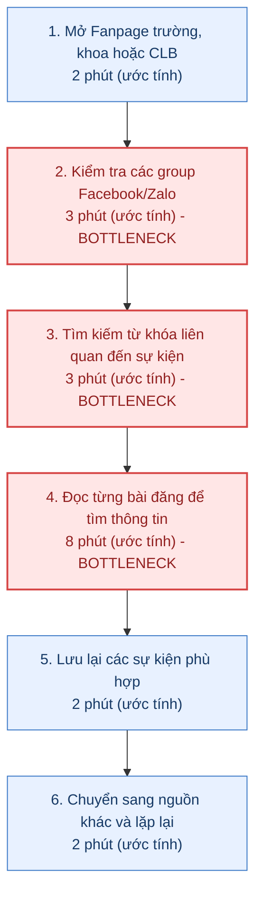
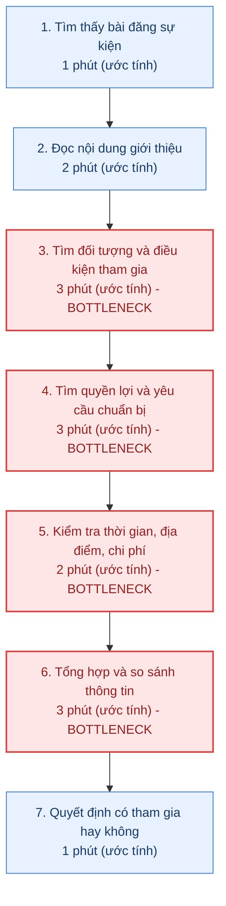
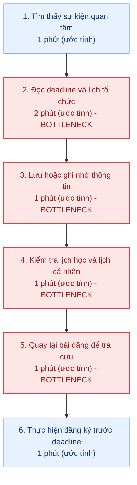

# Báo cáo cá nhân — MSSV_HoTen

> Đổi tên file theo quy tắc `MSSV_HoTen.md`, ví dụ `20241234_NguyenVanAn.md` (MSSV trước, dấu `_`, họ tên viết liền không dấu). Sửa cả dòng tiêu đề phía trên cho khớp.
> Template chi tiết và prompt mẫu cho từng mục: [docs/01-worksheet.md](../../docs/01-worksheet.md).
> Mỗi thành viên một file trong `report/individual/` trên repo nhóm: copy template này thành file mới, điền, rồi commit bằng tài khoản GitHub của bạn. Không viết hộ người khác.

## 1. Thông tin học viên

- Họ tên:
- MSSV:
- Email trường (không bắt buộc, repo có thể để public):
- Tên nhóm:
- Link repo nhóm:

---

## 2. Scan problem (CP1)

Lăng kính: **Lặp lại** · **Tốn thời gian** · **Cần đọc, tổng hợp nhiều thông tin** · **Pain từ người khác**.

| # | Lăng kính | Job Story: Khi… tôi muốn… để… | Ai chịu ảnh hưởng? | Dấu hiệu thật (thời gian, tần suất, số người, bằng chứng) |
|---:|---|---|---|---|
| 1 | Cần đọc, tổng hợp nhiều thông tin | Khi muốn tìm các sự kiện phù hợp để tham gia, tôi muốn tập hợp thông tin từ nhiều Fanpage và group vào một nơiđể không phải tìm kiếm thủ công trên từng kênh | Sinh viên NEU | Nhiều nguồn thông tin cần kiểm tra; ước tính 15–30 phút/lần tìm kiếm cần đo thực tế |
| 2 | Tốn thời gian | Khi tìm một sự kiện cụ thể, tôi muốn nhanh chóng tìm được thông tin về thời gian, địa điểm và cách đăng ký để không phải đọc nhiều bài đăng không liên quan | Sinh viên NEU | Phải mở và đọc nhiều bài đăng; ước tính 5–10 phút để tìm đủ thông tin một sự kiện, cần xác nhận |
| 3 | Lặp lại | Khi thường xuyên tìm kiếm sự kiện trong năm học, tôi muốn có danh sách sự kiện được cập nhật và phân loại theo chủ đề để không phải tìm lại từ đầu mỗi lần | Sinh viên NEU | Nhu cầu tìm kiếm lặp lại theo tuần hoặc theo tháng; cần ghi nhật ký tìm kiếm trong 1–2 tuần |
| 4 | Cần đọc, tổng hợp nhiều thông tin | Khi cân nhắc tham gia một sự kiện, tôi muốn tổng hợp điều kiện, đối tượng, quyền lợi và yêu cầu tham gia để xác định sự kiện có phù hợp với mình hay không | Sinh viên quan tâm đến hoạt động học thuật, năng khiếu và Đoàn - Hội | Thông tin thường nằm ở nhiều phần của bài đăng hoặc nhiều bài liên quan; cần kiểm tra trên 3–5 sự kiện thực tế |
| 5 | Tốn thời gian | Khi có nhiều sự kiện diễn ra trong cùng một khoảng thời gian, tôi muốn so sánh lịch tổ chức và deadline đăng ký để lựa chọn hoạt động phù hợp với lịch học | Sinh viên NEU tham gia nhiều hoạt động | Có nguy cơ trùng lịch học, lịch thi và lịch sự kiện; cần đối chiếu lịch của ít nhất 3 sự kiện thực tế |
| 6 | Lặp lại | Khi muốn đăng ký tham gia sự kiện, tôi muốn nhanh chóng tìm lại link đăng ký và các yêu cầu cần chuẩn bị để không phải quay lại tìm bài đăng gốc nhiều lần| Sinh viên NEU | Một sự kiện có thể có nhiều thông tin và đường link, cần theo dõi số lần phải tìm lại thông tin trong mỗi lần đăng ký |
| 7 | Pain từ người khác | Khi sinh viên hỏi về thông tin sự kiện trong group lớp hoặc CLB, tôi muốn có nguồn thông tin tập trung và dễ tra cứu để giảm việc phải trả lời những câu hỏi giống nhau | Ban cán sự lớp, ban chủ nhiệm CLB, ban tổ chức sự kiện | Có thể xuất hiện câu hỏi lặp lại về thời gian, địa điểm, deadline và đối tượng tham gia, cần thu thập ví dụ từ group thực tế |
| 8 | Pain từ người khác | Khi tổ chức một sự kiện nhưng bài đăng bị trôi giữa nhiều nội dung trên mạng xã hội, tôi muốn thông tin tiếp cận đúng đối tượng sinh viên để tăng khả năng tiếp cận và đăng ký tham gia | Ban tổ chức sự kiện, Đoàn – Hội, CLB | Cần kiểm tra lượt tiếp cận, lượt đăng ký và số câu hỏi lặp lại sau khi đăng thông báo; chưa có số liệu xác nhận |

**Nếu có dùng AI để gợi ý thêm:** ý nào AI gợi ý mà bạn giữ lại, ý nào bỏ và vì sao.

- Giữ lại: Các vấn đề về thông tin phân tán, khó so sánh điều kiện tham gia, khó theo dõi deadline và câu hỏi lặp lại vì đều liên quan trực tiếp đến quá trình tìm kiếm và tiếp nhận thông tin sự kiện.
- Bỏ qua: Các ý tưởng xây dựng AI Agent, hệ thống đề xuất sự kiện hoặc tự động đăng ký vì chưa phải vấn đề thực tế cần xác minh.
- Nhận định: Cần ưu tiên kiểm chứng vấn đề sinh viên mất thời gian tìm kiếm và tổng hợp thông tin trước khi nghĩ đến việc sử dụng AI.

---

## 3. Top 3 Problem Cards + quy trình nháp (CP2)

### Bảng chọn top 3

| Rank | Problem | Vì sao chọn | Điều còn chưa chắc |
|---:|---|---|---|
| 1 | Thông tin sự kiện NEU phân tán trên nhiều kênh, khiến sinh viên mất thời gian tìm kiếm và bỏ lỡ sự kiện phù hợp | Ảnh hưởng trực tiếp đến khả năng tiếp cận sự kiện, xảy ra ở nhiều nhóm sinh viên, có thể đo thời gian tìm kiếm và số sự kiện tìm được | Chưa xác định chính xác số lượng kênh sinh viên thường sử dụng và thời gian trung bình để tìm một sự kiện |
| 2 | Sinh viên mất thời gian đọc và tổng hợp thông tin để xác định sự kiện có phù hợp với mình hay không | Một sự kiện có nhiều thông tin như đối tượng, điều kiện, quyền lợi, thời gian và cách đăng ký, khó so sánh khi có nhiều lựa chọn | Chưa biết yếu tố nào khiến sinh viên khó quyết định nhất và mức độ ảnh hưởng đến quyết định tham gia |
| 3 | Sinh viên khó theo dõi deadline đăng ký và lịch tổ chức của nhiều sự kiện khác nhau | Có thể dẫn đến bỏ lỡ cơ hội tham gia hoặc đăng ký muộn, có thể đo số sự kiện bỏ lỡ và số lần trùng lịch | Chưa xác định tần suất sinh viên thực sự bỏ lỡ sự kiện do quên deadline thay vì không có nhu cầu tham gia |

### Problem Card #1

| Trường | Nội dung |
|---|---|
| Job Story | Khi muốn tìm các sự kiện học thuật, năng khiếu và hoạt động Đoàn – Hội tại NEU, tôi muốn tìm kiếm thông tin từ nhiều nguồn tại một nơi để nhanh chóng biết được những sự kiện phù hợp mà không phải kiểm tra từng Fanpage và group. |
| Actor | Sinh viên NEU, đặc biệt là sinh viên chủ động tìm kiếm cơ hội tham gia hoạt động ngoại khóa, học thuật và phát triển bản thân. |
| Thời điểm / bối cảnh | Khi bắt đầu học kỳ, khi có thời gian rảnh, khi muốn tích lũy kinh nghiệm hoặc tìm kiếm hoạt động ngoại khóa. |
| Quy trình hiện tại (3–7 bước) | Mở Fanpage trường, khoa hoặc CLB -> Kiểm tra các group Facebook, Zalo -> Tìm kiếm từ khóa liên quan đến sự kiện -> Mở từng bài đăng để đọc thông tin -> Ghi nhớ hoặc lưu lại các sự kiện phù hợp -> Quay lại các nguồn khác để tiếp tục tìm kiếm. |
| Bottleneck (bước nào, mất bao nhiêu phút) | Bước 2 - 4 phải chuyển đổi giữa nhiều kênh và đọc từng bài đăng để xác định nội dung liên quan; ước tính 15–30 phút cho một lần tìm kiếm, cần đo thực tế. |
| Impact (nếu không giải thì sao) | Tốn thời gian, khó nắm bắt đầy đủ các sự kiện đang diễn ra, có thể bỏ lỡ cơ hội tham gia các hoạt động phù hợp do thông tin bị trôi hoặc không được tiếp cận. |
| Success metric (baseline → target) | Thời gian tìm và xác định các sự kiện phù hợp: đo baseline trong 1 tuần → mục tiêu giảm ít nhất 40% thời gian tìm kiếm; đồng thời theo dõi số sự kiện phù hợp tìm được trên mỗi phiên tìm kiếm. |
| Phương án không dùng AI | Xây dựng một danh mục sự kiện tập trung, phân loại theo đơn vị tổ chức, lĩnh vực, thời gian và trạng thái đăng ký; cập nhật thông tin thủ công theo lịch. |
| Giả thuyết về AI (nếu có) | AI có thể hỗ trợ đọc nội dung bài đăng từ nhiều nguồn, nhận diện thông tin sự kiện và phân loại theo chủ đề, đối tượng và thời gian tổ chức. |
| Cảm nhận nhanh | Workflow chưa biết, cần đánh giá khả năng giải quyết bằng quy trình thu thập và phân loại thông tin đơn giản trước. 

Quy trình nháp hiện tại:

Thời gian ước tính: 15–30 phút/lần tìm kiếm.

### Problem Card #2 – Khó tổng hợp thông tin để lựa chọn sự kiện phù hợp

| Trường | Nội dung |
|---|---|
| Job Story | Khi tìm thấy nhiều sự kiện khác nhau, tôi muốn nhanh chóng nắm được đối tượng tham gia, điều kiện, quyền lợi, thời gian và yêu cầu của từng sự kiệnđể lựa chọn hoạt động phù hợp với nhu cầu và khả năng của mình. |
| Actor | Sinh viên NEU đang cân nhắc tham gia các cuộc thi, hội thảo, workshop, hoạt động văn nghệ, thể thao và chương trình Đoàn – Hội. |
| Thời điểm / bối cảnh | Sau khi tìm thấy một hoặc nhiều sự kiện và trước khi quyết định đăng ký tham gia. |
| Quy trình hiện tại (3–7 bước) | 1. Tìm thấy bài đăng sự kiện. 2. Đọc nội dung giới thiệu. 3. Tìm thông tin về đối tượng và điều kiện tham gia. 4. Tìm hiểu quyền lợi, chi phí và yêu cầu chuẩn bị. 5. Kiểm tra thời gian và địa điểm. 6. So sánh với nhu cầu cá nhân và quyết định tham gia. |
| Bottleneck (bước nào, mất bao nhiêu phút) | Bước 3–5: Thông tin thường nằm ở nhiều đoạn nội dung, hình ảnh hoặc đường link liên quan. Ước tính 10–20 phút để tổng hợp thông tin một sự kiện, cần xác nhận. |
| Impact (nếu không giải thì sao) | Khó đánh giá mức độ phù hợp của sự kiện, có thể hiểu thiếu điều kiện tham gia, bỏ qua quyền lợi hoặc mất thêm thời gian hỏi ban tổ chức. |
| Success metric (baseline → target) | Thời gian tổng hợp thông tin một sự kiện: đo baseline thực tế → mục tiêu giảm ít nhất 40%; đồng thời đảm bảo các trường thông tin quan trọng được ghi nhận đầy đủ và chính xác. |
| Phương án không dùng AI | Chuẩn hóa một biểu mẫu thông tin sự kiện gồm: tên, đơn vị tổ chức, đối tượng, điều kiện, thời gian, địa điểm, quyền lợi, chi phí và link đăng ký. |
| Giả thuyết về AI (nếu có) | AI có thể đọc bài đăng và tài liệu liên quan, trích xuất các trường thông tin quan trọng và trình bày dưới dạng bảng để sinh viên dễ so sánh. |
| Cảm nhận nhanh | Workflow. Có thể sử dụng AI ở bước trích xuất và tóm tắt thông tin, nhưng cần kiểm tra tính chính xác với nguồn gốc. |

Quy trình nháp hiện tại:

Thời gian ước tính: 10-20 phút/sự kiện

### Problem Card #3 – Khó theo dõi deadline và lịch sự kiện

| Trường | Nội dung |
|---|---|
| Job Story | Khi quan tâm đến nhiều sự kiện trong cùng một học kỳ, tôi muốn theo dõi deadline đăng ký và lịch tổ chức tại một nơiđể không bỏ lỡ các cơ hội phù hợp và tránh trùng lịch học hoặc lịch cá nhân. |
| Actor | Sinh viên NEU tham gia nhiều hoạt động học thuật, năng khiếu, Đoàn – Hội và CLB. |
| Thời điểm / bối cảnh | Sau khi tìm thấy và lựa chọn các sự kiện muốn tham gia, đặc biệt trong các giai đoạn có nhiều chương trình diễn ra đồng thời. |
| Quy trình hiện tại (3–7 bước) | 1. Đọc bài đăng sự kiện. 2. Ghi nhớ hoặc lưu deadline đăng ký. 3. Lưu link đăng ký và lịch tổ chức. 4. Kiểm tra lịch học và lịch cá nhân. 5. Quay lại bài đăng để kiểm tra khi cần. 6. Thực hiện đăng ký trước deadline. |
| Bottleneck (bước nào, mất bao nhiêu phút) | Bước 2-5: Thông tin thời gian nằm rải rác ở nhiều bài đăng và tin nhắn, sinh viên phải tìm lại khi cần. Ước tính 5–10 phút cho mỗi lần tra cứu lại, cần xác nhận. |
| Impact (nếu không giải thì sao) | Có thể quên deadline, đăng ký muộn, bỏ lỡ sự kiện hoặc gặp tình trạng trùng lịch với các hoạt động khác. |
| Success metric (baseline → target) | Tỷ lệ sự kiện đã quan tâm nhưng bỏ lỡ deadline: đo baseline thực tế → mục tiêu giảm ít nhất 50%; theo dõi tỷ lệ sự kiện được ghi nhận đầy đủ deadline và lịch tổ chức. |
| Phương án không dùng AI | Sử dụng Google Calendar hoặc Google Sheets để lưu sự kiện, deadline, link đăng ký và thiết lập nhắc lịch tự động. |
| Giả thuyết về AI (nếu có) | AI có thể hỗ trợ trích xuất ngày giờ từ bài đăng và tạo bản ghi sự kiện để người dùng xác nhận trước khi đưa vào lịch cá nhân. |
| Cảm nhận nhanh | Rule, Workflow: Việc nhắc lịch có thể giải quyết bằng công cụ lịch và quy tắc cố định; AI chỉ cần thiết nếu việc trích xuất thông tin từ nội dung không có cấu trúc thực sự gây khó khăn. |

Quy trình nháp hiện tại:

Thời gian ước tính: 5–10 phút/lần tra cứu lại.

### Card muốn pitch nhất

- Card số: **1 – Thông tin sự kiện NEU phân tán, khó tìm kiếm.**
- Vì sao:
  - Đây là vấn đề ở đầu quy trình, ảnh hưởng trực tiếp đến khả năng tiếp cận các cơ hội học tập và phát triển bản thân của sinh viên.
  - Thông tin được đăng tải bởi nhiều đơn vị như trường, khoa, Đoàn – Hội, CLB và các lớp.
  - Có thể mở rộng thành bài toán có giá trị cho nhiều nhóm sinh viên, không chỉ một khoa hoặc một CLB.
  - Là nền tảng để phát triển các chức năng tổng hợp, phân loại và tìm kiếm sự kiện nếu vấn đề được xác nhận.
- Câu hỏi muốn nhóm phản biện:
  1. Sinh viên thực sự mất nhiều thời gian tìm kiếm sự kiện hay chỉ đơn giản là không có nhu cầu tham gia thường xuyên?
  2. Vấn đề chính nằm ở việc thông tin phân tán hay nội dung sự kiện chưa đủ hấp dẫn?
  3. Có thể giải quyết phần lớn vấn đề bằng một danh mục sự kiện tập trung mà không cần AI không?
  4. Làm thế nào để đảm bảo thông tin sự kiện được cập nhật và không bị sai lệch?

### AI đã phản biện card thế nào

| Điểm yếu AI chỉ ra | Đồng ý? | Đã sửa gì |
|---|---|---|
| Chưa có bằng chứng định lượng chứng minh sinh viên thực sự mất nhiều thời gian tìm kiếm sự kiện. | Đồng ý | Bổ sung thời gian tìm kiếm dự kiến và xác định cần khảo sát, đo thời gian thực tế trước khi kết luận. |
| Actor "sinh viên NEU" còn rộng, chưa xác định nhóm sinh viên có nhu cầu rõ nhất. | Đồng ý | Thu hẹp đối tượng ưu tiên thành sinh viên chủ động tìm kiếm hoạt động học thuật, năng khiếu và Đoàn – Hội. |
| Có thể giải quyết bằng danh mục sự kiện tập trung mà chưa cần AI. | Đồng ý | Bổ sung phương án không dùng AI và chưa mặc định AI là giải pháp bắt buộc. |
| Chưa phân biệt việc không tìm thấy sự kiện với việc tìm thấy nhưng không muốn tham gia. | Đồng ý | Tách vấn đề tìm kiếm thông tin khỏi vấn đề lựa chọn và quyết định tham gia, đồng thời đưa ra các câu hỏi cần kiểm chứng. |

---

## 4. Tôi đã tham gia phần nào (CP3 → CP7)

| Hoạt động | Tôi đã làm gì? | Kết quả / ảnh hưởng tới bài nhóm |
|---|---|---|
| Pitch Problem Card | | |
| Phản biện bài của bạn khác | Câu hỏi tôi đã đặt: | |
| Nhận phản biện | Câu hỏi tôi nhận được: | Tôi đã sửa gì: |
| Gom cluster / cây OST | | |
| Chọn candidate problem | | |
| Kiểm chứng / research | | |
| Quy trình nhóm | | |
| Problem Statement | | |
| Mức can thiệp AI | | |
| Quyết định | | |

---

## 5. Dùng AI

| Checkpoint | Tôi dùng AI để làm gì? | AI hữu ích ở đâu? | AI sai hoặc hời hợt ở đâu? | Tôi sửa gì bằng nhận định của mình? |
|---|---|---|---|---|
| CP1 Scan | | | | |
| CP2 Problem Card | | | | |
| CP4 Research | | | | |
| CP5 Quy trình | | | | |
| CP5–6 Problem Statement | | | | |
| CP6 Mức can thiệp / quyết định | | | | |

---

## 6. Reflection (CP7)

Trả lời bằng trải nghiệm thật của bạn, tối thiểu 200 từ cho các câu 6.1–6.6 (không tính 6.7, câu này được chấm riêng ở tiêu chí C5). **Không dùng AI để viết thay.**

**6.1. Tôi học được gì khi nghe top 3 problems của các bạn khác?**

**6.2. Nhóm có lúc nào bị "solution-first" (nghĩ giải pháp trước khi hiểu vấn đề) không? Lúc đó nhóm nhận ra và xử lý thế nào?**

**6.3. Tôi có đổi ý sau khi bị phản biện không? Kể một lần cụ thể.**

**6.4. Kết quả kiểm chứng (phỏng vấn/survey/research) có làm tôi bất ngờ không? Điều gì?**

**6.5. Điều khó nhất khi viết Problem Statement là gì?**

**6.6. Nếu làm lại, tôi sẽ đổi gì? Tôi sẽ phản biện nhóm mạnh hơn ở điểm nào?**

**6.7. Hiểu bài:** giải thích bằng 5–8 câu, không nhìn tài liệu, chuỗi *problem → quy trình → metric → boundary → mức can thiệp AI → quyết định* của bài nhóm mình.

---

## 7. Tài liệu tham khảo

-
