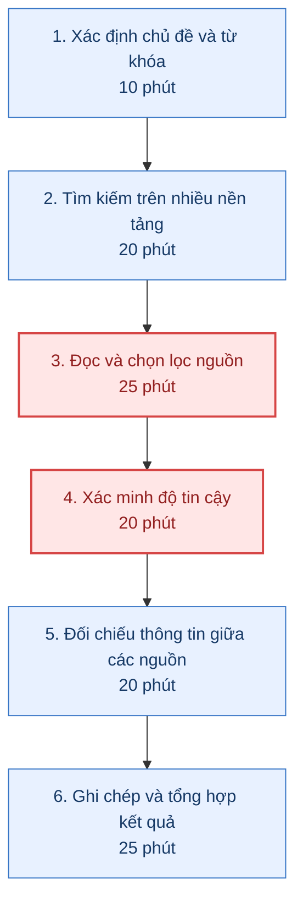
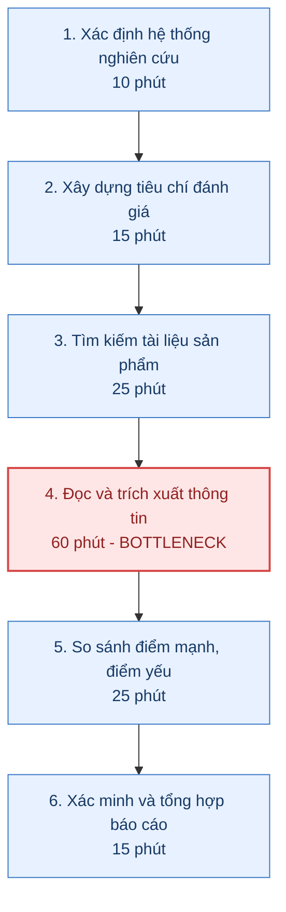
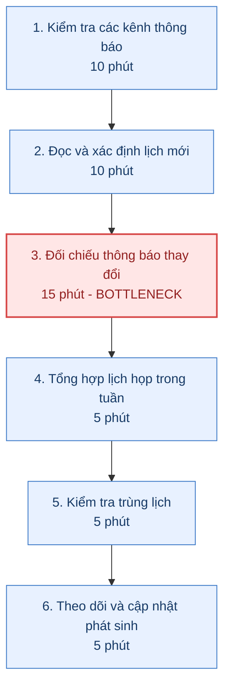

# Báo cáo cá nhân — 2A202603552_NguyenThiThuyDung

> Đổi tên file theo quy tắc `MSSV_HoTen.md`, ví dụ `20241234_NguyenVanAn.md` (MSSV trước, dấu `_`, họ tên viết liền không dấu). Sửa cả dòng tiêu đề phía trên cho khớp.
> Template chi tiết và prompt mẫu cho từng mục: [docs/01-worksheet.md](../../docs/01-worksheet.md).
> Mỗi thành viên một file trong `report/individual/` trên repo nhóm: copy template này thành file mới, điền, rồi commit bằng tài khoản GitHub của bạn. Không viết hộ người khác.

## 1. Thông tin học viên

- Họ tên: Nguyễn Thị Thùy Dung
- MSSV: 2A202603552
- Email trường (không bắt buộc, repo có thể để public): 26ai.dungntt@vinuni.edu.vn
- Tên nhóm: VuQuangThai
- Link repo nhóm: https://github.com/vuThai05/K5-L3A-DAY02-NEU65-DiscoveryProblemFraming.git

---

## 2. Scan problem (CP1)

Lăng kính: **Lặp lại** · **Tốn thời gian** · **Cần đọc, tổng hợp nhiều thông tin** · **Pain từ người khác**.

| # | Lăng kính | Job Story: Khi… tôi muốn… để… | Ai chịu ảnh hưởng? | Dấu hiệu thật (thời gian, tần suất, số người, bằng chứng) |
|---:|---|---|---|---|
| 1 | Lặp lại, tốn thời gian |Khi nghiên cứu một bài toán nghiệp vụ y tế mới, tôi muốn tìm được các nguồn thông tin đầy đủ và đáng tin cậy, để không phải tìm kiếm lặp đi lặp lại trên nhiều nền tảng. | BA, Researcher | Số lần tìm kiếm/chủ đề; thời gian tìm tài liệu; số nguồn phải kiểm tra. |
| 2 |Tốn thời gian, tổng hợp nhiều thông tin |Khi phân tích các hệ thống HIS/EHR/AI Agent trên thị trường, tôi muốn xác định và so sánh điểm mạnh, điểm yếu của từng hệ thống theo các tiêu chí thống nhất, để có căn cứ đánh giá sản phẩm và xác định khoảng trống thị trường. | BA, PO,PM |Thời gian phân tích/hệ thống; số hệ thống cần so sánh; số nhận định chưa có bằng chứng. |
| 3 |Lặp lại |Khi tham gia chương trình AI thực chiến, tôi muốn nộp daily standup đúng  thời hạn để tích lũy EXP trong quá trình học tập | Sinh viên tham gia học tập | Mỗi ngày trong quá trình tham gia học tập |
| 4 | Pain từ người khác | Khi cả team nhận được báo cáo phân tích nghiệp vụ từ tôi, họ muốn hiểu nghiệp vụ để tiến hành build MVP | Backend, Frontend và AI Engineer | Một buổi thảo luận trước mỗi lần nhận được thông tin từ tôi |
| 5 | Lặp lại | Khi quá quá nhiều lịch họp thay đổi linh hoạt mỗi tuần, tôi muốn sắp xếp lịch được thông báo từ các kênh rời rạc vào 1 kênh thông báo duy nhất để không bị bỏ quên bất kỳ lịch họp nào | Team | Mỗi tuần 1 lần vào chủ nhật |

**Nếu có dùng AI để gợi ý thêm:** ý nào AI gợi ý mà bạn giữ lại, ý nào bỏ và vì sao.
- Giữ lại ý "Khi phân tích các hệ thống HIS/EHR/AI Agent trên thị trường, tôi muốn xác định và so sánh điểm mạnh, điểm yếu của từng hệ thống theo các tiêu chí thống nhất, để có căn cứ đánh giá sản phẩm và xác định khoảng trống thị trường." vì đây là vấn đề do tôi tự nghĩ, AI chỉ format lại vấn đề cho rõ ràng hơn.
- Bỏ các ý liên quan trực tiếp đến hoạt động survey cho project vì hiện tại nhóm chưa kết luận được pain point.

---

## 3. Top 3 Problem Cards + quy trình nháp (CP2)

### Bảng chọn top 3

| Rank | Problem | Vì sao chọn | Điều còn chưa chắc |
|---:|---|---|---|
| 1 | Tìm kiếm và xác minh nguồn thông tin nghiên cứu y tế (#1)| Actor rõ (BA), tần suất cao, quy trình lặp lại, có thể đo thời gian tìm kiếm và kiểm chứng nguồn.| Thời gian thực tế mất bao lâu? Bao nhiêu phần trăm nguồn không phù hợp? |
| 2 | Phân tích điểm mạnh, điểm yếu của các hệ thống HIS/EHR/AI Agent (#2)| Phù hợp trực tiếp với công việc nghiên cứu thị trường của BA, nhiều bước đọc và tổng hợp tài liệu, có đầu ra cụ thể.| Có đủ dữ liệu công khai để đánh giá khách quan từng hệ thống không?|
| 3 | Tổng hợp và theo dõi lịch họp thay đổi (#5)| Actor rõ (thành viên team), quy trình dễ quan sát, bottleneck có thể đo, phù hợp triển khai thử nghiệm nhỏ. |Team có thường xuyên bỏ sót hoặc nhầm lịch họp không? |

### Problem Card #1

| Trường | Nội dung |
|---|---|
| Job Story | Khi nghiên cứu một bài toán nghiệp vụ y tế mới, tôi muốn tìm được các nguồn thông tin đầy đủ và đáng tin cậy, để không phải tìm kiếm lặp đi lặp lại trên nhiều nền tảng. |
| Actor | Business Analyst phụ trách nghiên cứu nghiệp vụ trong team phát triển AI Agent lĩnh vực y tế.|
| Thời điểm / bối cảnh | Khi bắt đầu nghiên cứu một chủ đề y tế mới, chuẩn bị phân tích nghiệp vụ hoặc tìm hiểu các hệ thống hiện có trên thị trường.|
| Quy trình hiện tại (3–7 bước) | 1. Xác định chủ đề và từ khóa tìm kiếm. 2. Tìm kiếm trên Google, Google Scholar, website bệnh viện, tài liệu sản phẩm. 3. Mở và đọc từng nguồn. 4. Xác minh độ tin cậy, thời điểm công bố và tính liên quan. 5. Đối chiếu các nguồn. 6. Ghi chép và tổng hợp.|
| Bottleneck (bước nào, mất bao nhiêu phút) | Bước 3–4: Đọc, chọn lọc và xác minh nguồn thông tin, ước lượng 45 phút/lần nghiên cứu.|
| Impact (nếu không giải thì sao) | 	Ước lượng 120 phút/chủ đề. Nếu nghiên cứu 3 chủ đề/tuần, tổng cộng khoảng 360 phút/tuần cho một BA.|
| Success metric (baseline → target) | Giảm thời gian nghiên cứu từ 120 xuống dưới 60 phút/chủ đề, đồng thời không giảm tỷ lệ thông tin quan trọng có nguồn kiểm chứng.|
| Phương án không dùng AI | Danh mục nguồn uy tín, bộ từ khóa chuẩn theo chủ đề, checklist đánh giá nguồn và thư viện tài liệu nghiên cứu dùng chung.|
| Giả thuyết về AI (nếu có) | AI có thể hỗ trợ tìm kiếm, sàng lọc, đối chiếu thông tin và xác định nguồn liên quan; BA vẫn kiểm chứng bằng tài liệu gốc.|
| Cảm nhận nhanh | Workflow / Agent — cần kiểm chứng xem mức độ tự chủ có thực sự cần thiết. |

Quy trình nháp hiện tại:

### Problem Card #2

| Trường | Nội dung |
|---|---|
| Job Story | Khi phân tích các hệ thống HIS/EHR/AI Agent trên thị trường, tôi muốn xác định và so sánh điểm mạnh, điểm yếu của từng hệ thống theo các tiêu chí thống nhất, để có căn cứ đánh giá sản phẩm và xác định khoảng trống thị trường. |
| Actor | BA phụ trách nghiên cứu thị trường và phân tích sản phẩm; PO/PM sử dụng kết quả để định hướng sản phẩm.|
| Thời điểm / bối cảnh | Khi team nghiên cứu giải pháp y tế hiện có, đánh giá đối thủ hoặc xác định phạm vi chức năng cho MVP.|
| Quy trình hiện tại (3–7 bước) | 1. Xác định các hệ thống cần nghiên cứu. 2. Xây dựng tiêu chí đánh giá. 3. Tìm tài liệu và thông tin sản phẩm. 4. Đọc và trích xuất thông tin về chức năng. 5. So sánh điểm mạnh, điểm yếu. 6. Xác minh và tổng hợp báo cáo.|
| Bottleneck (bước nào, mất bao nhiêu phút) | Bước 4: Đọc tài liệu và trích xuất bằng chứng về chức năng của từng hệ thống, ước lượng 60 phút/hệ thống.|
| Impact (nếu không giải thì sao) | Ước lượng 150 phút/hệ thống; khi nghiên cứu 4 hệ thống mất khoảng 600 phút (10 giờ), chưa tính thời gian họp review.|
| Success metric (baseline → target) | Giảm thời gian phân tích từ 150 xuống dưới 90 phút/hệ thống; ít nhất 90% nhận định về chức năng có nguồn bằng chứng hoặc được đánh dấu chưa xác minh.|
| Phương án không dùng AI | Bộ tiêu chí benchmarking chuẩn, bảng so sánh cố định, danh mục tài liệu sản phẩm và quy tắc phân loại mức độ xác thực của thông tin.|
| Giả thuyết về AI (nếu có) | AI hỗ trợ trích xuất thông tin từ tài liệu sản phẩm, đối chiếu các tiêu chí và xác định điểm khác biệt; BA chịu trách nhiệm kiểm chứng các kết luận.|
| Cảm nhận nhanh | Workflow / Agent — cần xem có phải truy cập và đối chiếu nhiều nguồn động hay không. |

Quy trình nháp hiện tại:

### Problem Card #3

| Trường | Nội dung |
|---|---|
| Job Story | Khi có quá nhiều lịch họp thay đổi linh hoạt mỗi tuần, tôi muốn tập hợp thông báo từ các kênh rời rạc vào một nơi dễ theo dõi, để không bỏ quên bất kỳ lịch họp nào. |
| Actor | Thành viên team dự án AI, bao gồm BA, Backend, Frontend, AI Engineer và PM.|
| Thời điểm / bối cảnh | Trong tuần làm việc, đặc biệt khi chuẩn bị lịch cho tuần tiếp theo vào Chủ nhật hoặc khi có thay đổi đột xuất.|
| Quy trình hiện tại (3–7 bước) | 1. Kiểm tra các kênh thông báo. 2. Đọc và xác định lịch họp mới. 3. Đối chiếu các thông báo thay đổi. 4. Tổng hợp lịch họp trong tuần. 5. Kiểm tra trùng lịch. 6. Theo dõi và cập nhật thông báo phát sinh.|
| Bottleneck (bước nào, mất bao nhiêu phút) | Bước 3: Đối chiếu các thông báo thay đổi để xác định thời gian họp cuối cùng, ước lượng 15 phút/tuần.|
| Impact (nếu không giải thì sao) | Ước lượng 50 phút/người/tuần cho việc kiểm tra và tổng hợp lịch. Nếu 5 thành viên cùng thực hiện, tổng cộng khoảng 250 phút/tuần.|
| Success metric (baseline → target) | Giảm thời gian tổng hợp lịch từ 50 xuống dưới 15 phút/người/tuần; không bỏ sót lịch họp hoặc thông báo đổi lịch đã được xác nhận.|
| Phương án không dùng AI | Sử dụng một lịch nhóm thống nhất; quy định người tạo cuộc họp cập nhật trực tiếp lịch chung; mẫu thông báo thay đổi có cấu trúc.|
| Giả thuyết về AI (nếu có) | AI hỗ trợ nhận diện các thông báo lịch họp từ nhiều kênh, xác định thay đổi và hỗ trợ tổng hợp thông tin.|
| Cảm nhận nhanh | Rule / Workflow — chưa có đủ bằng chứng cho thấy cần Agent. |

Quy trình nháp hiện tại:

### Card muốn pitch nhất

- Card số: #2 – Phân tích điểm mạnh, điểm yếu của các hệ thống HIS/EHR/AI Agent trên thị trường.
- Vì sao: Đây là công việc thực tế của BA trong team phát triển AI Agent y tế, đòi hỏi nghiên cứu nhiều hệ thống, đọc tài liệu và đối chiếu thông tin từ nhiều nguồn. Bottleneck rõ ràng ở bước đọc và trích xuất thông tin sản phẩm (ước lượng 60 phút/hệ thống). Kết quả có thể đo lường thông qua thời gian phân tích và tỷ lệ nhận định có bằng chứng.
- Câu hỏi muốn nhóm phản biện: Liệu bottleneck chính có thực sự nằm ở bước đọc và trích xuất thông tin, hay nằm ở việc xác minh tính chính xác và đánh giá điểm mạnh, điểm yếu? Có cần AI Agent hay chỉ cần workflow với bộ tiêu chí benchmarking chuẩn?

### AI đã phản biện card thế nào

| Điểm yếu AI chỉ ra | Đồng ý? | Đã sửa gì |
|---|---|---|
| Actor chưa đủ cụ thể, BA và PO/PM có vai trò khác nhau trong quy trình.| Có | Xác định BA nghiên cứu thị trường là actor chính; PO/PM là người sử dụng kết quả.| 
| Điểm yếu của sản phẩm có thể bị đánh giá chủ quan do thiếu thông tin công khai.| Có | Phân biệt rõ: chức năng không có, chưa được công bố và chưa xác minh được. Yêu cầu các nhận định phải có bằng chứng.| 

---

## 4. Tôi đã tham gia phần nào (CP3 → CP7)

| Hoạt động | Tôi đã làm gì? | Kết quả / ảnh hưởng tới bài nhóm |
|---|---|---|
| Pitch Problem Card | Đề xuất bài toán BA mất nhiều thời gian nghiên cứu, so sánh các hệ thống HIS/EHR/AI Agent. Trình bày Job Story, actor, quy trình AS-IS gồm 6 bước, bottleneck đọc/trích xuất 60 phút và tổng thời gian ước lượng 150 phút/hệ thống. | Candidate được đưa vào shortlist, đạt 32/35 điểm và được nhóm lựa chọn để tiếp tục phân tích. |
| Phản biện bài của bạn khác | Phân tích candidate tìm kiếm và tổng hợp sự kiện NEU của thành viên khác. Câu hỏi tôi đã đặt: Sinh viên có thực sự thường xuyên gặp khó khăn khi tìm kiếm thông tin sự kiện từ nhiều kênh không, hay vấn đề chỉ phát sinh vào một số thời điểm nhất định?. Nội dung cần làm rõ gồm tần suất phát sinh vấn đề, khả năng kiểm chứng và sự cần thiết của AI. | Giúp nhóm xem xét tính thực tế và khả năng đo lường của candidate thay vì chỉ đánh giá mức độ hấp dẫn của ý tưởng. |
| Nhận phản biện | Câu hỏi tôi nhận được: Bạn đã có dữ liệu thực tế chứng minh bước đọc và trích xuất thông tin là bottleneck lớn nhất chưa? Nếu sử dụng một bộ tiêu chí benchmarking và template so sánh cố định thì có thể giảm thời gian nghiên cứu mà không cần AI không?. Các nội dung cần phản biện gồm phạm vi benchmarking, mức độ tin cậy của baseline ước lượng và khả năng giải quyết bằng No AI/Rule. | Tôi đã thu hẹp phạm vi vào HIS/EHR/AI Agent với bộ tiêu chí cố định, ghi rõ baseline chưa đo và bổ sung đánh giá các phương án không sử dụng AI. |
| Gom cluster / cây OST | Tham gia phân loại candidate thành ba cluster: tìm kiếm và tổng hợp thông tin; theo dõi thông tin theo thời gian; đánh giá và lựa chọn. Phân tích ba opportunity của bài benchmarking: tìm nguồn, đọc/trích xuất và đối chiếu/xác minh. | Xây dựng OST tập trung vào vấn đề người dùng, tránh nhầm các giải pháp như AI Agent hoặc dashboard tự động với opportunity. |
| Chọn candidate problem | Đề xuất candidate #5: Benchmarking HIS/EHR/AI Agent. Tham gia đánh giá theo 7 tiêu chí: actor, quy trình, bằng chứng pain, impact, phạm vi lab, khả năng so sánh mức can thiệp và hiểu biết domain. | Nhóm thống nhất chọn candidate #5 với 32/35 điểm, cao nhất trong shortlist. |
| Kiểm chứng / research | Xác định hai giả định ưu tiên A1 và A2, xây dựng câu hỏi Mom Test, mẫu Interview Snapshot và nghiên cứu các công cụ G2, Elicit, Consensus. | Làm rõ các rủi ro Value và Feasibility; thu hẹp phạm vi nghiên cứu vào việc trích xuất và đối chiếu chức năng theo bộ tiêu chí cố định. Các tình huống phỏng vấn giả lập không được tính là bằng chứng thực tế. |
| Quy trình nhóm | Mô tả AS-IS gồm 6 bước với tổng thời gian ước lượng 150 phút/hệ thống. Phân tích TO-BE với AI Workflow, Rule, Human-in-the-loop và fallback. | Xác định điểm can thiệp của AI tại bước đọc/trích xuất; BA vẫn kiểm tra nguồn, sửa thông tin và phê duyệt bảng benchmarking. |
| Problem Statement | Tham gia xây dựng Problem Statement v0 và v1, xác định actor, bottleneck, impact, success metric, boundary và AI intervention point. | Đề xuất target giảm từ 150 xuống dưới 90 phút/hệ thống; tối thiểu 90% nhận định có bằng chứng hoặc trạng thái chưa xác minh. |
| Mức can thiệp AI | So sánh No AI, Rule, Workflow và Agent; đánh giá ma trận độ mơ hồ × độ phức tạp và vai trò của HITL. | Nhóm lựa chọn AI Workflow kết hợp Rule và HITL, không lựa chọn Agent tự chủ ở giai đoạn đầu. |
| Quyết định | Tham gia đánh giá Value, Usability, Feasibility và Viability; đề xuất pilot nhỏ và tiêu chí dừng. | Nhóm thống nhất Not Yet vì chưa đủ bằng chứng thực tế về tần suất pain và baseline. Cần phỏng vấn và đo tác vụ trước khi Go. |

---

## 5. Dùng AI

| Checkpoint | Tôi dùng AI để làm gì? | AI hữu ích ở đâu? | AI sai hoặc hời hợt ở đâu? | Tôi sửa gì bằng nhận định của mình? |
|---|---|---|---|---|
| CP1 Scan | Sử dụng AI để mở rộng các problem tự nghĩ | Gợi ý thêm được hướng phát triển idea và chỉnh sửa lại cách diễn đạt | Một số vấn đề quá rộng, chưa sát công việc hoặc chưa có dấu hiệu định lượng. | Chọn 2 vấn đề phù hợp với công việc và trải nghiệm của mình, tập trung mô tả pain thay vì đề xuất giải pháp. |
| CP2 Problem Card | Nhờ AI phản biện và tạo sơ đồ Mermaid theo ý tưởng có sẵn | Giúp chuẩn hóa bảng Problem Card, làm rõ quy trình và trực quan hóa các bước thực hiện. | AI đưa ra các câu hỏi quá to so với vấn đề | Tiếp nhận các câu hỏi phản biện phù hợp và chỉnh sửa lại problem card rõ ràng hơn |
| CP4 Research | Nhờ AI gợi ý vài câu hỏi để đi phỏng vấn người dùng | Gợi ý được các khía cạnh cần đào sâu| Một số câu hỏi thiên về lý thuyết, không liên quan đến trải nghiệm| Chỉ tham khảo và giữ lại các câu hỏi đúng với chuẩn Mom test |
| CP5 Quy trình | Dùng AI để format bảng và vẽ khung Mermaid | Căn chỉnh khung và chỉnh sửa lại bảng | AI tự ý gộp nội dung bảng, không giống như ý tưởng ban đầu của tôi | Chỉnh sửa lại phần AI tự ý chỉnh mà không hợp lý |
| CP5–6 Problem Statement | Nhờ AI kiểm tra lại nội dung| Phát hiện được những chỗ viết chưa được chuẩn xác | AI có xu hướng dùng quá nhiều thuật ngữ chuyên ngành | Chỉ giữ lại những phần nội dung dễ đọc, dễ hiểu và hợp lý |
| CP6 Mức can thiệp / quyết định | Hỏi AI về rủi ro kỹ thuật khi triển khai mô hình gợi ý | Giúp phân biệt tác vụ có quy tắc với tác vụ cần xử lý ngữ nghĩa, đồng thời làm rõ rủi ro của Agent tự chủ. | AI có thể đề xuất tự động hóa | Nhóm quyết định Not Yet cho đến khi có kiểm chứng và dữ liệu đo thực tế. |

---

## 6. Reflection (CP7)

Trả lời bằng trải nghiệm thật của bạn, tối thiểu 200 từ cho các câu 6.1–6.6 (không tính 6.7, câu này được chấm riêng ở tiêu chí C5). **Không dùng AI để viết thay.** 

### 6.1. Tôi học được gì khi nghe top 3 problems của các bạn khác?
Ban đầu, mình nghĩ công việc nghiên cứu tài liệu của mình khá khác với những vấn đề về sự kiện NEU mà bạn cùng nhóm chia sẻ. Nhưng khi nghe bạn nói về việc tìm thông tin, tổng hợp điều kiện tham gia và theo dõi thời hạn đăng ký, mình thấy cả hai đều mất công đọc, chọn lọc và kiểm tra thông tin từ nhiều nơi. Chuyện bạn phải theo dõi lịch sự kiện cũng khá giống việc mình theo dõi lịch họp, vì thông báo nằm rải rác nên dễ bỏ sót hoặc phải tìm lại. Mình nhận ra khi nghe các bạn trình bày, nếu tìm hiểu kỹ từng bước thì có thể thấy những khó khăn chung dù đề tài khác nhau.

### 6.2. Nhóm có lúc nào bị "solution-first" (nghĩ giải pháp trước khi hiểu vấn đề) không? Lúc đó nhóm nhận ra và xử lý thế nào?
Có lúc nhóm nghĩ ngay đến việc làm website tổng hợp thông tin hoặc dùng AI để tự nghiên cứu tài liệu. Khi cùng xem lại, mình và bạn cùng nhóm nhận ra chúng mình đang nói nhiều về thứ muốn làm nhưng chưa hiểu rõ người dùng cần gì nhất. Nhóm quay lại tách từng bước như tìm kiếm, đọc, tổng hợp và kiểm tra thông tin. Qua đó, mình học được cách chậm lại một chút trước khi chọn giải pháp, kể cả khi ý tưởng ban đầu có vẻ hấp dẫn.

### 6.3. Tôi có đổi ý sau khi bị phản biện không? Kể một lần cụ thể.
Ban đầu, mình cho rằng đọc tài liệu và lấy thông tin để so sánh là bước tốn thời gian nhất, với ước lượng khoảng 60 phút cho mỗi hệ thống. Khi nhận được câu hỏi mình đã đo thực tế chưa và liệu một bảng so sánh mẫu có giúp giảm thời gian không, mình nhận ra mình đang hơi chắc chắn với một con số mới chỉ là ước lượng. Mình bắt đầu cân nhắc việc dùng tiêu chí chung và bảng mẫu trước, đồng thời xem lại liệu khâu kiểm tra thông tin mới là phần gây chậm nhiều hơn. Sau lần đó, mình không còn mặc định cần AI ngay mà muốn đo thử công việc thực tế để có cơ sở lựa chọn.

### 6.4. Kết quả kiểm chứng (phỏng vấn/survey/research) có làm tôi bất ngờ không? Điều gì?
Khi tìm hiểu các công cụ có sẵn, mình khá bất ngờ vì việc tìm kiếm, tổng hợp và so sánh thông tin đã được hỗ trợ ở nhiều mức độ. Điều này khiến mình nghĩ rằng nhóm nên thử tận dụng những gì đã có trước khi xây thêm một công cụ mới. Mình cũng nhận ra có công cụ hỗ trợ chưa có nghĩa là mọi khó khăn của người dùng đều được giải quyết. Vì các tình huống phỏng vấn trong bài mới là giả lập, mình vẫn thấy cần trao đổi với người dùng thật để biết nhận định của nhóm đúng đến đâu.

### 6.5. Điều khó nhất khi viết Problem Statement là gì?
Với mình, khó nhất là chuyển từ nhận xét “việc này khá mất thời gian” sang một mô tả cụ thể, có thể kiểm tra được. Cả mình và bạn cùng nhóm đều có những ước lượng ban đầu, nhưng chưa đo thì chưa thể chắc bước nào thực sự gây chậm nhất. Chẳng hạn, con số 150 phút cho một hệ thống vẫn cần được kiểm chứng. Mình cũng hiểu rằng tổng hợp nhanh hơn chỉ có ích khi thông tin đủ chính xác để người dùng dựa vào đó lựa chọn.

### 6.6. Nếu làm lại, tôi sẽ đổi gì? Tôi sẽ phản biện nhóm mạnh hơn ở điểm nào?
Nếu làm lại, mình muốn cùng bạn hỏi người dùng và quan sát một công việc thực tế ngay từ đầu. Mình sẽ hỏi kỹ hơn rằng họ mất thời gian vì tìm thông tin, vì đọc quá nhiều hay vì phải kiểm tra lại những thông tin chưa rõ. Mình cũng muốn thử cách đơn giản như bảng tổng hợp chung và danh sách kiểm tra trước khi kết luận cần AI. Dù nhóm đã chọn hướng AI hỗ trợ theo từng bước, mình đồng ý với quyết định Not Yet — cần kiểm chứng thêm trước khi triển khai.

### 6.7. Hiểu bài
Theo mình hiểu, bài toán nhóm chọn là việc người nghiên cứu mất nhiều thời gian tìm, đọc và so sánh thông tin từ nhiều tài liệu để lập một bảng so sánh có căn cứ. Công việc bắt đầu từ chọn đối tượng và tiêu chí so sánh, sau đó tìm tài liệu, lấy thông tin cần thiết, đối chiếu và kiểm tra lại kết quả. Nhóm đang cho rằng bước đọc và lấy thông tin mất nhiều thời gian nhất, nhưng vẫn cần đo thực tế để xác nhận. Mục tiêu dự kiến là giảm từ khoảng 150 phút xuống dưới 90 phút cho mỗi hệ thống; con số ban đầu mới là ước lượng, còn ít nhất 90% nhận định cần có nguồn hoặc được ghi rõ là chưa xác minh. Nhóm chọn để AI hỗ trợ đọc và tổng hợp theo các bước định sẵn, còn người thực hiện vẫn kiểm tra nguồn, sửa lỗi và duyệt kết quả. AI không được tự thêm thông tin hay kết luận rằng một chức năng không tồn tại chỉ vì chưa tìm thấy trong tài liệu. Mình hiểu quyết định Not Yet là nhóm cần hỏi người dùng thật và thử làm trên cùng bộ tài liệu để so sánh thời gian, độ chính xác trước khi quyết định triển khai.

---

## 7. Tài liệu tham khảo

1. VinUni AI20K. **K5 · L3 · Day 02 — Discovery & Problem Framing.** https://github.com/VinUni-AI20k/K5-L3-Day02-DiscoveryProblemFraming
2. Nhóm NEU65. **Báo cáo nhóm Day 02 — Discovery & Problem Framing.** https://github.com/vuThai05/K5-L3A-DAY02-NEU65-DiscoveryProblemFraming
3. G2. **Compare Software and Services.** https://www.g2.com/compare
4. G2. **Researching and Customizing Software Recommendations on G2.** https://documentation.g2.com/help/docs/researching-and-customizing-software-recommendations-on-g2
5. Elicit. **AI for Research & Decision-Making.** https://elicit.com/
6. Elicit Help Center. **Getting Started with Elicit: Which Workflow Should I Use?** https://support.elicit.com/en/articles/14757543-getting-started-with-elicit-which-workflow-should-i-use
7. Consensus Help Center. **How Consensus Works.** https://help.consensus.app/en/articles/9922673-how-consensus-works
8. Consensus Help Center. **Responsible AI & Limitations.** https://help.consensus.app/en/articles/10046838-responsible-ai-limitations
