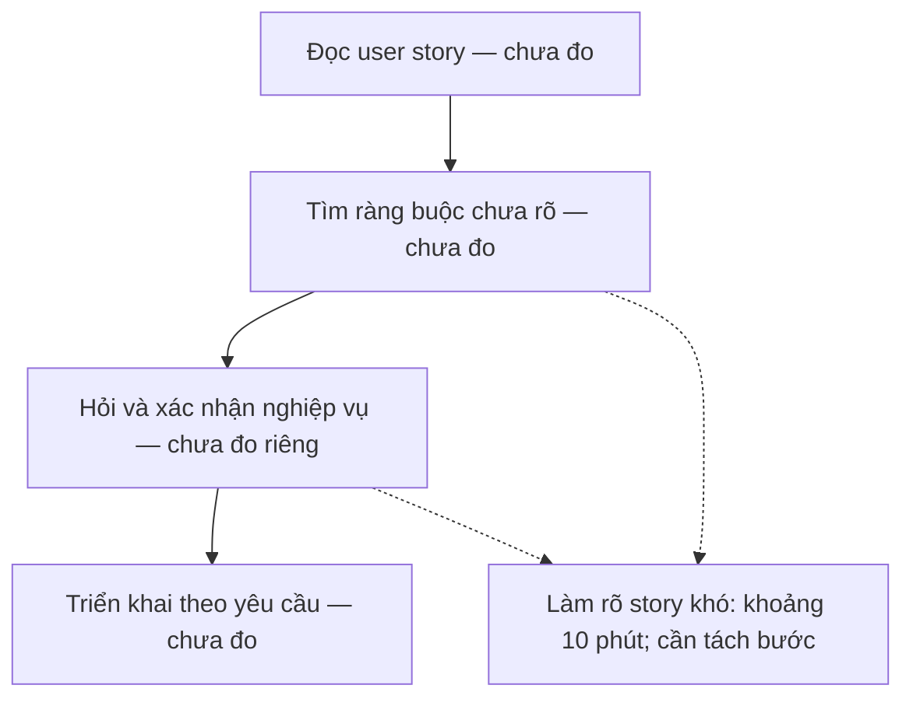
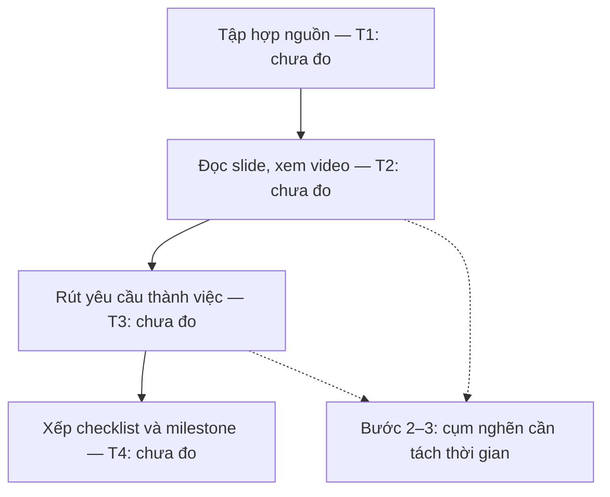
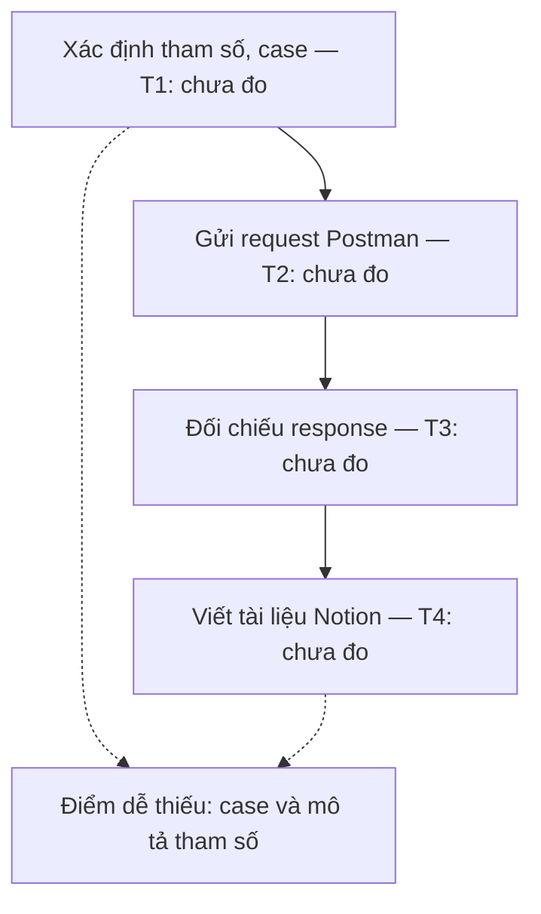

# Báo cáo cá nhân — 2A202603627_MaiDangKhuong

> Tôi đã ghi nhận CP1 và xây dựng bản nháp CP2. Thời gian là ước lượng từ trải nghiệm được chia sẻ, chưa bấm giờ từng bước; một số mục tiêu cần làm rõ thêm. CP3–CP7 chưa thực hiện.

## 1. Thông tin học viên

- Họ tên: Mai Đặng Khương
- MSSV: 2A202603627
- Email trường (không bắt buộc, repo có thể để public):
- Tên nhóm: TEAMLAGI
- Link repo nhóm: https://github.com/trongjhuongwr/K5-L3A-DAY02-TEAMLAGI-DiscoveryProblemFraming

---

## 2. Scan problem (CP1)

Lăng kính: **Lặp lại** · **Tốn thời gian** · **Cần đọc, tổng hợp nhiều thông tin** · **Pain từ người khác**.

| # | Lăng kính | Job Story: Khi… tôi muốn… để… | Ai chịu ảnh hưởng? | Dấu hiệu thật (thời gian, tần suất, số người, bằng chứng) |
|---:|---|---|---|---|
| 1 | Cần đọc, tổng hợp nhiều thông tin; Pain từ người khác | Khi nhận mong muốn, ý tưởng và tài liệu sản phẩm từ nhãn hàng, tôi muốn xác định nhu cầu thị trường, pain point/insight khách hàng và yếu tố giúp nội dung hiệu quả trên nền tảng, để xây dựng định hướng nội dung có cơ sở và kịp deadline. | Người làm nội dung tại công ty truyền thông giải trí, đồng thời làm freelancer (bạn của tôi). | Người bạn chia sẻ đã mất khoảng 2 ngày làm việc tập trung để research cho một job cụ thể; chưa xác định đây là thời gian điển hình cho mọi job. Theo người bạn, nhận nhiều job có thể dẫn đến trễ deadline; research chưa kỹ ảnh hưởng các bước làm nội dung về sau. Chưa có số liệu chuyển đổi/viral để kiểm chứng mức ảnh hưởng. |
| 2 | Cần đọc, tổng hợp nhiều thông tin | Khi lập kế hoạch học tập và dự án VinUni, tôi muốn tổng hợp yêu cầu từ slide bài giảng, video/slide workshop, email chương trình và nền tảng cohort thành checklist và mốc hoàn thành rõ ràng, để quản lý công việc cá nhân và nhóm mà không bỏ sót ý quan trọng. | Tôi trong vai trò học viên và người tham gia quản lý công việc nhóm. | Lần gần nhất mất khoảng 3 tiếng để tổng hợp slide, xem video và làm checklist. Hiện ghi việc trên giấy: trực quan nhưng tốn thời gian, khó quản lý và có nguy cơ mất ý nếu tổng hợp chưa kỹ. |
| 3 | Lặp lại | Khi viết daily standup cho dự án e-commerce, tôi muốn tổng hợp công việc đã làm thành báo cáo ngắn gọn và làm rõ bước tiếp theo hoặc những việc đang chờ yêu cầu, để nhóm nắm tiến độ và điểm cần hỗ trợ. | Tôi, backend developer trong dự án e-commerce. | Mất khoảng 15 phút/lần viết standup hằng ngày. Dấu vết công việc nằm trên Slack, Jira và OneNote. Tôi khó diễn đạt ngắn gọn và khó xác định việc tiếp theo khi chưa có yêu cầu. |
| 4 | Cần đọc, tổng hợp nhiều thông tin | Khi nhận user story để triển khai chức năng e-commerce, tôi muốn làm rõ ràng buộc nghiệp vụ và cách xử lý tình huống biên trước khi code, để triển khai đúng mong đợi của khách hàng. | Tôi, backend developer tại Genkin. | Với những user story khó, tôi mất khoảng 10 phút để làm rõ yêu cầu; không áp dụng con số này cho mọi story. Ví dụ tạo variant sản phẩm: chưa rõ một product có bao nhiêu variant và cần thông báo thế nào khi variant bị disable sau khi người dùng đã chọn trên UI. Ít khi phải làm lại vì hiểu sai. |
| 5 | Lặp lại | Khi hoàn thành một API, tôi muốn kiểm tra đầy đủ các trường hợp phản hồi và mô tả rõ tham số trong tài liệu bàn giao, để frontend hiểu và tích hợp API mà ít phải hỏi lại. | Tôi, backend developer; frontend developer sử dụng API. | Trung bình gần 15 phút/API cho phần tài liệu và kiểm thử khi làm chi tiết. Viết tài liệu trên Notion, dùng Postman kiểm thử và làm tham chiếu viết docs. Chưa bao phủ đủ các case response và mô tả tham số chưa đầy đủ; đã có frontend phải hỏi lại vì tài liệu thiếu mô tả tham số, không phải API thiếu tham số. |

**Nếu có dùng AI để gợi ý thêm:** ý nào AI gợi ý mà bạn giữ lại, ý nào bỏ và vì sao.

- Tôi tự đề xuất 5 vấn đề ban đầu rồi trao đổi với ChatGPT để làm rõ actor, bước khó và dấu hiệu thật. Không bổ sung vấn đề mới do AI đề xuất.
- Giữ cách thu hẹp vấn đề 1 vào research trước khi xây dựng nội dung; vấn đề 2 vào tổng hợp tài liệu thành kế hoạch hành động; vấn đề 5 vào độ đầy đủ của kiểm thử và mô tả tham số.
- Làm rõ để tránh khái quát quá mức: 2 ngày research chỉ thuộc một job cụ thể; 3 tiếng thuộc lần tổng hợp tài liệu gần nhất; 10 phút làm rõ yêu cầu chỉ dành cho story khó.
- Không coi việc nội dung ít chuyển đổi/không viral là hệ quả đã được chứng minh của research thiếu kỹ; chưa có số liệu xác minh.

**Nguồn dấu hiệu:** trải nghiệm cá nhân của tôi đối với vấn đề 2–5; thông tin người bạn chia sẻ và tôi cung cấp lại đối với vấn đề 1. Đây là dữ liệu scan CP1, chưa thay thế hoạt động kiểm chứng CP4 của nhóm.

---

## 3. Top 3 Problem Cards + quy trình nháp (CP2)

### Bảng chọn top 3

| Rank | Problem | Vì sao chọn | Điều còn chưa chắc |
|---:|---|---|---|
| 1 | Làm rõ user story e-commerce (CP1 #4) | Tôi chọn đây là vấn đề ưu tiên pitch, từ trải nghiệm trực tiếp triển khai chức năng product variant tại Genkin. | Thời gian khoảng 10 phút chỉ dành cho story khó; tôi ít phải làm lại. Cần kiểm chứng mức ảnh hưởng và tần suất. |
| 2 | Tổng hợp tài liệu VinUni thành checklist và milestone (CP1 #2) | Tôi mất khoảng 3 tiếng trong lần tổng hợp gần nhất; cần quản lý công việc cá nhân và nhóm rõ hơn. | Tôi chưa xác định được bước nào mất nhiều thời gian nhất trong quá trình đọc slide, xem video và làm checklist. |
| 3 | Kiểm thử và mô tả API để bàn giao frontend (CP1 #5) | Tôi mất gần 15 phút/API và đã có frontend hỏi lại vì tài liệu thiếu mô tả tham số. | Chưa đo số case bỏ sót và thời gian hỏi lại; cần xem checklist có đủ giải quyết không. |

Tôi không đưa research marketing và daily standup vào top 3 lần này. Tôi vẫn giữ cả hai trong bảng scan CP1.

### Problem Card #1 — Làm rõ ràng buộc nghiệp vụ trong user story e-commerce

| Trường | Nội dung |
|---|---|
| Job Story | Khi nhận user story để triển khai chức năng e-commerce, tôi muốn làm rõ ràng buộc nghiệp vụ và cách xử lý tình huống biên trước khi code, để triển khai đúng mong đợi của khách hàng. |
| Actor | Tôi, backend developer tại Genkin. |
| Thời điểm / bối cảnh | Khi yêu cầu mới chỉ mô tả chức năng chung, chưa đủ chi tiết để quyết định cách triển khai. Ví dụ: tạo variant cho product. |
| Quy trình hiện tại (3–7 bước) | Quy trình nháp: 1. Đọc user story; 2. Xác định ràng buộc và tình huống chưa rõ; 3. Hỏi lại để làm rõ yêu cầu; 4. Dùng yêu cầu đã làm rõ để triển khai. |
| Bottleneck (bước nào, mất bao nhiêu phút) | Bước làm rõ yêu cầu: khoảng 10 phút với những user story khó. Chưa tách thời gian tự phân tích, trao đổi và chờ trả lời; chưa có thời gian toàn bộ quy trình. |
| Impact (nếu không giải thì sao) | Tôi chưa đủ thông tin để quyết định hành vi của chức năng. Với product variant, chưa rõ số variant cho một product và cách thông báo khi variant bị disable sau khi khách đã chọn trên UI. Tôi ít khi phải làm lại vì hiểu sai; chưa có số liệu chứng minh mức thiệt hại lớn. |
| Success metric (baseline → target) | Baseline tham chiếu: khoảng 10 phút làm rõ cho story khó. Mục tiêu dự kiến: giảm thời gian làm rõ nhưng không tăng việc sửa lại do hiểu sai; mọi ràng buộc ảnh hưởng triển khai phải được xác nhận trước khi code. Tôi chưa chốt target số phút, cần đo thêm các story có độ khó tương đương. |
| Phương án không dùng AI | Dùng checklist làm rõ yêu cầu: giới hạn dữ liệu, trạng thái hợp lệ, tình huống thay đổi trạng thái, lỗi và thông báo; bổ sung acceptance criteria và hỏi người phụ trách xác nhận trước khi triển khai. |
| Giả thuyết về AI (nếu có) | Hỗ trợ phát hiện điểm mơ hồ và gợi ý câu hỏi/tình huống biên từ user story. Câu trả lời nghiệp vụ phải do người có trách nhiệm xác nhận; không để AI tự quyết giới hạn variant hoặc thông báo thay khách hàng. |
| Cảm nhận nhanh | Chưa biết; cần so sánh checklist không AI với Workflow hỗ trợ phân tích yêu cầu. |

Quy trình nháp hiện tại; thời gian từng bước chưa được đo riêng. Khoảng 10 phút chỉ là phần làm rõ story khó, không phải tổng thời gian đọc và code.

### Problem Card #2 — Tổng hợp tài liệu học tập thành kế hoạch hành động

| Trường | Nội dung |
|---|---|
| Job Story | Khi lập kế hoạch học tập và dự án VinUni, tôi muốn tổng hợp yêu cầu từ các tài liệu và kênh chương trình thành checklist và milestone rõ ràng, để quản lý việc cá nhân và nhóm mà không bỏ sót yêu cầu quan trọng. |
| Actor | Học viên VinUni đồng thời tham gia quản lý công việc nhóm; trường hợp cụ thể là tôi. |
| Thời điểm / bối cảnh | Khi cần xem lại slide, video workshop, email và tiến độ trên cohort để xác định việc phải làm. Hiện ghi việc trên giấy. |
| Quy trình hiện tại (3–7 bước) | Quy trình nháp: 1. Tập hợp tài liệu/thông báo liên quan; 2. Đọc slide và xem lại video; 3. Rút yêu cầu thành các việc trên giấy; 4. Xếp checklist và milestone cá nhân/nhóm. |
| Bottleneck (bước nào, mất bao nhiêu phút) | Cụm bước 2–3: đọc/xem lại rồi chuyển thông tin thành việc cần làm. Chưa xác định riêng bước nào chiếm nhiều phút nhất. 180 phút là tổng của lần gần nhất, không phải thời gian riêng bottleneck. |
| Impact (nếu không giải thì sao) | Mất khoảng 3 tiếng cho lần tổng hợp gần nhất; ghi giấy trực quan nhưng khó quản lý; tổng hợp chưa kỹ có nguy cơ mất ý. Chưa có bằng chứng đã trễ deadline hay số yêu cầu thực sự bỏ sót. |
| Success metric (baseline → target) | Baseline tham chiếu: khoảng 180 phút/lần gần nhất. Mục tiêu dự kiến: giảm ít nhất 30% thời gian trên gói tài liệu tương đương (tham chiếu 126 phút), đồng thời không bỏ sót yêu cầu bắt buộc trong danh sách đối chiếu đã kiểm thủ công. Đo riêng thời gian đọc để học và thời gian trích việc/lập kế hoạch; ghi rõ khối lượng tài liệu. |
| Phương án không dùng AI | Gom liên kết về một nơi; dùng checklist mẫu với các cột việc, nguồn, deadline, người phụ trách, trạng thái; tận dụng mục lục/timestamp nếu có. Thử cách này trước để biết phần pain còn lại. |
| Giả thuyết về AI (nếu có) | Hỗ trợ trích yêu cầu từ tài liệu được cung cấp, gắn nguồn/trang/timestamp và soạn nháp checklist. Người học đối chiếu, xác nhận deadline và phân công; không tự suy ra deadline hay thay thế việc học nội dung. Chưa xác nhận có transcript video. |
| Cảm nhận nhanh | Chưa biết; so sánh No AI với Workflow sau kiểm chứng. |

Quy trình nháp hiện tại ( T1 + T2 + T3 + T4 ≈ 180 phút cho lần đã kể):

### Problem Card #3 — Kiểm thử và tài liệu API đầy đủ để bàn giao

| Trường | Nội dung |
|---|---|
| Job Story | Khi hoàn thành một API, tôi muốn kiểm tra đầy đủ các trường hợp phản hồi và mô tả rõ tham số trong tài liệu bàn giao, để frontend hiểu và tích hợp API mà ít phải hỏi lại. |
| Actor | Tôi, backend developer thực hiện kiểm thử/tài liệu; frontend developer là người sử dụng tài liệu. |
| Thời điểm / bối cảnh | Sau khi hoàn thành API, trước khi bàn giao; dùng Postman kiểm thử và làm tham chiếu viết tài liệu Notion. |
| Quy trình hiện tại (3–7 bước) | Quy trình nháp: 1. Xác định tham số và tình huống cần kiểm tra; 2. Tạo/gửi request trên Postman; 3. Đối chiếu response; 4. Viết tài liệu Notion từ kết quả kiểm thử để bàn giao. |
| Bottleneck (bước nào, mất bao nhiêu phút) | Điểm dễ sai ở bước 1 và 4: chưa bao phủ đủ response case, mô tả tham số chưa đủ rõ. Chưa biết bước nào lâu nhất. Gần 15 phút là tổng kiểm thử và viết tài liệu/API, không phải thời gian riêng bước 4. |
| Impact (nếu không giải thì sao) | Đã có frontend phải hỏi lại vì tài liệu thiếu mô tả tham số. Chưa đo số lần hỏi lại và thời gian ảnh hưởng; không có bằng chứng API thực sự thiếu tham số. |
| Success metric (baseline → target) | Baseline thời gian: gần 15 phút/API; baseline chất lượng chưa đo. Mục tiêu dự kiến: mô tả 100% tham số trong hợp đồng API đã xác nhận (ý nghĩa, kiểu, bắt buộc/tùy chọn, ràng buộc, ví dụ phù hợp); kiểm đủ case trong checklist thống nhất; thời gian trung bình không vượt 15 phút/API trên mẫu tương đương. Đo số câu hỏi lại do thiếu mô tả trước/sau, chưa đặt mức giảm khi chưa có baseline. |
| Phương án không dùng AI | Template tài liệu tham số/response; checklist test case; Postman collection dùng lại; rà soát tài liệu với hợp đồng API trước bàn giao. Có thể dùng kiểm tra tự động theo schema nếu dự án có schema. |
| Giả thuyết về AI (nếu có) | Đề xuất test case và bản nháp mô tả từ hợp đồng API/code cùng response thực tế; developer kiểm tra và chạy test. Không coi test case AI đề xuất là bằng chứng API đã vượt qua kiểm thử; không tự suy diễn quy tắc nghiệp vụ thiếu. |
| Cảm nhận nhanh | Ưu tiên thử No AI/Rule; chỉ cân nhắc Workflow nếu vẫn tốn công diễn giải và bỏ sót sau khi có checklist. |

Quy trình nháp hiện tại ( T1 + T2 + T3 + T4 ≈ 15 phút/API):

### Card muốn pitch nhất

- Card số: **1 — Làm rõ user story e-commerce (vấn đề 4 ở CP1)**.
- Vì sao: tôi muốn đưa trải nghiệm đọc yêu cầu và triển khai product variant tại Genkin ra để nhóm phân tích, đặc biệt là các ràng buộc và tình huống biên chưa rõ.
- Câu hỏi muốn nhóm phản biện: Với thời gian làm rõ khoảng 10 phút/story khó và ít phải làm lại, vấn đề này có đủ đáng giải không? Checklist acceptance criteria có đủ hay còn khó khăn nào cần hỗ trợ thêm?

### AI đã phản biện card thế nào

| Điểm yếu AI chỉ ra | Đồng ý? | Đã sửa gì |
|---|---|---|
| Lựa chọn top 3 ban đầu ưu tiên tổng hợp tài liệu và đưa research marketing vào danh sách. | Không giữ lựa chọn ban đầu. | Tôi chọn user story e-commerce làm card ưu tiên pitch, bỏ research marketing khỏi top 3 và giữ vấn đề checklist VinUni, tài liệu API. |
| Card 1: 10 phút/story khó và ít làm lại chưa chứng minh mức ảnh hưởng lớn. | Tôi cần kiểm chứng thêm. | Giữ đúng giới hạn số liệu và đưa mức độ đáng giải vào câu hỏi muốn nhóm phản biện. |
| Card 2: 180 phút gộp học hiểu và lập kế hoạch. | Tôi cần đo riêng. | Chưa coi toàn bộ 180 phút là thời gian có thể cắt giảm. |
| Card 3: vấn đề đã xảy ra là tài liệu thiếu mô tả tham số, không phải API thiếu tham số. | Đúng với thông tin tôi cung cấp. | Giữ trọng tâm ở độ đầy đủ của tài liệu và kiểm thử. |

---

## 4. Tôi đã tham gia phần nào (CP3 → CP7)

| Hoạt động | Tôi đã làm gì? | Kết quả / ảnh hưởng tới bài nhóm |
|---|---|---|
| Pitch Problem Card | | |
| Phản biện bài của bạn khác | Câu hỏi tôi đã đặt: | |
| Nhận phản biện | Câu hỏi tôi nhận được: | Tôi đã sửa gì: |
| Gom cluster / cây OST | | |
| Chọn candidate problem | | |
| Kiểm chứng / research | | |
| Quy trình nhóm | | |
| Problem Statement | | |
| Mức can thiệp AI | | |
| Quyết định | | |

---

## 5. Dùng AI

| Checkpoint | Tôi dùng AI để làm gì? | AI hữu ích ở đâu? | AI sai hoặc hời hợt ở đâu? | Tôi sửa gì bằng nhận định của mình? |
|---|---|---|---|---|
| CP1 Scan | Làm rõ và diễn đạt 5 vấn đề tôi tự đề xuất theo Job Story. | Đặt câu hỏi về actor, bước khó, thời gian và hậu quả. | Diễn đạt ban đầu có thể khiến 2 ngày/job và 10 phút/story bị hiểu là thời gian phổ biến; chưa phân biệt thiếu tham số API với thiếu mô tả tham số. | Xác nhận 2 ngày là một job cụ thể, 10 phút cho story khó; frontend hỏi lại do tài liệu thiếu mô tả tham số. |
| CP2 Problem Card | Nhờ AI hỗ trợ cấu trúc card, vẽ quy trình nháp và phản biện từ thông tin CP1. | Giúp phân biệt tổng thời gian với thời gian từng bước và xem xét phương án không AI. | Top 3 ban đầu chưa đúng ưu tiên của tôi; có nhiều ghi chú biên tập trong nội dung báo cáo. | Tôi chọn vấn đề 4 làm card ưu tiên pitch, bỏ research marketing khỏi top 3; yêu cầu nội dung chính trình bày theo ngôi tôi. |
| CP4 Research | | | | |
| CP5 Quy trình | | | | |
| CP5–6 Problem Statement | | | | |
| CP6 Mức can thiệp / quyết định | | | | |

---

## 6. Reflection (CP7)

Trả lời bằng trải nghiệm thật của bạn, tối thiểu 200 từ cho các câu 6.1–6.6 (không tính 6.7, câu này được chấm riêng ở tiêu chí C5). **Không dùng AI để viết thay.**

**6.1. Tôi học được gì khi nghe top 3 problems của các bạn khác?**

**6.2. Nhóm có lúc nào bị "solution-first" (nghĩ giải pháp trước khi hiểu vấn đề) không? Lúc đó nhóm nhận ra và xử lý thế nào?**

**6.3. Tôi có đổi ý sau khi bị phản biện không? Kể một lần cụ thể.**

**6.4. Kết quả kiểm chứng (phỏng vấn/survey/research) có làm tôi bất ngờ không? Điều gì?**

**6.5. Điều khó nhất khi viết Problem Statement là gì?**

**6.6. Nếu làm lại, tôi sẽ đổi gì? Tôi sẽ phản biện nhóm mạnh hơn ở điểm nào?**

**6.7. Hiểu bài:** giải thích bằng 5–8 câu, không nhìn tài liệu, chuỗi *problem → quy trình → metric → boundary → mức can thiệp AI → quyết định* của bài nhóm mình.

---

## 7. Tài liệu tham khảo

-
