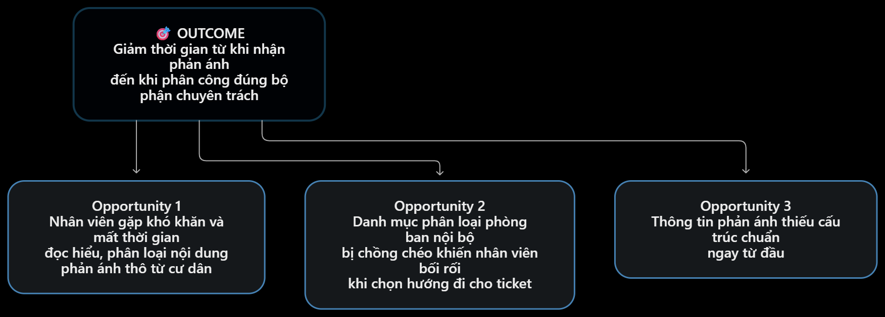

1. Pitch (Phần trình bày & Thách thức)
Người trình bày: Hoàng Ngọc Minh Trí

Job Story: Khi có phản ánh mới từ cư dân gửi đến hệ thống, tôi muốn biết chính xác nhóm sự cố và đơn vị xử lý chuyên trách, để ticket được chuyển đúng nơi ngay trong lần đầu tiên mà không cần đọc thủ công trùng lặp.

Actor (Đối tượng): Nhân viên tiếp nhận / Điều phối viên tổng đài CSKH.

Bottleneck (Điểm nghẽn): Bước đọc mô tả nội dung và xem ảnh đính kèm thủ công tốn 2.0 phút/ticket (chiếm hơn 44% tổng thời gian xử lý ban đầu vào giờ cao điểm).

Câu hỏi thách thức nhận được (Từ thành viên khác trong nhóm):

"Nếu chúng ta thay đổi giao diện App cư dân để bắt buộc họ tự chọn nhóm sự cố qua dạng cây thư mục (Form/Dropdown) từ trước, liệu giải pháp Quy trình/Rule này có đủ giải quyết vấn đề mà KHÔNG CẦN dùng tới AI phân loại hay không?"

2. Cluster (Phân cụm các vấn đề)
Nhóm gom nhóm các ý tưởng của các thành viên thành các cụm nỗi đau chính:

Cụm 1 (Được chọn làm trọng tâm): Nỗi đau ở điểm đầu vào và phân loại ticket (Bao gồm lỗi phân loại sai, tốn thời gian đọc hiểu văn bản thô, nghẽn luồng tiếp nhận giờ cao điểm).

Cụm 2: Nỗi đau về thiếu hụt dữ liệu hiện trường và bổ sung thông tin.

Cụm 3: Nỗi đau đứt gãy thông tin khi bàn giao ca trực.

3. Opportunity Solution Tree (OST) — Cây cơ hội & Giải pháp *Check 

*Xem chi tiết file sơ đồ hình ảnh tại thư mục dự án: `report/assets/ost-diagram.png`*

OUTCOME (Gốc của cây): Giảm thời gian từ khi nhận phản ánh của cư dân đến khi phân công đúng bộ phận xử lý chuyên trách.

Opportunity 1: Nhân viên gặp khó khăn và mất thời gian đọc hiểu, phân loại nội dung phản ánh thô từ cư dân.

Opportunity 2: Danh mục phân loại phòng ban nội bộ bị chồng chéo khiến nhân viên bối rối khi chọn hướng đi cho ticket.

Opportunity 3: Thông tin phản ánh thiếu cấu trúc chuẩn ngay từ đầu.

Các giải pháp tiềm năng:

Giải pháp Non-AI/Rule: Chuẩn hóa cây danh mục và bắt buộc cư dân chọn form mẫu sẵn.

Giải pháp AI: Mô hình phân loại tự động cú pháp text và OCR hình ảnh để gợi ý 1-click cho nhân viên (Human-in-the-loop).
