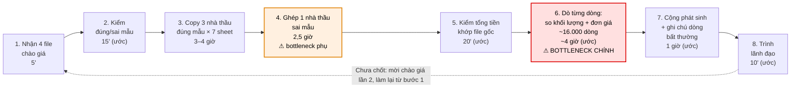
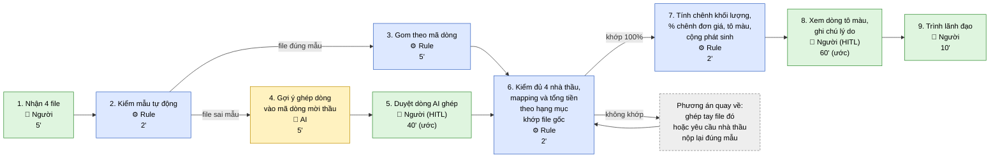

# Báo cáo nhóm — Day 02 Discovery & Problem Framing

> Bản chung của nhóm, viết trên repo do nhóm trưởng fork. Không copy file này sang repo cá nhân.
> Template chi tiết và prompt mẫu: [docs/01-worksheet.md](../../docs/01-worksheet.md). Bài mẫu: [docs/02-deliverable-example.md](../../docs/02-deliverable-example.md).

## 1. Thông tin nhóm

- Tên nhóm:
- Thành viên: xem `TEAM.md`
- Candidate problem được chọn (1 câu):
- Quyết định cuối: Go / Not Yet / No-Go

---

## 2. Hội tụ nhóm (CP3)

### 2.1. Pitch

| # | Người đưa ra | Candidate (Job Story ngắn) | Actor | Bottleneck | Câu hỏi phản biện nhận được (ai hỏi) |
|---:|---|---|---|---|---|
| 1 | | | | | |
| 2 | | | | | |
| 3 | | | | | |
| 4 | | | | | |
| 5 | | | | | |
| 6 | | | | | |
| 7 | | | | | |
| 8 | | | | | |
| 9 | | | | | |
| 10 | | | | | |
| 11 | | | | | |
| 12 | | | | | |
| 13 | | | | | |
| 14 | | | | | |
| 15 | | | | | |
| 16 | | | | | |
| 17 | | | | | |
| 18 | | | | | |

### 2.2. Cluster

| Cluster | Các candidate | Pattern chung |
|---|---|---|
| A | | |
| B | | |
| C | | |

### 2.3. Opportunity Solution Tree rút gọn

Gốc là **1 outcome**. Nhánh là **opportunity** (nhu cầu, pain), không phải tính năng hay công cụ.

```text
OUTCOME: 
├── Opportunity A: 
├── Opportunity B: 
└── Opportunity C: 
```

Những ý đã gạch bỏ vì là solution đội lốt opportunity:

-

### 2.4. Chấm điểm shortlist (1–5)

| Candidate | Actor rõ | Quy trình rõ | Pain có bằng chứng | Impact đo được | Vừa sức lab | So sánh được No AI/Rule/Workflow/Agent | Nhóm hiểu domain | Tổng |
|---|---:|---:|---:|---:|---:|---:|---:|---:|
| | | | | | | | | |
| | | | | | | | | |
| | | | | | | | | |

**Candidate được chọn:**

**Vì sao chọn:**

**Vì sao loại các candidate còn lại:**

**Xử lý bất đồng (nếu có):**

---

## 3. Kiểm chứng + research giải pháp đã có (CP4)

### 3.1. Assumption Map

| # | Giả định | Loại (Value / Usability / Feasibility / Viability) | Quan trọng (1–5) | Đã có bằng chứng (1–5) | Kiểm chứng trước? |
|---:|---|---|---:|---:|---|
| 1 | | | | | |
| 2 | | | | | |
| 3 | | | | | |
| 4 | | | | | |
| 5 | | | | | |
| 6 | | | | | |

*Điền 4–6 giả định; xóa dòng thừa.*

Giả định nhóm kiểm chứng trong buổi này:

### 3.2. Kiểm chứng

Cách đã dùng: Phỏng vấn / Survey / Log, ticket, review

Interview snapshot (mỗi buổi phỏng vấn một bảng, hoặc đặt file trong `report/assets/cp4-interview-snapshot-N.md`):

| Trường | Nội dung |
|---|---|
| Người được hỏi (vai trò, không ghi tên thật) | |
| Câu nói đáng nhớ nhất (nguyên văn) | |
| Lần gần nhất gặp vấn đề này: chuyện gì đã xảy ra? | |
| Hiện đang xử lý bằng cách nào (workaround)? | |
| Mất bao lâu, bao lần? | |
| Insight / opportunity rút ra | |

Tổng hợp:

| Nguồn | Số người / số mẫu | Tín hiệu xác nhận | Tín hiệu phản bác |
|---|---:|---|---|
| | | | |

**Nhóm đã sửa problem thế nào sau kiểm chứng:**

### 3.3. Research giải pháp đã có

| Công cụ / case / pattern | Link | Giải bước nào trong quy trình? | Điểm mạnh | Khoảng trống / rủi ro | Bài học cho nhóm |
|---|---|---|---|---|---|
| | | | | | |
| | | | | | |
| | | | | | |

---

## 4. Quy trình trước/sau (CP5)

Phần này mô tả cả gom và soát; thời gian tương lai là kỳ vọng thiết kế. Lựa chọn Rule cho riêng bước so số và giả thuyết AI cho ghép file sai mẫu cần được đánh giá theo phạm vi riêng, trước khi nhóm chốt mức can thiệp.

Phạm vi: từ lúc nhận bảng chào giá của 4 nhà thầu đến lúc trình lãnh đạo, gồm 2 phần **gom** (Card #2) và **soát** (Card #1) trong báo cáo cá nhân của Nguyễn Văn Vinh. Vẽ cả phần gom vì bước soát chỉ làm được khi bảng của 4 nhà thầu đã được gom đúng theo mã dòng. Số liệu lấy từ gói thầu gần nhất; thời gian ghi "(ước)" là ước lượng từng bước, tổng gom và tổng soát là đo thật.

### 4.1. Quy trình hiện tại

**HIỆN TẠI** — 8 bước/vòng, 8/8 bước thủ công, khoảng 11–13 giờ/vòng × 2 vòng/gói. Ô viền đỏ là bottleneck.



| Bước | Actor | Input | Output | Thời gian / tần suất | Ghi chú |
|---:|---|---|---|---|---|
| 1 | Chuyên viên KTKT (Nam) | Email / file nộp của 4 nhà thầu | 4 file Excel chào giá đã lưu | 5' / vòng | 2 vòng/gói ở gói gần nhất |
| 2 | Chuyên viên KTKT | 4 file chào giá, mẫu 7 sheet trong HSYC | Danh sách file đúng mẫu / sai mẫu (gói gần nhất: 3 đúng, 1 sai) | 15' (ước) / vòng | |
| 3 | Chuyên viên KTKT | 3 file đúng mẫu | File tổng hợp 7 sheet, 63 cột/sheet | 3–4 giờ / vòng (đo) | Copy tay từng sheet |
| 4 | Chuyên viên KTKT | 1 file sai mẫu (1 sheet 4.870 dòng) | Dòng của nhà thầu sai mẫu được xếp vào đúng hạng mục, đúng mã dòng | 2,5 giờ / vòng (đo) | Bottleneck phụ: chậm khoảng 2 lần so với một nhà thầu đúng mẫu; chỉ xảy ra khi có nhà thầu sai mẫu |
| 5 | Chuyên viên KTKT | File tổng hợp + 4 file gốc | Xác nhận tổng tiền từng nhà thầu khớp file gốc | 20' (ước) / vòng | Handoff sang phần soát |
| 6 | Chuyên viên KTKT | File tổng hợp (~4.100 dòng × 4 nhà thầu) | Các dòng có khối lượng khác mời thầu hoặc đơn giá chênh lớn được đánh dấu | ~4 giờ (ước) / vòng | **Bottleneck chính**; dò bằng mắt |
| 7 | Chuyên viên KTKT | Các dòng đã đánh dấu | Tổng phát sinh từng nhà thầu (0 đến ~3,9 tỷ) + ghi chú lý do | 1 giờ (ước) / vòng | |
| 8 | Chuyên viên KTKT → Lãnh đạo | Bảng tổng hợp có ghi chú | Lãnh đạo chọn nhà thầu, hỏi lại, hoặc mời chào giá lần 2 | 10' (ước) / vòng | Gói gần nhất: bị hỏi lại / trả lại ~4 lần |

Tổng: gom (bước 1–5) 6–7 giờ + soát (bước 6–8) 5–6 giờ = **khoảng 11–13 giờ/vòng, 22–26 giờ/gói (2 vòng)**.

**Bottleneck chính:** Bước 6, dò khoảng 16.000 dòng (4.100 dòng × 4 nhà thầu) bằng mắt để tìm dòng có khối lượng khác mời thầu hoặc đơn giá chênh lớn, mất khoảng 4 giờ/vòng. Đây là bước vừa tốn thời gian nhất vừa có rủi ro cao nhất: sót một dòng có thể làm lệch so sánh giá tới hàng tỷ (gói gần nhất có 1 nhà thầu mà giá trị tính theo khối lượng chào thấp hơn giá trị tính theo khối lượng mời thầu khoảng 3 tỷ). Bước 4 là bottleneck phụ, phụ thuộc vào việc có nhà thầu sai mẫu hay không (tỷ lệ này cần kiểm ở CP4).

### 4.2. Quy trình tương lai

**TƯƠNG LAI (kỳ vọng, chưa pilot)** — 9 bước/vòng, 4/9 bước thủ công, khoảng 2–2,5 giờ/vòng. Xanh dương = Rule, vàng = AI, xanh lá = con người, xám = phương án quay về.



| Bước | Ai / cái gì làm | Việc | Thời gian (ước) |
|---:|---|---|---|
| 1 | Con người | Nhận 4 file chào giá | 5' |
| 2 | Rule (macro) | Kiểm tên sheet, cột, mã dòng so với mẫu HSYC; tách file đúng mẫu / sai mẫu | 2' |
| 3 | Rule (Power Query / macro) | Gom các file đúng mẫu vào file tổng hợp theo mã dòng | 5' |
| 4 | AI | Chỉ với file sai mẫu: đọc từng dòng, gợi ý dòng đó thuộc mã dòng nào trong BOQ mời thầu (kể cả khi mô tả khác chữ), kèm mức tin cậy; dòng không tìm được thì đánh dấu "chưa ghép" | 5' |
| 5 | Con người (HITL) | Duyệt dòng AI ghép, ưu tiên dòng tin cậy thấp và dòng "chưa ghép"; tự ghép các dòng còn lại | 40' |
| 6 | Rule | So tổng tiền từng hạng mục của từng nhà thầu với file gốc; chỉ sang bước 7 khi khớp 100% | 2' |
| 7 | Rule (công thức + conditional formatting) | Tính chênh khối lượng = khối lượng chào − khối lượng mời thầu; % chênh đơn giá so với trung vị 4 nhà thầu; tô màu dòng chênh khối lượng khác 0 hoặc chênh đơn giá vượt ngưỡng; cộng phát sinh | 2' |
| 8 | Con người (HITL) | Xem các dòng tô màu, quyết định dòng nào thật sự bất thường, ghi lý do | 60' |
| 9 | Con người | Trình lãnh đạo | 10' |

Gom (bước 1–6) khoảng 1 giờ; soát (bước 7–9) khoảng 1,2 giờ.

**Boundary — AI không được:**
- Sửa khối lượng, đơn giá hay bất kỳ con số nào của nhà thầu; AI chỉ gợi ý dòng đó thuộc mã dòng nào.
- Tự xóa hoặc bỏ qua dòng mà nó không ghép được (phải đánh dấu "chưa ghép" để người xử lý).
- Kết luận nhà thầu nào đạt, rẻ nhất hay bị loại; quyết định này thuộc chuyên viên và lãnh đạo.
- Tự gửi file cho lãnh đạo hoặc nhà thầu.
- Nhận dữ liệu chào giá qua công cụ AI chưa được tổ chức cho phép (dữ liệu chào giá là thông tin mật của gói thầu).

**Khi nào con người phải kiểm tra (HITL):**
- Bước 5: mọi mapping do AI gợi ý phải được người duyệt đối chiếu mã, mô tả, đơn vị và dòng nguồn trước khi dùng; ưu tiên dòng tin cậy thấp và xử lý riêng các dòng chưa ghép.
- Bước 6: nếu tổng tiền bất kỳ hạng mục nào không khớp file gốc thì dừng, không sang bước 7.
- Bước 8: mọi dòng tô màu phải được người xem và ghi lý do trước khi trình.

Kiểm tra chéo: tổng tiền khớp không chứng minh mọi dòng được ghép đúng. Một dòng ghép sai có thể không tạo chênh khối lượng nếu hai dòng cùng khối lượng hoặc cùng đơn vị. Vì vậy chuyên viên kiểm mã, mô tả, đơn vị và dòng nguồn của mọi mapping AI trước khi sử dụng, không chỉ các gợi ý có mức tin cậy thấp; dòng mơ hồ được chuyển xử lý thủ công.

**Phương án quay về:**
- AI ghép sai, tổng tiền không khớp, hoặc AI không dùng được → chuyên viên ghép tay file sai mẫu như hiện tại (khoảng 2,5 giờ), hoặc yêu cầu nhà thầu nộp lại đúng mẫu.
- Macro / Power Query lỗi (ví dụ nhà thầu đổi mã dòng) → quay về copy tay (bước 3 hiện tại) cho file đó.
- Ngưỡng tô màu báo quá nhiều dòng → chỉnh ngưỡng cùng lãnh đạo; trong lúc chờ, dò tay các dòng có giá trị lớn.

### 4.3. Before / after

| Chỉ số | Trước | Sau (kỳ vọng) | Ghi chú |
|---|---:|---:|---|
| Số bước | 8 | 9 | Thêm bước kiểm mẫu tự động và tách riêng bước người duyệt dòng AI ghép |
| Tổng thời gian | 11–13 giờ/vòng (22–26 giờ/gói) | ~2–2,5 giờ/vòng (~4–5 giờ/gói) | "Trước" đo trên gói gần nhất; "Sau" là ước lượng, cần đo khi pilot |
| Số bước thủ công | 8/8 | 4/9 | Bước thủ công còn lại: nhận file, duyệt dòng AI ghép, xem dòng tô màu, trình lãnh đạo |
| Bottleneck chính | Dò ~16.000 dòng bằng mắt (~4 giờ/vòng) | Xem và ghi lý do cho các dòng tô màu (~60'/vòng) | Thời gian bước 8 phụ thuộc số dòng bị tô màu, tức là phụ thuộc ngưỡng |
| Rủi ro mới phát sinh | — | AI ghép sai dòng nhưng tổng tiền vẫn khớp; ngưỡng tô màu đặt sai gây báo nhầm nhiều hoặc bỏ sót; nhà thầu đổi mã dòng làm gom tự động sai; dữ liệu mật đi qua công cụ AI; chuyên viên tin máy, soát lơ là hơn | Xử lý bằng bước 6 (khớp tổng tiền), bước 7 (tô màu dòng chênh), HITL ở bước 5 và 8, và boundary về công cụ AI |

---

## 5. Problem Statement v0 (CP5)

| Trường | Nội dung |
|---|---|
| **Actor** | |
| **Quy trình** | |
| **Bottleneck** | |
| **Impact** | |
| **Success Metric** (baseline → target, cách đo) | |
| **Boundary** (AI không được làm gì; khi nào cần con người kiểm tra — HITL) | |

Phản biện nhận được (từ AI hoặc nhóm khác) và nhóm có đồng ý không:

-

---

## 6. Mức can thiệp AI (CP6)

### 6.1. Ma trận độ mơ hồ × độ phức tạp

Bài của nhóm nằm ở ô:

Vì sao:

### 6.2. So sánh 4 mức

| Mức | Phương án cho bài của nhóm | Đủ khi nào | Rủi ro | Chọn? |
|---|---|---|---|---|
| **No AI** (sửa quy trình) | | | | |
| **Rule** | | | | |
| **Workflow** | | | | |
| **Agent** | | | | |

**Mức chọn:**

**Vì sao không chọn mức đơn giản hơn:**

### 6.3. AI Canvas rút gọn

| Thành phần | Nội dung |
|---|---|
| **Prediction** — AI dự đoán / tạo ra gì? | |
| **Judgment** — con người cân nhắc, quyết định gì? | |
| **Action** — hành động cuối cùng là gì, ai làm? | |
| **Outcome** — đo kết quả bằng gì? | |
| **Input** — AI cần dữ liệu đầu vào gì mỗi lần chạy? Có sẵn không? | |
| **Feedback** — lấy phản hồi ở đâu để cải thiện? | |

### 6.4. Hai câu hỏi của Google PAIR

- Người dùng muốn **được hỗ trợ (augment)** hay **giao hẳn việc (automate)**? Bằng chứng:
- AI sai kiểu nào tệ hơn, **báo nhầm** hay **bỏ sót**? Vì sao, và thiết kế đã xử lý thế nào:

---

## 7. Problem Statement v1 + tiêu chí đánh giá (CP6)

| Trường | Nội dung |
|---|---|
| **Actor** | |
| **Quy trình** | |
| **Bottleneck** | |
| **Impact** | |
| **Success Metric** (baseline → target, cách đo) | |
| **Boundary** | |
| **AI intervention point** | |
| **Mức chọn** | No AI / Rule / Workflow / Agent |
| **Rủi ro & người kiểm tra** | |

**Thay đổi so với v0 và lý do:**

| Trường | v0 | v1 | Vì sao đổi |
|---|---|---|---|
| | | | |

**Tiêu chí đánh giá đầu ra của AI (3–5 tiêu chí):**

| # | Tiêu chí | Đạt khi | Không đạt khi |
|---:|---|---|---|
| 1 | | | |
| 2 | | | |
| 3 | | | |

---

## 8. Quyết định (CP6)

### 8.1. Bốn rủi ro

| Rủi ro | Câu hỏi | Mức độ rủi ro (Thấp = an toàn / TB / Cao = nguy hiểm) | Lý do / bằng chứng |
|---|---|---|---|
| **Value** | Người dùng có thật sự cần và sẽ dùng không? | | |
| **Usability** | Người dùng có dùng được, có hiểu và sửa được đầu ra của AI không? | | |
| **Feasibility** | Có đủ dữ liệu, công cụ, kỹ năng để làm không? | | |
| **Viability** | Có hợp chi phí, pháp lý, quy định tổ chức không? Ai vận hành? | | |

### 8.2. Kết luận

**Quyết định:** Go / Not Yet / No-Go

**Lý do:**

**Nếu Go — pilot nhỏ nhất:**

**Nếu Not Yet — cần kiểm chứng gì trước:**

**Nếu No-Go — nên làm gì thay AI:**

**Ngưỡng dừng** (nếu sau … mà … thì quay về …):

---

## 9. Hạn chế và hướng tiếp theo

-

## 10. Tài liệu tham khảo

-
