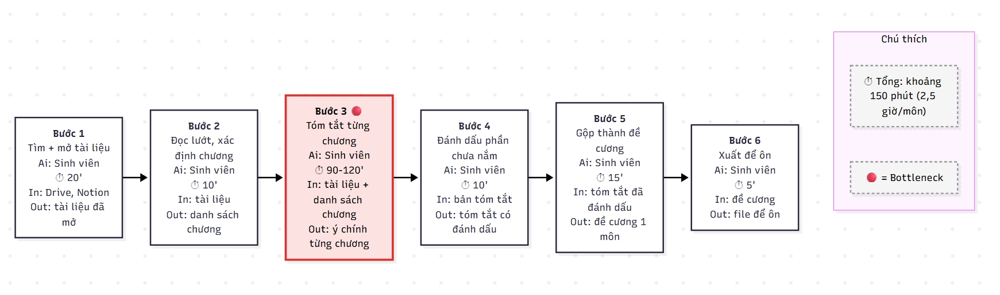
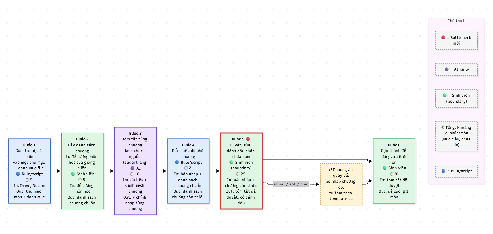

# Báo cáo nhóm — Day 02 Discovery & Problem Framing

> Bản chung của nhóm, viết trên repo do nhóm trưởng fork. Không copy file này sang repo cá nhân.
> Template chi tiết và prompt mẫu: [docs/01-worksheet.md](../../docs/01-worksheet.md). Bài mẫu: [docs/02-deliverable-example.md](../../docs/02-deliverable-example.md).

## 1. Thông tin nhóm

- Tên nhóm:
- Thành viên: xem `TEAM.md`
- Candidate problem được chọn (1 câu):
- Quyết định cuối: Go / Not Yet / No-Go

---

## 2. Hội tụ nhóm (CP3)

### 2.1. Pitch

| # | Người đưa ra | Candidate (Job Story ngắn) | Actor | Bottleneck | Câu hỏi phản biện nhận được (ai hỏi) |
|---:|---|---|---|---|---|
| 1 | | | | | |
| 2 | | | | | |
| 3 | | | | | |
| 4 | | | | | |
| 5 | | | | | |
| 6 | | | | | |
| 7 | | | | | |
| 8 | | | | | |
| 9 | | | | | |
| 10 | | | | | |
| 11 | | | | | |
| 12 | | | | | |

### 2.2. Cluster

| Cluster | Các candidate | Pattern chung |
|---|---|---|
| A | | |
| B | | |
| C | | |

### 2.3. Opportunity Solution Tree rút gọn

Gốc là **1 outcome**. Nhánh là **opportunity** (nhu cầu, pain), không phải tính năng hay công cụ.

```text
OUTCOME: 
├── Opportunity A: 
├── Opportunity B: 
└── Opportunity C: 
```

Những ý đã gạch bỏ vì là solution đội lốt opportunity:

-

### 2.4. Chấm điểm shortlist (1–5)

| Candidate | Actor rõ | Quy trình rõ | Pain có bằng chứng | Impact đo được | Vừa sức lab | So sánh được No AI/Rule/Workflow/Agent | Nhóm hiểu domain | Tổng |
|---|---:|---:|---:|---:|---:|---:|---:|---:|
| | | | | | | | | |
| | | | | | | | | |
| | | | | | | | | |

**Candidate được chọn:**

**Vì sao chọn:**

**Vì sao loại các candidate còn lại:**

**Xử lý bất đồng (nếu có):**

---

## 3. Kiểm chứng + research giải pháp đã có (CP4)

### 3.1. Assumption Map

| # | Giả định | Loại (Value / Usability / Feasibility / Viability) | Quan trọng (1–5) | Đã có bằng chứng (1–5) | Kiểm chứng trước? |
|---:|---|---|---:|---:|---|
| 1 | | | | | |
| 2 | | | | | |
| 3 | | | | | |
| 4 | | | | | |
| 5 | | | | | |
| 6 | | | | | |

*Điền 4–6 giả định; xóa dòng thừa.*

Giả định nhóm kiểm chứng trong buổi này:

### 3.2. Kiểm chứng

Cách đã dùng: Phỏng vấn / Survey / Log, ticket, review

Interview snapshot (mỗi buổi phỏng vấn một bảng, hoặc đặt file trong `report/assets/cp4-interview-snapshot-N.md`):

| Trường | Nội dung |
|---|---|
| Người được hỏi (vai trò, không ghi tên thật) | |
| Câu nói đáng nhớ nhất (nguyên văn) | |
| Lần gần nhất gặp vấn đề này: chuyện gì đã xảy ra? | |
| Hiện đang xử lý bằng cách nào (workaround)? | |
| Mất bao lâu, bao lần? | |
| Insight / opportunity rút ra | |

Tổng hợp:

| Nguồn | Số người / số mẫu | Tín hiệu xác nhận | Tín hiệu phản bác |
|---|---:|---|---|
| | | | |

**Nhóm đã sửa problem thế nào sau kiểm chứng:**

### 3.3. Research giải pháp đã có

| Công cụ / case / pattern | Link | Giải bước nào trong quy trình? | Điểm mạnh | Khoảng trống / rủi ro | Bài học cho nhóm |
|---|---|---|---|---|---|
| | | | | | |
| | | | | | |
| | | | | | |

---

## 4. Quy trình trước/sau (CP5)

### 4.1. Quy trình hiện tại

Sơ đồ (ASCII, Mermaid hoặc link ảnh trong `report/assets/`):

```text
cp5-workflow-current.jpeg
```


| Bước | Actor | Input | Output | Thời gian / tần suất | Ghi chú |
|---:|---|---|---|---|---|
| 1. Tìm và mở lại tài liệu | Sinh viên | Slide, giáo trình trên Drive; ghi chú trên Notion | Tài liệu của 1 môn đã mở sẵn | ~20'/môn, 6 môn/đợt ôn |  |
| 2. Đọc lướt, xác định các chương | Sinh viên | Tài liệu đã mở, danh mục môn | Danh sách chương cần tóm tắt | ~10'/môn | Danh mục chương của giảng viên là mốc đối chiếu về sau |
| 3. Tóm tắt từng chương thành ý chính  | Sinh viên | Slide + giáo trình + ghi chú của từng chương (thứ tự dựa trên danh sách chương) | Ý chính từng chương | ~90-120'/môn (trong tổng 2-3 giờ) | Đọc lại và chọn ý, chưa tách rõ “đọc” với “viết”. Có thể đọc chiếm phần lớn thời gian |
| 4. Đánh dấu phần mình chưa nắm | Sinh viên | Bản tóm tắt ý chính từng chương | Bản tóm tắt có đánh dấu chỗ yếu | ~10'/môn | Dựa vào cảm giác chủ quan |
| 5. Gộp lại thành đề cương | Sinh viên | Bản tóm tắt đã đánh dấu | Đề cương 1 môn | ~15'/môn |  |
| 6. Xuất ra để ôn | Sinh viên | Đề cương | File/trang dùng để ôn | ~5'/môn | Chưa rõ định dạng (Notion, PDF, giấy) |

**Bottleneck chính:** Bước 3, tóm tắt từng chương: khoảng 90-120 phút trong tổng ~2,5 giờ/môn (chiếm khoảng 60-70%).  
Lý do là bottleneck:
- Bước lớn nhất theo thời lượng.
- Là bước duy nhất vừa phải đọc nhiều tài liệu, vừa phải chọn ý, nên đúng chỗ công cụ tóm tắt có thể hỗ trợ.


### 4.2. Quy trình tương lai

Ghi rõ bước nào **Rule**, bước nào **AI**, bước nào **con người**, **boundary** ở đâu, **phương án quay về** khi AI sai.

```text
cp5-workflow-future.jpeg
```


| Bước | Loại | Actor | Input | Output | Thời gian / tần suất | Ghi chú |
|---:|---|---|---|---|---|---|
| 1. Gom tài liệu 1 môn | Rule/script | Công cụ | Slide, giáo trình trên Drive; ghi chú trên Notion | Thư mục môn + danh mục file | ~5' (hiện ~20') | Việc cố định, không cần hiểu nội dung. Cần quyền truy cập Drive và Notion. Chưa chắc làm được tự động hoàn toàn |
| 2. Lấy danh sách chương chuẩn | Con người | Sinh viên | Đề cương môn học của giảng viên | Danh sách chương chuẩn | ~5' (hiện ~10') | Để sinh viên làm, không để AI tự suy ra chương. Đây là mốc kiểm tra độ phủ. Thời gian giảm xuống nếu có đề cương từ giảng viên. Nếu không có thì giữ nguyên như hiện tại |
| 3. Tóm tắt từng chương | AI | AI | Thư mục môn + danh mục file (từ bước 1) + Danh sách chương chuẩn (từ bước 2) | Bản nháp tóm tắt từng chương (có chỉ nguồn) | ~10' (hiện 90-120') | Bước thay thế bottleneck cũ. Bắt buộc chỉ rõ nguồn để sinh viên kiểm tra |
| 4. Đối chiếu độ phủ | Rule/script | Công cụ | Bản nháp tóm tắt từng chương (từ bước 3) + Danh sách chương chuẩn (từ bước 2) | Danh sách chương còn thiếu | ~2' | So khớp tên chương, không cần AI |
| 5. Duyệt, sửa, đánh dấu phần chưa nắm | Con người (boundary) | Sinh viên | Bản nháp tóm tắt từng chương (từ bước 3) + Danh sách chương còn thiếu (từ bước 4) + Thư mục môn + danh mục file (từ bước 1, để đối chiếu nguồn) | Bản tóm tắt đã duyệt, có đánh dấu chỗ yếu | ~25' | Gộp bước “duyệt” với bước “đánh dấu” cũ. Bottleneck mới. Gộp hai việc thực hiện cùng một lượt đọc, chưa đo riêng từng việc. Nếu khi đo riêng bước nào chiếm nhiều thời gian hơn thì Bottleneck mới sẽ ở bước đó |
| 6. Gộp và xuất đề cương | Con người | Sinh viên | Bản tóm tắt đã duyệt, có đánh dấu chỗ yếu (từ bước 5) | Đề cương 1 môn |~8' | Dùng template đề cương có sẵn |

**Tổng:** khoảng 55 phút/môn (hiện khoảng 150 phút). Mục tiêu là dưới 60 phút/môn.  

**Boundary: AI không được làm gì**
- Không tự quyết định chương nào được bỏ qua.
- Không tự đánh dấu một chủ đề là “đã nắm”. Việc này chỉ sinh viên làm.
- Không thêm kiến thức ngoài tài liệu đã gom (để tránh bịa).
- Không sửa hoặc xóa tài liệu gốc.
- Không để sinh viên dùng bản nháp để ôn khi chưa qua bước 5.

**Phương án quay về**
| Tình huống | Làm gì |
|---:|---|
| AI tóm sai, sót ý hoặc quá nhạt ở một chương | Bỏ bản nháp chương đó, sinh viên tự tóm theo template đề cương cũ. Chương còn lại giữ nguyên |
| Bước 4 báo nhiều chương thiếu | Chạy lại bước 3 cho các chương đó. Nếu vẫn thiếu, tự tóm tay |
| AI hoặc script ngừng hoạt động | Quay về quy trình hiện tại ở mục 4.1 (khoảng 150 phút/môn). Mất thời gian nhưng không mất đề cương |

**Bottleneck mới**: Bước 5: sinh viên duyệt, sửa, đánh dấu phần chưa nắm (~25 phút). Chấp nhận được vì đây là điểm kiểm soát chất lượng. Nếu rút ngắn quá mức thì AI sai không bị phát hiện, và đó chính là rủi ro lớn nhất của candidate này.

### 4.3. Before / after

| Chỉ số | Trước | Sau (kỳ vọng) | Ghi chú |
|---|---:|---:|---|
| Số bước | 6 | 6 | Số bước không giảm. Cái đổi là ai làm từng bước . Bước “đánh dấu phần chưa nắm” được gộp vào bước duyệt, nhưng thêm 2 bước mới là lấy danh sách chương chuẩn và đối chiếu độ phủ |
| Tổng thời gian | ~150 phút/môn (2,5 giờ), 6 môn ≈ 15 giờ | ~55 phút/môn, 6 môn ≈ 5,5 giờ | Giảm khoảng 95 phút/môn (khoảng 63%). Đạt mục tiêu dưới 60 phút/môn của card. Số “trước” có thể lên 180 phút nếu bước tóm tắt mất 120 phút. Số “sau” chưa ai thử, nên cần bấm giờ thật |
| Số bước thủ công | 6 trên 6 (toàn bộ do sinh viên làm tay) | 3 trên 6 (bước 2, 5, 6) | Rule/script làm 2 bước (gom file, đối chiếu chương), AI làm 1 bước (tóm tắt). Thời gian làm tay còn ~38 phút trong tổng 55 phút |
| Bottleneck chính | Bước tóm tắt từng chương, ~90-120 phút (60-70% tổng thời gian) | Bước sinh viên duyệt, sửa, đánh dấu, ~25 phút (~45% tổng thời gian) | Bottleneck chuyển từ “tự tạo nội dung” sang “kiểm tra nội dung”. Chấp nhận được vì đây là điểm kiểm soát chất lượng, không nên rút ngắn thêm |
| Rủi ro mới phát sinh | Không có rủi ro từ AI. Rủi ro hiện có: tự tóm tắt bị sót chương mà không biết | 1. AI tóm sai, sót ý hoặc bịa<br>2. Sinh viên tin bản nháp mà duyệt qua loa<br>3. Script gom file lỗi hoặc thiếu quyền truy cập<br>4. Tên chương trong slide không khớp đề cương, script đối chiếu sai<br>5. Phụ thuộc vào công cụ bên ngoài | Cách giảm: bắt buộc AI chỉ rõ nguồn (slide/trang), có bước đối chiếu độ phủ chương, có phương án quay về (tự tóm theo template cũ). Rủi ro 2 là rủi ro nguy hiểm nhất, vì mất hết lợi ích nếu duyệt hời hợt |

---

## 5. Problem Statement v0 (CP5)

| Trường | Nội dung |
|---|---|
| **Actor** | Sinh viên đại học tự dựng đề cương ôn thi cho nhiều môn (khoảng 6 môn/kỳ) từ slide, giáo trình và ghi chú nằm rải ở Drive, Notion |
| **Quy trình** | Mỗi đợt ôn thi, với từng môn, sinh viên tìm và mở lại tài liệu, đọc lướt để xác định các chương, tóm tắt từng chương thành ý chính, đánh dấu phần chưa nắm, gộp thành đề cương rồi xuất ra để ôn |
| **Bottleneck** | Bước tóm tắt từng chương mất khoảng 90-120 phút/môn (60-70% tổng thời gian), vì sinh viên phải đọc lại toàn bộ tài liệu rồi tự chọn ý chính. Giả định, chưa bấm giờ, chưa tách riêng “đọc” và “viết” |
| **Impact** | Khoảng 150 phút/môn, 6 môn ≈ 15 giờ mỗi đợt ôn thi. Càng gần ngày thi càng dồn việc, dễ bỏ sót chương và ôn dàn trải |
| **Success Metric** (baseline → target, cách đo) | Giảm thời gian dựng đề cương từ khoảng 150 phút xuống dưới 60 phút/môn; không bỏ sót chương nào so với đề cương môn học của giảng viên. Cách đo: bấm giờ từng bước khi dựng đề cương 1 môn, trước và sau; đối chiếu danh sách chương trong đề cương với danh mục chương của giảng viên. |
| **Boundary** (AI không được làm gì; khi nào cần con người kiểm tra — HITL) | AI không tự quyết định chương nào được bỏ qua; không tự đánh dấu một chủ đề là “đã nắm”; không thêm kiến thức ngoài tài liệu đã gom; không sửa hoặc xóa tài liệu gốc. Sinh viên không dùng bản nháp để ôn khi chưa duyệt xong. Nếu AI sai hoặc ngừng hoạt động, sinh viên quay về tự tóm tắt theo template cũ. |

Phản biện nhận được (từ AI hoặc nhóm khác) và nhóm có đồng ý không:

| Phản biện | Đồng ý? | Cách sửa đề xuất |
|---|---|---|
| NotebookLM và công cụ tương tự đã làm tốt bước tóm tắt, nên problem này có thể đã được giải | Đồng ý | Thu hẹp problem thành “kiểm tra bản tóm tắt AI có phủ hết chương và đúng ý không” |
| Sinh viên có thể duyệt bản AI qua loa, mất lợi ích kiểm soát | Đồng ý | Thêm bước đối chiếu độ phủ chương bằng script, và yêu cầu AI chỉ rõ nguồn (slide/trang) |
| Chỉ đo thời gian là chưa đủ, đề cương ngắn nhưng sai vẫn “thắng” | Đồng ý | Giữ điều kiện “không bỏ sót chương nào”. Thêm chỉ số: mỗi người làm thử 5 câu hỏi ôn từ đề cương, đếm câu không tìm được đáp án |

---

## 6. Mức can thiệp AI (CP6)

### 6.1. Ma trận độ mơ hồ × độ phức tạp

Bài của nhóm nằm ở ô:

Vì sao:

### 6.2. So sánh 4 mức

| Mức | Phương án cho bài của nhóm | Đủ khi nào | Rủi ro | Chọn? |
|---|---|---|---|---|
| **No AI** (sửa quy trình) | | | | |
| **Rule** | | | | |
| **Workflow** | | | | |
| **Agent** | | | | |

**Mức chọn:**

**Vì sao không chọn mức đơn giản hơn:**

### 6.3. AI Canvas rút gọn

| Thành phần | Nội dung |
|---|---|
| **Prediction** — AI dự đoán / tạo ra gì? | |
| **Judgment** — con người cân nhắc, quyết định gì? | |
| **Action** — hành động cuối cùng là gì, ai làm? | |
| **Outcome** — đo kết quả bằng gì? | |
| **Input** — AI cần dữ liệu đầu vào gì mỗi lần chạy? Có sẵn không? | |
| **Feedback** — lấy phản hồi ở đâu để cải thiện? | |

### 6.4. Hai câu hỏi của Google PAIR

- Người dùng muốn **được hỗ trợ (augment)** hay **giao hẳn việc (automate)**? Bằng chứng:
- AI sai kiểu nào tệ hơn, **báo nhầm** hay **bỏ sót**? Vì sao, và thiết kế đã xử lý thế nào:

---

## 7. Problem Statement v1 + tiêu chí đánh giá (CP6)

| Trường | Nội dung |
|---|---|
| **Actor** | |
| **Quy trình** | |
| **Bottleneck** | |
| **Impact** | |
| **Success Metric** (baseline → target, cách đo) | |
| **Boundary** | |
| **AI intervention point** | |
| **Mức chọn** | No AI / Rule / Workflow / Agent |
| **Rủi ro & người kiểm tra** | |

**Thay đổi so với v0 và lý do:**

| Trường | v0 | v1 | Vì sao đổi |
|---|---|---|---|
| | | | |

**Tiêu chí đánh giá đầu ra của AI (3–5 tiêu chí):**

| # | Tiêu chí | Đạt khi | Không đạt khi |
|---:|---|---|---|
| 1 | | | |
| 2 | | | |
| 3 | | | |

---

## 8. Quyết định (CP6)

### 8.1. Bốn rủi ro

| Rủi ro | Câu hỏi | Mức độ rủi ro (Thấp = an toàn / TB / Cao = nguy hiểm) | Lý do / bằng chứng |
|---|---|---|---|
| **Value** | Người dùng có thật sự cần và sẽ dùng không? | | |
| **Usability** | Người dùng có dùng được, có hiểu và sửa được đầu ra của AI không? | | |
| **Feasibility** | Có đủ dữ liệu, công cụ, kỹ năng để làm không? | | |
| **Viability** | Có hợp chi phí, pháp lý, quy định tổ chức không? Ai vận hành? | | |

### 8.2. Kết luận

**Quyết định:** Go / Not Yet / No-Go

**Lý do:**

**Nếu Go — pilot nhỏ nhất:**

**Nếu Not Yet — cần kiểm chứng gì trước:**

**Nếu No-Go — nên làm gì thay AI:**

**Ngưỡng dừng** (nếu sau … mà … thì quay về …):

---

## 9. Hạn chế và hướng tiếp theo

-

## 10. Tài liệu tham khảo

-
