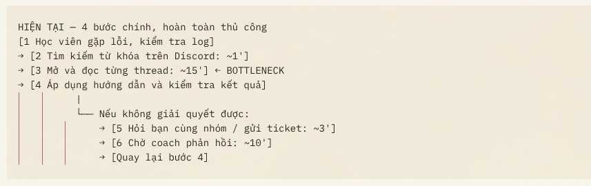
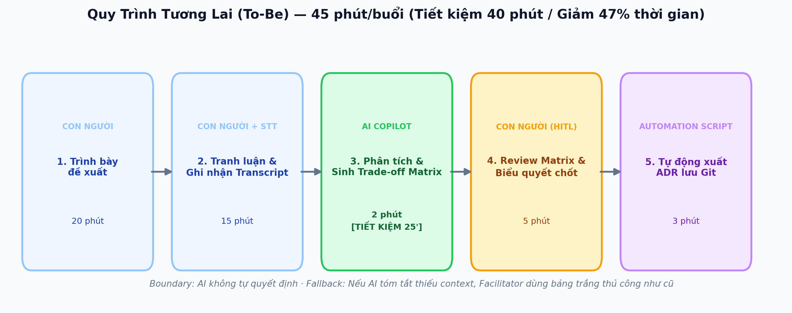

# Báo cáo nhóm — Day 02 Discovery & Problem Framing

> Bản chung của nhóm, viết trên repo do nhóm trưởng fork. Không copy file này sang repo cá nhân.
> Template chi tiết và prompt mẫu: [docs/01-worksheet.md](../../docs/01-worksheet.md). Bài mẫu: [docs/02-deliverable-example.md](../../docs/02-deliverable-example.md).

## 1. Thông tin nhóm

- Tên nhóm:
- Thành viên: xem `TEAM.md`
- Candidate problem được chọn (1 câu): Tìm lại câu trả lời cũ của coach trong Discord
- Quyết định cuối: Go / Not Yet / No-Go

---

## 2. Hội tụ nhóm (CP3)

### 2.1. Pitch

|   # | Người đưa ra      | Candidate (Job Story ngắn)                                                                                                                                                                                                                                        | Actor                                      | Bottleneck                                                                                                                                                                                                                        | Câu hỏi phản biện nhận được (ai hỏi)                                                                                                                           |
| --: | ----------------- | ----------------------------------------------------------------------------------------------------------------------------------------------------------------------------------------------------------------------------------------------------------------- | ------------------------------------------ | --------------------------------------------------------------------------------------------------------------------------------------------------------------------------------------------------------------------------------- | -------------------------------------------------------------------------------------------------------------------------------------------------------------- |
|   1 | Minh Đức          | Khi viết báo cáo tuần tôi muốn tổng hợp các kết quả số liệu theo đúng format để mang trình bày, báo cáo kịp giờ và dễ đọc                                                                                                                                         | Sinh viên làm đồ án, thành viên phát triển | Viết ngắn gọn ~ 30 phút<br/>Vẽ sơ đồ ~ 30 phút<br/>Review và format ~ 30 phút                                                                                                                                                     |                                                                                                                                                                |
|   2 | Minh Đức          | Khi tham gia họp online, tôi muốn một danh sách các ý chính, công việc để tham khảo lại                                                                                                                                                                           | Thành viên trong nhóm, Team Lead, Thư ký   | Tổng hợp theo tài liệu, theo dõi và ghi lại, thường mất 30 phút để thống nhất lại                                                                                                                                                 |                                                                                                                                                                |
|   3 | Minh Đức          | Khi trước và sau các buổi học, tôi muốn tự động gom tất cả slide bài giảng, bài tập và tài liệu tham khảo từ các kênh rải rác về một thư mục duy nhất trên máy, để tiết kiệm thời gian tra cứu và không bị bỏ sót tài liệu được cập nhật.                         | Sinh viên                                  | Truy cập vào mỗi trang và tải tài liệu mất 10-15 phút, mất 10-15 phút để sắp xếp và đặt tên                                                                                                                                       |                                                                                                                                                                |
|   4 | Quý Anh           | Khi chuẩn bị nộp báo cáo dự án/bài lab, tôi muốn biết bài còn thiếu mục nào so với yêu cầu, để không bị trừ điểm vì thiếu nội dung                                                                                                                                | Học viên                                   | Bước đối chiếu từng mục với yêu cầu nằm rải ở nhiều file (~30 phút/lần, 2 lần/tuần)                                                                                                                                               |                                                                                                                                                                |
|   5 | Quý Anh           | Khi gặp lại lỗi hệ thống đã từng được hỏi, tôi muốn tìm lại câu trả lời của coach, để không phải hỏi lại                                                                                                                                                          | Học viên                                   | Bước mở từng thread Discord để đọc (~15 phút/lần, 2 lần/tuần)                                                                                                                                                                     |                                                                                                                                                                |
|   6 | Quý Anh           | Khi tới buổi họp nhóm hằng tuần, tôi muốn nhớ lại lần trước đã chốt gì, để bắt đầu làm tiếp ngay                                                                                                                                                                  | Nhóm học viên làm dự án chung              | Bước lục tin nhắn và hỏi qua lại (~20 phút/buổi, 1 buổi/tuần)                                                                                                                                                                     |                                                                                                                                                                |
|   7 | Việt Anh          | Khi ca sáng mở ra 35 hồ sơ mới, tôi muốn biết hồ sơ nào vượt hạn mức và cái khoản nào không khớp điều khoản bảo hiểm, để quyết định duyệt hay từ chối mà không trả nhầm tiền khách hàng                                                                           | nhân viên giám sát hồ sơ bồi thường        | Bước 3 trong quy trình 5 bước — đối chiếu từng khoản với hạn mức và điều khoản: 3 phút/hồ sơ. Tức ~105 phút/ngày, ~39 giờ/tháng/người. Đây là bước duy nhất quyết định tiền thật cho khách — sai ở đây thì công ty trả nhầm tiền. |                                                                                                                                                                |
|   8 | Việt Anh          | Khi đã đối chiếu xong, tôi muốn hệ thống tự điền số tiền bồi thường, hạn mức còn lại và ngày trả tiền, để không phải chép tay rồi tự tính lại một lần nữa.                                                                                                        | nhân viên giám sát hồ sơ bồi thường        | Bước 3, chép số vào form, mất 1 phút mỗi hồ sơ (35 phút/ngày). Bước này ít thời gian nhất nhưng rủi ro nặng nhất, vì dễ nhập sai và lỗi chỉ lộ ra sau khi đã trả tiền cho khách.                                                  |                                                                                                                                                                |
|   9 | Việt Anh          | Khi khách gọi hỏi hồ sơ của họ đang ở bước nào, tôi muốn bộ phận CSBH tra được ngay trạng thái và mốc trả tiền, để khách không phải chờ rồi gọi lại lần hai                                                                                                       | Nhân viên chăm sóc và hỗ trợ khách hàng    | Bước 2, tra cứu trong Claims Core, mất 3 phút mỗi cuộc gọi (tìm mã hồ sơ rồi mở từng mục lịch sử). 25 cuộc gọi/ngày × 8 phút, tức 3 giờ/ngày, 66 giờ/tháng.                                                                       |                                                                                                                                                                |
|  10 | Nguyễn Thanh Tùng | Khi khởi tạo một dự án hoặc tính năng mới trên Jira, tôi muốn tự động sinh ra sẵn bộ sub-task chuẩn, để không phải tạo thủ công từng task cho mỗi đầu việc lặp lại hằng tuần.                                                                                     | PM                                         | Tạo thủ công hàng loạt sub-task (15-20 phút/lần)                                                                                                                                                                                  | Bài toán hoàn toàn giải được bằng Jira Automation có sẵn; quy trình đề xuất bị gượng ép và đo lường "về 0 phút" là vô lý vì PM vẫn phải rà soát, gán người.    |
|  11 | Nguyễn Thanh Tùng | Khi cần làm báo cáo tiến độ dự án hằng tuần cho CEO, tôi muốn các biểu đồ tiến độ từ Power BI và số liệu task từ Jira được gom chung vào một khung nhìn thống nhất, để không phải mở luân phiên nhiều tab, chụp màn hình và căn chỉnh lại slide Excel/PowerPoint. | PM                                         | Tổng hợp và formatting thủ công (45 phút/lần)                                                                                                                                                                                     | Đây thuần túy là sự cố tích hợp dữ liệu và thiết kế dashboard kém; chỉ cần nhúng connector/embed link là xong chứ không cần quy trình phức tạp hay AI.         |
|  12 | Nguyễn Thanh Tùng | Khi các bạn Dev chuẩn bị bắt đầu sprint mới, tôi muốn các ticket được giao có sẵn phần mô tả tiêu chí nghiệm thu rõ ràng từ BA/PO, chuẩn chỉnh, để họ không phải liên tục ping PM hỏi lại yêu cầu làm gián đoạn tập trung.                                        | Dev, PM, BA/PO                             | Làm rõ yêu cầu chưa chuẩn chỉnh (3-5 lần hỏi/sprint)                                                                                                                                                                              | Gốc rễ nằm ở chất lượng đầu vào của PRD sơ sài; đặt mục tiêu "0 lần hỏi" là không thực tế và nếu PM dùng AI thả context ẩu sẽ khiến AI tự "chế" sai nghiệp vụ. |
|  13 | Giang Thái Sơn    | Khi mới vào công ty, tôi muốn nắm rõ quy trình onboarding và môi trường làm việc để sớm bắt đầu công việc được giao.                                                                                                                                              | Fresher AI                                 | Tài liệu onboarding phân tán, phải hỏi mentor nhiều lần.                                                                                                                                                                          |                                                                                                                                                                |
|  14 | Giang Thái Sơn    | Khi tiếp nhận dự án mới, tôi muốn hiểu kiến trúc hệ thống và các công nghệ đang sử dụng để có thể tự thực hiện task.                                                                                                                                              | Fresher AI                                 | Phải đọc nhiều tài liệu và mã nguồn, khó xác định kiến thức cần ưu tiên                                                                                                                                                           |                                                                                                                                                                |
|  15 | Giang Thái Sơn    | Khi gặp vấn đề kỹ thuật chưa biết cách xử lý, tôi muốn tìm được kiến thức và hướng dẫn phù hợp để tự giải quyết trước khi nhờ mentor.                                                                                                                             | Fresher AI                                 | Khó tìm đúng tài liệu, mất thời gian thử nhiều hướng xử lý.                                                                                                                                                                       |                                                                                                                                                                |

### 2.2. Cluster

| Cluster | Các candidate | Pattern chung |
|---|---|---|
| A - Báo cáo / tổng hợp | #1, #2, #11 | Tổng hợp dữ liệu/số liệu từ nhiều nguồn để làm báo cáo định kỳ hoặc chốt ý chính, mất nhiều thời gian format và xử lý thủ công. |
| B - Tìm kiếm | #3, #5, #13, #14, #15 | Khó khăn trong việc tìm kiếm, gom nhóm tài liệu rải rác, tìm lại lỗi/câu trả lời cũ, tra cứu kiến thức kỹ thuật và tài liệu onboarding phân tán. |
| C - Review | #4, #7, #8, #12 | Rà soát, đối chiếu thông tin với quy định/chuẩn mực để đảm bảo chính xác và không bỏ sót lỗi. |
| D - Theo dõi việc | #6, #9, #10 | Theo dõi trạng thái công việc, tiến độ xử lý hồ sơ, lịch sử cuộc gọi hoặc tự động thiết lập cấu trúc công việc, ghi nhớ các nội dung đã chốt từ các buổi họp trước. |

### 2.3. Opportunity Solution Tree rút gọn

Gốc là **1 outcome**. Nhánh là **opportunity** (nhu cầu, pain), không phải tính năng hay công cụ.

```text
OUTCOME: Giảm thời gian học viên tìm kiếm và xử lý lỗi hệ thống, hạn chế việc phải hỏi lại coach
├── Opportunity A: Lịch sử câu hỏi và hướng dẫn sửa lỗi nằm rải rác trên các thread Discord, khó tìm từ khóa chính xác 
├── Opportunity B: Mất nhiều thời gian đọc dọc các thread dài để chọn ra đúng hướng dẫn phù hợp 
└── Opportunity C: Học viên không chắc chắn hướng dẫn cũ có áp dụng được cho phiên bản lỗi hiện tại hay không 
```

Những ý đã gạch bỏ vì là solution đội lốt opportunity:

- X "Vector DB / Bot hỏi đáp nội bộ" ← solution, gạch khỏi tầng này
- X "AI tóm tắt lịch sử thread Discord" ← solution, gạch khỏi tầng này

### 2.4. Chấm điểm shortlist (1–5)

| Candidate | Actor rõ | Quy trình rõ | Pain có bằng chứng | Impact đo được | Vừa sức lab | So sánh được No AI/Rule/Workflow/Agent | Nhóm hiểu domain | Tổng |
|---|---:|---:|---:|---:|---:|---:|---:|---:|
| Tìm lại câu trả lời cũ của coach trong Discord | 4 | 4 | 3 | 3 | 5 | 5 | 5 | 29 |
| Gom Power BI và Jira vào một khung nhìn báo cáo tiến độ | 4 | 5 | 4 | 4 | 4 | 3 | 3 | 27 |
| Nắm quy trình onboarding khi mới vào công ty | 4 | 3 | 2 | 2 | 4 | 3 | 4 | 23 |

**Candidate được chọn:** Tìm lại câu trả lời cũ của coach trong Discord

**Vì sao chọn:** Bài này còn câu hỏi thật để kiểm chứng và ai cũng đã từng hỏi lại coach.

**Vì sao loại các candidate còn lại:** Gom Power BI và Jira vào một khung nhìn có lời giải đã rõ là chỉ cần nhúng connector, không còn câu hỏi để nghiên cứu, và nhóm không dùng Power BI hằng ngày nên khó kiểm chứng. Nắm quy trình onboarding có actor rõ nhưng chưa vẽ được quy trình, chưa có số lần hỏi mentor, và onboarding chỉ xảy ra một lần nên khó đo tác động.

**Xử lý bất đồng (nếu có):** có bên cho rằng "Gom Power BI và Jira" có impact lớn hơn, không nên loại chỉ vì lời giải dễ thấy. Nhóm chốt giữ "Tìm lại câu trả lời cũ của coach" vì bài này còn câu hỏi thật để kiểm chứng và ai cũng đã từng hỏi lại coach; ghi hai candidate kia vào mục hướng tiếp theo.

---

## 3. Kiểm chứng + research giải pháp đã có (CP4)

### 3.1. Assumption Map

| # | Giả định | Loại (Value / Usability / Feasibility / Viability) | Quan trọng (1–5) | Đã có bằng chứng (1–5) | Kiểm chứng trước? |
|---:|---|---|---:|---:|---|
| 1 | Học viên ngoài nhóm cũng gặp lại lỗi đã từng được hỏi và mất ≥ 10 phút mỗi lần tìm lại câu trả lời, ít nhất 1 lần/tuần | Value | 5 | 2 | Phỏng vấn 3 học viên nhóm khác |
| 2 | Hơn một nửa thời gian mỗi lần tìm nằm ở bước mở từng thread để đọc, không phải ở bước gõ từ khóa hay bước chờ coach | Value | 5 | 2 | Đếm 2 kênh log gần nhất |
| 3 | Phần lớn lỗi bị hỏi lại đã có câu trả lời cũ trong Discord, chủ yếu do coach trả lời, tức là có dữ liệu để tìm | Feasibility | 4 | 2 | Thử trên log |
| 4 | Khi thấy câu trả lời cũ có nguồn từ coach (qua search, FAQ hay AI), học viên tự làm theo, không hỏi lại coach để xác nhận | Usability | 4 | 1 | |


### 3.2. Kiểm chứng

Cách đã dùng: Interview

Interview snapshot (mỗi buổi phỏng vấn một bảng, hoặc đặt file trong `report/assets/cp4-interview-snapshot-N.md`):

| Trường                                            | Nội dung                                                   |
| ------------------------------------------------- | ---------------------------------------------------------- |
| Người được hỏi (vai trò, không ghi tên thật)      | Học viên lớp L3B                                           |
| Câu nói đáng nhớ nhất (nguyên văn)                | Tìm kiếm trên Discord nhưng không thấy, hỏi bot không được |
| Lần gần nhất gặp vấn đề này: chuyện gì đã xảy ra? | Nộp nhầm bài trên hệ thống LMS                             |
| Hiện đang xử lý bằng cách nào (workaround)?       | Hỏi lab coach bằng cách tạo ticket                         |
| Mất bao lâu, bao lần?                             | Mất tầm 10 phút, 2 lần                                     |
| Insight / opportunity rút ra                      | Tìm kiếm hay đợi người trả lời dẫn tới delay               |

Tổng hợp:

| Nguồn | Số người / số mẫu | Tín hiệu xác nhận | Tín hiệu phản bác |
|---|---:|---|---|
| Phỏng vấn | 2 người | Học viên bị mất thời gian khi tìm kiếm cách giải quyết vấn đề hay đợi coach xử lý | Một vài vấn đề áp dụng thread cũ vẫn xử lý được. |

**Nhóm đã sửa problem thế nào sau kiểm chứng:**
Sử dụng AI chat bot kết hợp RAG document, thread cũ và tự động chuyển ticket lên.

### 3.3. Research giải pháp đã có

| Công cụ / case / pattern | Link                                                                                    | Giải bước nào trong quy trình? | Điểm mạnh                                                                          | Khoảng trống / rủi ro                                                              | Bài học cho nhóm                             |
| ------------------------ | --------------------------------------------------------------------------------------- | ------------------------------ | ---------------------------------------------------------------------------------- | ---------------------------------------------------------------------------------- | -------------------------------------------- |
| Tìm kiếm trong Discord   | https://support.discord.com/hc/en-us/articles/115000468588-How-to-Use-Search-on-Discord | Bước tìm kiếm theo từ khoá     | Có sẵn trong Discord, tốc độ nhanh, miễn phí                                       | Chỉ tìm theo từ khoá chính xác, nếu học viên mô tả không chính xác thì sẽ không ra | Người dùng                                   |
| Discord Forum gom nhóm   | https://docs.discord.com/developers/intro                                               | Gom các ca lỗi theo chủ đề     | Tốc độ nhanh, tính năng có sẵn, tìm kiếm theo keyword nếu diễn đạt không chính xác | Phụ thuộc vào việc thiết kế tag và gán tag của các bài viết trước                  | Gom nhóm các vấn đề cũ giúp tìm kiếm tốt hơn |
| Chat Bot hỏi đáp         | https://docs.discord.com/developers/bots/overview                                       | Bước tìm kiếm lỗi và giải đáp  | Có khả năng hiểu ngữ nghĩa của người dùng                                          | Có thể hallucinate                                                                 | Sử dụng LLM không có thể dẫn đến hallucinate |

---

## 4. Quy trình trước/sau (CP5)

### 4.1. Quy trình hiện tại

Sơ đồ (ASCII, Mermaid hoặc link ảnh trong `report/assets/`):



```text
HIỆN TẠI — 4 bước chính, hoàn toàn thủ công
[1 Học viên gặp lỗi, kiểm tra log]
→ [2 Tìm kiếm từ khóa trên Discord: ~1']
→ [3 Mở và đọc từng thread: ~15'] ← BOTTLENECK
→ [4 Áp dụng hướng dẫn và kiểm tra kết quả]
          |
          └── Nếu không giải quyết được:
              → [5 Hỏi bạn cùng nhóm / gửi ticket: ~3']
              → [6 Chờ coach phản hồi: ~10']
              → [Quay lại bước 4]
```

| Bước | Actor | Input | Output | Thời gian / tần suất | Ghi chú |
| ---: | ----- | ----- | ------ | -------------------- | ------- |
| 1. Xác định lỗi | Học viên | Log, thông báo lỗi | Mô tả lỗi cần xử lý | Chưa đo | |
| 2. Tìm kiếm | Học viên | Từ khóa lỗi | Danh sách thread liên quan | ~1 phút | |
| 3. Đọc thread | Học viên | Các thread Discord | Câu trả lời có khả năng phù hợp | ~15 phút | |
| 4. Kiểm tra và áp dụng | Học viên | Hướng dẫn tìm được | Kết quả xử lý lỗi | Chưa đo | |
| 5. Gửi câu hỏi (nếu cần) | Học viên | Log, mô tả lỗi | Ticket hoặc câu hỏi | ~3 phút | |
| 6. Phản hồi (nếu cần) | Coach | Ticket, câu hỏi | Hướng dẫn xử lý | ~10 phút chờ | |

**Bottleneck chính:** Bước 3 — học viên phải mở và đọc nhiều thread vì câu trả lời phân tán, từ khóa tìm kiếm không thống nhất và hướng dẫn cuối cùng của coach có thể nằm giữa nhiều tin nhắn.  
**Tần suất:** Khoảng 2 lần/tuần. Riêng bước đọc thread chiếm khoảng 30 phút/tuần/học viên.  
**Handoff:** Nếu không tự giải quyết được, học viên chuyển vấn đề cho bạn cùng nhóm hoặc coach.

### 4.2. Quy trình tương lai

Ghi rõ bước nào **Rule**, bước nào **AI**, bước nào **con người**, **boundary** ở đâu, **phương án quay về** khi AI sai.



```text
TƯƠNG LAI — 3 bước, khoảng 8 phút/lần (mục tiêu)
[1 Nhập mô tả lỗi và truy xuất thread: 1']
    ← HỌC VIÊN + RULE/SEARCH
    Input: lỗi, log, lịch sử Discord
    Output: các thread liên quan
→ [2 Tổng hợp hướng dẫn xử lý: 2']
    ← AI (RAG / AI Search)
    Input: các thread đã truy xuất
    Output: hướng dẫn + link nguồn gốc
→ [3 Kiểm tra và áp dụng hướng dẫn: 5']
    ← CON NGƯỜI (HITL)
    Input: hướng dẫn, link Discord
    Output: kết quả sửa lỗi
BOUNDARY:
- AI chỉ tổng hợp từ dữ liệu được cấp quyền.
- Không bịa cách sửa lỗi hoặc mạo nhận coach.
- Không tự chạy lệnh, sửa code hoặc đóng ticket.
- Không đọc DM trái phép hay lưu API key, mật khẩu.
- Học viên phải kiểm tra hướng dẫn trước khi áp dụng.
- Chỉ coach xác nhận câu trả lời chính thức.
PHƯƠNG ÁN QUAY VỀ:
AI không tìm thấy nguồn / trả lời sai / ngừng hoạt động
→ Học viên tìm kiếm thủ công trên Discord.
→ Nếu vẫn không giải quyết được, hỏi coach
  kèm thông tin lỗi và các bước đã thử.
```

| Bước | Actor / Cơ chế | Input | Output | Thời gian mục tiêu | Ghi chú |
| ---: | -------------- | ----- | ------ | ------------------ | ------- |
| 1. Truy xuất | Học viên + Rule/Search | Mô tả lỗi, log đã loại thông tin nhạy cảm | Danh sách thread liên quan | 1 phút | |
| 2. Tổng hợp | AI (RAG) | Thread, câu trả lời cũ | Hướng dẫn có dẫn nguồn | 2 phút | |
| 3. Kiểm chứng và áp dụng | Học viên | Hướng dẫn, nguồn gốc | Kết quả xử lý lỗi | 5 phút | |

- **AI Intervention Point:** Bước 2 — AI hỗ trợ tổng hợp thông tin từ các thread được truy xuất, không tự quyết định hoặc thực hiện cách sửa lỗi.
- **Human-in-the-Loop:** Học viên đối chiếu hướng dẫn với lỗi thực tế và kiểm tra kết quả sau khi áp dụng.
- **Handoff:** Hệ thống chuyển hướng dẫn cho học viên kiểm chứng. Những trường hợp không giải quyết được sẽ được học viên chuyển cho coach.

### 4.3. Before / after

| Chỉ số         |                                    Trước |                                                     Sau (kỳ vọng) | Ghi chú                                                                                     |
| -------------- | ---------------------------------------: | ----------------------------------------------------------------: | ------------------------------------------------------------------------------------------- |
| Số bước        | 4 bước chính, thêm 2 bước khi cần hỗ trợ |                                                            3 bước | Rút gọn quy trình nhờ tìm kiếm và tổng hợp thông tin tự động.                               |
| Tổng thời gian |                           Chưa đo đầy đủ |                                                 Khoảng 8 phút/lần | Mục tiêu chính: thời gian tìm được hướng dẫn phù hợp ≤ 3 phút.                              |
| Bước thủ công  |                           4/4 bước chính |                               1/3 hoàn toàn thủ công, 1/3 kết hợp | Học viên vẫn nhập mô tả lỗi, kiểm tra và áp dụng hướng dẫn.                                 |
| Bottleneck     |         Mở và đọc từng thread (~15 phút) |                            Học viên kiểm tra và áp dụng (~5 phút) | Bước kiểm tra vẫn cần thiết để đảm bảo hướng dẫn phù hợp và an toàn.                        |
| Rủi ro mới     |                                        — | AI tổng hợp sai ngữ cảnh, hướng dẫn lỗi thời, truy xuất sai nguồn | Kiểm soát bằng dẫn nguồn Discord, Human-in-the-Loop và phương án quay về tìm kiếm thủ công. |

---

## 5. Problem Statement v0 (CP5)

| Trường | Nội dung |
|---|---|
| **Actor** | Học viên gặp lỗi kỹ thuật khi làm bài / học, là lab coach / mentor phải trả lời thủ công. |
| **Quy trình** | Học viên gặp vấn đề.<br/>Học viên tìm kiếm trong chat cũ về câu hỏi và trả lời của vấn đề.(1 phút)<br/>Học viên dán log hoặc chụp màn hình cho trợ lý bot hoặc tạo ticket. (3 phút)<br/>Học viên phải đợi trả lời của lab coach về vấn đề hiện có. (10 phút) |
| **Bottleneck** | Bước 2, tìm lại trong chat cũ. Từ khóa tìm kiếm thường không khớp cách người trước mô tả lỗi, nên học viên phải mở từng thread để đọc. Câu trả lời cuối của coach nằm lẫn giữa nhiều tin nhắn thử–sai và không được đánh dấu. Bước này mất ~15 phút/lần. Nếu không tìm ra, quy trình rơi sang bước 3–4: hỏi lại và chờ coach. |
| **Impact** | Phía học viên: ~15 phút/lần × 2 lần/tuần ≈ 30 phút/tuần/người. Khi phải hỏi lại, học viên bị chặn, không làm tiếp lab được trong lúc chờ. Phía coach: phải trả lời lại câu đã từng trả lời |
| **Success Metric** (baseline → target, cách đo) | Thời gian từ lúc bắt đầu tìm đến lúc có cách sửa: baseline ~15 phút/lần → target < 3 phút/lần. Cách đo: ≥ 3 học viên tự bấm giờ mỗi lần tìm, trong 2 tuần. |
| **Boundary** (AI không được làm gì; khi nào cần con người kiểm tra — HITL) | AI không được trả lời thay coach khi chưa có coach duyệt. AI không được tự đánh dấu câu hỏi là "đã giải". AI không được đọc kênh riêng hoặc DM, và không được giữ lại log hay ảnh chụp có API key, mật khẩu. HITL: học viên tự kiểm cách sửa trước khi chạy lệnh trên máy mình; chỉ coach xác nhận câu trả lời nào đúng. |

Phản biện nhận được (từ AI hoặc nhóm khác) và nhóm có đồng ý không:

- **AI: Quy trình thiếu bước**
  - Thiếu đường hỏi bạn cùng nhóm: đây thường là cách xử lý phổ biến.
  - Thiếu bước áp dụng cách sửa: tìm thấy câu trả lời rồi vẫn phải chạy thử. Nếu câu trả lời đã cũ (đợt lab trước, thư viện đã đổi phiên bản), học viên mất thêm thời gian, mà quy trình chưa tính.

---

## 6. Mức can thiệp AI (CP6)

### 6.1. Ma trận độ mơ hồ × độ phức tạp

Bài của nhóm nằm ở ô:

Vì sao:

### 6.2. So sánh 4 mức

| Mức | Phương án cho bài của nhóm | Đủ khi nào | Rủi ro | Chọn? |
|---|---|---|---|---|
| **No AI** (sửa quy trình) | | | | |
| **Rule** | | | | |
| **Workflow** | | | | |
| **Agent** | | | | |

**Mức chọn:**

**Vì sao không chọn mức đơn giản hơn:**

### 6.3. AI Canvas rút gọn

| Thành phần | Nội dung |
|---|---|
| **Prediction** — AI dự đoán / tạo ra gì? | |
| **Judgment** — con người cân nhắc, quyết định gì? | |
| **Action** — hành động cuối cùng là gì, ai làm? | |
| **Outcome** — đo kết quả bằng gì? | |
| **Input** — AI cần dữ liệu đầu vào gì mỗi lần chạy? Có sẵn không? | |
| **Feedback** — lấy phản hồi ở đâu để cải thiện? | |

### 6.4. Hai câu hỏi của Google PAIR

- Người dùng muốn **được hỗ trợ (augment)** hay **giao hẳn việc (automate)**? Bằng chứng:
- AI sai kiểu nào tệ hơn, **báo nhầm** hay **bỏ sót**? Vì sao, và thiết kế đã xử lý thế nào:

---

## 7. Problem Statement v1 + tiêu chí đánh giá (CP6)

| Trường | Nội dung |
|---|---|
| **Actor** | |
| **Quy trình** | |
| **Bottleneck** | |
| **Impact** | |
| **Success Metric** (baseline → target, cách đo) | |
| **Boundary** | |
| **AI intervention point** | |
| **Mức chọn** | No AI / Rule / Workflow / Agent |
| **Rủi ro & người kiểm tra** | |

**Thay đổi so với v0 và lý do:**

| Trường | v0 | v1 | Vì sao đổi |
|---|---|---|---|
| | | | |

**Tiêu chí đánh giá đầu ra của AI (3–5 tiêu chí):**

| # | Tiêu chí | Đạt khi | Không đạt khi |
|---:|---|---|---|
| 1 | | | |
| 2 | | | |
| 3 | | | |

---

## 8. Quyết định (CP6)

### 8.1. Bốn rủi ro

| Rủi ro | Câu hỏi | Mức độ rủi ro (Thấp = an toàn / TB / Cao = nguy hiểm) | Lý do / bằng chứng |
|---|---|---|---|
| **Value** | Người dùng có thật sự cần và sẽ dùng không? | | |
| **Usability** | Người dùng có dùng được, có hiểu và sửa được đầu ra của AI không? | | |
| **Feasibility** | Có đủ dữ liệu, công cụ, kỹ năng để làm không? | | |
| **Viability** | Có hợp chi phí, pháp lý, quy định tổ chức không? Ai vận hành? | | |

### 8.2. Kết luận

**Quyết định:** Go / Not Yet / No-Go

**Lý do:**

**Nếu Go — pilot nhỏ nhất:**

**Nếu Not Yet — cần kiểm chứng gì trước:**

**Nếu No-Go — nên làm gì thay AI:**

**Ngưỡng dừng** (nếu sau … mà … thì quay về …):

---

## 9. Hạn chế và hướng tiếp theo

-

## 10. Tài liệu tham khảo

-
