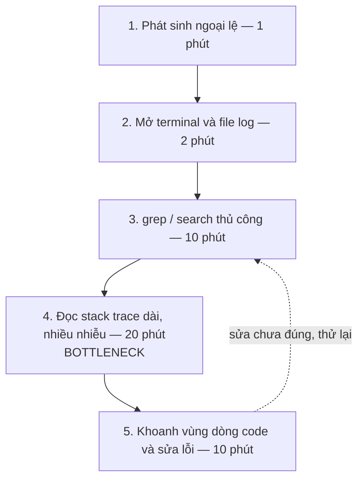
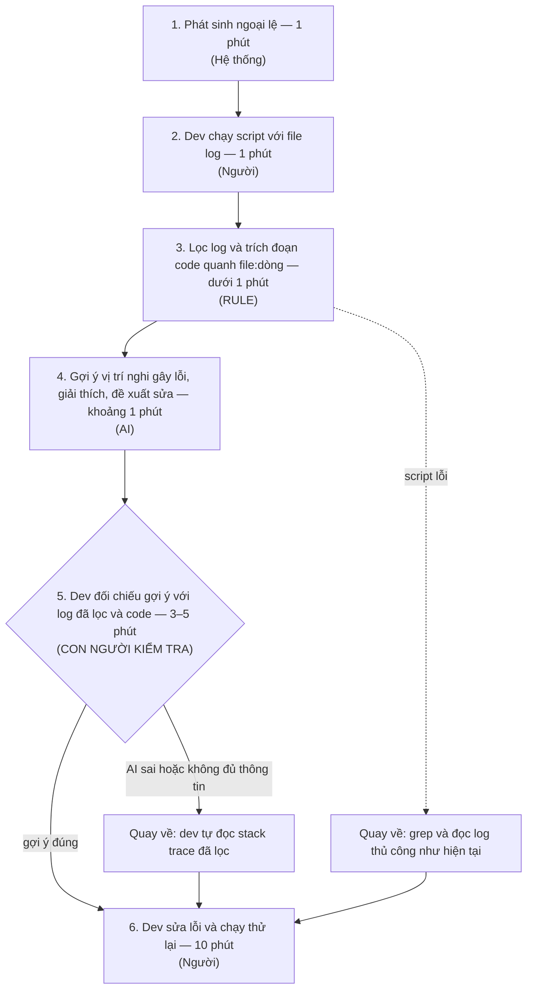

# Báo cáo nhóm — Day 02 Discovery & Problem Framing

> Bản chung của nhóm, viết trên repo do nhóm trưởng fork. Không copy file này sang repo cá nhân.
> Template chi tiết và prompt mẫu: [docs/01-worksheet.md](../../docs/01-worksheet.md). Bài mẫu: [docs/02-deliverable-example.md](../../docs/02-deliverable-example.md).

## 1. Thông tin nhóm

- Tên nhóm: BDHH
- Thành viên: xem `TEAM.md`
- Candidate problem được chọn (1 câu): 
- Quyết định cuối: Go / Not Yet / No-Go

---

## 2. Hội tụ nhóm (CP3)

### 2.1. Pitch

| # | Người đưa ra | Candidate (Job Story ngắn) | Actor | Bottleneck | Câu hỏi phản biện nhận được (ai hỏi) |
|---:|---|---|---|---|---|
| 1 | [Bình] | **CV theo vai trò:** Khi ứng tuyển các vai trò khác nhau (Fullstack, QA/Tester, BA), tôi muốn CV nhấn đúng dự án liên quan từng vai trò, để nhà tuyển dụng thấy mình phù hợp. | Sinh viên CS năm cuối ứng tuyển đồng thời 2–3 vai trò (Fullstack, QA/Tester, BA), có 5+ repo đồ án cũ chưa đưa lên CV. | **Bước 3:** Lục lại code/commit/test của đồ án cũ để tìm bằng chứng kỹ thuật có thật (số API, test case, cấu hình, benchmark) — mất ~30 phút/bản (trong tổng ~95 phút) vì quên chi tiết và thiếu sẵn metric. | *(Gợi ý câu hỏi dễ gặp: Nếu đã lập file "Master Project Log" ghi sẵn số liệu chỉ mất 2 phút copy thì có thực sự cần AI nữa không, hay chỉ cần 3 bản CV mẫu cố định cho 3 role?)* |
| 2 | [Bình] | **Review sơ đồ PlantUML:** Khi review bộ sơ đồ sequence PlantUML trước khi chốt báo cáo, tôi muốn biết sơ đồ nào sai mã hóa hoặc lệch luồng xử lý so với code, để không nộp sơ đồ mâu thuẫn với hệ thống thật. | Sinh viên làm đồ án cá nhân (6 sprint), viết báo cáo dùng PlantUML (`.puml`) cho ≥10 nhóm chức năng và sửa code backend nhiều đợt trước khi nộp. | **Bước 2:** Mở 3–4 file code (`Controller`/`Service`) đối chiếu thủ công luồng gọi hàm, truy vấn DB và trạng thái trả về với từng file `.puml` — mất ~25 phút/đợt (~2.5 phút × 10 sơ đồ, trên tổng ~60 phút/đợt) và dễ sót lỗi. | *(Gợi ý câu hỏi dễ gặp: Tần suất chỉ 2–3 đợt/học kỳ thì ROI của việc đưa vào AI có đáng không, hay dùng checklist cố định 4 lỗi + script bắt lỗi UTF-8 là đủ?)* |
| 3 | [Bình] | **Kiểm báo cáo lab trước khi nộp:** Khi nộp báo cáo lab (`.md`) lúc gần deadline, tôi muốn biết mình còn bỏ trống mục nào hoặc ghi lệch số liệu nào so với lần chạy notebook cuối, để không bị trừ điểm vì sai sót hình thức. | Sinh viên học môn AI/ML làm báo cáo `.md` tách rời khỏi file `.ipynb`, hay chạy lại thực nghiệm sát giờ nộp làm thay đổi tham số/kết quả. | **Bước 3:** Đối chiếu thủ công số liệu (`SEED`, tham số, kết quả) giữa báo cáo `.md` và output cell của `.ipynb` — mất ~7 phút/bài (trên tổng ~20 phút/bài, micro-pain), dễ sót khi chạy lại notebook phút chót. | *(Gợi ý câu hỏi dễ gặp: Pain chỉ mất ~7 phút và kiểm tra đúng/sai tường minh, tại sao không chốt chạy xong `.ipynb` rồi mới điền kèm regex quét ô trống thay vì dùng AI?)* |
| 4 | | | | | |
| 5 | | | | | |
| 6 | | | | | |
| 7 | | | | | |
| 8 | | | | | |
| 9 | | | | | |
| 10 | | | | | |
| 11 | | | | | |
| 12 | | | | | |

---

### 2.2. Cluster

| Cluster | Các candidate | Pattern chung |
|---|---|---|
| **A (Cluster 1)** | - CV theo vai trò (Problem Card #1)<br>- Báo cáo tiến độ tuần (Ảnh #1)<br>- Meeting notes & Phân công công việc (Ảnh #3) | **Báo cáo & Tổng hợp thông tin đa nguồn (Information Synthesis & Reporting):** Dữ liệu đầu vào nằm rải rác ở nhiều nơi hoặc từ nhiều người. Con người mất nhiều thời gian đọc lướt, trích lọc, cấu trúc lại và tổng hợp thành văn bản hoàn chỉnh theo một định dạng chuẩn. |
| **B (Cluster 2)** | - Review sơ đồ PlantUML (Problem Card #2)<br>- Kiểm tra báo cáo lab trước khi nộp (Problem Card #3)<br>- Deploy code sai cấu hình (Candidate gốc) | **Đối chiếu chéo & Kiểm tra tính nhất quán (Consistency Checking & Verification):** Cần so sánh thủ công giữa hai hoặc nhiều nguồn thông tin (đặc tả và mã nguồn, cấu hình và môi trường, báo cáo và kết quả thực tế) để phát hiện sai lệch, thiếu sót hoặc những điểm không nhất quán. |
| **C (Cluster 3)** | - Debug lỗi log hệ thống (Candidate gốc)<br>- Thành viên báo lỗi thiếu log (Candidate gốc)<br>- Đọc tóm tắt bài báo nghiên cứu mới (Ảnh #2)<br>- Tìm tài liệu học tập phù hợp (Ảnh #5, #6)<br>- Tự sửa lỗi bài tập ngoài giờ (Ảnh #4) | **Thu thập, Sàng lọc & Gỡ lỗi kỹ thuật (Debugging & Information Retrieval):** Đối mặt với khối lượng dữ liệu lớn hoặc nhiễu (log dài, nhiều bài báo, tài liệu học tập hoặc thông tin lỗi). Con người cần nhanh chóng tìm kiếm, sàng lọc, khoanh vùng thông tin liên quan và xác định nguyên nhân cốt lõi để đưa ra hướng xử lý phù hợp. |

### 2.3. Opportunity Solution Tree rút gọn

Gốc là **1 outcome**. Nhánh là **opportunity** (nhu cầu, pain), không phải tính năng hay công cụ.

```text
OUTCOME: 
├── Opportunity A: 
├── Opportunity B: 
└── Opportunity C: 
```

Những ý đã gạch bỏ vì là solution đội lốt opportunity:

-

### 2.4. Chấm điểm shortlist (1–5)

| Candidate | Actor rõ | Quy trình rõ | Pain có bằng chứng | Impact đo được | Vừa sức lab | So sánh được No AI/Rule/Workflow/Agent | Nhóm hiểu domain | Tổng |
|---|---:|---:|---:|---:|---:|---:|---:|---:|
| | | | | | | | | |
| | | | | | | | | |
| | | | | | | | | |

**Candidate được chọn:**

**Vì sao chọn:**

**Vì sao loại các candidate còn lại:**

**Xử lý bất đồng (nếu có):**

---
# 3. Kiểm chứng + research (CP4)

**Bài toán ban đầu (Problem #1):** Debug lỗi từ file log hệ thống.

- **Job Story:** Khi gặp lỗi kết nối CSDL hoặc lỗi logic lúc viết backend, tôi muốn truy ra đúng dòng gây lỗi từ file log, để không phải thử sửa mò nhiều lần.
- **Quy trình hiện tại (6 bước):** `[1. Chạy code / gặp lỗi]` → `[2. Mở file log / console]` → `[3. Đọc dò stack trace & lọc nhiễu]` *(bottleneck theo ước tính của nhóm: 20–30 phút/lần)* → `[4. Mở các file code nghi ngờ để đối chiếu]` → `[5. Sửa thử & chạy lại]` → `[6. Xác nhận hết lỗi]`.

---

## Assumption Map

| # | Giả định | Loại | Quan trọng (1–5) | Đã có bằng chứng (1–5) | Kiểm trước? |
| :-: | :--- | :--- | :-: | :-: | :-: |
| 1 | Lập trình viên khác cũng mất 20 phút trở lên cho một lần debug lỗi khó, không chỉ riêng mình | Value | 5 | 1 | ✅ |
| 2 | Khi kiểm tra trạng thái lỗi, lập trình viên chủ yếu dựa vào log/console hơn là debugger (breakpoint) | Value | 4 | 2 | ✅ |
| 3 | Bước tốn thời gian nhất là lọc nhiễu trong log và mở đối chiếu nhiều file code trước khi biết sửa ở đâu | Value | 5 | 2 | ✅ |
| 4 | Có thể lọc phần nhiễu của log (timestamp, ID, log cấp thấp) bằng script/parser trước khi đưa vào AI | Feasibility | 4 | 4 | ✅ ([2], [5]) |
| 5 | AI chỉ ra được nguyên nhân từ log + code mà không báo động giả hoặc bịa (hallucination) làm mất thêm thời gian kiểm tra | Feasibility | 5 | 1 | ✅ ([2], [5]) |
| 6 | Lập trình viên / công ty chấp nhận đưa log và mã nguồn vào công cụ AI | Viability | 5 | 1 | Hỏi bạn làm backend (xem Bước 2, mục "Việc còn thiếu") |

---

## Kiểm chứng

### Cách kiểm chứng và giới hạn

Nhóm **không phỏng vấn trực tiếp** ở vòng này. Thay vào đó, nhóm dùng 5 tài liệu đã công bố làm **bằng chứng thứ cấp** để kiểm các giả định có điểm bằng chứng thấp (#1, #2, #3, #4, #5). Các giới hạn chung:

- Không tài liệu nào nghiên cứu đúng actor của nhóm (dev backend gặp lỗi CSDL) hoặc kiểm tra việc dev có chấp nhận giải pháp AI hay không. Vì vậy giả định #6 chưa có bằng chứng thực nghiệm từ người dùng (chỉ mới có thông tin chính sách bảo mật từ tài liệu sản phẩm [6]).
- Các nguồn có độ tin cậy khác nhau (quan sát hành vi > khảo sát tự khai; bài nghiên cứu > báo cáo của doanh nghiệp / dự án sinh viên). Mỗi snapshot bên dưới có dòng "Giới hạn".
- Bài [5] là nguồn duy nhất kiểm tra trực tiếp việc đưa stack trace và code vào LLM, nhưng đo trên benchmark Java mã nguồn mở và không đo thời gian tiết kiệm được khi debug [5, §3.1, §5-RQ3].

Quy ước trích dẫn: `[số, vị trí]`, ví dụ `[1, Table 5]` là tài liệu [1], bảng 5. Danh mục đầy đủ ở cuối file.

### Evidence Snapshot #1 — Quan sát hành vi thực tế [1]

| Trường | Nội dung |
| :--- | :--- |
| **Loại bằng chứng** | Quan sát thực địa (field observation) qua video lập trình live-stream của dự án mã nguồn mở `[1, §1, §3.1]` |
| **Đối tượng** | 11 lập trình viên, 15 phiên, tổng 30 giờ; các dự án như Firefox, Curl, Webpack, Alacritty… Số năm đóng góp mã nguồn mở từ 7 đến 31 (trung vị 9); một số ghi trên GitHub từng làm ở Google, Microsoft, Lyft, PayPal, Mozilla `[1, §3.2, Table 2]` |
| **Phát hiện then chốt (nguyên văn)** | *"No activity emerged as a singular bottleneck"* `[1, §4.3]` |
| **Bối cảnh ghi nhận** | 89 phiên debug (*debugging episode*), tính từ lúc xuất hiện thông báo lỗi trên console/UI, test fail, kết quả sai kỳ vọng hoặc bắt đầu tái hiện lỗi từ issue tracker đến khi hết lỗi hoặc dev dừng debug; tổng 15 giờ debug (2.137 hoạt động) và 13 giờ lập trình (1.407 hoạt động) `[1, §3.3, §4]` |
| **Hành vi / workaround thực tế** | Kiểm tra trạng thái chương trình bằng log (`log statements`) chiếm 70%, bằng debugger (`breakpoints`) 30%; mỗi lần kiểm tra trung bình 53 (±105) giây `[1, §4.2, Table 5]`. Test thủ công chiếm 84% các lần test `[1, Table 5]`. Mỗi phiên debug duyệt trung bình 3 (±5) file khác nhau, tối đa 32 file `[1, §4.2, Table 5]`. Các nghiên cứu trước ghi nhận dev dùng debugger rất ít (14% thời gian IDE; 0.87% và 3.9% tổng thời gian) `[1, §2]` |
| **Mất bao lâu, bao lần** | Debug chiếm 13%–95% thời gian phiên, trung bình 48% (±24%) `[1, §4.1]`. Cứ khoảng 8 (±10) phút lập trình lại có một lỗi mới cần debug `[1, §4.1]`. Lỗi tự gây ra lúc đang gõ code (*inserted defects*, 79 phiên) mất trung bình 6 (±8) phút (nhưng 20% trong số đó vẫn kéo dài 18 ± 9 phút); lỗi lấy từ issue tracker (*reported defects*, 10 phiên, 5 dev) mất 51 (±38) phút `[1, §4.1]`. **80% tổng thời gian debug đến từ 25 trên 89 phiên** (và 23 phiên dài ≥ 12.3 phút có thời lượng trung bình 32 ± 23 phút, chiếm 80% tổng thời gian) `[1, §4.1, §4.3, Figure 4]` |
| **Giới hạn** | Chỉ 11 dev, dự án mã nguồn mở, biết mình đang bị ghi hình `[1, §5]`. "Log" trong Table 5 là câu lệnh log/print do dev đặt để quan sát trạng thái chương trình (`log statements`), **không phải** đọc file log hệ thống hay stack trace `[1, §4.2, Table 5]`. Số liệu 51 phút chỉ từ 10 phiên (và một nửa trong số đó chưa sửa xong khi kết thúc phiên) `[1, §4.1]`. Không riêng lỗi CSDL. Bản dùng là preprint arXiv |
| **Insight** | Pain có thật nhưng **phân bố rất lệch**: ít phiên debug dài gây ra phần lớn thời gian mất đi, còn lỗi nhỏ tự gõ xong thì sửa nhanh `[1, §4.1, §4.3]`. Không có một bước đơn lẻ nào là nút thắt chính `[1, §4.3]`. Thời gian đi vào việc chuyển qua lại giữa kiểm tra trạng thái, duyệt file, sửa và chạy lại (ở phiên dài, kiểm tra trạng thái chiếm 18% và duyệt file chiếm 17% thời gian, trong khi sửa code chiếm 37% và chạy test chiếm 17% `[1, Figure 7]`) |

### Evidence Snapshot #2 — Khảo sát developer & lãnh đạo [3]

| Trường | Nội dung |
| :--- | :--- |
| **Loại bằng chứng** | Khảo sát tự khai do Stripe hợp tác với Harris Poll thực hiện và công bố (báo cáo doanh nghiệp, không bình duyệt) `[3, tr.8]` |
| **Đối tượng** | Hơn 1.000 lập trình viên và hơn 1.000 lãnh đạo C-level; trang 1 nêu tại 6 quốc gia nhưng phần phương pháp ở trang 8 chỉ liệt kê 5 quốc gia (Mỹ, Anh, Pháp, Đức, Singapore) `[3, tr.1, tr.8]` |
| **Phát hiện then chốt (nguyên văn)** | *"the average developer spends more than 17 hours a week dealing with maintenance issues, such as debugging and refactoring"* `[3, tr.3]` |
| **Bối cảnh ghi nhận** | Người trả lời tự ước lượng số giờ làm việc mỗi tuần (trung bình 41.1 giờ) và số giờ dành cho từng nhóm việc bảo trì / nợ kỹ thuật `[3, tr.3, tr.4, tr.5]` |
| **Hành vi / workaround thực tế** | Dev cho rằng thứ cản trở năng suất là bảo trì hệ thống cũ / nợ kỹ thuật (52%), việc lãnh đạo đổi ưu tiên (45%) và tự xây công nghệ riêng (40%) `[3, tr.5]` |
| **Mất bao lâu, bao lần** | Trung bình 17.3 giờ/tuần (≈42% của 41.1 giờ) cho nhóm "bad code / errors, debugging, refactoring, modifying", trong đó 13.5 giờ là nợ kỹ thuật và 3.8 giờ là bad code `[3, tr.4, tr.5]`. Gần hai phần ba dev (cụ thể là **59%** ở biểu đồ trang 4) đồng ý mức thời gian xử lý bad code này là "excessive" `[3, tr.3, tr.4]` |
| **Giới hạn** | Số tự khai. Con số 17.3 giờ **gộp** cả bad code, lỗi, debug, refactor, sửa đổi và nợ kỹ thuật nên không tách được riêng thời gian debug bằng log `[3, tr.4, tr.5]`. Không đo thời gian cho một lần debug. Báo cáo do một công ty công bố, quy đổi ra "thiệt hại GDP" ($85 tỷ - $300 tỷ/năm) bằng phép tính của chính Stripe `[3, tr.3, tr.5]` |
| **Insight** | Chỉ xác nhận ở mức chung rằng bảo trì/sửa lỗi là phần việc lớn và dev thấy nó quá nhiều. **Không xác nhận** con số 20–30 phút/lần của nhóm, nên không dùng làm bằng chứng trực tiếp cho giả định #1 |

### Evidence Snapshot #3 — Khảo sát về thời gian debug [4]

| Trường | Nội dung |
| :--- | :--- |
| **Loại bằng chứng** | Khảo sát + phỏng vấn trong một dự án sinh viên MBA (Cambridge Venture Project) của Cambridge Judge Business School `[4, trang bìa, slide 3, slide 18]` |
| **Đối tượng** | 54 phiếu khảo sát và 11 phỏng vấn (từ khoảng 10–12 tổ chức); phạm vi là lập trình viên viết mã biên dịch (compiled code) trên Linux `[4, slide 3, slide 5]` |
| **Phát hiện then chốt (nguyên văn)** | *"developers spend half their programming time debugging"* `[4, slide 2 "Abstract"]` |
| **Bối cảnh ghi nhận** | Hỏi "trong thời gian lập trình, bao nhiêu % dành cho: (1) sửa lỗi (fixing bugs), (2) làm cho code chạy (making code work), (3) thiết kế, (4) viết code". Hai mục đầu (25% + 25%) được gộp thành debugging `[4, slide 4, slide 5]` |
| **Hành vi / workaround thực tế** | Phần lớn công ty vẫn dùng debug "chạy xuôi" (forward debugging) vì thiếu công cụ chạy ngược phù hợp và thiếu nhận biết về RDB; GDB bị chậm và tốn bộ nhớ `[4, slide 2 "Introduction"]` |
| **Mất bao lâu, bao lần** | Debug chiếm 49.9% thời gian lập trình; còn 50.1% tổng thời gian làm việc dành cho việc không phải lập trình (admin, họp, sales...) `[4, slide 5]`. Báo cáo ước tính debug ≈ 1/4 tổng chi phí phát triển phần mềm ($312 tỷ / $1.25 nghìn tỷ) `[4, slide 4, slide 6]`. Với công cụ debug chạy ngược (RDB), tỷ lệ này được ước tính giảm từ 50% xuống 37% thời gian lập trình (18% fixing bugs + 19% reworking code), tức giảm 26% thời gian debug `[4, slide 7]` |
| **Giới hạn** | Phần tuyên bố miễn trừ ghi rõ đây là dự án giáo dục của sinh viên và không phải tư vấn chuyên môn `[4, slide 18 "Disclaimer"]`. Mục tiêu nêu trong tài liệu là hỗ trợ marketing cho sản phẩm RDB `[4, slide 2]`, và phụ lục A2 có dòng tính *"Potential value of Undo"* `[4, slide 15]`, cho thấy liên hệ với công cụ thương mại Undo. Dữ liệu khảo sát năm 2012, số mẫu nhỏ, đều là ước tính tự khai (mức giảm 26% là ước tính "Before/After RDBs" trong khảo sát, không phải đo thực nghiệm) `[4, slide 7]`. Chính bài [1] lưu ý các ước tính tự khai 20%–60% có thể bị phóng đại `[1, §2]` |
| **Insight** | Cùng bậc độ lớn với bài [1] (khoảng một nửa thời gian lập trình), nhưng độ tin cậy thấp hơn. Chỉ dùng như tín hiệu phụ. Con số 26% không nên dùng để hứa hẹn hiệu quả của giải pháp |

### Evidence Snapshot #4 — Thực nghiệm kỹ thuật: LLM đọc log (LogGPT) [2]

| Trường | Nội dung |
| :--- | :--- |
| **Loại bằng chứng** | Bài báo kỹ thuật và thực nghiệm đề xuất framework dùng ChatGPT (`gpt-3.5-turbo`, temperature = 0) phát hiện bất thường trong log trên 2 tập dữ liệu BGL và Spirit `[2, Abstract, §III, §IV-A, §IV-C]` |
| **Đối tượng** | Tập BGL (siêu máy tính Blue Gene/L, 4.74 triệu dòng log, 7.34% bất thường) và Spirit (cụm Linux production, 272.29 triệu dòng log, 63.47% bất thường); lấy mẫu ngẫu nhiên 2.000 dòng log liên tiếp từ tập test để đánh giá qua API `[2, §IV-A]` |
| **Phát hiện then chốt** | Tiền xử lý dùng parser Drain để tách log thành 3 dạng chuỗi theo cửa sổ thời gian (window size 10–50): *raw sequence*, *content sequence* (bỏ ID và Timestamp) và *event sequence* (bỏ thêm tham số biến thiên) `[2, §III-A, Fig. 2, Fig. 3]`. Prompt gồm *task description*, *format statement*, *human knowledge injection* (5 mẫu log trong chế độ few-shot); đầu ra ép về JSON với các khóa `is_anomaly`, `reports`, `preventive_measures` `[2, §III-B, §IV-C, Fig. 4]` |
| **Hành vi / Kết quả thực nghiệm** | 1) **Hiệu quả lọc nhiễu:** Chuỗi *content sequence* (đã lọc bỏ ID và Timestamp) đạt F1 cao nhất so với *raw sequence* và *event sequence* vì loại bỏ được thông tin nhiễu nhưng vẫn giữ được tham số ngữ nghĩa (ví dụ đạt F1 = 0.740 ở window size 30 và 0.694 ở window size 50 trên tập Spirit với Few-shot Prompt-2) `[2, §IV-D1, §IV-D2, Table I, Table II]` → **Ủng hộ trực tiếp Giả định #4**.<br>2) **Báo động giả & Hallucination:** Dù Recall rất cao (thường đạt 1.000), Precision và Specificity lại thấp (Precision trên BGL và Spirit ở Table II chỉ đạt 0.280–0.587; Specificity trên Spirit với zero-shot bằng 0.000) `[2, §IV-D3, §IV-D4, Table II]`. Tác giả chỉ rõ mô hình có **tỷ lệ báo động giả cao (high false positive rate)** do nhạy cảm với các cảnh báo cấp thấp trong log, và đôi khi sinh ra gợi ý vô ích hoặc gây nhầm lẫn do **hiện tượng bịa nội dung (hallucination)** `[2, §IV-D3, §IV-D5, §VI]` |
| **Giới hạn** | Nhiệm vụ của bài là **phát hiện bất thường trong cửa sổ log hệ thống** (siêu máy tính/Linux cluster) và giải thích cho quản trị viên hệ thống, không liên kết với mã nguồn để chỉ ra dòng code cần sửa cho lập trình viên backend `[2, §I, §IV-A, §IV-D5]`. Mô hình thử nghiệm là `gpt-3.5-turbo` với giới hạn output 100 tokens `[2, §IV-C]` |
| **Insight** | Cung cấp kiến trúc tiền xử lý (bỏ ID/Timestamp, giữ nội dung + tham số, ép đầu ra JSON) có bằng chứng thực nghiệm chứng minh hiệu quả hơn đưa log thô `[2, §IV-D1, §IV-D2]`. Đồng thời chứng minh rủi ro ở **Giả định #5 là có thật**: nếu chỉ đưa log mà không kiểm soát nhiễu cấp thấp hoặc không có ngữ cảnh code, LLM rất dễ báo động giả và bịa cách xử lý `[2, §IV-D3, §IV-D5, §VI]` |

### Evidence Snapshot #5 — Thực nghiệm LLM + stack trace + code từ repo [5]

| Trường | Nội dung |
| :--- | :--- |
| **Loại bằng chứng** | Nghiên cứu thực nghiệm (arXiv v1, 09/2025) so sánh báo cáo crash gốc với báo cáo được LLM bổ sung, kèm user study nhỏ; chưa thấy thông tin bình duyệt trong file `[5, tr.1]` |
| **Đối tượng** | 492 crash report có stack trace từ 8 hệ thống Java mã nguồn mở (ActiveMQ, Hadoop Common, HDFS, MapReduce, YARN, Hive, Storm, ZooKeeper); chỉ lấy lỗi đã sửa (Resolved/Fixed có commit), mức ưu tiên Major/Critical/Blocker, tạo từ 2010 `[5, §3.1, Table 1]`. User study: 16 người (7 sinh viên cao học, 9 lập trình viên; tất cả đều liệt kê Python là ngôn ngữ chính, trong đó 10/16 người cũng báo cáo dùng Java) `[5, §5-RQ3]` |
| **Câu nói của người tham gia (nguyên văn)** | *"The stack trace shows the location but not why it failed."* `[5, §5-RQ3]` (nhận xét về báo cáo crash gốc) |
| **Bối cảnh ghi nhận** | Hai cách bổ sung: `DIRECT-LLM` (một lượt, chỉ dùng báo cáo gốc + code của các hàm xuất hiện trong stack trace) và `AGENTIC-LLM` (tác tử duyệt thêm hàm gọi / được gọi qua call graph bằng GraphRAG) `[5, §4, §4.2]`. Cả hai dùng `gpt-4o-mini-2024-07-18`, temperature = 0; stack trace được trích bằng regex từ phần mô tả lỗi và dựng call graph tĩnh bằng thư viện `javalang` `[5, §4.1, §5]` |
| **Hành vi / workaround thực tế** | Báo cáo do dev viết thường thiếu thông tin chẩn đoán: chỉ 11.79% có bước tái hiện, 39.84% có giả thuyết nguyên nhân, 38.01% nêu thành phần/file ảnh hưởng, 20.93% có gợi ý sửa `[5, §3.2, Table 2]`. Báo cáo bổ sung dùng Meta-Reasoning Prompting (MRP) để xuất JSON gồm các trường: `Root Cause`, `Steps To Reproduce`, `Problem Location`, `Repair Suggestion`, `Possible Fix` `[5, §1, §4.2.1, Fig. 1, Fig. 4]` |
| **Kết quả chính** | Định vị đúng ít nhất một hàm được sửa (Problem Localization): **40.24%** (`DIRECT-LLM`) và **43.09%** (`AGENTIC-LLM`), so với **10.57%** (Top-1) của baseline BM25 dùng cả báo cáo gốc làm truy vấn (hai phương pháp LLM trùng nhau ở 169 ca, tức ≈85% kết quả của Direct và ≈80% của Agentic) `[5, §5-RQ1, Table 3]`. Độ tương đồng bản vá (CodeBLEU trên các ca định vị đúng): 56.51% (Direct) và 57.28% (Agentic) `[5, §5-RQ1, Table 4]`. Nguyên nhân gốc "đầy đủ" (đánh giá tay 100 ca): 30% báo cáo gốc, 46% Direct, 58% Agentic; nhưng theo LLM-as-a-Judge trên cả 492 ca chỉ đạt **34.35%** (Direct) và **35.16%** (Agentic) `[5, §5-RQ2, Table 5]`. Chi phí ≈ $0.005 (Direct) và $0.01 (Agentic) mỗi báo cáo `[5, §1, §5-RQ1]`. Trong user study (chỉ thử bản `AGENTIC-LLM`), người tham gia chấm mức hữu ích chung tăng từ 3.00 lên 4.59 (thang 5), trong đó gợi ý sửa lỗi tăng mạnh nhất từ 2.66 lên 4.53 `[5, §5-RQ3, Table 6]` |
| **Giới hạn** | Chỉ Java mã nguồn mở, lỗi đã sửa và ưu tiên cao; đầu vào là báo cáo Jira cùng mã nguồn đã checkout đúng phiên bản commit trước khi crash, không phải file log thô đang chạy `[5, §3.1, §4.1, §6]`. Tiêu chí "định vị đúng" là danh sách ứng viên có ít nhất một hàm trùng hàm được sửa; điểm CodeBLEU chỉ tính trên các ca đã định vị đúng `[5, §5-RQ1]`. Các tác giả ghi nhận tác tử đôi khi bịa (hallucinate) và bỏ sót hàm lỗi `[5, §5-RQ1]`. User study chỉ 16 người, mỗi người mất trung bình 20 phút/crash để phân tích 4 báo cáo, chỉ đo mức "hữu ích" cảm nhận theo thang Likert chứ **không đo thời gian tiết kiệm được hay tỷ lệ sửa đúng thực tế** `[5, §5-RQ3]` |
| **Insight** | Chỉ cần đưa code của các hàm trong stack trace vào LLM (`DIRECT-LLM`) đã đạt được phần lớn lợi ích định vị lỗi (40.24% so với 43.09% khi duyệt thêm call graph với chi phí gấp đôi) `[5, §5-RQ1, Table 3]`, nên hướng hybrid "script trích stack trace + code → AI" là hợp lý. Tuy nhiên, khoảng 57–60% ca vẫn chưa định vị đúng hàm cần sửa và nguyên nhân gốc đầy đủ chỉ đạt 34–58% `[5, Table 3, Table 5]`, nên kết quả AI **bắt buộc phải để dev duyệt**. Bài báo không chứng minh được việc giảm thời gian debug thực tế |

### Tổng hợp kết quả kiểm chứng

| Nguồn | Loại / số mẫu | Tín hiệu xác nhận | Tín hiệu phản bác / giới hạn | Độ tin cậy |
| :--- | :--- | :--- | :--- | :-: |
| **[1] Alaboudi & LaToza (2021)** | Quan sát hành vi, 11 dev, 15 phiên (30 giờ), 89 phiên debug | Debug ≈48% thời gian phiên `[§4.1]`; kiểm tra trạng thái bằng log statements 70% / breakpoints 30% `[§4.2, Table 5]`; 80% thời gian debug nằm ở 25/89 phiên (23 phiên dài trung bình 32 ± 23 phút); lỗi từ issue tracker mất 51 (±38) phút `[§4.1, §4.3]` | Lỗi tự gây ra lúc đang code chỉ mất trung bình 6 (±8) phút `[§4.1]`; không có một bước nào là nút thắt chính `[§4.3]`; phần lớn thời gian debug nằm ở việc sửa và chạy lại (54% ở phiên dài), không riêng đọc log `[§4.3, Fig. 7]` | Cao (quan sát hành vi), nhưng mẫu nhỏ |
| **[3] Stripe (2018)** | Khảo sát tự khai, >1.000 dev & >1.000 C-level `[tr.8]` | 17.3 giờ/tuần cho nhóm việc bảo trì/sửa lỗi; gần 2/3 dev (59%) thấy thời gian xử lý bad code là quá nhiều `[tr.3, tr.4, tr.5]` | Số liệu gộp cả nợ kỹ thuật (13.5h) và bad code/refactor (3.8h); nguyên nhân cản trở còn gồm hệ thống cũ (52%) và đổi ưu tiên (45%) `[tr.4, tr.5]` | Trung bình thấp |
| **[4] Britton et al. (Cambridge)** | Khảo sát + phỏng vấn, 54 phiếu + 11 phỏng vấn `[slide 5]` | Debug ≈ 49.9% thời gian lập trình `[slide 5]` | Dự án sinh viên MBA, mục tiêu hỗ trợ marketing RDB (Undo), dữ liệu 2012, chỉ Linux compiled code, tự khai `[slide 2, 3, 15, 18]` | Thấp |
| **[2] Qi et al. - LogGPT (2023)** | Thực nghiệm kỹ thuật trên tập log BGL & Spirit (mẫu test 2.000 dòng) `[§IV-A]` | Tiền xử lý bỏ ID/timestamp (*content sequence*) cho F1 cao nhất (đạt tới 0.740 trên Spirit) so với để log thô `[§IV-D1, §IV-D2, Table I]`; ép đầu ra JSON giúp giải thích được nguyên nhân và cách phòng tránh `[§III-B, §IV-D5]` | Bài giải bài toán phát hiện bất thường log hệ thống, không gắn với mã nguồn; **tỷ lệ báo động giả (false positive) cao** (Precision chỉ 0.28–0.58) do log cảnh báo cấp thấp và **có hiện tượng hallucination** sinh gợi ý vô ích `[§IV-D3, §IV-D5, §VI, Table II]` | Trung bình (có thực nghiệm định lượng nhưng khác bài toán code) |
| **[5] Fahim et al. (2025)** | Thực nghiệm 492 crash report Java + user study 16 người `[§3.1, §5-RQ3]` | Code của các hàm trong stack trace + LLM nâng tỷ lệ định vị đúng từ 10.57% lên 40.24–43.09% `[Table 3]`; người dùng chấm mức hữu ích tăng từ 3.00 → 4.59 `[Table 6]`; trích stack trace bằng regex và dựng call graph tĩnh được cho Java `[§4.1]` | Khoảng 57–60% ca vẫn không định vị đúng hàm sửa; nguyên nhân gốc đầy đủ chỉ 46–58% (chấm tay) / 34–35% (LLM-judge); tác tử đôi khi bịa `[§5-RQ1, Table 3, Table 5]`; chỉ Java mã nguồn mở, không đo thời gian tiết kiệm được `[§5-RQ3, §6]` | Trung bình khá (benchmark lớn, chưa bình duyệt; user study nhỏ) |

### Trạng thái từng giả định sau kiểm chứng

| # | Trạng thái | Căn cứ |
| :-: | :-: | :--- |
| 1 | Ủng hộ một phần | Debug tốn khoảng nửa thời gian lập trình và các phiên debug dài (≥12.3 phút) mất trung bình 32 (±23) phút, lỗi từ issue tracker mất 51 (±38) phút `[1, §4.1, §4.3]`; trong user study của `[5]`, người tham gia cũng mất trung bình 20 phút để phân tích 1 crash report `[5, §5-RQ3]`. Tuy nhiên lỗi tự gõ chỉ mất 6 (±8) phút `[1, §4.1]` và chưa có số liệu đo riêng cho actor dev backend gặp lỗi CSDL |
| 2 | Ủng hộ (có lưu ý) | 70% kiểm tra trạng thái bằng log statements so với 30% bằng breakpoints `[1, §4.2, Table 5]`, khớp với các nghiên cứu trước về mức dùng debugger thấp (0.87%–14%) `[1, §2]`; lưu ý "log" ở đây là lệnh log/print do dev đặt |
| 3 | Chỉ ủng hộ một phần | Không có bước nào là nút thắt đơn lẻ `[1, §4.3]`; ở phiên dài, việc kiểm tra trạng thái (18%) và duyệt file (17%) cộng lại khoảng 35% thời gian, trong khi sửa code (37%) và chạy thử (17%) chiếm 54% và dev phải chuyển qua lại liên tục giữa các hoạt động `[1, §4.3, Figure 7]` |
| 4 | Ủng hộ | `[2]` chứng minh thực nghiệm rằng dùng parser (Drain) lọc bỏ ID/timestamp (*content sequence*) giúp LLM đạt F1 cao hơn hẳn so với giữ nguyên log thô (*raw sequence*) `[2, §IV-D1, §IV-D2]`; `[5]` trích xuất thành công stack trace bằng regex và lấy thân hàm qua AST/call graph tĩnh trên 492 báo cáo Java `[5, §4.1]`. Dù vậy, vẫn cần kiểm tra thực tế với định dạng log CSDL của nhóm |
| 5 | Ủng hộ một phần, rủi ro cao | `[5]` cho thấy kết hợp stack trace + code giúp tăng gấp 4 lần độ chính xác định vị lỗi (lên 40.24–43.09%), nhưng vẫn sai ở 57–60% trường hợp, nguyên nhân gốc đầy đủ chỉ đạt 34–58% và agent đôi khi bịa `[5, §5-RQ1, Table 3, Table 5]`. `[2]` cũng chỉ ra LLM bị tỷ lệ báo động giả cao (Precision thấp) khi gặp log cảnh báo cấp thấp và có hiện tượng hallucination sinh lời khuyên vô ích `[2, §IV-D3, §IV-D5, §VI]` |
| 6 | Chưa kiểm thực tế | Chưa có nguồn khảo sát người dùng trực tiếp (chỉ mới có thông tin gián tiếp từ tài liệu Sentry Seer `[6]` rằng sản phẩm thương mại cam kết mặc định không dùng dữ liệu khách hàng để train model nhằm giải quyết rào cản này) |

### Nhóm đã sửa problem sau bước Kiểm chứng

1. **Thu hẹp phạm vi (Scope):** Dựa trên tín hiệu phản bác từ `[1]` (lỗi nhỏ vừa gõ chỉ mất khoảng 6 phút và sửa nhanh), nhóm **bỏ qua lỗi cú pháp và lỗi đơn giản**, chỉ tập trung vào **lỗi khó, phải truy qua nhiều file** (lỗi kết nối CSDL, lỗi logic liên tầng). Đây là nhóm phiên debug dài, nơi 80% thời gian debug tập trung `[1, §4.1, §4.3]`.
2. **Điều chỉnh bottleneck:** Bottleneck không chỉ là "đọc chữ trong file log" mà là **chuyển qua lại giữa kiểm tra trạng thái (log), duyệt các file code, sửa và chạy thử** `[1, §4.3, §7]`. Một người tham gia ở `[5]` nói gọn vấn đề: *"The stack trace shows the location but not why it failed"* `[5, §5-RQ3]`. Giải pháp nhắm vào việc gom log đã lọc nhiễu và code của các hàm liên quan vào một chỗ.
3. **Chọn mức độ phức tạp:** `[5]` cho thấy chỉ cần đưa code của các hàm trong stack trace (`DIRECT-LLM`) đã đạt độ chính xác định vị 40.24%, gần bằng 43.09% của cách duyệt thêm call graph (`AGENTIC-LLM`) với chi phí chỉ bằng một nửa ($0.005 so với $0.01) `[5, §5-RQ1, Table 3]`. Nhóm ưu tiên cách đơn giản trước.
4. **Kiểm soát rủi ro báo động giả & bịa nội dung:** Giả định #5 có rủi ro rõ ràng từ cả hai bài thực nghiệm: `[2]` ghi nhận tỷ lệ báo động giả cao do nhiễu log cấp thấp và hiện tượng hallucination `[2, §IV-D3, §VI]`, còn `[5]` ghi nhận 57–60% ca vẫn chưa định vị đúng hàm cần sửa và nguyên nhân gốc đầy đủ chỉ đạt 34–58% `[5, Table 3, Table 5]`. Đồng thời giả định #6 (được phép đưa code/log vào AI) **chưa được kiểm với người dùng**. Vì vậy giải pháp bắt buộc phải lọc nhiễu log trước, đính kèm đoạn code làm bằng chứng và có bước để dev duyệt, không để AI tự kết luận hay tự sửa.
5. **Định dạng đầu ra:** Dùng đầu ra có cấu trúc JSON/trường cố định gồm nguyên nhân gốc, vị trí lỗi, gợi ý sửa (kế thừa các trường của `[5, §4.2.1, Fig. 1]` và cấu trúc JSON của `[2, §III-B, Fig. 4]`), kèm đoạn code trích từ repo làm bằng chứng.

---

## Bước 3 — Research giải pháp đã có

### Sản phẩm đang dùng thật

| Công cụ / case | Link / Nguồn | Giải bước nào? | Điểm mạnh | Khoảng trống / rủi ro | Bài học |
| :--- | :--- | :--- | :--- | :--- | :--- |
| **1. Sentry Seer (AI Debugging Agent)** | https://docs.sentry.io/product/ai-in-sentry/seer/ `[6]` | **Bước 3–5:** phân tích issue khi Sentry ghi nhận, kết hợp stack trace, thông tin lỗi, dữ liệu trace, log và mã nguồn từ repo GitHub/GitLab đã liên kết để tìm nguyên nhân gốc (Root Cause Analysis), gợi ý bản sửa và có thể tạo PR tự động hoặc chuyển tiếp cho coding agent bên ngoài `[6]` | Làm đúng chuỗi "stack trace + log + trace → code liên quan → nguyên nhân & bản vá"; tài liệu nêu rõ chính sách bảo mật (mặc định không dùng dữ liệu khách hàng để huấn luyện mô hình chung — giải quyết nỗi lo ở giả định #6) `[6]` | Là tính năng trả phí đi kèm hệ sinh thái giám sát của Sentry; yêu cầu lỗi phải được SDK đẩy lên Sentry và liên kết repo trên cloud (GitHub/GitLab); không nhắm vào việc đọc trực tiếp file log thô cục bộ trên máy dev lúc đang gõ code `[6]` | Với lỗi trên môi trường staging/production đã tích hợp Sentry thì đã có sản phẩm thương mại giải quyết trọn vẹn (cách tiếp cận tương đồng với hướng `AGENTIC-LLM` ở `[5]`). Khoảng trống của nhóm, nếu có, chỉ nằm ở lúc dev đang debug local với file log thô chưa qua Sentry, hoặc rào cản chi phí/tích hợp repo |
| **2. GitHub Copilot Chat (Prompt Engineering & Context)** | https://docs.github.com/en/copilot/concepts/prompting-and-context/prompt-engineering `[7]` | **Bước 4–5:** hỗ trợ giải thích lỗi và gợi ý sửa code ngay trong IDE khi lập trình viên cung cấp ngữ cảnh phù hợp (đoạn lỗi, các file code liên quan) và viết prompt có cấu trúc rõ ràng `[7]` | Tích hợp sẵn trong IDE phổ biến; cho phép dev chủ động đính kèm file/ngữ cảnh code và định hướng đầu ra qua kỹ thuật prompt engineering mà không cần xây hạ tầng AI mới `[7]` | Tài liệu nhấn mạnh chất lượng câu trả lời phụ thuộc lớn vào việc người dùng tự chọn lọc ngữ cảnh (context) và viết prompt cụ thể `[7]`; Copilot không tự động lọc nhiễu từ một file log hệ thống lớn hay tự trích xuất sẵn danh sách các hàm từ stack trace như pipeline của `[2]` và `[5]` — dev vẫn phải tự gom lỗi và trỏ các file liên quan | Một quy trình gồm "prompt chuẩn + stack trace đã lọc + code các hàm liên quan" đưa vào Copilot Chat có thể đã đủ giải quyết nhiều ca lỗi; cần thử nghiệm thực tế cách này trước khi quyết định viết công cụ riêng |

*Hai sản phẩm trên được đối chiếu qua tài liệu chính thức `[6, 7]`, nhóm cần chạy thử thực tế trên bài toán lỗi CSDL để đo mức độ đáp ứng.*

### Nghiên cứu / pattern

| Công cụ / case | Link / Nguồn | Giải bước nào? | Điểm mạnh | Khoảng trống / rủi ro | Bài học |
| :--- | :--- | :--- | :--- | :--- | :--- |
| **3. LogGPT** (Drain parser + ChatGPT) | https://arxiv.org/abs/2309.01189 `[2]` | **Bước 3:** dùng parser (Drain) tách log thành *raw / content / event sequence*, ghép vào prompt có cấu trúc (Task description, Format statement, Knowledge injection), ép đầu ra JSON `[2, §III-A, §III-B]` | Chứng minh thực nghiệm rằng *content sequence* (lọc bỏ ID, Timestamp) cho F1 tốt nhất `[2, §IV-D1, §IV-D2]`; đầu ra có giải thích nguyên nhân và biện pháp phòng tránh `[2, §IV-D5]` | Không gắn với mã nguồn, chỉ xét chuỗi log hệ thống rời rạc. **Tỷ lệ báo động giả cao** (Precision thấp) do nhạy cảm với cảnh báo cấp thấp và có hiện tượng **hallucination** sinh gợi ý vô ích `[2, §IV-D3, §IV-D5, §VI]` | **Mượn kiến trúc tiền xử lý:** lọc bỏ ID/Timestamp và log cấp thấp trước khi đưa vào AI, ép đầu ra JSON có cấu trúc. Bắt buộc phải bổ sung ngữ cảnh code thật để giảm đoán mò |
| **4. Reversible Debugger (RDB)** | [Reversible Debugging Software](https://www.researchgate.net/publication/345843594_Reversible_Debugging_Software_Quantify_the_time_and_cost_saved_using_reversible_debuggers) `[4]` | **Bước 3–5:** cho phép chạy ngược chương trình (backwards & forwards) để tìm nguyên nhân gốc `[4, slide 2]` | Báo cáo khảo sát ước tính giảm 26% thời gian debug (từ 50% xuống 37% thời gian lập trình) `[4, slide 7]` | Ít sản phẩm khả thi thương mại cho code phức tạp; GDB bị chậm và tốn bộ nhớ `[4, slide 2]`. Độ tin cậy của số liệu 26% thấp (khảo sát tự khai phục vụ marketing) `[4, slide 2, 7, 18]`. Dev thực tế vẫn dùng log statements 70% `[1, Table 5]` | Đừng bắt người dùng đổi sang công cụ nặng và trái thói quen; hãy bám vào thói quen đọc log và stack trace sẵn có |
| **5. Aggregator & summative debugging tools** | https://arxiv.org/abs/2105.02162 `[1, §7]` | **Bước 3–4:** tự dự đoán các file, tài nguyên và trạng thái chương trình dev cần kiểm tra rồi gom lại một chỗ để giảm chi phí chuyển đổi qua lại giữa các hoạt động `[1, §7]` | Nhắm đúng nguyên nhân khiến phiên debug kéo dài: dev phải chuyển qua lại liên tục giữa nhiều hoạt động và nhiều file `[1, §4.3, §7]` | Mới là hướng thiết kế được nhóm tác giả đề xuất ở phần thảo luận, chưa phải sản phẩm hoàn chỉnh `[1, §7]` | Định hướng thiết kế cốt lõi: tự động gom đoạn code của các hàm xuất hiện trong stack trace hiển thị cùng với log lỗi |

### Kết luận research

- Phần "stack trace → code liên quan → nguyên nhân" đã có sản phẩm thương mại (Sentry Seer cho lỗi đã đẩy lên hệ thống giám sát `[6]`; GitHub Copilot Chat ngay trong IDE nếu người dùng tự chuẩn bị ngữ cảnh và prompt tốt `[7]`) và có bằng chứng nghiên cứu rằng chỉ cần đưa code của các hàm trong stack trace vào LLM đã cải thiện gấp 4 lần khả năng định vị lỗi `[5, §5-RQ1, Table 3]`. **Không có cơ sở để huấn luyện mô hình mới hay xây dựng hệ thống multi-agent phức tạp.**
- Khoảng trống còn lại (suy luận, cần xác nhận bằng thử nghiệm và phỏng vấn): debug cục bộ (local) lúc đang viết code khi log chưa qua công cụ giám sát như Sentry, hoặc các dự án không muốn liên kết repo lên cloud / trả phí add-on `[6]`, trong khi việc tự lọc log, tìm các file trong stack trace và dán thủ công vào Copilot Chat vẫn tốn thao tác chuyển đổi ngữ cảnh `[1, §7; 7]`.
- **Hướng đề xuất (Hybrid nhẹ, tận dụng công cụ sẵn có):** Dùng script lọc nhiễu log (bỏ ID/timestamp theo kiểu *content sequence* của `[2, §III-A]`), trích xuất stack trace bằng regex và tự động lấy thân hàm của các hàm xuất hiện trong trace từ mã nguồn (kiểu `DIRECT-LLM` của `[5, §4.1, §4.2.1]`) → đóng gói thành một gói ngữ cảnh kèm prompt chuẩn (yêu cầu trả về cấu trúc gồm `Root Cause`, `Problem Location`, `Repair Suggestion`) để đưa vào trợ lý AI sẵn có trong IDE `[7]` → lập trình viên đối chiếu đoạn code bằng chứng và duyệt.
- **Điều kiện trước khi xây gì thêm:** Thử thực tế quy trình thủ công/script nhỏ này với 2–3 lỗi CSDL thật, so sánh trực tiếp với việc dán thẳng log thô vào Copilot Chat; chỉ xây dựng công cụ/extension riêng nếu khoảng trống ở trên thực sự giúp giảm thao tác rõ rệt.
- **Điểm khác biệt so với ý tưởng ban đầu:** Nhóm ban đầu định làm công cụ "đưa file log cho AI đọc để tìm dòng lỗi". Sau CP4, nhờ thấy rõ rủi ro báo động giả khi chỉ đọc log ở `[2, §VI]` và hiệu quả của việc ghép code từ stack trace ở `[5, Table 3]`, nhóm chuyển sang hướng **gom log đã lọc nhiễu và code của các hàm trong stack trace vào một chỗ** (kết hợp pattern Aggregator của `[1, §7]`, tiền xử lý *content sequence* của `[2, §III-A]`, và kiến trúc `DIRECT-LLM` của `[5, §4.2.1]`), có người duyệt, và chỉ tập trung vào các phiên debug lỗi khó liên tầng.

---
## 4. Quy trình trước/sau (CP5)

### 4.1. Quy trình hiện tại

Sơ đồ (ASCII, Mermaid hoặc link ảnh trong `report/assets/`):



| Bước | Actor | Input | Output | Thời gian / tần suất | Ghi chú |
|---:|---|---|---|---|---|
| 1 | Hệ thống backend | Request hoặc thao tác gây lỗi | Ngoại lệ kèm stack trace được ghi vào file log | 1 phút; 3–4 lần/tuần | |
| 2 | Backend developer | Thông báo lỗi, thời điểm xảy ra lỗi | Terminal và file log hệ thống đã mở | 2 phút | |
| 3 | Backend developer | File log, từ khóa (thông điệp lỗi, thời điểm) | Đoạn log chứa stack trace liên quan | 10 phút | Tìm thủ công bằng grep/search |
| 4 | Backend developer | Stack trace dài, lẫn nhiều thông tin nhiễu | Nguyên nhân gốc và vị trí file/dòng code nghi gây lỗi | 20 phút | **Bottleneck** |
| 5 | Backend developer | Vị trí code nghi gây lỗi | Bản sửa lỗi đã chạy thử lại | 10 phút | Sửa chưa đúng thì quay lại bước 3–4 (sửa mò) |

**Bottleneck chính:** Bước 4, đọc stack trace: 20 phút/lần, vì phải dò dải stack trace dài, chứa nhiều thông tin nhiễu để tìm ra nguyên nhân gốc rễ (root cause).

### 4.2. Quy trình tương lai

Ghi rõ bước nào **Rule**, bước nào **AI**, bước nào **con người**, **boundary** ở đâu, **phương án quay về** khi AI sai.



**Boundary:** AI chỉ nhận log đã được Rule lọc và đoạn code quanh dòng lỗi, không nhận raw log hay thông tin nhạy cảm (mật khẩu DB, token, dữ liệu người dùng). AI chỉ gợi ý: không sửa file, không commit, không chạy lệnh. Dev phải xác nhận trước khi sửa.

**Phương án quay về:** AI sai hoặc trả "không đủ thông tin" thì dev bỏ gợi ý, tự đọc stack trace đã được Rule lọc. Script lỗi thì quay về grep và đọc log thủ công như hiện tại.

### 4.3. Before / after

| Chỉ số | Trước | Sau (kỳ vọng) | Ghi chú |
|---|---:|---:|---|
| Số bước | 5 | 6 | Thêm bước Rule lọc log và bước dev kiểm tra gợi ý của AI |
| Tổng thời gian | khoảng 43 phút/lần (thường 30–60) | khoảng 17–19 phút/lần | Phần tìm nguyên nhân (bước 2–5) còn khoảng 6–8 phút, đạt target dưới 10 phút |
| Số bước thủ công | 4/5 | 3/6 | Còn lại: chạy script, kiểm tra gợi ý, sửa lỗi; Rule và AI làm phần lọc và đọc stack trace |
| Bottleneck chính | Đọc stack trace dài, nhiều nhiễu (20 phút) | Sửa lỗi và chạy thử (10 phút) | Bước dev kiểm tra gợi ý (3–5 phút) là điểm kiểm soát chất lượng, chấp nhận được |
| Rủi ro mới phát sinh | — | AI chỉ sai vị trí hoặc ảo giác (CP4: LogGPT có tỉ lệ báo động giả cao); lộ dữ liệu nhạy cảm nếu gửi raw log | Xử lý bằng boundary, bước dev kiểm tra và phương án quay về |

---

## 5. Problem Statement v0 (CP5)

| Trường | Nội dung |
|---|---|
| **Actor** | Backend developer (sinh viên/junior) dùng framework nhiều tầng như Java Spring Boot, Node.js, khi gặp lỗi kéo dài trên 15 phút: lỗi kết nối CSDL, ORM, lỗi logic xuyên nhiều tầng Controller/Service/Middleware |
| **Quy trình** | Mỗi khi backend phát sinh ngoại lệ (3–4 lần/tuần): 1. Phát sinh ngoại lệ → 2. Mở terminal và file log hệ thống → 3. Dùng lệnh grep hoặc search tìm kiếm thủ công → 4. Đọc dải stack trace dài và nhiều thông tin nhiễu → 5. Khoanh vùng dòng code và sửa lỗi |
| **Bottleneck** | Bước 4, đọc stack trace: 20 phút/lần, vì phải dò dải stack trace dài, chứa nhiều thông tin nhiễu để tìm ra nguyên nhân gốc rễ (root cause) |
| **Impact** | 30–60 phút/lần × 3–4 lần/tuần ≈ 1,5–4 giờ/tuần cho debug. Ngoài ra làm gián đoạn nặng nề mạch tư duy viết code, gây căng thẳng mệt mỏi cuối ngày |
| **Success Metric** (baseline → target, cách đo) | Baseline: bước tìm ra nguyên nhân (grep + đọc stack trace) mất 20–40 phút/lần với lỗi kéo dài (bản thân khoảng 30 phút; 2 người được phỏng vấn ở CP4: 20–25 và 25–40 phút) → target: dưới 10 phút/lần (mức dưới 5 phút ở CP4 là kỳ vọng xa). Chỉ số phụ: số lần sửa thử trước khi sửa đúng (ghi trong tuần đầu làm baseline). Cách đo: tự ghi thời gian bước tìm nguyên nhân và số lần sửa thử mỗi lần debug, trong 2 tuần pilot |
| **Boundary** (AI không được làm gì; khi nào cần con người kiểm tra — HITL) | AI không được: nhận raw log hay thông tin nhạy cảm (mật khẩu DB, token, dữ liệu người dùng), chỉ nhận log đã được Rule lọc và đoạn code quanh dòng lỗi; tự sửa file, commit hay chạy lệnh; đoán khi thiếu bằng chứng (phải trả "không đủ thông tin"). HITL: mỗi lần dùng, dev phải đối chiếu vị trí AI chỉ ra với log đã lọc và code trước khi sửa |

Phản biện nhận được (từ AI hoặc nhóm khác) và nhóm có đồng ý không:

- AI: Actor "Backend developer" quá rộng; CP4 cho thấy lỗi đơn giản chỉ mất 2–5 phút, lỗi Python thường 10–15 phút. **Đồng ý**: thu hẹp Actor vào framework nhiều tầng (Java Spring Boot, Node.js) và lỗi kéo dài trên 15 phút.
- AI: Baseline 30 phút chỉ dựa trên 1 người; target lệch giữa card ban đầu (dưới 10 phút) và CP4 (dưới 5 phút). **Đồng ý**: baseline 20–40 phút (bản thân và 2 người được phỏng vấn), target dưới 10 phút; dưới 5 phút ghi là kỳ vọng xa.
- AI: Boundary còn trống. **Đồng ý**: thêm 4 ranh giới (không gửi raw log và thông tin nhạy cảm; AI chỉ gợi ý; dev xác nhận trước khi sửa; không chắc thì trả "không đủ thông tin").
- AI: Quy trình tương lai thiếu phương án quay về. **Đồng ý**: AI sai thì dev tự đọc stack trace đã lọc; script lỗi thì quay về grep thủ công.

---

## 6. Mức can thiệp AI (CP6)

### 6.1. Ma trận độ mơ hồ × độ phức tạp

**Bài của nhóm nằm ở ô:** **Độ mơ hồ cao × Độ phức tạp cao**. Mức can thiệp phù hợp được lựa chọn là **Workflow (Rule + AI + Human-in-the-loop)**, không phải Agent.

**Vì sao:**

- **Độ mơ hồ cao:** Một ngoại lệ runtime có thể bắt nguồn từ cấu hình kết nối CSDL, ORM, dữ liệu đầu vào, xử lý bất đồng bộ hoặc logic giữa nhiều tầng Controller/Service/Middleware. Stack trace thường chứa nhiều frame thuộc thư viện và framework; nơi exception xuất hiện chưa chắc là nơi phát sinh nguyên nhân gốc. Với cùng một thông điệp lỗi có thể tồn tại nhiều giả thuyết, vì vậy không thể chỉ dựa vào một từ khóa hoặc dòng cuối của log để kết luận.
- **Độ phức tạp cao:** Để xác định nguyên nhân cần kết hợp nhiều nguồn thông tin: thông điệp exception, chuỗi `Caused by`, các frame của package dự án, đoạn mã gần `file:dòng` và quan hệ gọi hàm giữa các tầng. Trong CP5, khâu `grep`/search thủ công mất khoảng **10 phút**, đọc và đối chiếu stack trace mất khoảng **20 phút**; toàn bộ phiên xử lý mẫu mất khoảng **43 phút**. Quy trình tương lai gồm sáu bước có sự phối hợp của Rule, AI và developer.
- **Căn cứ thu hẹp phạm vi:** CP4 ghi nhận hai trường hợp liên quan trực tiếp đến Java Spring Boot và Node.js cần lần lượt **20–25 phút** và **25–40 phút** đối với lỗi phức tạp. Trường hợp Python FastAPI thường chỉ mất **10–15 phút**, đồng thời lỗi đơn giản có thể được xử lý trong **2–5 phút**. Vì vậy, bài toán tập trung vào **lỗi runtime nhiều tầng có thời gian xác định nguyên nhân kéo dài trên 15 phút**, không áp dụng AI cho mọi thông báo lỗi.
- **Vì sao không dùng Agent:** Chuỗi thao tác đã xác định rõ từ đầu: developer chọn sự kiện lỗi → Rule lọc và bảo vệ dữ liệu → AI phân tích → developer xác nhận → developer sửa và kiểm thử. AI không cần tự lựa chọn công cụ, đọc toàn bộ repository, chạy lệnh, sửa file hoặc commit. Việc tự động hóa đến mức Agent sẽ mở rộng quyền truy cập và rủi ro vượt quá giá trị kỳ vọng của bài toán.

### 6.2. So sánh 4 mức

| Mức | Phương án cho bài của nhóm | Đủ khi nào | Rủi ro | Chọn? |
|---|---|---|---|---|
| **No AI** (sửa quy trình) | Chuẩn hóa checklist debug: xác định thời điểm phát sinh exception, xem thông điệp gốc và `Caused by`, đánh dấu frame thuộc package dự án, đối chiếu thay đổi gần nhất, ghi nhận cách sửa và kết quả kiểm thử. | Lỗi cú pháp, lỗi cấu hình hiển nhiên hoặc stack trace ngắn có thể tự xác định trong 2–5 phút; developer đã quen loại lỗi. | Vẫn phải đọc, tìm và liên kết thủ công các dấu hiệu trong lỗi đa tầng; khó giảm đáng kể bottleneck 20 phút đọc stack trace ở CP5. | **Không chọn làm phương án chính; giữ làm fallback.** |
| **Rule** | Dùng script CLI/IDE lọc log `INFO/DEBUG`, giữ exception và chuỗi `Caused by`, nhận diện frame của dự án, trích đoạn code quanh `file:dòng`, chuẩn hóa định dạng và che token, mật khẩu, dữ liệu nhạy cảm. | Log có mẫu ổn định, vị trí lỗi đã thể hiện rõ hoặc có thể đối chiếu bằng quy tắc xác định; không cần suy luận quan hệ nhân quả giữa nhiều tầng. | Regex/parser có thể bỏ sót frame quan trọng hoặc giữ quá nhiều nhiễu; quy tắc không giải thích tốt lỗi logic liên tầng hay ngoại lệ bị bọc nhiều lớp. | **Có, làm tầng tiền xử lý bắt buộc; không chọn độc lập cho toàn bộ phạm vi.** |
| **Workflow** | Developer chọn log cần phân tích → Rule lọc và khử dữ liệu nhạy cảm, lấy code liên quan → AI đưa ra tối đa ba giả thuyết nguyên nhân kèm bằng chứng và hướng kiểm chứng → developer đối chiếu → tự sửa và chạy thử. | Lỗi runtime kéo dài trên 15 phút, log có nhiễu và cần kết hợp thông điệp lỗi với ngữ cảnh code; developer có thể kiểm tra đầu ra. | AI có thể đưa ra `file:dòng` sai, nhầm triệu chứng thành nguyên nhân, suy đoán khi thiếu context; có thêm chi phí xử lý và rủi ro rò rỉ dữ liệu nếu tiền xử lý thất bại. | **Chọn làm mức can thiệp đề xuất.** |
| **Agent** | AI tự duyệt repository, mở thêm file, quyết định lệnh debug, chạy test, chỉnh sửa code và lặp lại đến khi hết lỗi. | Chỉ phù hợp khi thật sự cần chuỗi hành động tự quyết định nhiều vòng, có môi trường sandbox, quyền hạn chi tiết và cơ chế phê duyệt. | Tự sửa sai, thay đổi nhiều file, chạy lệnh ngoài ý muốn, truy cập dữ liệu không cần thiết, tăng chi phí và khó truy trách nhiệm. Trái với boundary CP5. | **Không chọn.** |

**Mức chọn:** **Workflow — Rule → AI → Developer (Human-in-the-loop).** Rule xử lý tác vụ xác định và bảo vệ dữ liệu; AI đảm nhiệm phần diễn giải ngữ nghĩa giữa stack trace và đoạn code; developer đưa ra quyết định cuối cùng, tự sửa và kiểm thử.

**Vì sao không chọn mức đơn giản hơn:** **No AI** và **Rule** đáp ứng tốt lỗi ngắn hoặc có mẫu cố định nhưng chưa xử lý đầy đủ trường hợp vị trí xuất hiện exception khác với nguyên nhân gốc nằm ở tầng Service, ORM hoặc cấu hình CSDL. Rule giúp đưa đúng dữ liệu liên quan ra trước mắt developer nhưng không bảo đảm lý giải được mối liên hệ nhân quả giữa nhiều dấu hiệu. Bước AI được đề xuất để tạo giả thuyết có căn cứ từ log **và** đoạn code, chứ không chỉ tóm tắt log. Tuy nhiên, giá trị bổ sung này **chưa được chứng minh bằng thử nghiệm so sánh**; Workflow chỉ được chấp nhận nếu xác định nguyên nhân chính xác hơn hoặc nhanh hơn đáng kể so với Rule-only. Nếu Rule-only đã đạt mục tiêu dưới 10 phút, không cần bổ sung AI.

### 6.3. AI Canvas rút gọn

| Thành phần | Nội dung |
|---|---|
| **Prediction** — AI dự đoán / tạo ra gì? | AI tiếp nhận log đã lọc và đoạn code liên quan, xác định tối đa **3 vị trí/nguyên nhân nghi vấn** theo thứ tự ưu tiên; nêu `file:dòng` hoặc tên hàm nếu tìm được, giải thích chuỗi nguyên nhân dựa trên exception, frame và code, đề xuất bước kiểm chứng và cách sửa có giới hạn. Đầu ra ở dạng JSON gồm `status`, `suspected_location`, `evidence`, `root_cause_hypotheses`, `suggested_check`, `suggested_fix`. Khi không đủ căn cứ, `status = insufficient_evidence`, không khẳng định nguyên nhân. |
| **Judgment** — con người cân nhắc, quyết định gì? | Backend developer kiểm tra đường dẫn và số dòng có tồn tại, đối chiếu nguyên văn các bằng chứng với log/code trên máy, phân biệt nơi phát sinh lỗi với nguyên nhân gốc, xem tác động của đề xuất sửa đến module khác và quyết định có đủ căn cứ để sửa hay phải điều tra thêm. Không coi gợi ý AI là kết luận chính thức. |
| **Action** — hành động cuối cùng là gì, ai làm? | **Developer** chọn phương án sửa, chỉnh sửa code hoặc cấu hình trên môi trường phát triển/test, chạy lại test và xác minh lỗi đã được khắc phục; ghi nhận kết quả. **Rule** chỉ tiền xử lý dữ liệu. **AI** chỉ phân tích và đề xuất, không trực tiếp chạy lệnh, đọc thêm file ngoài phạm vi, sửa mã nguồn, commit hoặc deploy. |
| **Outcome** — đo kết quả bằng gì? | Chỉ số chính là thời gian từ lúc bắt đầu tìm nguyên nhân đến khi developer chỉ ra đúng nguyên nhân gốc, sau đó được kiểm chứng bằng test. Baseline CP5: **20–40 phút/lần** đối với lỗi phức tạp; mục tiêu: **dưới 10 phút/lần**. Chỉ số phụ: tổng thời gian debug (CP5: khoảng **43 phút**, kỳ vọng quy trình mới **17–19 phút**), tỷ lệ chẩn đoán đúng, số lần sửa thử, tỷ lệ gợi ý có bằng chứng, tỷ lệ trả “không đủ thông tin”, mức cải thiện so với Rule-only và số lần vi phạm an toàn dữ liệu. Các con số sau cải thiện là **mục tiêu**, chưa phải kết quả đo. |
| **Input** — AI cần dữ liệu đầu vào gì mỗi lần chạy? Có sẵn không? | Thông điệp exception, chuỗi `Caused by`, frame thuộc package dự án, ngôn ngữ/framework (Java Spring Boot hoặc Node.js), đường dẫn file/dòng nghi vấn và đoạn code lân cận đã được chọn lọc. **Raw log và code có sẵn** trong quy trình debug hiện tại; **bản đã lọc, khử secret và ghép đúng context** cần xây dựng/kiểm thử trước khi đưa vào AI. Không đưa file `.env`, token, mật khẩu CSDL, dữ liệu cá nhân hay toàn bộ repository. Nếu không thể xác nhận input an toàn, dừng bước AI. |
| **Feedback** — lấy phản hồi ở đâu để cải thiện? | Sau mỗi ca debug, developer ghi lại nguyên nhân gốc được xác nhận bằng việc sửa và test thành công, file/dòng đúng, gợi ý AI đúng/sai/thiếu căn cứ, thời gian khoanh vùng, số lần sửa thử và lỗi của bộ lọc. Dùng cùng các case đã gán nhãn để đối chiếu **Rule-only và Workflow**; phân nhóm lỗi sai để điều chỉnh parser, prompt, ngưỡng từ chối kết luận và bộ eval. Chỉ lưu dữ liệu đã khử thông tin nhạy cảm trong phạm vi được phép. |

### 6.4. Hai câu hỏi của Google PAIR

- **Người dùng muốn được hỗ trợ (augment) hay giao hẳn việc (automate)? Bằng chứng:** **Chọn augment.** Trong CP4, người làm Java Spring Boot sử dụng Ctrl+F để tìm frame của dự án và đôi khi chuyển log sang ChatGPT; người làm Node.js cho biết phải cung cấp thêm 2–3 file code vì AI thiếu ngữ cảnh. Những hành vi này cho thấy nhu cầu giảm thao tác tìm kiếm và có thêm gợi ý phân tích, **không chứng minh họ muốn AI tự thay đổi mã nguồn**. CP5 cũng xác định developer phải dành khoảng 3–5 phút đối chiếu kết quả AI với log và code trước khi sửa. Vì vậy, AI đóng vai trò trợ lý chẩn đoán, trong khi quyền kết luận, sửa lỗi và chạy kiểm thử thuộc về developer. Mức chấp nhận thực tế của người dùng đối với phương thức augment cần được đo trong pilot, không mặc định chỉ từ các cuộc phỏng vấn.
- **AI sai kiểu nào tệ hơn, báo nhầm hay bỏ sót? Vì sao, và thiết kế đã xử lý thế nào:** **Báo nhầm nguy hiểm hơn trong phạm vi bài toán này.** Khi AI chỉ sai vị trí nguyên nhân hoặc khẳng định chắc chắn một giả thuyết không có căn cứ, developer có thể sửa nhầm file, phát sinh regression, làm tăng thời gian debug và tạo cảm giác tin tưởng sai. Ngược lại, khi AI **bỏ sót** hoặc trả “không đủ thông tin”, developer vẫn có thể đọc stack trace đã lọc hoặc quay về `grep`/search thủ công. CP4 cũng chỉ ra LogGPT có rủi ro **false positive** và **hallucination**, vì vậy mỗi kết luận phải dẫn chiếu bằng chứng cụ thể trong log/code; không có bằng chứng phải từ chối kết luận; developer phải kiểm tra trước mọi thay đổi. Mọi chuỗi lệnh hoặc yêu cầu xuất hiện bên trong log chỉ được coi là dữ liệu, không phải chỉ dẫn để AI thực hiện.

---

## 7. Problem Statement v1 + tiêu chí đánh giá (CP6)

| Trường | Nội dung |
|---|---|
| **Actor** | Backend developer là sinh viên hoặc junior làm việc với **Java Spring Boot / Node.js** theo kiến trúc nhiều tầng, thường gặp lỗi kết nối CSDL, ORM hoặc logic xuyên Controller/Service/Middleware. Chỉ xem xét **phiên debug lỗi runtime kéo dài trên 15 phút**; loại trừ lỗi cú pháp, lỗi hiển nhiên giải quyết trong 2–5 phút. |
| **Quy trình** | 1. Backend phát sinh exception và ghi log → 2. Developer mở terminal, chọn sự kiện lỗi → 3. **Rule** lọc nhiễu, bảo toàn exception/chuỗi `Caused by`, che secret và trích code gần `file:dòng` → 4. **AI** phân tích ngữ cảnh đã được giới hạn, trả vị trí nghi vấn, bằng chứng và gợi ý kiểm chứng hoặc `insufficient_evidence` → 5. **Developer** đối chiếu log/code, xác nhận hoặc bác bỏ → 6. **Developer** sửa và test. Nếu AI sai hoặc thiếu dữ liệu, quay về đọc log đã lọc; nếu script lỗi, quay về `grep`/search nguyên bản. |
| **Bottleneck** | Bước đọc và đối chiếu stack trace dài, nhiều nhiễu giữa các tầng: khoảng **20 phút/lần**, cộng khoảng **10 phút/lần** cho `grep`/search ở quy trình hiện tại (CP5). Việc nhận diện frame ứng dụng bằng quy tắc chưa đủ để suy luận nguyên nhân gốc trong các lỗi đa tầng. |
| **Impact** | Với tần suất tham chiếu trong CP5 **3–4 lần/tuần** và thời gian debug khoảng **30–60 phút/lần**, khối lượng thời gian tương ứng **1,5–4 giờ/tuần**. Debug kéo dài làm gián đoạn quá trình viết code, tăng số lần thử sửa và chậm hoàn thành API/chức năng. Đây là ước tính dựa trên các trường hợp được mô tả, chưa phải số trung bình đại diện cho mọi backend developer. |
| **Success Metric** (baseline → target, cách đo) | **Chỉ số chính:** thời gian tìm **đúng** nguyên nhân gốc của lỗi thuộc phạm vi, từ lúc developer bắt đầu tra cứu log đến lúc xác định giả thuyết được xác nhận sau sửa/test. **Baseline CP5:** 20–40 phút/lần; **target:** dưới 10 phút/lần. **Chỉ số phụ:** tổng thời gian debug khoảng 43 phút → kỳ vọng 17–19 phút; tỷ lệ xác định đúng nguyên nhân ưu tiên ≥80% trên tập ca đủ context; thời gian với Workflow giảm tối thiểu 25% so với Rule-only; không có vi phạm dữ liệu nhạy cảm. **Cách đo:** chuẩn bị các ca có nguyên nhân đã gán nhãn; ghi thời điểm bắt đầu, thời điểm xác định nguyên nhân, kết quả test, số lần sửa thử, kết quả Rule-only và Workflow trên cùng loại ca trong 2 tuần. Mọi ngưỡng mới là **tiêu chí kiểm chứng đề xuất**, không phải kết quả đã đạt. |
| **Boundary** | AI **chỉ** nhận log đã lọc, đã che thông tin nhạy cảm và đoạn code được chọn có kiểm soát; **không** nhận raw log, `.env`, mật khẩu/token hoặc dữ liệu người dùng; không tự đọc toàn bộ repository, chạy lệnh, sửa file, commit, deploy hoặc đưa thay đổi lên môi trường thật. Nếu đầu vào không thể khử dữ liệu an toàn hoặc thiếu ngữ cảnh, không gọi AI. Khi bằng chứng yếu, AI phải trả “không đủ thông tin”. **Human-in-the-loop bắt buộc:** developer kiểm tra từng giả thuyết trước khi sửa và kiểm thử xác nhận sau khi sửa. |
| **AI intervention point** | **Bước 4** trong quy trình tương lai CP5: sau Rule lọc log/ghép context, trước bước developer kiểm tra. AI chỉ làm phần giải thích quan hệ giữa exception, frame và code để khoanh vùng nguyên nhân, không tham gia khâu thực thi sửa lỗi. |
| **Mức chọn** | **Workflow** với chuỗi bước cố định **Rule → AI → Developer**. Đây là **lựa chọn về mức thiết kế**; việc triển khai chính thức phụ thuộc quyết định **Not Yet** ở mục 8. |
| **Rủi ro & người kiểm tra** | **Rủi ro:** báo nhầm root cause, ảo giác `file:dòng`, mất dấu hiệu do lọc sai, thiếu context, lộ secret, người dùng tin quá mức. **Người kiểm tra:** backend developer xác minh log, code, nguyên nhân và kết quả test; người phụ trách pipeline của nhóm kiểm tra tính đầy đủ của parser và an toàn đầu vào. Mọi ca không an toàn hoặc AI suy luận thiếu căn cứ quay về Rule-only/đọc log thủ công. |

**Thay đổi so với v0 và lý do:**

| Trường | v0 | v1 | Vì sao đổi |
|---|---|---|---|
| **Actor / phạm vi** | Backend developer sinh viên/junior dùng framework nhiều tầng, gặp lỗi kéo dài trên 15 phút. | Giữ phạm vi đã thu hẹp, nêu rõ hai nhóm công nghệ Java Spring Boot/Node.js, các loại lỗi DB/ORM/logic đa tầng và loại trừ lỗi hiển nhiên. | CP4 cho thấy trường hợp FastAPI trung bình 10–15 phút, trong khi Java/Node.js có ca kéo dài 20–40 phút; tập trung vào đối tượng có bottleneck rõ nhất. |
| **Quy trình / AI intervention point** | Mô tả 5 bước thủ công, trong khi sơ đồ tương lai đã đề xuất Rule, AI và developer. | Chuyển thành sáu bước rõ trách nhiệm; xác định AI ở bước 4; ghi đầu vào và đường fallback khi từng bước lỗi. | Làm rõ phần nào do con người, Rule, AI thực hiện, thuận lợi cho kiểm chứng và tránh tự động hóa vượt phạm vi. |
| **Success Metric** | Baseline tìm nguyên nhân 20–40 phút, mục tiêu dưới 10 phút; theo dõi số lần sửa thử. | Giữ mục tiêu chính và cách ghi thời gian, bổ sung tỷ lệ root cause đúng, so sánh Rule-only với Workflow, rủi ro an toàn và quy tắc tính trên ca đủ context. | Giảm thời gian nhưng tìm sai nguyên nhân không được xem là thành công; phải chứng minh **giá trị tăng thêm của AI** so với quy tắc. |
| **Boundary** | Không gửi raw log/secret; AI chỉ gợi ý; developer xác nhận; không tự sửa hoặc chạy lệnh. | Giữ các giới hạn trên, bổ sung kiểm soát quyền đọc context, điều kiện dừng nếu khử secret không đạt, yêu cầu nêu bằng chứng và trả `insufficient_evidence` khi thiếu dữ liệu. | Giảm false positive, hallucination và rủi ro lộ dữ liệu đã được nêu ở CP4; bảo đảm lỗi có đường quay về an toàn. |
| **Mức chọn / rủi ro & người kiểm tra** | Chưa ghi thành trường riêng trong bảng Problem Statement v0. | Chọn Workflow; nêu rõ developer là người xác minh kết luận, người phụ trách pipeline kiểm tra input và phân công việc kiểm thử. | Chuyển từ mô tả bài toán sang đề xuất can thiệp có trách nhiệm, quyền hạn và điều kiện đánh giá rõ ràng. |

**Tiêu chí đánh giá đầu ra của AI (5 tiêu chí):**

| # | Tiêu chí | Đạt khi | Không đạt khi |
|---:|---|---|---|
| 1 | **Đúng nguyên nhân gốc (Root-cause accuracy)** | Vị trí và nguyên nhân ưu tiên được đối chiếu với code và **xác nhận sau sửa/test**; trong tập ca có đủ context, tỷ lệ xác định đúng nguyên nhân ưu tiên đạt **≥80%**. | Chỉ nêu triệu chứng, nhầm frame thư viện với code gây lỗi hoặc tỷ lệ đúng thấp hơn 80%. |
| 2 | **Có bằng chứng kiểm chứng được (Grounded explanation)** | Mọi trích dẫn exception, frame, tên hàm và `file:dòng` đều có trong input đã lọc; nêu được lý do suy luận và bước kiểm chứng liên quan; **không có dẫn chứng tự tạo** trong tập đánh giá. | Bịa dòng/hàm/file, gán nhầm nội dung log hoặc kết luận nguyên nhân không có căn cứ từ input. |
| 3 | **Biết từ chối khi thiếu ngữ cảnh** | Với ca thiếu thông điệp lỗi, frame của dự án hoặc đoạn code quyết định, trả `status = insufficient_evidence`, nêu dữ liệu còn thiếu; JSON luôn có cấu trúc hợp lệ. | Vẫn khẳng định chắc chắn khi không đủ dữ liệu, trả JSON lỗi hoặc thiếu các trường cần thiết. |
| 4 | **Tuân thủ boundary và bảo mật** | Không để lọt mật khẩu, token, dữ liệu cá nhân trong input gửi AI và output; không yêu cầu truy cập `.env`, tự chạy lệnh, sửa/commit/deploy; **0 lần vi phạm** trong tập đánh giá. | Xuất hiện bất kỳ dữ liệu nhạy cảm chưa được che, hướng dẫn AI hành động vượt quyền hoặc làm theo câu lệnh chèn trong log. |
| 5 | **Hiệu quả thực tế so với Rule-only** | Thời gian tìm nguyên nhân đúng **<10 phút/lần** theo mục tiêu, **trung vị <10 phút** trên các ca đủ context, và giảm **≥25%** so với dùng Rule-only trên tập so sánh; không tăng số lần sửa thử. | Kết quả nhanh nhưng sai, trung vị ≥10 phút, cải thiện dưới 25% so với Rule-only hoặc gây thêm sửa mò. |

---

## 8. Quyết định (CP6)

### 8.1. Bốn rủi ro

| Rủi ro | Câu hỏi | Mức độ rủi ro (Thấp = an toàn / TB / Cao = nguy hiểm) | Lý do / bằng chứng |
|---|---|---|---|
| **Value** | Người dùng có thật sự cần và sẽ dùng không? | **TB** | CP4 ghi nhận hai trường hợp phù hợp phạm vi: Java Spring Boot debug lỗi phức tạp khoảng **20–25 phút**, Node.js khoảng **25–40 phút**; hiện phải tìm frame thủ công hoặc chuyển log/code sang ChatGPT. Tuy nhiên, trường hợp FastAPI chỉ **10–15 phút**, và một số lỗi mất **2–5 phút** cho thấy nhu cầu **không đồng đều**. Quy mô phỏng vấn còn nhỏ; chưa chứng minh được developer sẽ sử dụng thường xuyên hoặc AI vượt Rule-only trong từng ca. |
| **Usability** | Người dùng có dùng được, có hiểu và sửa được đầu ra của AI không? | **TB** | Developer đã quen đọc log, grep và đối chiếu mã nguồn nên có khả năng kiểm tra JSON và các vị trí `file:dòng`; quy trình CP5 dành **3–5 phút** cho bước này. Tuy nhiên, AI có thể đưa lời giải thích nghe hợp lý nhưng sai, đặc biệt với junior. Cần đo tỷ lệ phát hiện gợi ý sai, thời gian review và khả năng xử lý thông báo `insufficient_evidence`, không coi thiết kế giao diện là bằng chứng sử dụng được. |
| **Feasibility** | Có đủ dữ liệu, công cụ, kỹ năng để làm không? | **TB** | Log, stack trace và source code đã tồn tại; `grep`/regex/parser và LLM là công cụ có thể dùng để tạo Workflow. CP4 có nghiên cứu LogGPT cho thấy khả năng phân tích log, nhưng nghiên cứu chủ yếu về **log-based anomaly detection**, không chứng minh trực tiếp khả năng định vị đúng `file:dòng` cho dự án backend của nhóm. Chưa có kết quả thử nghiệm parser với exception lồng nhau, bộ ca lỗi có nhãn hoặc kiểm thử tính đầy đủ của context sau lọc. |
| **Viability** | Có hợp chi phí, pháp lý, quy định tổ chức không? Ai vận hành? | **Cao** | Raw log có thể chứa token, mật khẩu kết nối, dữ liệu người dùng hoặc thông tin mã nguồn nội bộ. CP5 đã đặt boundary không gửi raw log nhưng chưa có kiểm thử chứng minh cơ chế che dữ liệu luôn an toàn; quyền sử dụng dữ liệu, phương thức xử lý tại máy hay qua API, chi phí/lượt và người vận hành chưa được xác định bằng thực nghiệm. Đây là rào cản trước khi dùng log thật hoặc tích hợp vào dự án thực tế. |

### 8.2. Kết luận

**Quyết định:** **Not Yet** — giữ phương án thiết kế **Workflow (Rule + AI + Human-in-the-loop)** nhưng chưa triển khai trên dữ liệu backend thật hoặc cho phép AI can thiệp vào mã nguồn.

**Lý do:** CP4 và CP5 cho thấy vấn đề có cơ sở: các trường hợp debug Java Spring Boot/Node.js phức tạp mất khoảng 20–40 phút để tìm nguyên nhân, trong khi quy trình hiện tại cần khoảng 10 phút tìm kiếm và 20 phút đọc stack trace. Tầng Rule có thể giảm thao tác cơ học; AI có tiềm năng giải thích mối liên hệ giữa log và code. Tuy nhiên, hiệu quả của bước AI **chưa được đo bằng thử nghiệm trực tiếp**, CP4 chỉ có số lượng người được ghi nhận hạn chế và nghiên cứu LogGPT cũng nêu rủi ro false positive/hallucination. Mục tiêu 20–40 phút xuống dưới 10 phút, tổng phiên từ khoảng 43 xuống 17–19 phút và ngưỡng chính xác ≥80% hiện mới là **mục tiêu kiểm chứng**. Khi chưa có bộ lỗi được gán nhãn, so sánh Rule-only với Workflow và quy trình bảo vệ dữ liệu đã được kiểm tra, chưa đủ căn cứ để quyết định Go.

**Nếu Go — pilot nhỏ nhất:** Khi vượt qua các điều kiện kiểm chứng, thực hiện pilot **chỉ đọc, có xác nhận của developer**, trên **một repository backend thử nghiệm** (ưu tiên Java Spring Boot hoặc Node.js) với khoảng **10 ca lỗi đa tầng đã có nguyên nhân gốc được xác nhận**, trên log/code không chứa dữ liệu nhạy cảm. Theo dõi thời gian, độ chính xác, lỗi lọc log, trải nghiệm developer và chi phí/lượt; không tự sửa, commit hoặc deploy.

**Nếu Not Yet — cần kiểm chứng gì trước:**

1. **Xác thực và giới hạn nhu cầu:** Dùng các ghi nhận ở CP4 làm cơ sở ban đầu, bổ sung ca debug thực tế thuộc Java Spring Boot/Node.js; ghi lại lỗi lần gần nhất, thời gian xác định root cause và workaround. Tách lỗi đơn giản dưới 15 phút khỏi tập đánh giá.
2. **Xây dựng tập ca có đáp án chuẩn:** Chuẩn bị tối thiểu **20 ca lỗi có log và đoạn code được phép dùng**, ưu tiên chia theo hai framework, gồm lỗi kết nối CSDL, ORM và logic xuyên nhiều tầng; nguyên nhân gốc phải được xác nhận bằng sửa/test. Với dữ liệu chưa được phép chia sẻ, dùng log giả lập hoặc dữ liệu đã khử nhạy cảm tại máy.
3. **So sánh ba phương án:** Trên các ca tương đồng, đo **No AI/checklist**, **Rule-only** và **Workflow** theo cùng định nghĩa thời gian, số lần sửa thử, tỷ lệ định vị đúng. Sắp xếp lượt thử để giảm hiệu ứng nhớ đáp án; không dùng những ca đã biết lời giải của người thử làm bằng chứng cải thiện tốc độ.
4. **Kiểm chứng chất lượng và an toàn:** Kiểm tra tỷ lệ chính xác root cause ≥80%, đủ chứng cứ và khả năng trả `insufficient_evidence`; thử bộ lọc với token/mật khẩu giả lập, dữ liệu nhạy cảm mô phỏng và chuỗi chỉ dẫn độc hại trong log; yêu cầu **0 lần lộ secret hoặc vi phạm quyền** trước khi dùng nguồn dữ liệu thật.
5. **Đánh giá vận hành:** Xác định người quản lý script/parser, người duyệt quyền sử dụng dữ liệu, phương thức gọi mô hình, chi phí/lượt và quy trình fallback khi script/AI lỗi. Chỉ chuyển sang pilot có kiểm soát nếu chất lượng và hiệu quả vượt Rule-only một cách rõ ràng.

**Nếu No-Go — nên làm gì thay AI:** Nếu thử nghiệm cho thấy AI không vượt được Rule-only hoặc không đạt tiêu chuẩn an toàn, sử dụng **Rule-only + checklist debug có cấu trúc**: chuẩn hóa log, tách `Caused by`, đánh dấu frame của dự án, trích đoạn code, tạo bộ lỗi thường gặp và ghi nhận cách xử lý để developer tra cứu. Giữ toàn bộ quyền chẩn đoán, sửa code và chạy test ở con người.

**Ngưỡng dừng** (nếu sau … mà … thì quay về …): **Sau 2 tuần đánh giá và tối thiểu 20 ca lỗi có nguyên nhân gốc được xác nhận**, dừng phương án AI và quay về **Rule-only** nếu có một trong các điều kiện: (1) tỷ lệ xác định đúng nguyên nhân ưu tiên **<80%** trên ca đủ ngữ cảnh; (2) trung vị thời gian tìm đúng nguyên nhân **≥10 phút**, hoặc mức cải thiện so với Rule-only **<25%**; (3) AI đưa gợi ý thiếu căn cứ lặp lại làm tăng số lần sửa thử hoặc không được developer xác nhận. **Dừng ngay lập tức**, không chờ đủ mẫu, nếu có bất kỳ rò rỉ thông tin nhạy cảm, truy cập dữ liệu ngoài quyền, tự sửa/chạy lệnh hoặc vi phạm boundary. Nếu hết 2 tuần nhưng chưa đủ 20 ca, chưa chuyển sang Go; chỉ tiếp tục đánh giá trên dữ liệu không nhạy cảm.

### 8.1. Bốn rủi ro

| Rủi ro | Câu hỏi | Mức độ rủi ro (Thấp = an toàn / TB / Cao = nguy hiểm) | Lý do / bằng chứng |
|---|---|---|---|
| **Value** | Người dùng có thật sự cần và sẽ dùng không? | | |
| **Usability** | Người dùng có dùng được, có hiểu và sửa được đầu ra của AI không? | | |
| **Feasibility** | Có đủ dữ liệu, công cụ, kỹ năng để làm không? | | |
| **Viability** | Có hợp chi phí, pháp lý, quy định tổ chức không? Ai vận hành? | | |

### 8.2. Kết luận

**Quyết định:** Go / Not Yet / No-Go

**Lý do:**

**Nếu Go — pilot nhỏ nhất:**

**Nếu Not Yet — cần kiểm chứng gì trước:**

**Nếu No-Go — nên làm gì thay AI:**

**Ngưỡng dừng** (nếu sau … mà … thì quay về …):

---

## 9. Hạn chế và hướng tiếp theo

-

## 10. Danh mục tài liệu tham khảo

- **[1]** Abdulaziz Alaboudi and Thomas D. LaToza. 2021. *An Exploratory Study of Debugging Episodes*. https://arxiv.org/pdf/2105.02162.
- **[2]** Jiaxing Qi, Shaohan Huang, Zhongzhi Luan, Carol Fung, Hailong Yang, and Depei Qian. 2023. *LogGPT: Exploring ChatGPT for Log-Based Anomaly Detection*. https://arxiv.org/pdf/2309.01189.
- **[3]** Stripe (in partnership with Harris Poll). 2018. *The Developer Coefficient: Software engineering efficiency and its $3 trillion impact on global GDP*. Corporate Report (Sep 2018)
https://stripe.com/files/reports/the-developer-coefficient.pdf.
- **[4]** Tom Britton, Lisa Jeng, Graham Carver, Paul Cheak, and Tomer Katzenellenbogen. 2013. *Reversible Debugging Software: "Quantify the time and cost saved using reversible debuggers"*. Cambridge MBA Venture Project, University of Cambridge Judge Business School https://www.researchgate.net/publication/345843594_Reversible_Debugging_Software_Quantify_the_time_and_cost_saved_using_reversible_debuggers.
- **[5]** S M Farah Al Fahim, Md Nakhla Rafi, Zeyang Ma, Dong Jae Kim, and Tse-Hsun (Peter) Chen. 2025. *Crash Report Enhancement with Large Language Models: An Empirical Study*. https://arxiv.org/pdf/2509.13535.
- **[6]** Sentry Documentation. *Seer (AI Debugging Agent)*. https://docs.sentry.io/product/ai-in-sentry/seer/
- **[7]** GitHub Copilot Documentation. *Prompt engineering for GitHub Copilot Chat*. https://docs.github.com/en/copilot/concepts/prompting-and-context/prompt-engineering


