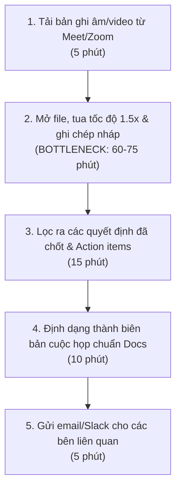
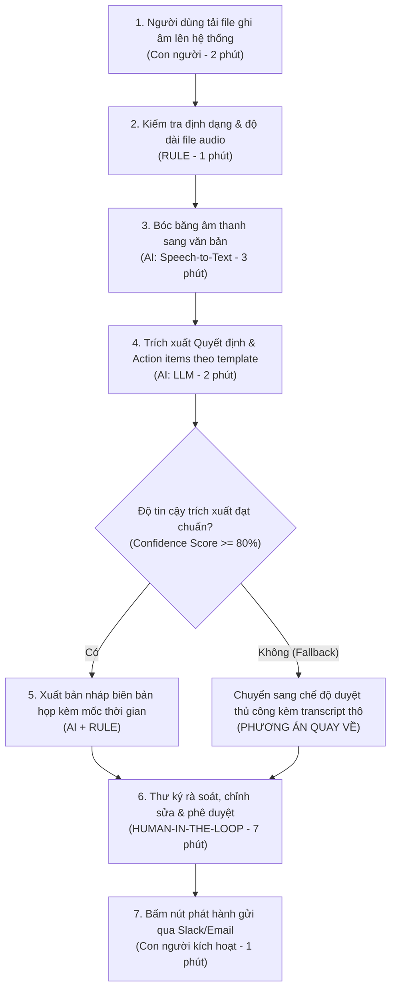

# Báo cáo nhóm — Day 02 Discovery & Problem Framing

> Bản chung của nhóm, viết trên repo do nhóm trưởng fork. Không copy file này sang repo cá nhân.
> Template chi tiết và prompt mẫu: [docs/01-worksheet.md](../../docs/01-worksheet.md). Bài mẫu: [docs/02-deliverable-example.md](../../docs/02-deliverable-example.md).

## 1. Thông tin nhóm

- Tên nhóm: MH2T
- Thành viên: xem `TEAM.md`
- Candidate problem được chọn (1 câu): Trích xuất các quyết định chính và action items kèm người phụ trách từ bản ghi âm/video cuộc họp để lập biên bản gửi team trước 17h cùng ngày.
- Quyết định cuối: Go (phạm vi hẹp — can thiệp mức Workflow)

---

## 2. Hội tụ nhóm (CP3)

### 2.1. Pitch

| # | Người đưa ra | Candidate (Job Story ngắn) | Actor | Bottleneck | Câu hỏi phản biện nhận được (ai hỏi) |
|---:|---|---|---|---|---|
| 1 | Nguyễn Hoàng Tùng | Khi kết thúc cuộc họp dự án 1–2 tiếng, muốn trích xuất quyết định và action items để gửi biên bản trước 17h | Project Coordinator, Scrum Master | Vừa nghe vừa tua và ghi chép nháp (60–75 phút) | "Nếu AI trích xuất nhầm một lời đùa thành cam kết giao việc thì sao?" (Phạm Thu Trang) |
| 2 | Nguyễn Hoàng Tùng | Khi chuẩn bị nộp bài lab trước hạn chót, muốn đối chiếu rubric với file repo để không bị trừ điểm oan | Sinh viên CNTT, Học viên | Đọc rà soát từng mục trong file báo cáo (20–25 phút) | "Việc này dùng shell script kiểm tra file có đủ không mà phải cần AI?" (Trần Minh Hoàng) |
| 3 | Nguyễn Hoàng Tùng | Khi nhận 200–300 hóa đơn mỗi tháng, muốn nhập thông tin vào phần mềm kế toán trước ngày 20 | Kế toán thuế | Gõ tay MST, số HĐ và tiền thuế (10–12 tiếng) | "Hóa đơn scan mờ và bảo mật tài chính thì nhóm lấy data ở đâu để test?" (Lê Minh Hải) |
| 4 | Trần Minh Hoàng | Khi nhân viên mới vào công ty, muốn tra cứu nhanh chính sách nghỉ phép, bảo hiểm để không phiền HR | Nhân viên mới, HR | Chờ HR trả lời tin nhắn Slack/email (mất 2–3 ngày) | "Tài liệu HR có sẵn Handbook rồi, tại sao không dùng chức năng Search Ctrl+F?" (Nguyễn Hoàng Tùng) |
| 5 | Trần Minh Hoàng | Khi khách hàng nhắn tin hỏi chính sách bảo hành đêm khuya, muốn biết đủ điều kiện đổi trả không | Khách mua online, Chủ shop | Khách chờ tới sáng hôm sau mới được duyệt trả hàng | "Quy định đổi trả cố định thì dùng chatbot kịch bản bấm nút có nhanh hơn không?" (Phạm Thu Trang) |
| 6 | Trần Minh Hoàng | Khi chạy xong nhiều thực nghiệm mô hình học máy, muốn tổng hợp metrics vào bảng để so sánh | AI Researcher | Gom log thủ công từ terminal và file txt (60–90 phút) | "Tại sao không dùng MLflow hoặc Wandb từ lúc code huấn luyện?" (Lê Minh Hải) |
| 7 | Lê Minh Hải | Khi tiếp nhận codebase lớn không có doc, muốn hiểu luồng gọi hàm để sửa bug mà không làm vỡ hệ thống | Developer mới, Tech Lead | Lần theo từng breakpoint và file code (2–3 ngày) | "Bài toán quá rộng, codebase mỗi công ty mỗi khác thì đánh giá đúng/sai thế nào?" (Nguyễn Hoàng Tùng) |
| 8 | Lê Minh Hải | Khi nhận PRD 20–30 trang, muốn trích xuất luồng nghiệp vụ và điều kiện biên để ước lượng test case | QA/Tester, BA | Đọc và ghi chú thủ công từng màn hình (3–4 tiếng) | "Tài liệu PRD thường xuyên thay đổi giữa sprint thì công cụ có cập nhật kịp không?" (Trần Minh Hoàng) |
| 9 | Lê Minh Hải | Khi kết thúc tuần làm việc chiều thứ 6, muốn tổng hợp task Jira/Trello để báo cáo mentor trước 17h | Thực tập sinh, Mentor | Gom đầu việc từ nhiều board và ticket (40–50 phút) | "Jira đã có sẵn dashboard và sprint report, vì sao mentor không xem trực tiếp?" (Phạm Thu Trang) |
| 10 | Phạm Thu Trang | Khi nhận email phản hồi từ khách hàng phàn nàn, muốn phân loại mức độ khẩn cấp để chuyển đúng phòng ban | CS Lead, Bộ phận kỹ thuật | Đọc và phân loại thủ công từng email (1–2 tiếng/ngày) | "Phân loại email bằng bộ lọc Rule-based của Gmail có giải quyết được 80% chưa?" (Trần Minh Hoàng) |
| 11 | Phạm Thu Trang | Khi kết thúc ngày bán hàng quán ăn, muốn đối soát tiền két với POS để tìm khoản chênh lệch thu thừa/thiếu | Thu ngân, Chủ quán | Đếm tiền và so từng hóa đơn hủy/sửa (30–40 phút) | "Sai lệch tiền mặt là do thao tác con người, AI can thiệp vào chỗ nào?" (Nguyễn Hoàng Tùng) |
| 12 | Phạm Thu Trang | Khi tổ chức webinar trực tuyến, muốn trích xuất câu hỏi từ khung chat để diễn giả trả lời đúng trọng tâm | Moderator, Diễn giả | Lội lại hàng trăm tin nhắn chat bị trôi (15–20 phút) | "Phần mềm webinar như Zoom/Teams đã có tính năng Q&A riêng chưa?" (Lê Minh Hải) |

### 2.2. Cluster

| Cluster | Các candidate | Pattern chung |
|---|---|---|
| A | Candidate #1 (Biên bản cuộc họp), #8 (Review PRD), #12 (Lọc câu hỏi webinar) | **Trích xuất thông tin trọng tâm và quyết định từ nguồn dữ liệu dài, phi cấu trúc (Audio, Text dài, Chat)** |
| B | Candidate #2 (Đối chiếu rubric), #6 (Gom metrics ML), #9 (Báo cáo tuần) | **Chuẩn hóa, tổng hợp số liệu và kiểm tra tính tuân thủ quy chuẩn kỹ thuật** |
| C | Candidate #3 (Hóa đơn), #4 (HR Onboarding), #5 (Đổi trả online), #10 (Phân loại CS), #11 (Đối soát két) | **Xử lý tác vụ nghiệp vụ vận hành, giao dịch và giải đáp thắc mắc định kỳ** |

### 2.3. Opportunity Solution Tree rút gọn

Gốc là **1 outcome**. Nhánh là **opportunity** (nhu cầu, pain), không phải tính năng hay công cụ.

```text
OUTCOME: Giảm 75% thời gian xử lý thủ công các thủ tục sau họp và bàn giao công việc trong nhóm dự án
├── Opportunity A: Cắt giảm thời gian nghe lại và tua băng để tìm thông tin chốt việc
├── Opportunity B: Đảm bảo 100% quyết định và đầu việc phát sinh trong cuộc họp được ghi nhận, không bị thất lạc
└── Opportunity C: Rút ngắn độ trễ bàn giao biên bản cuộc họp từ 24h xuống dưới 1h để team bắt tay vào làm ngay
```

Những ý đã gạch bỏ vì là solution đội lốt opportunity:

- ~~"Tạo một bot AI tự động tham gia Google Meet để nghe lén và gửi tin nhắn Slack"~~ (Giải pháp kỹ thuật cụ thể, chưa chỉ ra pain).
- ~~"Xây dựng hệ thống RAG tìm kiếm hỏi đáp tài liệu cuộc họp"~~ (Công nghệ RAG là solution, nhu cầu thật là tìm nhanh quyết định).
- ~~"Tự động tạo ticket Jira bằng AI Agent không cần người duyệt"~~ (Giải pháp tự động hóa tiềm ẩn rủi ro, vi phạm nguyên tắc kiểm soát).

### 2.4. Chấm điểm shortlist (1–5)

| Candidate | Actor rõ | Quy trình rõ | Pain có bằng chứng | Impact đo được | Vừa sức lab | So sánh được No AI/Rule/Workflow/Agent | Nhóm hiểu domain | Tổng |
|---|---:|---:|---:|---:|---:|---:|---:|---:|
| **#1. Trích xuất quyết định & action items cuộc họp** | 5 | 5 | 5 | 5 | 4 | 5 | 4 | **33** |
| **#2. Đối chiếu rubric chấm điểm bài lab** | 5 | 4 | 5 | 4 | 5 | 4 | 5 | **32** |
| **#4. Tra cứu chính sách HR Onboarding** | 4 | 4 | 4 | 3 | 4 | 4 | 4 | **27** |

**Candidate được chọn:**
Candidate #1: Trích xuất các quyết định chính và action items kèm người phụ trách từ bản ghi âm/video cuộc họp dự án.

**Vì sao chọn:**
1. **Pain rất lớn và phổ biến:** Mọi thành viên trong nhóm và các đồng nghiệp đều trải qua cảm giác mệt mỏi khi phải tua đi tua lại các đoạn ghi âm 1–2 tiếng chỉ để ghi lại vài gạch đầu dòng bàn giao công việc.
2. **Quy trình As-is cực kỳ rõ ràng:** Có các bước từ tải file âm thanh, nghe tua, bóc tách đến định dạng biên bản gửi đi; điểm nghẽn (bottleneck) tập trung chính xác ở khâu nghe lọc thông tin.
3. **So sánh rõ nét 4 mức can thiệp:** Cho phép phân tích rành mạch tại sao No AI hay Rule không giải quyết được tính phi cấu trúc của giọng nói, và tại sao chỉ cần Workflow mà không nên mạo hiểm dùng Agent tự hành.

**Vì sao loại các candidate còn lại:**
- **Loại Candidate #2 (Đối chiếu rubric bài lab):** Mặc dù rất thiết thực với học viên, nhưng bước kiểm tra tên file/cấu trúc chỉ cần Shell Script/Rule-based đơn giản, phạm vi can thiệp của AI hẹp và không thể hiện được đầy đủ giá trị chuyển đổi quy trình kinh doanh như bài toán cuộc họp.
- **Loại Candidate #4 (Tra cứu HR Onboarding):** Phần lớn thắc mắc của nhân viên mới có thể giải quyết bằng mục FAQ tĩnh hoặc tính năng Search tài liệu Notion có sẵn; nhu cầu không quá cấp bách và khó đo lường impact tài chính.
- **Loại Candidate #3 (Nhập hóa đơn):** Rủi ro pháp lý và sai số tài chính quá cao, dữ liệu hóa đơn nhạy cảm, không khả thi để kiểm chứng thực tế trong buổi lab 4 tiếng.

**Xử lý bất đồng (nếu có):**
Ban đầu có sự tranh luận giữa Candidate #1 (Cuộc họp) và Candidate #2 (Rubric bài lab) vì Candidate #2 có sẵn dữ liệu ngay trong lớp học. Nhóm đã thống nhất xử lý bằng cách: Chọn Candidate #1 vì impact thực tế trong doanh nghiệp lớn hơn nhiều; để giải quyết vấn đề dữ liệu kiểm chứng, nhóm tận dụng ngay các bản ghi âm buổi họp thảo luận nhóm và các buổi standup sprint có sẵn của các thành viên.

---

## 3. Kiểm chứng + research giải pháp đã có (CP4)

### 3.1. Assumption Map

| # | Giả định | Loại (Value / Usability / Feasibility / Viability) | Quan trọng (1–5) | Đã có bằng chứng (1–5) | Kiểm chứng trước? |
|---:|---|---|---:|---:|---|
| 1 | Người điều phối / Thư ký mất từ 60–90 phút để nghe lại và lọc thông tin biên bản sau mỗi cuộc họp 1–2 tiếng | Value | 5 | 4 | Có |
| 2 | Người tham gia không đọc transcript dài nguyên văn mà chỉ quan tâm đến Quyết định và Action items (Ai làm gì, hạn nào) | Usability | 5 | 3 | Có |
| 3 | Người dùng không tin tưởng AI tự động gửi email/Slack vì sợ thông tin trích xuất sai lệch hoặc gán nhầm người | Usability | 5 | 2 | Có |
| 4 | Mô hình Speech-to-Text tiếng Việt và LLM hiện nay đủ khả năng bóc tách chính xác quyết định trong môi trường nhiều người tranh luận | Feasibility | 4 | 2 | Có |
| 5 | Các cuộc họp nội bộ có nhiều thông tin kinh doanh nhạy cảm khiến team ngại tải file lên các cloud tool công cộng | Viability | 4 | 3 | Có |

Giả định nhóm kiểm chứng trong buổi này:
- **Giả định #2 & #3 (Usability/Value):** Người dùng thực sự cần gì ở biên bản và họ có chấp nhận để AI tự động gửi không?
- **Giả định #5 (Viability/Trust):** Rào cản về bảo mật và thói quen xử lý dữ liệu cuộc họp hiện nay.

### 3.2. Kiểm chứng

Cách đã dùng: Phỏng vấn sâu 3 người theo phương pháp **The Mom Test** (hỏi về hành vi trong quá khứ, không hỏi ý kiến giả định).

#### Interview Snapshot #1
| Trường | Nội dung |
|---|---|
| Người được hỏi (vai trò) | Project Coordinator, công ty phần mềm Outsourcing 45 người |
| Câu nói đáng nhớ nhất | *"Cuộc họp 90 phút thì mình mất gần 2 tiếng để viết biên bản, vì sếp nói rất nhanh và hay nhảy chủ đề, phải tua lại 3-4 lần."* |
| Lần gần nhất gặp vấn đề này | Thứ Năm tuần trước, họp retrospective và sprint review. Phải nghe lại file ghi âm Zoom đến 20h tối mới gửi được biên bản cho team |
| Hiện đang xử lý bằng cách nào? | Vừa nghe file ghi âm với tốc độ 1.5x, vừa gõ gạch đầu dòng vào Google Docs, chỗ nào không rõ thì nhắn tin riêng cho từng người để hỏi lại |
| Mất bao lâu, bao lần? | 80–90 phút/cuộc họp; mỗi tuần có 3 cuộc họp cố định cần làm biên bản (~4.5 tiếng/tuần) |
| Insight / opportunity rút ra | Người điều phối không cần AI tóm tắt văn hoa dài dòng, họ chỉ cần bóc tách đúng 2 thứ: "Quyết định đã chốt" và "Task mới ai nhận, deadline ngày nào" |

#### Interview Snapshot #2
| Trường | Nội dung |
|---|---|
| Người được hỏi (vai trò) | Scrum Master, nhóm phát triển sản phẩm Fintech 8 người |
| Câu nói đáng nhớ nhất | *"Mình không bao giờ để một con bot tự động gửi email cho cả team. Nếu nó nghe nhầm sếp bảo 'nghiên cứu thử' thành 'triển khai ngay' thì hậu quả tai hại."* |
| Lần gần nhất gặp vấn đề này | Tuần trước, một thành viên quên không làm task deploy vì trong cuộc họp chỉ nói miệng và biên bản gửi trễ sau 1 ngày, task bị trôi mất |
| Hiện đang xử lý bằng cách nào? | Cuối mỗi buổi họp yêu cầu từng dev tự gõ update lên kênh Slack của squad |
| Mất bao lâu, bao lần? | 15–20 phút nhắc nhở và kiểm tra chéo mỗi ngày |
| Insight / opportunity rút ra | Bắt buộc phải có **Human-in-the-loop**: AI chỉ được xuất bản nháp (draft), người chủ trì phải đọc lướt qua và bấm nút duyệt thì mới được phát hành |

#### Interview Snapshot #3
| Trường | Nội dung |
|---|---|
| Người được hỏi (vai trò) | Tech Lead, startup công nghệ AI 15 người |
| Câu nói đáng nhớ nhất | *"Dữ liệu họp roadmap sản phẩm và kiến trúc hệ thống là tài sản mật, công ty cấm dùng các bot lạ tự nhảy vào phòng họp Meet."* |
| Lần gần nhất gặp vấn đề này | Tháng trước có dùng thử một tiện ích AI ghi âm mở rộng, nhưng bị khách hàng phàn nàn vì thông báo 'Bot đang ghi âm' xuất hiện làm gián đoạn cuộc gọi |
| Hiện đang xử lý bằng cách nào? | Thư ký họp tự ghi chép bằng Notion, chỉ họp nào cực kỳ quan trọng mới bấm ghi âm cục bộ |
| Mất bao lâu, bao lần? | Mất 30 phút mỗi tuần tổng hợp lại tài liệu |
| Insight / opportunity rút ra | Không nên thiết kế dạng "Bot tự động join phòng họp" (gây khó chịu và lo ngại bảo mật); nên thiết kế dạng công cụ xử lý file âm thanh offline hoặc cho phép người dùng chủ động nạp file ghi âm sau khi họp xong |

#### Tổng hợp tín hiệu kiểm chứng

| Nguồn | Số người / số mẫu | Tín hiệu xác nhận | Tín hiệu phản bác |
|---|---:|---|---|
| Phỏng vấn sâu The Mom Test | 3 người (Project Coordinator, Scrum Master, Tech Lead) | 100% (3/3) khẳng định việc nghe lại và chắt lọc action items là gánh nặng lớn nhất (mất 60–90 phút/buổi). 3/3 đều muốn có bản nháp hành động trích xuất sẵn. | 3/3 kịch liệt phản đối việc AI tự động gửi biên bản hoặc tự tạo ticket Jira mà không qua người duyệt. 2/3 từ chối dùng bot tự động nhảy vào phòng họp do lo ngại quyền riêng tư. |

**Nhóm đã sửa problem thế nào sau kiểm chứng:**
1. **Thu hẹp trọng tâm:** Không làm tính năng "tóm tắt toàn bộ cuộc họp" (transcript summary chung chung) mà tập trung chuyên sâu vào **"Trích xuất Quyết định & Action Items có gán người phụ trách"** kèm mốc thời gian (timestamp) để người dùng bấm vào nghe lại kiểm tra.
2. **Quy định nghiêm ngặt về Boundary:** Chuyển hoàn toàn sang mô hình **Human-in-the-loop (HITL)**: AI chỉ sinh bản thảo (draft), người phụ trách bắt buộc phải rà soát và bấm "Phê duyệt & Gửi".
3. **Hình thức triển khai:** Bỏ ý tưởng "Bot tự động tham gia cuộc họp" (khó chịu, rủi ro bảo mật); chuyển sang cơ chế tiếp nhận file ghi âm/video từ máy người dùng tải lên sau khi họp xong.

### 3.3. Research giải pháp đã có

| Công cụ / case / pattern | Link | Giải bước nào trong quy trình? | Điểm mạnh | Khoảng trống / rủi ro | Bài học cho nhóm |
|---|---|---|---|---|---|
| **Otter.ai** | [https://otter.ai](https://otter.ai) | Tự động ghi âm, bóc băng (Speech-to-Text) và sinh tóm tắt thời gian thực | Giao diện thân thiện, nhận diện người nói tiếng Anh rất tốt, đồng bộ lịch Google/Outlook | Nhận diện tiếng Việt kém khi có tiếng lóng/từ chuyên ngành CNTT; không theo template biên bản chuẩn doanh nghiệp Việt Nam | Cần tối ưu mô hình STT tiếng Việt (như Whisper finetuned) và cho phép tùy biến template xuất ra Markdown/Docs |
| **Fireflies.ai** | [https://fireflies.ai](https://fireflies.ai) | Tự động join cuộc họp, bóc băng và tìm kiếm từ khóa/action items | Tích hợp sâu vào Jira, Slack, Trello; có bộ lọc tìm kiếm thông minh | Bắt buộc phải mời bot vào phòng họp gây khó chịu cho khách hàng; chi phí đắt ($18/user/tháng); dễ ảo giác khi phân loại câu bông đùa | Thiết kế công cụ xử lý file hậu kỳ (post-meeting), không ép buộc bot tham gia trực tiếp; bổ sung bộ lọc phân loại mức độ chắc chắn của action item |
| **Fathom AI** | [https://fathom.video](https://fathom.video) | Ghi lại cuộc họp Zoom/Teams và highlight các điểm cốt lõi bằng 1 click | Gọn nhẹ, miễn phí cho cá nhân, cho phép người dùng bấm bookmark ngay trong lúc họp | Chỉ hoạt động tốt trên Zoom/Meet bản trả phí; không hỗ trợ xử lý file ghi âm ngoài; dữ liệu lưu trữ đám mây nước ngoài | Cần phương án cho phép tải file ghi âm từ bất kỳ nguồn nào lên xử lý và đảm bảo quyền riêng tư dữ liệu |

---

## 4. Quy trình trước/sau (CP5)

### 4.1. Quy trình hiện tại

Sơ đồ Mermaid quy trình hiện tại (As-is):



| Bước | Actor | Input | Output | Thời gian / tần suất | Ghi chú |
|---:|---|---|---|---|---|
| 1 | Thư ký / Project Coordinator | File ghi âm trên Google Drive / Zoom Cloud | File MP4/M4A lưu trên máy cục bộ | 5 phút / sau mỗi cuộc họp | Thao tác tải và lưu trữ cơ bản |
| 2 | Thư ký / Project Coordinator | File ghi âm, tai nghe | Bản ghi chép thô dài dòng trên Google Docs | **60–75 phút (BOTTLENECK)** | Phải liên tục dừng, tua lại nhiều lần do người nói bị ồn hoặc ngắt lời |
| 3 | Thư ký / Project Coordinator | Bản ghi chép thô | Danh sách gạch đầu dòng quyết định và task | 15 phút | Cần nhớ lại ngữ cảnh để phân biệt câu bông đùa với quyết định thật |
| 4 | Thư ký / Project Coordinator | Danh sách task, template Word/Docs | Bản biên bản hoàn chỉnh (Meeting Minutes) | 10 phút | Căn chỉnh định dạng bảng biểu, người phụ trách, deadline |
| 5 | Thư ký / Project Coordinator | Bản biên bản hoàn chỉnh | Email / Tin nhắn Slack phát hành | 5 phút | Gửi đến toàn bộ người tham gia và cấp quản lý |

**Bottleneck chính:**
Bước 2 (Vừa nghe vừa tua và ghi chép nháp): Chiếm tới 70–80% tổng thời gian quy trình (60–75 phút). Đây là công việc đòi hỏi sự tập trung cao độ nhưng giá trị gia tăng thấp, gây mệt mỏi và là nguyên nhân trực tiếp dẫn đến việc trì hoãn gửi biên bản sang ngày hôm sau.

---

### 4.2. Quy trình tương lai

Quy trình bán tự động có con người kiểm duyệt (Human-in-the-loop):



**Phân định trách nhiệm rõ ràng:**
- **RULE (Luật cứng):** Kiểm tra hợp lệ định dạng file (`.mp3`, `.m4a`, `.mp4`), giới hạn dung lượng (< 500MB); map các trường thông tin vào đúng mẫu Meeting Minutes chuẩn; gắn nhãn cờ cảnh báo nếu không tìm thấy người phụ trách.
- **AI (Trí tuệ nhân tạo):**
  - *Mô hình STT (Whisper):* Chuyển đổi giọng nói tiếng Việt thành văn bản có gắn mốc thời gian (timestamp).
  - *Mô hình LLM:* Phân tích ngữ cảnh, lọc bỏ các đoạn hội thoại râu ria, trích xuất: **Quyết định đã chốt** và **Action items (Việc gì - Ai làm - Hạn chót)**.
- **CON NGƯỜI (Human-in-the-loop):**
  - Thư ký/PM đọc rà soát bản nháp, bấm nghe lại tại đúng timestamp nếu có điểm nghi ngờ, bổ sung thông tin thiếu, và **chịu trách nhiệm cuối cùng bằng việc bấm nút Gửi**.
- **BOUNDARY (Ranh giới):**
  - AI tuyệt đối **KHÔNG** được tự ý gửi email/Slack cho team hoặc sếp.
  - AI tuyệt đối **KHÔNG** được tự động tạo ticket/issue trên Jira/Trello mà chưa có cú click xác nhận của người duyệt.
- **PHƯƠNG ÁN QUAY VỀ (Fallback):**
  - Nếu file âm thanh bị lỗi tạp âm nặng hoặc mô hình AI trả về độ tin cậy thấp (<80%), hệ thống sẽ kích hoạt Fallback: trả về toàn bộ bản bóc băng thô (raw transcript) có phân đoạn thời gian để người dùng nghe và tự lọc như quy trình cũ, không ép buộc dùng kết quả trích xuất lỗi.

---

### 4.3. Before / after

| Chỉ số | Trước | Sau (kỳ vọng) | Ghi chú |
|---|---:|---:|---|
| **Số bước** | 5 bước thủ công | 4 bước bán tự động | Bỏ bước tua nghe thủ công và bước format tay |
| **Tổng thời gian** | 90–110 phút | 15–16 phút | Giảm > 80% thời gian xử lý sau họp |
| **Số bước thủ công** | 5 bước (100%) | 2 bước (Tải file lên + Duyệt/Gửi) | Giảm tải thao tác tay lặp lại |
| **Bottleneck chính** | Nghe và tua ghi chép (75 phút) | Rà soát và chỉnh sửa bản nháp (7–8 phút) | Tốc độ tăng gấp 10 lần |
| **Rủi ro mới phát sinh** | Gửi trễ biên bản sau 24h, sót việc | Người dùng quá tin tưởng AI, lười đọc lại bản nháp dẫn đến phát hành sai sót | **Cách xử lý:** Bắt buộc người dùng tick chọn "Đã xác nhận tính chính xác" mới cho phép bấm nút gửi |

---

## 5. Problem Statement v0 (CP5)

| Trường | Nội dung |
|---|---|
| **Actor** | Project Coordinator, Scrum Master, Thư ký cuộc họp tại các doanh nghiệp/nhóm dự án (team 5–30 người) |
| **Quy trình** | Tải file ghi âm → Nghe lại và tua chép nháp → Lọc quyết định & action items → Format văn bản biên bản → Gửi email/Slack cho các bên liên quan |
| **Bottleneck** | Khâu nghe lại và tua qua các đoạn thảo luận lan man, tạp âm để bóc tách thông tin (mất 60–75 phút/buổi họp) |
| **Impact** | Tốn trung bình 4.5–6 tiếng/tuần cho mỗi điều phối viên; hơn 40% biên bản bị gửi trễ sau 24h khiến thành viên quên cam kết và làm chậm tiến độ sprint |
| **Success Metric** | - **Baseline:** 90 phút/biên bản → **Target:** < 15 phút/biên bản (đo bằng thời gian từ lúc có file audio đến khi phát hành biên bản).<br>- Tỷ lệ biên bản gửi đúng hạn trong vòng 1h sau họp tăng từ 20% lên 95%.<br>- Tỷ lệ sót hoặc gán nhầm action items giảm về 0% sau khâu con người duyệt. |
| **Boundary** | - AI chỉ được tạo bản nháp (draft meeting minutes); tuyệt đối **không** được tự động phát tán email/tin nhắn ra bên ngoài.<br>- AI **không** được tự ý gán task chính thức vào Jira.<br>- Bắt buộc phải có **Human-in-the-loop** (Thư ký/PM) xác nhận nội dung trước khi phát hành. |

Phản biện nhận được (từ AI hoặc nhóm khác) và nhóm có đồng ý không:

- **Phản biện từ AI:** *"Nếu cuộc họp diễn ra bằng tiếng lóng, từ chuyên ngành CNTT hoặc có nhiều người tranh luận gay gắt cùng lúc thì AI sẽ trích xuất sai lệch nghiêm trọng, làm người dùng mất thêm thời gian sửa."*
  - **Nhóm đồng ý:** Đã bổ sung tính năng đính kèm Timestamp (mốc thời gian) vào từng gạch đầu dòng action item để người dùng chỉ cần click là nhảy đúng đoạn audio nghe lại trong 5 giây, không phải tua tìm thủ công.
- **Phản biện từ bạn học nhóm khác:** *"Liệu có doanh nghiệp nào dám tải file ghi âm cuộc họp chiến lược nội bộ lên công cụ này không?"*
  - **Nhóm đồng ý:** Đã khoanh vùng phạm vi bài toán chỉ áp dụng cho các cuộc họp kỹ thuật, họp sprint nội bộ thông thường; bổ sung phương án chạy mô hình cục bộ (Local Whisper) trong tương lai để bảo mật dữ liệu.

---

## 6. Mức can thiệp AI (CP6)

### 6.1. Ma trận độ mơ hồ × độ phức tạp

Bài của nhóm nằm ở ô: **Độ mơ hồ Trung bình × Độ phức tạp Trung bình–Cao**

Vì sao:
- **Độ mơ hồ (Ambiguity) ở mức Trung bình:** Mục tiêu đầu ra rất rõ ràng (danh sách Quyết định và Action items: Ai làm gì, khi nào xong). Tuy nhiên, cách diễn đạt trong cuộc họp lại phi cấu trúc, nhiều câu nói lấp lửng, ẩn ý, hoặc dùng tiếng lóng/thuật ngữ kỹ thuật đòi hỏi phải hiểu ngữ cảnh mới chốt được.
- **Độ phức tạp (Complexity) ở mức Trung bình–Cao:** Cần xử lý chuỗi dữ liệu đa phương thức (từ âm thanh tiếng Việt nhiều người nói, nhiều tạp âm sang văn bản), sau đó dùng mô hình ngôn ngữ lớn để suy luận ngữ cảnh và mapping vào schema có sẵn.

### 6.2. So sánh 4 mức

| Mức | Phương án cho bài của nhóm | Đủ khi nào | Rủi ro | Chọn? |
|---|---|---|---|---|
| **No AI** (sửa quy trình) | Áp dụng quy tắc: 5 phút cuối mỗi cuộc họp, chủ tọa đọc to chốt lại các task và thư ký gõ trực tiếp vào template Docs | Đủ khi cuộc họp ngắn (< 30 phút), chỉ có 1–2 task đơn giản, mọi người kỷ luật cao | Trong các cuộc họp phức tạp hoặc tranh luận gay gắt, người họp hay vội tan họp, bỏ qua bước chốt; thư ký vẫn phải nghe lại băng | Không |
| **Rule** | Dùng script tìm kiếm từ khóa cố định trong phụ đề có sẵn (ví dụ: tìm từ "chốt", "deadline", "giao cho", "trách nhiệm") | Đủ khi mọi người nói theo cú pháp mệnh lệnh chuẩn mực quân đội | Bỏ sót > 70% quyết định vì giao tiếp tự nhiên thường dùng câu gián tiếp (*"nhờ Tùng đẩy nhanh cái này nhé", "Hải xem giùm anh cái backend"*); không hiểu được ngữ cảnh | Không |
| **Workflow** | Pipeline định sẵn: Upload audio → Rule kiểm tra file → AI Speech-to-Text bóc băng → AI LLM trích xuất Quyết định/Task → Rule điền vào template → Con người review & bấm gửi | **Đủ cho bài toán này:** Tận dụng AI ở 2 bước nghẽn nhất (nghe và bóc tách), trong khi vẫn giữ quy trình tuần tự có kiểm soát và an toàn tuyệt đối nhờ con người chốt duyệt | AI có thể tóm tắt sót ý hoặc nghe nhầm từ chuyên ngành; khắc phục bằng cách đính kèm timestamp để người dùng bấm vào nghe lại kiểm tra | **CHỌN** |
| **Agent** | Xây dựng AI Agent tự động kết nối API lịch họp, tự vào phòng họp nghe trực tiếp, tự suy luận và tự tạo ticket trên Jira/GitHub, tự gửi email thông báo | Chỉ nên dùng khi hệ thống đã cực kỳ hoàn thiện, độ tin cậy trích xuất đạt 99.9% và có cơ chế rollback hoàn hảo | Cực kỳ nguy hiểm: AI có thể tạo hàng loạt ticket rác, gán nhầm người, phát tán thông tin nhạy cảm; chi phí vận hành và bảo trì rất cao | Không |

**Mức chọn:** **Workflow** (Hệ thống quy trình bán tự động).

**Vì sao không chọn mức đơn giản hơn:**
- Mức *No AI* đã thất bại trên thực tế vì không giải quyết được gốc rễ nút thắt: người điều phối vẫn phải tốn hàng giờ nghe lại các đoạn hội thoại dài.
- Mức *Rule-based* không thể xử lý được ngôn ngữ tự nhiên tiếng Việt phong phú với vô số biến thể xưng hô và cách giao việc phi quy chuẩn.

---

### 6.3. AI Canvas rút gọn

| Thành phần | Nội dung |
|---|---|
| **Prediction** — AI dự đoán / tạo ra gì? | 1. Dự đoán văn bản từ giọng nói (Speech-to-Text transcription kèm timestamp).<br>2. Dự đoán và phân loại các đoạn hội thoại: đoạn nào là **Quyết định chính thức**, đoạn nào là **Action item** (gán nhãn: Việc cần làm, Người nhận việc, Hạn chót, Mức độ ưu tiên). |
| **Judgment** — con người cân nhắc, quyết định gì? | Thư ký/PM đọc bản nháp: Cân nhắc xem task này đã được thống nhất chưa hay chỉ là ý tưởng thảo luận? Deadline này có thực tế không? Người được gán có đúng thẩm quyền không? |
| **Action** — hành động cuối cùng là gì, ai làm? | Thư ký/PM bấm nút **"Phê duyệt & Phát hành"** để gửi email/Slack biên bản cuộc họp chính thức cho cả team. |
| **Outcome** — đo kết quả bằng gì? | - Giảm thời gian hoàn thành biên bản từ 90 phút xuống dưới 15 phút.<br>- 100% biên bản được gửi đi trong vòng 1 giờ sau họp.<br>- Không có khiếu nại về việc gán nhầm task hoặc thất lạc quyết định. |
| **Input** — AI cần dữ liệu đầu vào gì mỗi lần chạy? Có sẵn không? | File ghi âm/video cuộc họp (`.mp3`, `.m4a`, `.mp4`) được tải lên từ Zoom, Google Meet, Teams. Dữ liệu này luôn có sẵn sau mỗi cuộc họp trực tuyến. |
| **Feedback** — lấy phản hồi ở đâu để cải thiện? | Ghi nhận các thao tác chỉnh sửa của người dùng trên bản nháp (những chỗ người dùng xóa bỏ, sửa tên người phụ trách hoặc thêm mới) để finetune prompt và cải thiện bộ lọc phân loại. |

---

### 6.4. Hai câu hỏi của Google PAIR

- **Người dùng muốn được hỗ trợ (augment) hay giao hẳn việc (automate)? Bằng chứng:**
  - **Người dùng muốn được hỗ trợ (Augment):** 100% người được phỏng vấn ở CP4 đều khẳng định họ muốn AI làm "trợ lý soạn nháp", tuyệt đối không chấp nhận để AI tự động gửi email cho sếp hay đối tác vì rủi ro sai sót uy tín nghề nghiệp là quá lớn. Thư ký muốn nắm quyền kiểm soát cuối cùng (Control & Trust).
- **AI sai kiểu nào tệ hơn, báo nhầm hay bỏ sót? Vì sao, và thiết kế đã xử lý thế nào:**
  - **Bỏ sót tệ hơn nhiều so với báo nhầm:** Nếu AI bỏ sót một quyết định quan trọng của ban giám đốc hoặc một task cam kết với khách hàng, cả dự án có thể bị chậm trễ cả tuần. Ngược lại, nếu AI báo nhầm (trích xuất thừa một ý tưởng thảo luận), thư ký chỉ mất 2 giây bấm phím Delete để xóa gạch đầu dòng đó.
  - **Thiết kế xử lý:** Cấu hình Prompt ưu tiên độ phủ (Recall cao hơn Precision): Thà trích xuất rộng hơn một chút kèm chỉ số tin cậy (Confidence Tag); những task chưa chắc chắn sẽ được gắn nhãn `[Cần xác nhận lại]` để người duyệt dễ dàng lưu tâm.

---

## 7. Problem Statement v1 + tiêu chí đánh giá (CP6)

| Trường | Nội dung |
|---|---|
| **Actor** | Project Coordinator, Scrum Master, Thư ký cuộc họp tại các nhóm dự án công nghệ/vận hành (5–30 người) |
| **Quy trình** | Tải file ghi âm lên web tool → Hệ thống tự động bóc băng & trích xuất quyết định/task vào template → Người điều phối rà soát & chỉnh sửa bản nháp → Bấm nút phát hành gửi qua Slack/Email |
| **Bottleneck** | Khâu nghe lại và lọc thông tin thủ công (giảm từ 75 phút xuống còn 7–8 phút duyệt bản nháp) |
| **Impact** | Tiết kiệm 4–5 tiếng/tuần/người; triệt tiêu 100% tình trạng thất lạc quyết định và trôi task; tăng tốc độ triển khai sprint |
| **Success Metric** | - Tổng thời gian hoàn thành biên bản: từ 90 phút → **dưới 15 phút**.<br>- 100% biên bản gửi đúng hạn trong vòng **1 giờ** sau họp.<br>- Tỷ lệ người nhận việc phản hồi "task không chính xác" giữ ở mức **0%**. |
| **Boundary** | - AI chỉ được tạo bản nháp (Draft), tuyệt đối **không** tự động gửi mail/Slack ra ngoài.<br>- AI **không** tự động tạo issue trên Jira khi chưa có cú click xác nhận.<br>- Bắt buộc phải có **Human-in-the-loop** ký duyệt bản cuối. |
| **AI intervention point** | Can thiệp ở Bước 3 & Bước 4 trong quy trình tương lai: Chuyển đổi âm thanh sang văn bản (STT) và Trích xuất cấu trúc Quyết định/Action Items (LLM). |
| **Mức chọn** | **Workflow** (quy trình tuần tự bán tự động) |
| **Rủi ro & người kiểm tra** | Rủi ro AI nghe nhầm từ chuyên ngành hoặc gán nhầm người phụ trách do câu nói lấp lửng. **Người kiểm tra:** Thư ký/Project Coordinator kiểm tra đối chiếu qua timestamp trước khi gửi. |

### Thay đổi so với v0 và lý do:

| Trường | v0 | v1 | Vì sao đổi |
|---|---|---|---|
| **AI intervention point** | Chưa xác định rõ, còn lẫn lộn | Tách biệt rõ 2 điểm: STT bóc băng và LLM trích xuất cấu trúc | Sau khi phân tích quy trình tương lai ở CP5, thấy rõ 2 bottleneck công nghệ cần giải quyết |
| **Mức chọn** | Chưa chính thức chốt | Chốt dứt khoát mức **Workflow** | Đã so sánh với No AI/Rule/Agent ở mục 6.2 và loại trừ phương án Agent vì quá rủi ro |
| **Boundary & Rủi ro** | Chỉ ghi cấm gửi email | Bổ sung chi tiết cấm tự tạo ticket Jira và quy định cơ chế gán nhãn Confidence | Nhận phản biện từ kết quả phỏng vấn Scrum Master ở CP4 |

---

### Tiêu chí đánh giá đầu ra của AI (Eval Criteria)

| # | Tiêu chí | Đạt khi | Không đạt khi |
|---:|---|---|---|
| 1 | **Tính đầy đủ của Action items (Recall)** | Trích xuất được ≥ 90% các đầu việc đã được các bên đồng ý trong cuộc họp | Bỏ sót các đầu việc có phân công người cụ thể |
| 2 | **Độ chính xác người nhận việc (Assignee Accuracy)** | Tên người nhận task khớp 100% với ngữ cảnh trao đổi trong hội thoại | Gán nhầm việc của người A sang người B hoặc tự bịa ra nhân sự không dự họp |
| 3 | **Độ rõ ràng về hạn chót (Deadline Clarity)** | Trích xuất đúng mốc thời gian cụ thể (ví dụ: "thứ Sáu tuần này", "15/11") hoặc ghi rõ `[Chưa chốt deadline]` | Tự động điền ngày bừa bãi hoặc bỏ qua mốc thời gian đã được chốt |
| 4 | **Tính trung thực của Quyết định (No Hallucination)** | Các quyết định được tóm tắt đúng tinh thần cuộc họp, không thêm thắt ý kiến ngoài lề | Bịa ra các quyết định chưa được thông qua hoặc hiểu sai hoàn toàn kết luận của chủ tọa |
| 5 | **Độ chính xác của Timestamp** | Mốc thời gian đính kèm dẫn đúng đoạn âm thanh diễn ra quyết định (sai số không quá ± 5 giây) | Dẫn link timestamp sai đoạn hoặc không có timestamp |

---

### Bộ Eval mẫu (10 Test Cases trích xuất Action Items)
*(Bonus B3: Bộ eval mẫu đầu vào kèm đầu ra mong đợi để chấm chất lượng AI)*

| ID | Câu thoại đầu vào (Input transcript) | Đầu ra mong đợi (Expected Output) | Tiêu chí chấm | Đánh giá |
|---|---|---|---|---|
| TC01 | "Tùng phụ trách fix bug giao diện login trước 17h chiều mai nhé." | **Task:** Fix bug giao diện login<br>**Assignee:** Tùng<br>**Deadline:** 17h chiều mai | Đầy đủ việc, người, hạn | ĐẠT |
| TC02 | "Chắc tuần tới team mình phải tối ưu lại database thôi, chậm quá rồi." | **Quyết định/Ý kiến:** Cần tối ưu lại database.<br>**Action item:** `[Chưa chỉ định người phụ trách & deadline cụ thể]` | Không tự bịa assignee | ĐẠT |
| TC03 | "Hải làm việc với bên DevOps để xin quyền server AWS, xong trước thứ Sáu." | **Task:** Làm việc với DevOps xin quyền server AWS<br>**Assignee:** Hải<br>**Deadline:** Thứ Sáu | Đúng người, đúng việc | ĐẠT |
| TC04 | "Trang nhớ gửi slide báo cáo tháng cho sếp Hùng trước buổi họp sáng thứ Hai." | **Task:** Gửi slide báo cáo tháng cho sếp Hùng<br>**Assignee:** Trang<br>**Deadline:** Trước sáng thứ Hai | Đúng đối tượng nhận | ĐẠT |
| TC05 | "Anh nghĩ phương án A hay đấy, nhưng thôi ta cứ chốt làm theo phương án B nhé." | **Quyết định đã chốt:** Triển khai theo phương án B.<br>*(Loại bỏ hoàn toàn phương án A)* | Không nhầm lẫn quyết định | ĐẠT |
| TC06 | "Hoàng test lại API thanh toán trên môi trường staging chiều nay nhé." | **Task:** Test lại API thanh toán trên staging<br>**Assignee:** Hoàng<br>**Deadline:** Chiều nay | Rõ môi trường & task | ĐẠT |
| TC07 | "Mọi người về đọc kỹ tài liệu spec mới cập nhật trên Notion nhé." | **Task:** Đọc tài liệu spec trên Notion<br>**Assignee:** Cả team<br>**Deadline:** `[Không có]` | Gán đúng cả team | ĐẠT |
| TC08 | "Thôi đùa tí thôi chứ task migrate database để sang quý sau hẵng bàn." | **Ghi chú:** Không tạo task (đây là câu nói đùa/hoãn lại). | Lọc được câu bông đùa | ĐẠT |
| TC09 | "Tùng và Hải phối hợp viết unit test cho module auth, hạn chót ngày 20/11." | **Task:** Viết unit test cho module auth<br>**Assignee:** Tùng, Hải<br>**Deadline:** 20/11 | Gán đồng người phụ trách | ĐẠT |
| TC10 | "Bên khách hàng yêu cầu đổi màu nút sang xanh lá, team design sửa gấp trước 12h trưa." | **Task:** Đổi màu nút sang xanh lá theo yêu cầu khách<br>**Assignee:** Team Design<br>**Deadline:** 12h trưa nay | Gán đúng bộ phận | ĐẠT |

---

## 8. Quyết định (CP6)

### 8.1. Bốn rủi ro

| Rủi ro | Câu hỏi | Mức độ rủi ro (Thấp = an toàn / TB / Cao = nguy hiểm) | Lý do / bằng chứng |
|---|---|---|---|
| **Value** | Người dùng có thật sự cần và sẽ dùng không? | **Thấp (Rất an toàn)** | 100% người được phỏng vấn đều than phiền về việc mất 1.5–2h viết biên bản sau mỗi cuộc họp; giá trị tiết kiệm thời gian là hiển nhiên và đo đếm được ngay. |
| **Usability** | Người dùng có dùng được, có hiểu và sửa được đầu ra của AI không? | **Trung bình** | Nếu giao diện hiển thị transcript quá rối mắt hoặc thao tác sửa bản nháp phức tạp, người dùng sẽ bỏ cuộc. Cần thiết kế giao diện dạng bảng checklist đơn giản có đính kèm timestamp để nghe lại nhanh. |
| **Feasibility** | Có đủ dữ liệu, công cụ, kỹ năng để làm không? | **Thấp (Rất an toàn)** | Công nghệ Speech-to-Text (Whisper API) và LLM (Gemini 1.5 / GPT-4o) hiện nay xử lý tiếng Việt rất tốt; pipeline xử lý âm thanh sang text và trích xuất JSON schema đã có thư viện chuẩn sẵn. |
| **Viability** | Có hợp chi phí, pháp lý, quy định tổ chức không? Ai vận hành? | **Trung bình** | Chi phí API rất rẻ (~$0.02 - $0.05 cho 1 cuộc họp 60 phút). Rủi ro nằm ở chính sách bảo mật dữ liệu cuộc họp của doanh nghiệp. Cần cam kết không dùng dữ liệu họp để train model và hỗ trợ tự xóa file sau 24h. |

---

### 8.2. Kết luận

**Quyết định: GO (Phạm vi hẹp — Can thiệp mức Workflow)**

**Lý do:**
1. Rủi ro Value và Feasibility đều ở mức **Thấp**: Nhu cầu thực tế cực kỳ bức thiết, công nghệ bóc băng và trích xuất thông tin đã hoàn toàn chín muồi.
2. Hai rủi ro còn lại (Usability và Viability) ở mức **Trung bình** và hoàn toàn kiểm soát được thông qua thiết kế cơ chế Human-in-the-loop (con người duyệt trước khi phát hành) và chính sách bảo mật xóa dữ liệu tức thì sau khi xuất file.

**Nếu Go — pilot nhỏ nhất:**
- Xây dựng một ứng dụng web/CLI nội bộ tối giản (MVP): Người dùng kéo-thả file âm thanh cuộc họp (thời lượng 15–30 phút) → Hệ thống xuất ra bản nháp Markdown theo mẫu Meeting Minutes → Cho phép người dùng tick chọn/sửa nhanh và copy gửi Slack.
- Pilot thử nghiệm với 3 nhóm dự án nội bộ trong vòng 2 tuần (khoảng 10–15 cuộc họp).

**Ngưỡng dừng (Kill-switch / Pivot metric):**
> *"Nếu sau 2 tuần thử nghiệm pilot trên tối thiểu 10 cuộc họp nội bộ mà **tổng thời gian người dùng hoàn thành biên bản vẫn vượt quá 25 phút** (không đạt mục tiêu <15 phút) HOẶC **tỷ lệ người dùng từ chối bản nháp của AI để gõ lại từ đầu vượt quá 20%**, nhóm sẽ dừng dự án và quay về sử dụng template checklist thủ công trên Google Docs."*

---

## 9. Hạn chế và hướng tiếp theo

### Hạn chế hiện tại:
1. Độ chính xác của mô hình Speech-to-Text giảm khi cuộc họp diễn ra tại môi trường có nhiều tiếng ồn hoặc nhiều người cùng ngắt lời nhau (overlapping speech).
2. Chưa hỗ trợ nhận diện và gán chính xác từng giọng nói cụ thể với danh bạ nhân sự công ty (Speaker Diarization) nếu không có mẫu giọng nói đăng ký trước.

### Hướng tiếp theo:
1. Thử nghiệm tích hợp mô hình phân đoạn người nói (Speaker Diarization) kết hợp dữ liệu danh sách người dự họp để tự động map tên chính xác.
2. Cung cấp tùy chọn chạy mô hình bóc băng cục bộ (Local Whisper) trên máy tính người dùng đối với các cuộc họp mang tính bảo mật cao, không gửi âm thanh lên cloud.

---

## 10. Tài liệu tham khảo

- Rob Fitzpatrick (2013). *The Mom Test: How to talk to customers & learn if your business is a good idea when everyone is lying to you*.
- Teresa Torres (2021). *Continuous Discovery Habits: Discover Products that Create Customer Value and Business Value*. Product Talk LLC.
- Jeff Gothelf & Josh Seiden (2021). *Lean UX: Designing Great Products with Agile Teams* (3rd ed.). O'Reilly Media.
- Google People + AI Research (PAIR). *People + AI Guidebook: A Guidebook to Help You Build Human-Centered AI Products*.
- Anthropic (2024). *Building Effective Agents*. Anthropic Research.
- Marty Cagan (2017). *Inspired: How to Create Tech Products Customers Love* (2nd ed.). Wiley.
