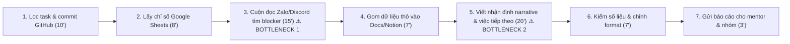
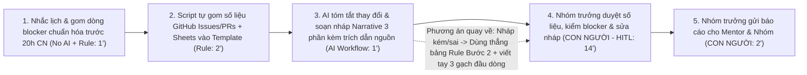

# Báo cáo nhóm — Day 02 Discovery & Problem Framing

> Bản chung của nhóm, viết trên repo do nhóm trưởng fork. Không copy file này sang repo cá nhân.
> Template chi tiết và prompt mẫu: [docs/01-worksheet.md](../../docs/01-worksheet.md). Bài mẫu: [docs/02-deliverable-example.md](../../docs/02-deliverable-example.md).

## 1. Thông tin nhóm

- **Tên nhóm:** Top1
- **Thành viên:** Vũ Trí Dũng, Nguyễn Vũ Hoàng, Phan Hoàng Phúc, Khổng Tiến Dương (chi tiết xem [TEAM.md](../../TEAM.md))
- **Candidate problem được chọn (1 câu):** Nhóm trưởng / Tech Lead của các nhóm dự án phần mềm và đồ án (4–6 người, làm việc lệch giờ và code cùng AI) mất 60–75 phút mỗi đợt báo cáo tuần (và 40–60 phút đồng bộ mỗi ngày) để gom trạng thái task từ GitHub/Sheets, đọc lại lịch sử commit/Zalo tìm nguyên nhân nghẽn (blocker) và viết bản cập nhật tiến độ + việc tiếp theo cho cả nhóm và giảng viên/mentor.
- **Quyết định cuối:** **Go (phạm vi nhỏ — Pilot 2 tuần)** với kiến trúc **Workflow** kết hợp: Quy ước cập nhật ngắn (No AI) + Script/Rule gom dữ liệu GitHub/Sheets (Rule) + AI tóm tắt thay đổi/blocker và soạn nháp nhận định tiến độ (Workflow) + Nhóm trưởng/Lead duyệt trước khi gửi (HITL).

---

## 2. Hội tụ nhóm (CP3)

### 2.1. Pitch

Cả 4 thành viên lần lượt trình bày Top 3 Problem Cards của mình (tổng cộng 12 candidates). Bảng dưới đây ghi lại tóm tắt từng candidate và câu hỏi phản biện trực tiếp từ các thành viên trong nhóm:

|   # | Người đưa ra     | Candidate (Job Story ngắn)                                                                                                                                                                                                                                                                    | Actor                                                                           | Bottleneck                                                                                                                                    | Câu hỏi phản biện nhận được (ai hỏi)                                                                                                                                                                                          |
| --: | ---------------- | --------------------------------------------------------------------------------------------------------------------------------------------------------------------------------------------------------------------------------------------------------------------------------------------- | ------------------------------------------------------------------------------- | --------------------------------------------------------------------------------------------------------------------------------------------- | ----------------------------------------------------------------------------------------------------------------------------------------------------------------------------------------------------------------------------- |
|   1 | Vũ Trí Dũng      | Khi chuẩn bị cho buổi họp báo cáo tiến độ dự án đầu tuần, tôi muốn gom số liệu đầu việc đã xong, việc đang nghẽn và ghi chú trao đổi từ nhiều công cụ (GitHub, Google Sheets, Zalo) về một chỗ, để viết bản cập nhật tình hình cho nhóm và mentor đúng giờ mà không phải chuyển tab copy tay. | Nhóm trưởng dự án phụ trách báo cáo tiến độ hằng tuần cho mentor / giảng viên   | Bước 3 & 5: Cuộn đọc lại tin nhắn Zalo cả tuần tìm ngữ cảnh blocker (15') và viết phần nhận định tổng hợp _narrative_ (20') — tổng 35/70 phút | **Nguyễn Vũ Hoàng hỏi:** _"Nếu mỗi thành viên cập nhật task và blocker vào Sheets trước hạn, rồi nhóm trưởng viết theo mẫu ba phần, thì còn mất bao nhiêu phút? Bạn đã thử cách này chưa, và có bằng chứng nào cho thấy phần còn lại vẫn cần AI?"_ |
|   2 | Vũ Trí Dũng      | Khi vừa kết thúc một cuộc họp nhóm dự án kéo dài 60–90 phút, tôi muốn chuyển nhanh các ý vừa bàn thành danh sách đầu việc rõ ràng kèm người phụ trách và hạn hoàn thành, để mọi người bắt tay vào làm ngay mà không ai quên việc hay hiểu lệch ý nhau.                                        | Người ghi biên bản họp và các thành viên tham gia cuộc họp dự án ở đại học      | Bước 2 & 3: Đọc dò lại ghi chú thô dài sau buổi họp 90' (7') và bóc tách thành đầu việc rõ người – rõ hạn (8') — tổng 15/25 phút              | **Phan Hoàng Phúc hỏi:** _"Nếu dành đúng 5 phút cuối cuộc họp để chia sẻ màn hình và gõ trực tiếp đầu việc + tên người nhận lên bảng chung (No AI) thì có giải quyết được dứt điểm việc trễ 3 task mà không cần AI không?"_   |
|   3 | Vũ Trí Dũng      | Khi phải đọc 4–6 bài báo khoa học hoặc tài liệu kỹ thuật tiếng Anh dài mỗi tuần cho đồ án, tôi muốn đối chiếu nhanh phương pháp, tập dữ liệu, chỉ số đánh giá và hạn chế của từng bài trên cùng một bảng, để chọn đúng hướng tiếp cận mà không phải mở lại từng file PDF đọc từ đầu.          | Sinh viên đang làm đồ án môn học hoặc nghiên cứu khoa học (_Literature Review_) | Bước 3 & 4: Đọc dò chi tiết phần Methodology/Experiments (20') và chép tay thông số sang bảng Notion (10') — tổng 30/55 phút/bài              | **Khổng Tiến Dương hỏi:** _"Các bài báo có cấu trúc bảng thực nghiệm rất khác nhau; nếu công cụ trích xuất nhầm điều kiện baseline hoặc nhầm dataset thì sinh viên làm sao phát hiện nếu không đọc lại PDF?"_                 |
|   4 | Nguyễn Vũ Hoàng  | Khi cài và chạy bài lab bị lỗi (Git, thiếu môi trường, lỗi API), mình muốn hiểu vì sao lỗi và cần sửa gì, để chạy được bài mà không chỉ thử lệnh mù mờ.                                                                                                                                       | Lập trình viên mới ra trường đang học AI thực chiến                             | Bước 3–4: Đọc lỗi và hỏi rõ nguyên nhân / cách sửa phù hợp với môi trường của mình (20–30 phút/lần)                                           | **Vũ Trí Dũng hỏi:** _"Nếu dùng công cụ đóng gói sẵn môi trường, chẳng hạn Docker hoặc Dev Container, thì giảm được bao nhiêu lỗi bạn đang gặp? Những lỗi nào vẫn còn và cần AI hỗ trợ?"_                |
|   5 | Nguyễn Vũ Hoàng  | Khi đầu buổi có nhiều việc cần làm, mình muốn biết đúng link, repo và thứ tự công việc, để bắt đầu đúng phần mà không bị rối.                                                                                                                                                                 | Học viên khi bắt đầu buổi học hoặc bài lab                                      | Bước 2: Xác định đúng thông tin (link, repo, việc đầu tiên) giữa nhiều thông báo cùng lúc đầu buổi                                            | **Khổng Tiến Dương hỏi:** _"Vấn đề này chỉ cần giảng viên/TA ghim 1 tin nhắn 'Bắt đầu ở đây' (No AI) là xong trong 1 phút, vậy có đủ độ sâu để làm bài toán cho cả nhóm không?"_                                              |
|   6 | Nguyễn Vũ Hoàng  | Khi về nhà sau một ngày học nhiều kiến thức mới, mình muốn hệ thống lại các ý chưa hiểu, để nắm bài và làm tiếp phần thực hành.                                                                                                                                                               | Học viên cần ôn lại kiến thức sau giờ lên lớp                                   | Bước 3: Đọc, đối chiếu tài liệu và nối các ý rời rạc thành một mạch dễ hiểu (trong 30–60 phút ôn bài ở nhà)                                   | **Phan Hoàng Phúc hỏi:** _"Nếu AI tóm tắt giúp thì rất dễ rơi vào cảm giác 'đọc tóm tắt tưởng là đã hiểu' (illusion of competence), vậy đo lường việc thực sự hiểu bài bằng cách nào?"_                                       |
|   7 | Phan Hoàng Phúc  | Khi cần biết mọi người đang làm tới đâu, tôi muốn có thông tin tiến độ mới nhất ngay, để không phải tốn thời gian họp và nhắn tin hỏi qua lại mỗi ngày.                                                                                                                                       | Lead / tech lead trong nhóm dự án từ 2 người trở lên và các thành viên bị hỏi   | Bước 3: Họp cập nhật tiến độ online/trực tiếp (khoảng 60 phút trong tổng 120 phút/ngày cho việc hỏi và họp)                                   | **Vũ Trí Dũng hỏi:** _"Con số 120 phút/ngày mới là ước lượng theo trí nhớ; nếu chỉ đặt standup cố định 15 phút kèm template cập nhật cuối ngày thì đã giảm được bao nhiêu phút mà chưa cần AI?"_                              |
|   8 | Phan Hoàng Phúc  | Khi tôi làm xong phần việc của mình, tôi muốn có sẵn việc tiếp theo nên làm, để không phải ngồi chờ người phân việc hay không biết làm gì tiếp.                                                                                                                                               | Thành viên code (tech lead) vừa xong một phần việc                              | Bước 3: Chờ lead rảnh để trao đổi và phân việc mới (khoảng 30 phút/lần trong tổng 65 phút)                                                    | **Khổng Tiến Dương hỏi:** _"Nếu nhóm duy trì một danh sách backlog đã sắp sẵn thứ tự ưu tiên từ đầu tuần để ai xong việc tự kéo việc tiếp theo (No AI) thì bước chờ 30 phút này có tự biến mất không?"_                       |
|   9 | Phan Hoàng Phúc  | Khi tôi và bạn tech còn lại cùng code với AI và phải push/pull liên tục mới biết nhau làm tới đâu, tôi muốn nắm được thay đổi của nhau mà không cần pull code về chạy thử, để hai bên không làm lệch hoặc trùng việc.                                                                         | Hai tech lead / dev cùng code một dự án với tốc độ thay đổi nhanh               | Bước 3: Pull code về, đọc diff và chạy thử để hiểu bạn kia vừa sửa gì (khoảng 15 phút/lần đồng bộ)                                            | **Nguyễn Vũ Hoàng hỏi:** _"Nếu quy ước viết commit message/PR description theo mẫu cố định hoặc dùng GitHub webhook gửi tóm tắt thay đổi vào kênh chat thì có cần đọc toàn bộ diff mỗi lần nữa không?"_                       |
|  10 | Khổng Tiến Dương | Khi tiếp nhận code mới do thành viên khác vibe code, tôi muốn hiểu nhanh cấu trúc và logic codebase, để khi bàn giao hoặc nhận bàn giao không bị chậm cả nhóm.                                                                                                                                | Software dev (người tiếp nhận bàn giao) + team deploy                           | Bước 4: Đọc lại code và trao đổi miệng khi file mô tả không chuẩn định dạng (khoảng 60 phút/lần bàn giao)                                     | **Vũ Trí Dũng hỏi:** _"Thế nào là 'hiểu đủ kiến trúc và logic' để đo lường target 5 phút, và tại sao ở bước 3 đã có file mô tả do AI tạo mà người nhận vẫn không hiểu?"_                                                      |
|  11 | Khổng Tiến Dương | Khi debug code do AI sinh ra và gặp lại các lỗi lặp lại của thành viên trước (do IDE, package, logic), tôi muốn có nơi tra cứu các lỗi hay gặp và cách fix đã thành công, để xử lý nhanh khi gặp lỗi tương tự.                                                                                | Team developer cùng làm việc trên một dự án                                     | Bước 3: Dev sau gặp lại đúng lỗi cũ nhưng không có file ghi chung nên phải nhờ AI check và dò lại từ đầu (~10 phút/lần)                       | **Nguyễn Vũ Hoàng hỏi:** _"Tại sao giải pháp chỉ đơn giản là tạo 1 file `.md` chung để ghi lỗi mà cả team ở công ty cũ lại không ai duy trì việc đó? Rào cản nằm ở công cụ hay ở thói quen của dev?"_                         |
|  12 | Khổng Tiến Dương | Khi hoàn thành 1 module và chuyển sang đội khác mở rộng, tôi muốn các file mô tả hệ thống đúng định dạng và mô tả chuẩn luồng thực thi giữa các module, để đội tiếp nhận không phải dò lại từ đầu.                                                                                            | Tất cả thành viên trong team phát triển và đội tiếp nhận mở rộng                | Bước 3: Đội tiếp nhận không hiểu logic liên module do mô tả sai lệch, phải đọc dò lại từ đầu (2–3 tiếng/module)                               | **Phan Hoàng Phúc hỏi:** _"Nếu dev lúc hoàn thành module không chịu kiểm tra lại file tài liệu trước khi bàn giao thì dù dùng Agent sinh tài liệu vẫn sẽ bị lệch so với code thật, đúng không?"_                              |

---

### 2.2. Cluster

Sau vòng pitch và phản biện, nhóm gom 12 candidates thành **4 cụm (clusters)** dựa trên sự tương đồng về bản chất nỗi đau (pain pattern):

| Cluster                                                            | Các candidate                                                                                                                                                                                                                                                                | Pattern chung                                                                                                                                                                                                                                                                                    |
| ------------------------------------------------------------------ | ---------------------------------------------------------------------------------------------------------------------------------------------------------------------------------------------------------------------------------------------------------------------------- | ------------------------------------------------------------------------------------------------------------------------------------------------------------------------------------------------------------------------------------------------------------------------------------------------ |
| **A — Đồng bộ tiến độ, thay đổi code & đầu việc trong nhóm dự án** | **#1** (Dũng — Báo cáo tiến độ tuần từ nhiều công cụ), **#2** (Dũng — Chuyển nội dung họp thành danh sách đầu việc), **#7** (Phúc — Họp và nhắn hỏi tiến độ mỗi ngày), **#8** (Phúc — Chờ phân việc tiếp theo), **#9** (Phúc — Push/pull đọc diff mới biết tiến độ của nhau) | Thông tin về tiến độ, thay đổi code (khi làm việc nhanh cùng AI), vướng mắc (blocker) và đầu việc tiếp theo nằm phân tán ở nhiều nơi (GitHub, Sheets, Zalo/Slack, cuộc họp), khiến nhóm trưởng/lead và thành viên mất nhiều thời gian hỏi qua lại, đọc diff, chờ việc hoặc gom báo cáo thủ công. |
| **B — Tiếp nhận bàn giao codebase & định hướng công việc/module**  | **#5** (Hoàng — Làm rõ việc cần làm và repo đầu buổi), **#10** (Dương — Tiếp nhận và hiểu codebase mới khi bàn giao), **#12** (Dương — Hiểu luồng thực thi và quan hệ giữa các module khi mở rộng)                                                                           | Thiếu thông tin mô tả chuẩn hóa tại điểm chuyển giao (đầu buổi học hoặc khi bàn giao module/codebase giữa các dev), khiến người nhận phải tự đọc dò lại từ đầu hoặc hỏi lại nhiều lần.                                                                                                           |
| **C — Xử lý và chia sẻ cách gỡ lỗi (debug/setup) lặp lại**         | **#4** (Hoàng — Hiểu và xử lý lỗi khi cài/chạy bài lab), **#11** (Dương — Debug code do AI sinh ra bị lặp lại lỗi cũ của thành viên trước)                                                                                                                                   | Khi gặp lỗi môi trường, package hoặc lỗi code do AI sinh ra, từng cá nhân phải tự hỏi và dò nguyên nhân từ đầu vì chưa hiểu gốc rễ lỗi và nhóm thiếu cơ chế lưu vết "lỗi đã gặp – cách sửa thành công" đủ nhẹ để mọi người dùng lại.                                                             |
| **D — Đọc hiểu và tổng hợp khối lượng tài liệu/kiến thức lớn**     | **#3** (Dũng — Đọc và lập bảng đối chiếu các bài báo khoa học cho đồ án), **#6** (Hoàng — Tổng hợp và nối mạch kiến thức sau ngày học)                                                                                                                                       | Người học phải đọc, đối chiếu và trích xuất thông tin từ nhiều tài liệu dài (PDF bài báo khoa học, slide/tài liệu buổi học) sang một khung tổng hợp có cấu trúc để hiểu sâu và tra cứu lại.                                                                                                      |

---

### 2.3. Opportunity Solution Tree rút gọn

Nhóm thống nhất **1 Outcome chung** cho bối cảnh làm dự án phần mềm / đồ án kỹ thuật theo nhóm, và tách các nhánh **Opportunity (pain/nhu cầu của người dùng)** khỏi các giải pháp trá hình:

```text
OUTCOME: Giảm thời gian nhóm dự án phần mềm/đồ án mất vào việc đồng bộ tiến độ, bàn giao và gỡ lỗi lặp lại mỗi tuần mà cả nhóm lẫn mentor vẫn nắm rõ tình hình công việc
├── Opportunity A1 (Đồng bộ & tổng hợp tiến độ): Nhóm trưởng/Lead phải mở 3–4 công cụ rời rạc (GitHub, Sheets, Zalo) để gom số liệu, đọc lại tin nhắn/commit tìm blocker và viết bản nhận định tiến độ cho nhóm/mentor
├── Opportunity A2 (Phối hợp hằng ngày khi code nhanh): Các thành viên làm lệch giờ hoặc code nhanh cùng AI không nắm được bạn cùng nhóm vừa thay đổi gì trên repo và việc tiếp theo cần làm nếu không nhắn hỏi, chờ họp hoặc pull code về đọc diff
├── Opportunity B (Bàn giao module/codebase): Người tiếp nhận module mới mất 1–3 tiếng đọc dò lại từ đầu vì mô tả bàn giao không phản ánh đúng luồng thực thi thực tế
├── Opportunity C (Gỡ lỗi lặp lại): Thành viên gặp lỗi cài đặt môi trường hoặc lỗi code lặp lại phải tự dò tìm nguyên nhân từ đầu (10–30 phút/lần) vì nhóm không lưu lại ngữ cảnh lỗi và cách sửa đã kiểm chứng
└── Opportunity D (Tổng hợp tài liệu dài): Thành viên làm nghiên cứu/ôn tập mất nhiều giờ đọc dò từng file PDF/tài liệu dài để trích xuất thông số so sánh và nối mạch kiến thức
```

**Những ý đã gạch bỏ vì là solution đội lốt opportunity (đã loại khỏi tầng Opportunity trong lúc thảo luận):**

- ✗ _"Cần một Agent tự động đọc GitHub và Zalo rồi gửi báo cáo cho mentor"_ ← Đây là **Solution (giải pháp kỹ thuật)**, pain thật là việc dữ liệu tiến độ và nguyên nhân blocker nằm rải rác khiến người tổng hợp mất 35 phút đọc lọc và viết nhận định (Opportunity A1).
- ✗ _"Tạo một file `.md` chung lưu các lỗi debug hoặc làm chatbot bắt lỗi cài lab"_ ← Đây là **Solution**, pain thật là thành viên mất 10–30 phút dò lại một lỗi mà người khác trong nhóm đã từng sửa xong (Opportunity C).
- ✗ _"Xây công cụ AI tự động sinh tài liệu kiến trúc hệ thống cho mọi module"_ ← Đây là **Solution**; thực tế ở Card #10 của Dương đã chỉ ra dù AI sinh file mô tả nhưng không đúng chuẩn và thiếu kiểm duyệt của người viết code thì người nhận vẫn mất 1 tiếng trao đổi lại (Opportunity B).

---

### 2.4. Chấm điểm shortlist (1–5)

Nhóm rút gọn về **3 Candidate đại diện cho 3 cụm lớn nhất** để chấm điểm từ 1 đến 5 trên 7 tiêu chí:

1. **Candidate 1 (Cụm A — kết hợp #1 của Dũng & #7, #9 của Phúc):** Tổng hợp và đồng bộ tiến độ dự án, thay đổi code & blocker từ nhiều công cụ (GitHub, Sheets, Zalo) để cập nhật cho nhóm và mentor/giảng viên.
2. **Candidate 2 (Cụm C — kết hợp #4 của Hoàng & #11 của Dương):** Xử lý và chia sẻ cách khắc phục các lỗi lặp lại khi cài đặt môi trường / debug code trong nhóm.
3. **Candidate 3 (Cụm B — kết hợp #10, #12 của Dương):** Tiếp nhận bàn giao codebase và nắm luồng thực thi giữa các module khi nhiều người cùng vibe code.

| Candidate                                                                       | Actor rõ | Quy trình rõ | Pain có bằng chứng | Impact đo được | Vừa sức lab | So sánh được No AI/Rule/Workflow/Agent | Nhóm hiểu domain |   Tổng |
| ------------------------------------------------------------------------------- | -------: | -----------: | -----------------: | -------------: | ----------: | -------------------------------------: | ---------------: | -----: |
| **1. Tổng hợp & đồng bộ tiến độ dự án từ nhiều công cụ (GitHub, Sheets, Zalo)** |        5 |            5 |                  5 |              5 |           5 |                                      5 |                5 | **35** |
| **2. Xử lý & chia sẻ lỗi lặp lại khi cài đặt / debug code**                     |        5 |            4 |                  4 |              4 |           4 |                                      4 |                5 | **30** |
| **3. Tiếp nhận bàn giao codebase & hiểu luồng thực thi liên module**            |        4 |            3 |                  4 |              3 |           2 |                                      4 |                4 | **24** |

**Candidate được chọn:** **Candidate 1 — Tổng hợp và đồng bộ tiến độ dự án, thay đổi code & blocker từ nhiều công cụ (GitHub, Google Sheets, Zalo) để viết bản cập nhật cho nhóm và giảng viên/mentor.**

**Vì sao chọn:**

- **Hội tụ trực tiếp nỗi đau của nhiều thành viên trong nhóm:** Kết hợp chặt chẽ bài toán tổng hợp tiến độ tuần từ GitHub + Sheets + Zalo của Dũng (#1, mất 70 phút/tuần) với bài toán đồng bộ tiến độ và thay đổi code/commit hằng ngày của Phúc (#7 và #9), đồng thời giải quyết luôn khâu bàn giao thông tin thay đổi module của Dương (#10).
- **Quy trình và Bottleneck cực kỳ rõ ràng, có số đo baseline thật:** Quy trình 7 bước cụ thể; bottleneck nằm chính xác ở bước đọc lọc lịch sử trao đổi/commit để tìm nguyên nhân nghẽn (blocker) và viết phần nhận định tổng hợp (_narrative_).
- **Rất thuận lợi để kiểm chứng tại lớp (CP4) và so sánh 4 mức can thiệp (CP6):** Mọi nhóm làm đồ án / dự án phần mềm trong lớp đều có Nhóm trưởng / Tech Lead thực hiện việc này; đồng thời tách bạch rất rõ phần nào giải bằng **No AI** (quy ước cập nhật + backlog ưu tiên), phần nào giải bằng **Rule** (script/automation lấy trạng thái GitHub/Sheets), và phần nào mới cần **Workflow có AI** (tóm tắt thảo luận/commit và soạn nháp nhận định).

**Vì sao loại các candidate còn lại:**

- **Loại Candidate 2 (Xử lý & chia sẻ lỗi lặp lại khi cài/debug code — 30 điểm):** Dù là pain thật (Hoàng mất 20–30 phút đọc lỗi cài lab, Dương mất 10 phút/lần cho lỗi lặp lại), nhưng qua câu hỏi phản biện ở CP3 (_"Tại sao chỉ 1 file `.md` mà team không làm?"_), nhóm nhận ra nút thắt lớn nhất nằm ở **thói quen không ghi chép sau khi fix xong lỗi** chứ không phải thiếu AI. Ngoài ra, việc đo lường "hiểu rõ nguyên nhân gốc của lỗi" khó chuẩn hóa trong phạm vi thời gian ngắn của buổi lab hơn so với đo thời gian và chất lượng bản tổng hợp tiến độ.
- **Loại Candidate 3 (Tiếp nhận bàn giao codebase & hiểu luồng liên module — 24 điểm):** Có impact lớn ở môi trường công ty (tiết kiệm 1–3 tiếng mỗi lần chuyển giao module), nhưng phạm vi quá rộng cho một buổi lab 4 tiếng vì phụ thuộc nặng vào cấu trúc từng dự án cụ thể; hơn nữa các bước quy trình hiện tại của người bàn giao còn lỏng lẻo và khó thiết lập bộ tiêu chí đánh giá (eval) định lượng ngay trong lớp.

**Xử lý bất đồng (nếu có):**

- Lúc đầu **Khổng Tiến Dương** và **Nguyễn Vũ Hoàng** nghiêng về Candidate 2 (Debug lỗi lặp lại khi vibe code / cài lab) vì sát với trải nghiệm cá nhân khi code hằng ngày, trong khi **Vũ Trí Dũng** và **Phan Hoàng Phúc** nghiêng về Candidate 1 (Tổng hợp & đồng bộ tiến độ dự án).
- **Cách nhóm giải quyết:** Nhóm đối chiếu cả hai bài toán vào tiêu chí chấm điểm C8–C10 của Rubric và nhận thấy: bài toán _"Không hiểu bạn cùng nhóm vừa code/push gì và đang vướng lỗi gì khi đồng bộ tiến độ"_ (Card #9 của Phúc và Card #10 của Dương) thực chất là **đầu vào trực tiếp** của quy trình tổng hợp tiến độ dự án (Candidate 1). Do đó, nhóm thống nhất chọn **Candidate 1** làm bài toán chính và đưa khâu _"tóm tắt thay đổi từ commit/PR và các lỗi đang nghẽn (blocker)"_ vào thành một bước trong quy trình của Candidate 1; còn bài toán xây dựng kho tra cứu lỗi debug (Candidate 2) được ghi nhận vào mục 9 (_Hướng tiếp theo_).

---

## 3. Kiểm chứng + research giải pháp đã có (CP4)

### 3.1. Assumption Map

Nhóm liệt kê 5 giả định cốt lõi mà nếu sai thì bài toán hoặc hướng giải quyết sẽ sụp đổ, và chấm điểm theo 2 trục **Quan trọng (1–5)** và **Đã có bằng chứng (1–5)**:

|   # | Giả định                                                                                                                                                                                                               | Loại (Value / Usability / Feasibility / Viability) | Quan trọng (1–5) | Đã có bằng chứng (1–5) | Kiểm chứng trước?                                   |
| --: | ---------------------------------------------------------------------------------------------------------------------------------------------------------------------------------------------------------------------- | -------------------------------------------------- | ---------------: | ---------------------: | --------------------------------------------------- |
|   1 | Các Nhóm trưởng / Tech Lead ở các nhóm dự án khác cũng mất từ **45–60 phút trở lên mỗi tuần** (hoặc >30 phút/ngày) để gom tiến độ từ nhiều công cụ (GitHub, Sheets, Zalo/Slack).                                       | Value                                              |                5 |                      2 | ✅ **Kiểm chứng ngay** (Phỏng vấn + Poll)           |
|   2 | Bước tốn thời gian và gây mệt mỏi nhất là **đọc lọc lại tin nhắn chat / lịch sử commit để tìm nguyên nhân nghẽn (blocker) và viết nhận định tổng hợp (_narrative_)**, chứ không phải bước đếm số lượng task.           | Value                                              |                5 |                      2 | ✅ **Kiểm chứng ngay** (Phỏng vấn)                  |
|   3 | Chỉ cần áp dụng quy ước **No AI** (standup 15 phút + bảng backlog tự điền trên Sheets/GitHub Projects) là đã giải quyết được triệt để, không cần dùng đến Workflow có AI.                                              | Value / Viability                                  |                5 |                      1 | ✅ **Kiểm chứng ngay** (Hỏi kỹ workaround hiện tại) |
|   4 | Giảng viên hướng dẫn / Mentor và các thành viên thực sự đọc phần nhận định tóm tắt (_narrative_ + _blocker_), chứ không chỉ nhìn bảng số lượng task Đã xong / Đang làm.                                                | Value                                              |                4 |                      2 | ✅ **Kiểm chứng ngay** (Phỏng vấn)                  |
|   5 | Dữ liệu đầu vào (danh sách commit/PR trên GitHub, bảng task trên Sheets và các tin nhắn báo lỗi/blocker trên Zalo/Discord) có thể gom lại bằng script/template chuẩn mà không mất quá 5 phút thao tác của Nhóm trưởng. | Feasibility / Usability                            |                4 |                      3 | Kiểm tra qua Research công cụ (mục 3.3)             |

**Giả định nhóm ưu tiên kiểm chứng trong buổi này:** Giả định **#1, #2, #3 và #4** (đều có mức độ Quan trọng 4–5 nhưng Bằng chứng ban đầu mới chỉ từ nội bộ 4 thành viên trong nhóm, điểm 1–2).

---

### 3.2. Kiểm chứng

**Cách đã dùng:**

1. **Phỏng vấn trực tiếp 5 người** (3 Nhóm trưởng đồ án / dự án phần mềm ở các bàn khác trong lớp K5-L3A và 2 Tech Lead / Developer đang làm dự án nhóm bên ngoài) theo đúng 3 nguyên tắc của **The Mom Test**: chỉ hỏi về lần gần nhất họ tổng hợp tiến độ/đồng bộ việc, từng bước họ đã làm, thời gian thực tế và workaround hiện tại; tuyệt đối không hỏi câu giả định _"Bạn có muốn dùng công cụ AI..."_.
2. **Khảo sát nhanh (Micro-survey / Poll) 8 học viên** ở các nhóm khác trong lớp từng giữ vai trò Nhóm trưởng hoặc điều phối dự án.

_(Bản ghi chi tiết cả 5 buổi phỏng vấn được lưu thêm tại [cp4-interview-snapshots.md](../assets/cp4-interview-snapshots.md))._

#### Interview Snapshot #1 — Nhóm trưởng dự án AI (nhóm 5 người, làm lệch giờ)

| Trường                                            | Nội dung                                                                                                                                                                                                                                                   |
| ------------------------------------------------- | ---------------------------------------------------------------------------------------------------------------------------------------------------------------------------------------------------------------------------------------------------------- |
| Người được hỏi (vai trò, không ghi tên thật)      | Nhóm trưởng đồ án môn học & dự án AI ứng dụng (nhóm 5 sinh viên năm cuối, mỗi người một lịch thực tập khác nhau)                                                                                                                                           |
| Câu nói đáng nhớ nhất (nguyên văn)                | _"Code thì đẩy lên GitHub, lịch thì ở Google Sheets, nhưng lúc tắc ở đâu thì mấy bạn toàn chụp ảnh màn hình quăng vào Zalo lúc 11h đêm. Tối Chủ Nhật mình ngồi lội lại hơn trăm tin nhắn Zalo với lịch sử commit để viết báo cáo gửi thầy mà hoa cả mắt."_ |
| Lần gần nhất gặp vấn đề này: chuyện gì đã xảy ra? | Tối Chủ Nhật tuần trước, chuẩn bị báo cáo tiến độ tuần cho giảng viên hướng dẫn trước sáng thứ Hai. Phải mở GitHub xem 4 nhánh code của các bạn, mở Sheets xem bảng phân công và cuộn lại Zalo từ thứ Tư để tìm xem vì sao module OCR bị chậm.             |
| Hiện đang xử lý bằng cách nào (workaround)?       | Nhắn tin tag từng người trong Zalo hỏi _"Tuần này làm được gì, kẹt gì viết 3 gạch đầu dòng cho mình"_, nhưng thường đến 22h Chủ Nhật vẫn có 2/5 bạn chưa trả lời nên phải tự vào GitHub đọc commit và tự viết thay.                                        |
| Mất bao lâu, bao lần?                             | Mất khoảng **65 phút** mỗi tối Chủ Nhật hằng tuần + khoảng **15–20 phút** mỗi tối trong tuần để đọc tin nhắn và nhắc việc.                                                                                                                                 |
| Insight / opportunity rút ra                      | Workaround "bắt mọi người tự điền/tự nhắn" thường thất bại khi các thành viên bận hoặc làm lệch giờ; pain lớn nhất đúng là khâu **đối chiếu chéo giữa commit trên GitHub và thảo luận báo lỗi rời rạc trên Zalo** để viết nhận định.                       |

#### Interview Snapshot #2 — Tech Lead nhóm phát triển sản phẩm (nhóm 4 dev dùng AI coding)

| Trường                                            | Nội dung                                                                                                                                                                                                                          |
| ------------------------------------------------- | --------------------------------------------------------------------------------------------------------------------------------------------------------------------------------------------------------------------------------- |
| Người được hỏi (vai trò, không ghi tên thật)      | Tech Lead của nhóm 4 lập trình viên trẻ đang xây dựng sản phẩm web/app có sử dụng Cursor / Claude Code                                                                                                                            |
| Câu nói đáng nhớ nhất (nguyên văn)                | _"Từ hồi cả team dùng AI để code, một buổi chiều một ông push lên 15–20 files sửa đủ thứ. Không đọc lại diff với tóm tắt xem ông ấy vừa đổi logic gì thì hôm sau mình code đè lên hoặc họp hỏi nhau mất cả tiếng đồng hồ."_       |
| Lần gần nhất gặp vấn đề này: chuyện gì đã xảy ra? | Chiều thứ Sáu tuần trước, 2 thành viên cùng sửa chung phần xác thực và API backend bằng AI. Khi gộp tiến độ cuối ngày, mất 45 phút họp Discord chỉ để giải thích ai đã sửa file nào và vì sao 1 endpoint bị đổi cấu trúc dữ liệu. |
| Hiện đang xử lý bằng cách nào (workaround)?       | Quy định mỗi khi push code lớn phải copy danh sách file sửa và nhắn 2 câu vào Discord, nhưng khi đang gấp chạy tính năng thì các dev chỉ ghi commit message kiểu `fix bug` hoặc `update api`.                                     |
| Mất bao lâu, bao lần?                             | Mất khoảng **30–45 phút/ngày** (khoảng **3–3,5 giờ/tuần**) để pull code, đọc diff và nhắn hỏi nhau tiến độ.                                                                                                                       |
| Insight / opportunity rút ra                      | Khi code cùng AI, tốc độ thay đổi code tăng vọt khiến quy ước viết mô tả thủ công (No AI) hay bị bỏ qua; việc tự động trích xuất tóm tắt thay đổi từ Git commit/diff kết hợp với ghi chú thảo luận là nhu cầu rất sát thực tế.    |

#### Interview Snapshot #3 — Nhóm trưởng nhóm đồ án 3 người (Tín hiệu phản bác)

| Trường                                            | Nội dung                                                                                                                                                                                                                                      |
| ------------------------------------------------- | --------------------------------------------------------------------------------------------------------------------------------------------------------------------------------------------------------------------------------------------- |
| Người được hỏi (vai trò, không ghi tên thật)      | Nhóm trưởng nhóm đồ án 3 sinh viên ngồi học cùng nhau trên trường 4 buổi/tuần                                                                                                                                                                 |
| Câu nói đáng nhớ nhất (nguyên văn)                | _"Nhóm mình có 3 người lại ngồi cạnh nhau suốt trên thư viện, có gì quay sang nói 5 phút là xong. Cuối tuần mình chỉ chụp ảnh bảng Trello kèm 3 gạch đầu dòng gửi thầy, mất tầm 10–15 phút thôi."_                                            |
| Lần gần nhất gặp vấn đề này: chuyện gì đã xảy ra? | Sáng thứ Bảy tuần trước, cả 3 bạn ngồi chung tại thư viện, mở bảng Trello kéo thẻ sang cột _Done_ và gửi link cho giảng viên.                                                                                                                 |
| Hiện đang xử lý bằng cách nào (workaround)?       | Dùng duy nhất 1 bảng Trello và trao đổi trực tiếp tại bàn học.                                                                                                                                                                                |
| Mất bao lâu, bao lần?                             | Chỉ mất **10–15 phút/tuần**.                                                                                                                                                                                                                  |
| Insight / opportunity rút ra                      | **Tín hiệu phản bác quan trọng:** Với nhóm rất nhỏ (2–3 người) làm việc trực tiếp cùng giờ và giảng viên chỉ xem bảng Trello, phương án **No AI** (bảng kanban + trao đổi ngắn trực tiếp) là hoàn toàn đủ, không cần công cụ tổng hợp hay AI. |

#### Interview Snapshot #4 — Thành viên phụ trách báo cáo tiến độ dự án nghiên cứu (nhóm 6 người)

| Trường                                            | Nội dung                                                                                                                                                                                                                                                                                             |
| ------------------------------------------------- | ---------------------------------------------------------------------------------------------------------------------------------------------------------------------------------------------------------------------------------------------------------------------------------------------------- |
| Người được hỏi (vai trò, không ghi tên thật)      | Học viên phụ trách điều phối và viết báo cáo tuần cho nhóm dự án nghiên cứu ứng dụng gồm 6 thành viên và 1 mentor doanh nghiệp                                                                                                                                                                       |
| Câu nói đáng nhớ nhất (nguyên văn)                | _"Mentor doanh nghiệp không có thời gian mở từng link GitHub hay bảng Sheets đâu. Anh ấy chỉ đọc đúng đoạn tóm tắt 200 chữ ở đầu email: tuần này đạt mốc gì, đang kẹt ở đâu cần anh ấy quyết, tuần sau làm gì. Viết đoạn đó sao cho chuẩn số liệu mà không sót ý của 6 người mới là bước lâu nhất."_ |
| Lần gần nhất gặp vấn đề này: chuyện gì đã xảy ra? | Tối thứ Năm tuần trước (trước buổi họp thứ Sáu với mentor), phải gom kết quả chạy thử nghiệm của 3 bạn làm model và 2 bạn làm dữ liệu từ Google Sheets + nhóm chat Zalo.                                                                                                                             |
| Hiện đang xử lý bằng cách nào (workaround)?       | Tạo Google Form bắt các bạn điền trước giờ họp 4 tiếng, rồi copy từ Sheets sang Google Docs để viết lại thành bản tóm tắt điều hành (_executive summary_).                                                                                                                                           |
| Mất bao lâu, bao lần?                             | Mất khoảng **50–60 phút/tuần** (trong đó riêng việc đọc câu trả lời rời rạc và viết lại bản nhận định ngắn gọn cho mentor mất **25–30 phút**).                                                                                                                                                       |
| Insight / opportunity rút ra                      | Xác nhận mạnh mẽ **Giả định #2 và #4**: Mentor rất cần phần nhận định tổng hợp (_narrative_) ngắn gọn gắn với blocker thực tế; dù đã dùng Form/Sheets (No AI/Rule) để gom dữ liệu thì bước viết tổng hợp từ góc nhìn toàn dự án vẫn tốn 25–30 phút.                                                  |

#### Interview Snapshot #5 — Developer từng làm việc trong team có dùng bot tự động gửi báo cáo

| Trường                                            | Nội dung                                                                                                                                                                                                                                                                                                          |
| ------------------------------------------------- | ----------------------------------------------------------------------------------------------------------------------------------------------------------------------------------------------------------------------------------------------------------------------------------------------------------------- |
| Người được hỏi (vai trò, không ghi tên thật)      | Lập trình viên Backend (1 năm kinh nghiệm, từng làm dự án dùng bot tự động tổng hợp Jira/Git gửi thẳng vào Slack)                                                                                                                                                                                                 |
| Câu nói đáng nhớ nhất (nguyên văn)                | _"Đợt trước team mình từng cài một con bot tự động lấy commit với ticket rồi tự post báo cáo ngày lên kênh chung. Được 1 tuần là không ai đọc nữa vì nó viết dài dòng và có lần nó báo 'Đã hoàn thành tính năng thanh toán' trong khi mới chỉ push code khung chưa chạy được, làm sếp hiểu nhầm."_                |
| Lần gần nhất gặp vấn đề này: chuyện gì đã xảy ra? | Cách đây 2 tháng, bot tự động tóm tắt PR và gửi thẳng vào kênh có khách hàng/quản lý mà không qua Tech Lead duyệt, dẫn đến báo cáo sai trạng thái thực tế của tính năng.                                                                                                                                          |
| Hiện đang xử lý bằng cách nào (workaround)?       | Tắt tính năng tự động gửi của bot; chỉ dùng script gom danh sách PR rồi Tech Lead tự đọc và sửa lại 3–4 gạch đầu dòng trước khi đăng.                                                                                                                                                                             |
| Mất bao lâu, bao lần?                             | Giảm từ 45 phút xuống khoảng **15 phút/lần**, không còn sự cố hiểu nhầm trạng thái.                                                                                                                                                                                                                               |
| Insight / opportunity rút ra                      | Bằng chứng sống động cho câu hỏi của **Google PAIR** và **Boundary**: người dùng muốn **Augment (hỗ trợ tạo bản nháp)** chứ tuyệt đối không muốn **Automate (AI tự gửi báo cáo thẳng cho sếp/mentor)** vì rủi ro AI hiểu sai trạng thái commit ("code mới lên khung" tưởng là "đã xong tính năng") rất nguy hiểm. |

#### Bảng tổng hợp kết quả kiểm chứng

| Nguồn                               |                                               Số người / số mẫu | Tín hiệu xác nhận                                                                                                                                                                                                                                                                                                                  | Tín hiệu phản bác                                                                                                                                                                |
| ----------------------------------- | --------------------------------------------------------------: | ---------------------------------------------------------------------------------------------------------------------------------------------------------------------------------------------------------------------------------------------------------------------------------------------------------------------------------- | -------------------------------------------------------------------------------------------------------------------------------------------------------------------------------- |
| **Phỏng vấn sâu (The Mom Test)**    | 5 người (3 Nhóm trưởng dự án/đồ án, 1 Tech Lead, 1 Backend Dev) | **4/5 người** mất từ **45–75 phút/tuần** (hoặc 30–45 phút/ngày) để gom tiến độ từ GitHub, Sheets và Zalo/Discord; cả 4 người đều xác nhận bước lâu nhất là **đọc lại lịch sử trao đổi/commit để tìm ngữ cảnh blocker và viết bản nhận định tổng hợp (20–35 phút)**; xác nhận rõ nhu cầu cần người kiểm duyệt (HITL) trước khi gửi. | **1/5 người** (nhóm đồ án 3 người ngồi học chung trực tiếp) chỉ mất **10–15 phút/tuần** và khẳng định bảng Trello + trao đổi miệng tại bàn là đủ, không cần thêm công cụ hay AI. |
| **Khảo sát nhanh (Poll trong lớp)** | 8 học viên ở các bàn khác từng làm Nhóm trưởng / điều phối nhóm | **6/8 người (75%)** cho biết phải mở từ 3 công cụ trở lên (GitHub, Sheets/Notion, Zalo/Discord) mỗi khi tổng hợp tiến độ và từng ít nhất 1 lần bỏ sót vướng mắc của thành viên hoặc gửi báo cáo sát giờ.                                                                                                                           | **2/8 người (25%)** cho biết nhóm họ chỉ có 2–3 người code chung 1 nhánh nhỏ nên chỉ cần dùng mẫu checklist cố định trên Google Docs là đủ.                                      |

**Nhóm đã sửa problem thế nào sau kiểm chứng:**

1. **Thu hẹp và làm sắc nét Actor & Bối cảnh:** Không phát biểu bài toán cho "mọi nhóm dự án" chung chung, mà thu hẹp vào **"Nhóm trưởng / Tech Lead của nhóm dự án phần mềm hoặc đồ án từ 4–6 thành viên trở lên, làm việc lệch giờ và có tốc độ thay đổi code nhanh (code cùng AI), nơi mentor/quản lý cần bản nhận định tiến độ và blocker hàng tuần"**. Với nhóm 2–3 người ngồi làm việc trực tiếp cùng nhau, nhóm khuyến nghị dùng ngay phương án **No AI** (bảng Kanban + standup ngắn).
2. **Điều chỉnh Quy trình & Giải pháp:** Không chỉ gom số liệu ở cuối tuần mà bổ sung **gắn kết dữ liệu commit/diff trên GitHub** với **ghi chú thảo luận trên Zalo/Sheets** (từ insight của Snapshot #1 và #2).
3. **Siết chặt Boundary & Metric:** Từ bài học thất bại thực tế ở Snapshot #5 (bot tự gửi báo cáo làm sếp hiểu nhầm tiến độ), nhóm chốt cứng Boundary: **AI tuyệt đối không tự động gửi báo cáo và không tự suy diễn trạng thái "Đã hoàn thành" nếu task chưa được đánh dấu Done trên bảng quản lý**; đồng thời bổ sung tiêu chí đánh giá (eval) kiểm tra độ khớp giữa trạng thái commit và trạng thái task.

---

### 3.3. Research giải pháp đã có

Nhóm khảo sát 4 công cụ và mẫu quy trình (workflow patterns) thực tế đang giải bài toán tổng hợp tiến độ dự án kỹ thuật (tất cả các link đều đã được nhóm tự mở và kiểm chứng nội dung):

| Công cụ / case / pattern                                                     | Link                                                                                                                         | Giải bước nào trong quy trình?                                                                                                                                                                 | Điểm mạnh                                                                                                                                                                               | Khoảng trống / rủi ro                                                                                                                                                                                                                               | Bài học cho nhóm                                                                                                                                                                                              |
| ---------------------------------------------------------------------------- | ---------------------------------------------------------------------------------------------------------------------------- | ---------------------------------------------------------------------------------------------------------------------------------------------------------------------------------------------- | --------------------------------------------------------------------------------------------------------------------------------------------------------------------------------------- | --------------------------------------------------------------------------------------------------------------------------------------------------------------------------------------------------------------------------------------------------- | ------------------------------------------------------------------------------------------------------------------------------------------------------------------------------------------------------------- |
| **1. GitHub Projects & Built-in Automations / GraphQL API**                  | https://docs.github.com/en/issues/planning-and-tracking-with-projects/automating-your-project/using-the-built-in-automations | **Bước 1 & Bước 2:** Tự động cập nhật trạng thái thẻ việc khi Issue/PR đóng hoặc merge; gom danh sách task theo sprint/tuần ở một bảng.                                                        | Có sẵn hoàn toàn miễn phí trên GitHub (công cụ mọi nhóm đồ án/code đều đang dùng); số liệu trạng thái PR/Issue chính xác 100% theo **Rule**.                                            | Chỉ hiển thị danh sách thẻ và trạng thái đóng/mở; **không biết được nguyên nhân vì sao một task đang bị nghẽn (blocker)** nếu thành viên trao đổi trong Zalo/Discord, và không tự viết được bản nhận định tổng hợp cho mentor.                      | **Dùng Rule/Automation có sẵn của GitHub** cho Bước 1 (gom trạng thái task/PR) thay vì copy tay; tuyệt đối không dùng AI để đếm số lượng task.                                                                |
| **2. Atlassian Rovo (AI trong Jira / Confluence)**                           | https://support.atlassian.com/rovo/docs/what-is-rovo/                                                                        | **Bước 1, 4 & 5:** Tóm tắt tiến độ sprint, tổng hợp các ticket bị nghẽn và soạn nháp bản cập nhật trạng thái (_status report_) từ dữ liệu Jira/Confluence.                                     | Tích hợp sâu trong hệ sinh thái Atlassian; tạo bản nháp _narrative_ nhanh kèm link dẫn về từng ticket gốc.                                                                              | Chỉ đọc được dữ liệu nằm trong Jira/Confluence, **không thấy được bảng Google Sheets hay các đoạn thảo luận kỹ thuật trên Zalo** của nhóm sinh viên; đòi hỏi gói trả phí doanh nghiệp và cộng đồng ghi nhận AI đôi khi tính nhầm thống kê số lượng. | Học cách Rovo **gắn link nguồn (citation) vào từng ý nhận định** để người duyệt dễ kiểm tra, nhưng nhóm cần giải pháp nhẹ và miễn phí hơn cho bối cảnh GitHub + Sheets + Zalo.                                |
| **3. Linear Project Updates & Automated Cycles**                             | https://linear.app/docs/project-updates                                                                                      | **Bước 1, 2 & 5:** Nhắc lịch viết cập nhật dự án định kỳ theo khung cố định (_On track / At risk / Off track_) và tự động đính kèm biểu đồ tiến độ.                                            | Thiết kế UX rất chuẩn mực cho việc **Augment**: máy tự gom chỉ số tiến độ (Rule), con người (hoặc AI hỗ trợ nháp) viết ngắn gọn 3 mục điểm chính và rủi ro trước khi bấm đăng.          | Toàn bộ thành viên phải chuyển sang dùng Linear chuẩn chỉnh; vẫn chưa gom được ngữ cảnh thảo luận nhanh trên kênh chat ngoài (Zalo/Discord).                                                                                                        | Mượn **cấu trúc bản cập nhật 3 phần cố định + nhãn trạng thái rủi ro** của Linear làm khuôn mẫu đầu ra (Output Template) cho bài toán của nhóm.                                                               |
| **4. n8n Workflow Templates (GitHub/Jira + Chat + AI Weekly Status Report)** | https://n8n.io/workflows/                                                                                                    | **Bước 1 → Bước 5:** Chạy theo lịch định sẵn, gọi API lấy danh sách commit/issue từ GitHub và dòng dữ liệu từ Google Sheets, đưa vào LLM theo prompt cố định để sinh bản nháp báo cáo tiến độ. | Thể hiện chuẩn xác kiến trúc **Workflow** (các bước lấy dữ liệu cố định bằng code/node, LLM chỉ làm đúng 1 bước tổng hợp ngôn ngữ); kết nối được cả GitHub, Google Sheets và kênh chat. | Nhiều template mẫu cấu hình gửi thẳng email/tin nhắn tự động mà thiếu bước con người duyệt (HITL); nếu prompt không ràng buộc chặt thì LLM dễ suy diễn quá đà từ tiêu đề commit ngắn.                                                               | **Không cần tự xây hệ thống phức tạp hay Agent:** chỉ cần kết hợp script/Rule gom dữ liệu GitHub + Sheets + ghi chú blocker vào 1 khuôn mẫu, dùng AI soạn nháp và **bắt buộc dừng ở bước Nhóm trưởng duyệt**. |

---

## 4. Quy trình trước/sau (CP5)

### 4.1. Quy trình hiện tại

Sơ đồ quy trình hiện tại (7 bước thủ công, tổng thời gian trung bình **70 phút/tuần** cho báo cáo tổng hợp đầu tuần, chưa kể thời gian hỏi lẻ trong tuần):

```text
HIỆN TẠI — 7 bước, 70 phút/tuần, 7/7 bước thủ công

[1 Lọc task & commit trên GitHub: 10'] → [2 Lấy chỉ số tiến độ từ Google Sheets: 8']
→ [3 Cuộn đọc lại Zalo/Discord tìm nguyên nhân blocker: 15']          ← BOTTLENECK (phần 1)
→ [4 Copy-paste gom dữ liệu thô vào Google Docs / Notion: 7']
→ [5 Viết nhận định tổng hợp (kết quả, rủi ro/blocker, tuần tới): 20'] ← BOTTLENECK (phần 2)
→ [6 Tự đối chiếu lại số liệu & căn chỉnh định dạng: 7']
→ [7 Gửi báo cáo cho mentor / giảng viên và nhóm: 3']
```



| Bước | Actor                   | Input                                                                      | Output                                                                                                          | Thời gian / tần suất | Ghi chú                                                                                     |
| ---: | ----------------------- | -------------------------------------------------------------------------- | --------------------------------------------------------------------------------------------------------------- | -------------------- | ------------------------------------------------------------------------------------------- |
|    1 | Nhóm trưởng / Tech Lead | Repo GitHub của nhóm (Issues, Pull Requests, lịch sử commits trong tuần)   | Danh sách tạm các đầu việc đã đóng, đang mở và các nhánh vừa được push code                                     | 10 phút / tuần       | Phải mở từng nhánh/PR xem thành viên đã thực sự làm tới đâu                                 |
|    2 | Nhóm trưởng / Tech Lead | File Google Sheets theo dõi kế hoạch tổng thể và phân công module          | Số liệu phần trăm hoàn thành từng module, các task quá hạn so với kế hoạch                                      | 8 phút / tuần        | Chuyển tab qua lại giữa GitHub và Sheets để so khớp                                         |
|    3 | Nhóm trưởng / Tech Lead | Lịch sử tin nhắn nhóm trên Zalo / Discord trong cả tuần (100–200 tin nhắn) | Ghi chú rời rạc về lý do vì sao một số task bị chậm hoặc lỗi môi trường/API chưa gỡ được                        | **15 phút / tuần**   | **Bottleneck 1:** Tin nhắn báo lỗi nằm lẫn trong chat trao đổi hằng ngày, rất dễ bỏ sót     |
|    4 | Nhóm trưởng / Tech Lead | Ghi chú từ Bước 1, 2, 3                                                    | Một trang nháp chứa số liệu thô và các đoạn copy-paste lộn xộn trên Google Docs / Notion                        | 7 phút / tuần        | Dữ liệu thô chưa có cấu trúc thống nhất                                                     |
|    5 | Nhóm trưởng / Tech Lead | Trang dữ liệu thô ở Bước 4                                                 | Bản thảo phần nhận định (_narrative_): 3 kết quả chính, các rủi ro/blocker cần mentor hỗ trợ, kế hoạch tuần tới | **20 phút / tuần**   | **Bottleneck 2:** Khó tóm tắt ngắn gọn và nối mạch giữa thay đổi kỹ thuật với tiến độ chung |
|    6 | Nhóm trưởng / Tech Lead | Bản thảo báo cáo tuần                                                      | Bản báo cáo đã kiểm tra lại con số và trình bày sạch đẹp                                                        | 7 phút / tuần        | Vẫn phải mở lại GitHub/Sheets nếu nghi ngờ nhớ nhầm số                                      |
|    7 | Nhóm trưởng / Tech Lead | Bản báo cáo hoàn chỉnh                                                     | Email / tin nhắn gửi cho giảng viên hướng dẫn (mentor) và đăng lên kênh thông báo nhóm                          | 3 phút / tuần        | Handoff cho mentor và cả nhóm trước buổi họp đầu tuần                                       |

**Bottleneck chính:** Nằm ở **Bước 3 (15 phút)** và **Bước 5 (20 phút)** — tổng cộng **35/70 phút (chiếm 50% tổng thời gian)**. Nguyên nhân là Nhóm trưởng vừa phải lội ngược dòng hàng trăm tin nhắn Zalo/commit để tìm ngữ cảnh vướng mắc kỹ thuật (blocker), vừa phải tổng hợp dữ liệu rời rạc từ 3 nguồn thành một bản nhận định (_narrative_) ngắn gọn, mạch lạc để mentor đọc hiểu trong 2 phút.

---

### 4.2. Quy trình tương lai

Dựa trên kết quả kiểm chứng và research ở CP4, nhóm thiết kế quy trình tương lai gồm **5 bước (khoảng 20 phút/tuần)**, kết hợp **Quy ước nhóm (No AI)** + **Rule/Script** + **AI trong Workflow** + **Con người kiểm duyệt (HITL)**:

```text
TƯƠNG LAI — 5 bước, khoảng 20 phút/tuần, 2/5 bước thủ công của Nhóm trưởng

[1 Thành viên cập nhật 1 dòng blocker (nếu có) vào cột Ghi chú trên Sheets/GitHub trước 20h CN: Rule nhắc tự động] ← NO AI + RULE (chuẩn hóa đầu vào)
→ [2 Script/Automation tự gom trạng thái Issues/PRs + commits từ GitHub và bảng Sheets vào 1 file Markdown chuẩn: 2'] ← RULE (không dùng AI đếm số)
→ [3 AI tóm tắt các thay đổi code/thảo luận dài và soạn bản nháp nhận định 3 phần (kèm link nguồn commit/issue): 2'] ← AI (trong WORKFLOW cố định)
→ [4 Nhóm trưởng kiểm tra đối chiếu số liệu, sửa câu chữ nhận định và xác nhận các blocker: 14']                     ← CON NGƯỜI (HITL — BOUNDARY)
→ [5 Nhóm trưởng bấm gửi báo cáo cho mentor và đăng lên kênh nhóm: 2']                                               ← CON NGƯỜI

BOUNDARY (Ranh giới):
- AI KHÔNG tự động gửi báo cáo cho mentor hay đăng lên nhóm chat.
- AI KHÔNG tự tính toán hay sửa đổi số liệu thống kê (số task Done/In Progress lấy 100% từ Bước 2 bằng Rule).
- AI KHÔNG tự suy diễn trạng thái "Đã hoàn thành tính năng" chỉ từ tiêu đề commit nếu thẻ việc chưa chuyển trạng thái Done.

PHƯƠNG ÁN QUAY VỀ (Fallback khi AI sai hoặc ngừng hoạt động):
- Nếu bản nháp AI viết lan man, sai ngữ cảnh quá 50% hoặc lỗi kết nối: Nhóm trưởng bỏ qua đầu ra của Bước 3, giữ nguyên bảng số liệu và danh sách link đã được Rule gom sẵn ở Bước 2, rồi tự điền nhanh 3 gạch đầu dòng theo Template cố định (tổng thời gian vẫn chỉ mất khoảng 25–30 phút thay vì 70 phút như cũ).
```



| Bước | Phân loại            | Actor / Công cụ                                      | Input                                                                               | Output                                                                                                                                                             | Thời gian                   |
| ---: | -------------------- | ---------------------------------------------------- | ----------------------------------------------------------------------------------- | ------------------------------------------------------------------------------------------------------------------------------------------------------------------ | --------------------------- |
|    1 | **No AI + Rule**     | Quy ước nhóm + Nhắc lịch tự động lúc 19h Chủ Nhật    | Hoạt động trong tuần của từng thành viên                                            | Mỗi thành viên cập nhật trạng thái thẻ việc và ghi tối đa 1–2 dòng vào cột `Blocker / Cần hỗ trợ` trên Sheets/GitHub Project                                       | 1 phút kiểm của Nhóm trưởng |
|    2 | **Rule**             | Script / GitHub Built-in Automation                  | GitHub Issues/PRs, lịch sử commit trong tuần, bảng Google Sheets                    | Khung báo cáo Markdown đã điền sẵn 100% bảng số liệu chính xác (Done / In Progress / Overdue) kèm danh sách commit message & dòng blocker                          | 2 phút                      |
|    3 | **AI (Workflow)**    | LLM chạy theo Prompt chuẩn cố định (1 bước duy nhất) | File Markdown dữ liệu thô từ Bước 2 + các đoạn thảo luận lỗi dài trên Zalo (nếu có) | Bản nháp phần Nhận định (_Narrative_ dưới 250 từ): (1) Điểm nổi bật đã hoàn thành, (2) Blocker/rủi ro kèm tên người & link issue/commit, (3) Việc ưu tiên tuần tới | 1 phút                      |
|    4 | **Con người (HITL)** | Nhóm trưởng / Tech Lead                              | Bảng số liệu Rule (Bước 2) + Bản nháp AI (Bước 3)                                   | Bản báo cáo đã được kiểm chứng độ chính xác, chỉnh lại giọng văn và thứ tự ưu tiên hỗ trợ                                                                          | **14 phút**                 |
|    5 | **Con người**        | Nhóm trưởng / Tech Lead                              | Bản báo cáo đã duyệt                                                                | Email / tin nhắn gửi cho giảng viên hướng dẫn (mentor) và nhóm dự án                                                                                               | 2 phút                      |

---

### 4.3. Before / after

| Chỉ số                               |                                               Trước |                                                                                                                                                    Sau (kỳ vọng) | Ghi chú                                                                                                                          |
| ------------------------------------ | --------------------------------------------------: | ---------------------------------------------------------------------------------------------------------------------------------------------------------------: | -------------------------------------------------------------------------------------------------------------------------------- |
| **Số bước**                          |                                              7 bước |                                                                                                                                                       **5 bước** | Gộp và tự động hóa khâu thu thập/định dạng dữ liệu từ 3 nguồn                                                                    |
| **Tổng thời gian của Nhóm trưởng**   |                 **70 phút/tuần** (baseline: 60–75') |                                                                                                                                **~20 phút/tuần** (target: < 25') | Giảm ~71% thời gian thao tác của Nhóm trưởng mỗi tuần                                                                            |
| **Số bước thủ công của Nhóm trưởng** |                                            7/7 bước |                                                                                                                                   **2/5 bước** (Bước 4 & Bước 5) | Nhóm trưởng chỉ tập trung vào bước giá trị cao nhất: kiểm duyệt nhận định và gửi báo cáo                                         |
| **Bottleneck chính**                 | Bước 3 (lội chat 15') & Bước 5 (viết narrative 20') |                                                                                                              **Bước 4: Nhóm trưởng review & sửa bản nháp (14')** | Bottleneck chuyển sang bước kiểm soát chất lượng của con người (chấp nhận được và cần thiết)                                     |
| **Rủi ro mới phát sinh**             |                                                   — | (1) AI hiểu nhầm commit khung là đã xong tính năng; (2) AI bịa nguyên nhân blocker không có trong input; (3) Thành viên quên điền cột blocker trước 20h Chủ Nhật | Xử lý bằng Boundary (Rule khóa cứng số liệu trạng thái), yêu cầu AI đính kèm mã Issue/Commit cho từng câu, và bước HITL ở Bước 4 |

---

## 5. Problem Statement v0 (CP5)

| Trường                                                                     | Nội dung                                                                                                                                                                                                                                                                                                                      |
| -------------------------------------------------------------------------- | ----------------------------------------------------------------------------------------------------------------------------------------------------------------------------------------------------------------------------------------------------------------------------------------------------------------------------- |
| **Actor**                                                                  | Nhóm trưởng dự án phần mềm hoặc đồ án môn học phụ trách tổng hợp và báo cáo tiến độ hằng tuần cho giảng viên hướng dẫn (mentor) và cả nhóm.                                                                                                                                                                                   |
| **Quy trình**                                                              | Mỗi cuối tuần (tối Chủ Nhật / sáng thứ Hai): lọc trạng thái task và commit trên GitHub → lấy chỉ số theo dõi từ Google Sheets → cuộn đọc lại tin nhắn nhóm Zalo cả tuần để tìm nguyên nhân nghẽn (blocker) → gom dữ liệu thô vào Docs/Notion → viết phần nhận định tổng hợp (_narrative_) → kiểm tra định dạng → gửi báo cáo. |
| **Bottleneck**                                                             | Bước đọc lọc lại tin nhắn Zalo tìm ngữ cảnh blocker (**15 phút**) và bước viết phần nhận định tổng hợp (_narrative_: kết quả nổi bật, rủi ro/blocker, kế hoạch tuần tới) từ dữ liệu thô rời rạc (**20 phút**) — chiếm **35/70 phút** tổng thời gian.                                                                          |
| **Impact**                                                                 | Tiêu tốn **60–75 phút/tuần** của mỗi Nhóm trưởng; dễ gửi báo cáo sát giờ hoặc trễ khiến mentor không kịp nắm tình hình trước buổi họp; dễ bỏ sót vướng mắc kỹ thuật mà thành viên đã nhắn trong tuần.                                                                                                                         |
| **Success Metric** (baseline → target, cách đo)                            | Giảm tổng thời gian chuẩn bị báo cáo tiến độ tuần từ **70 phút/tuần** (baseline trung bình tự bấm giờ 2 tuần gần nhất: 65' và 75') xuống **dưới 25 phút/tuần**, đo bằng nhật ký bấm giờ thực tế của Nhóm trưởng trong 3 tuần chạy thử (pilot).                                                                                |
| **Boundary** (AI không được làm gì; khi nào cần con người kiểm tra — HITL) | AI không được tự động gửi báo cáo cho mentor hay đăng lên nhóm; AI không được tự bịa ra nhận định ngoài dữ liệu đầu vào; Nhóm trưởng bắt buộc phải đọc kiểm tra toàn bộ bản nháp trước khi gửi (HITL).                                                                                                                        |

**Phản biện nhận được (từ AI đóng vai PM hoài nghi và từ thảo luận chéo trong nhóm) và nhóm có đồng ý không:**

- **Điểm phản biện 1 (Về Actor):** _"Problem Statement v0 đang viết cho mọi Nhóm trưởng dự án, nhưng kết quả phỏng vấn Snapshot #3 ở CP4 đã chỉ ra nhóm 2–3 người ngồi làm việc trực tiếp cùng nhau chỉ mất 10–15 phút và chỉ cần bảng Trello (No AI). Tại sao v0 chưa giới hạn rõ phạm vi Actor?"_
  - **Nhóm đồng ý 100%:** Ở bản v1 (Mục 7), nhóm sửa lại trường **Actor** để chỉ rõ: nhóm dự án từ **4–6 thành viên trở lên, làm việc lệch giờ và có tốc độ thay đổi code nhanh**, nơi mentor cần đọc phần nhận định tổng hợp.
- **Điểm phản biện 2 (Về Success Metric):** _"Metric ở v0 mới chỉ đo tốc độ (70 phút xuống dưới 25 phút). Nếu Nhóm trưởng dùng AI tạo nháp trong 1 phút rồi duyệt qua loa trong 5 phút nhưng bản báo cáo bị sót blocker hoặc báo sai trạng thái tính năng (như sự cố ở Snapshot #5) thì vẫn tính là đạt target dưới 25 phút sao?"_
  - **Nhóm đồng ý 100%:** Ở bản v1, nhóm bổ sung thêm **2 chỉ số đo chất lượng** vào Success Metric: (1) Tỷ lệ phần trăm nội dung bản nháp Nhóm trưởng phải viết lại từ đầu (dưới 30%), và (2) Không bỏ sót blocker nào đã ghi nhận trong tuần & số câu mentor phải hỏi lại vì thông tin mâu thuẫn không tăng.
- **Điểm phản biện 3 (Về Boundary):** _"Boundary ở v0 nói 'AI không bịa nhận định' còn chung chung; cần chỉ rõ ranh giới giữa số liệu thống kê (Rule) và việc suy diễn trạng thái hoàn thành từ commit code."_
  - **Nhóm đồng ý:** Ở bản v1, nhóm ghi rõ vào Boundary: **Mọi con số thống kê (Done/In Progress/Overdue) phải do Rule trích xuất**, và **AI không được kết luận một tính năng là 'Đã hoàn thành' chỉ dựa vào commit message nếu trạng thái task trên bảng chưa chuyển sang Done**.

---

## 6. Mức can thiệp AI (CP6)

### 6.1. Ma trận độ mơ hồ × độ phức tạp

- **Bài của nhóm nằm ở ô:** **Độ mơ hồ CAO × Độ phức tạp THẤP – TRUNG BÌNH**.
- **Vì sao:**
  - **Độ mơ hồ cao (High Ambiguity):** Nội dung thảo luận vướng mắc kỹ thuật trên Zalo và lịch sử commit mỗi tuần mỗi khác (ngôn ngữ tự nhiên, viết tắt, nhiều mảnh thông tin rời rạc); bản nhận định tổng hợp (_narrative_) không có một đáp án đúng/sai duy nhất kiểu công thức toán học mà có nhiều cách diễn đạt miễn là súc tích, đúng sự thật và nêu bật được rủi ro cần mentor hỗ trợ.
  - **Độ phức tạp thấp – trung bình (Low–Medium Complexity):** Quy trình tổng hợp luôn đi theo một trình tự các bước cố định hằng tuần (Lấy số liệu GitHub/Sheets → Gom ghi chú blocker → Tóm tắt & viết nháp nhận định → Nhóm trưởng duyệt → Gửi), chỉ lấy từ 3 nguồn dữ liệu xác định trước, **không cần tự động rẽ nhánh hay tự quyết định gọi công cụ mới**.
  - Theo ma trận và nguyên tắc của _Anthropic (Building Effective Agents)_, ô này phù hợp nhất với mức **Workflow (các bước định sẵn, kết hợp Rule lấy dữ liệu và AI hỗ trợ ở đúng 1 bước xử lý ngôn ngữ)**.

---

### 6.2. So sánh 4 mức

| Mức                       | Phương án cho bài của nhóm                                                                                                                                                                                                                                                  | Đủ khi nào                                                                                                                                     | Rủi ro                                                                                                                                                                                                                              | Chọn?                                                                       |
| ------------------------- | --------------------------------------------------------------------------------------------------------------------------------------------------------------------------------------------------------------------------------------------------------------------------- | ---------------------------------------------------------------------------------------------------------------------------------------------- | ----------------------------------------------------------------------------------------------------------------------------------------------------------------------------------------------------------------------------------- | --------------------------------------------------------------------------- |
| **No AI** (sửa quy trình) | Áp dụng mẫu báo cáo cố định 3 phần + quy ước mỗi thành viên tự điền trạng thái và 1 dòng blocker vào bảng Google Sheets/GitHub Project chung trước 20h Chủ Nhật; kèm họp standup cố định 15 phút.                                                                           | Đủ cho **nhóm nhỏ 2–3 người** làm việc trực tiếp cùng giờ hoặc khi mentor chỉ xem bảng thẻ việc mà không cần đọc bản nhận định tổng hợp.       | Thành viên làm lệch giờ hay quên điền hoặc ghi quá vắn tắt; Nhóm trưởng vẫn mất 20–25 phút đọc lại lịch sử commit/chat và viết nối mạch nhận định chung cho cả dự án.                                                               | **Chọn làm nền tảng bước 1** (và khuyến nghị dùng riêng cho nhóm 2–3 người) |
| **Rule**                  | Viết script / dùng GitHub Built-in Automation tự động kéo danh sách Issues/PRs (Done, In Progress, Overdue), lịch sử commit trong tuần và cột dữ liệu từ Google Sheets vào một khung file Markdown chuẩn.                                                                   | Đủ cho **Bước 1 & Bước 2** (gom số liệu định lượng và danh sách link commit/issue về một chỗ mà không phải chuyển tab copy tay).               | Rule không thể đọc hiểu các đoạn thảo luận lỗi dài trên Zalo hay tóm tắt 20 commit messages rời rạc thành 3 ý nhận định mạch lạc cho mentor.                                                                                        | **Chọn cho bước gom số liệu (Bước 2)**                                      |
| **Workflow**              | **Luồng cố định:** (1) Quy ước điền cột blocker → (2) Rule tự động gom số liệu GitHub/Sheets vào khung Markdown → (3) **AI tóm tắt ngữ cảnh thảo luận/commit và soạn bản nháp nhận định 3 phần kèm mã trích dẫn** → (4) Nhóm trưởng kiểm duyệt & sửa → (5) Nhóm trưởng gửi. | Đủ khi nhóm có từ 4–6 người làm lệch giờ, phát sinh nhiều commit/thảo luận trong tuần và mentor cần đọc bản nhận định ngắn gọn trước buổi họp. | AI có thể diễn giải quá đà từ tiêu đề commit ngắn hoặc tóm tắt sót ý nếu đầu vào thiếu ngữ cảnh (kiểm soát được nhờ trích dẫn mã Issue/Commit và bước Nhóm trưởng duyệt).                                                           | ✅ **CHỌN CHÍNH**                                                           |
| **Agent**                 | AI tự động truy cập toàn bộ GitHub, Google Sheets và kênh chat Zalo/Slack, tự quyết định lúc nào cần nhắn hỏi từng thành viên, tự chạy code kiểm tra tiến độ và tự động gửi email báo cáo cho mentor.                                                                       | Chỉ cần khi quy trình không cố định trước được các bước hoặc phải tự động điều phối hàng chục dự án phức tạp liên thông.                       | **Quá phức tạp và rủi ro cao:** Đòi hỏi cấp quyền đọc/ghi toàn bộ kênh chat cá nhân và repo; nguy cơ làm phiền thành viên hoặc tự gửi báo cáo sai trạng thái cho mentor (như thất bại thực tế đã ghi nhận ở Interview Snapshot #5). | **Không chọn**                                                              |

**Mức chọn:** **Workflow** (kết hợp chặt chẽ trên nền **No AI** chuẩn hóa đầu vào và **Rule** gom số liệu định lượng).

**Vì sao không chọn mức đơn giản hơn (chỉ dừng ở No AI hoặc Rule):**

- Kết quả kiểm chứng ở CP4 (4/5 phỏng vấn sâu và 6/8 khảo sát) chỉ ra rằng ngay cả khi nhóm đã có bảng Sheets/Form để gom trạng thái (No AI) và có bảng thống kê task trên GitHub (Rule), người tổng hợp vẫn mất **20–30 phút** ở bước đọc nối các mảnh thông tin kỹ thuật rời rạc (commit messages, thảo luận vướng mắc trên Zalo) để viết thành đoạn nhận định điều hành (_narrative_ < 250 từ) cho mentor/quản lý.
- Đây chính là bước chuyển đổi từ _dữ liệu thô phi cấu trúc_ sang _văn bản tổng hợp có ngữ cảnh_ — nơi **No AI** và **Rule** không xử lý được, trong khi chỉ cần thêm đúng **1 bước gọi AI theo prompt cố định (Workflow)** là giải quyết trực tiếp được bottleneck 35 phút này mà không cần bất kỳ sự phức tạp nào của **Agent**.

---

### 6.3. AI Canvas rút gọn

| Thành phần                                                        | Nội dung                                                                                                                                                                                                                                                                                                                                                                                                                       |
| ----------------------------------------------------------------- | ------------------------------------------------------------------------------------------------------------------------------------------------------------------------------------------------------------------------------------------------------------------------------------------------------------------------------------------------------------------------------------------------------------------------------ |
| **Prediction** — AI dự đoán / tạo ra gì?                          | Tạo **bản nháp phần Nhận định tiến độ tuần (_Narrative_ tối đa 250 từ)** gồm 3 mục cố định: (1) 3 kết quả chính đã hoàn thành, (2) Các điểm nghẽn (_blockers_) / rủi ro kỹ thuật kèm nguyên nhân tóm tắt và người đang xử lý, (3) Ưu tiên tuần tới — mỗi ý đều gắn kèm mã `[#Issue/PR]` hoặc `[Commit]` nguồn.                                                                                                                 |
| **Judgment** — con người cân nhắc, quyết định gì?                 | **Nhóm trưởng / Tech Lead** phán đoán và quyết định: (1) Blocker nào thực sự nghiêm trọng cần đưa lên xin ý kiến mentor trong buổi họp, (2) Mức độ hoàn thành thực chất của module có đúng như code vừa push không, (3) Cách diễn đạt nào phù hợp với bối cảnh của nhóm và mentor.                                                                                                                                             |
| **Action** — hành động cuối cùng là gì, ai làm?                   | **Nhóm trưởng** chỉnh sửa bản nháp (nếu cần), ký xác nhận và trực tiếp bấm gửi báo cáo qua email / kênh thông báo cho giảng viên hướng dẫn (mentor) và cả nhóm.                                                                                                                                                                                                                                                                |
| **Outcome** — đo kết quả bằng gì?                                 | (1) Thời gian Nhóm trưởng hoàn thành báo cáo tuần (target < 25 phút); (2) Tỷ lệ phần trăm câu chữ bản nháp Nhóm trưởng phải viết lại (< 30%); (3) Tỷ lệ phát hiện đủ 100% blocker đã báo trong tuần và số câu mentor phải hỏi lại vì thông tin mâu thuẫn không tăng.                                                                                                                                                           |
| **Input** — AI cần dữ liệu đầu vào gì mỗi lần chạy? Có sẵn không? | **Đều đã có sẵn hằng tuần:** (1) Bảng tổng hợp trạng thái Issues/PRs và danh sách commit messages trong tuần trích xuất từ GitHub (qua Rule ở Bước 2); (2) Các dòng cập nhật tiến độ module và cột `Blocker` từ Google Sheets của nhóm; (3) Đoạn copy các tin nhắn thảo luận lỗi quan trọng trên Zalo (nếu thành viên chưa kịp ghi vào Sheets); (4) Bản báo cáo của tuần liền trước (để đối chiếu mục tiêu tuần trước đặt ra). |
| **Feedback** — lấy phản hồi ở đâu để cải thiện?                   | (1) So sánh bản nháp do AI sinh ra ở Bước 3 với bản cuối cùng sau khi Nhóm trưởng đã sửa ở Bước 4 (_diff_ giữa nháp và bản gửi thật) để tinh chỉnh lại Prompt chuẩn; (2) Các câu hỏi làm rõ của mentor trong buổi họp đầu tuần.                                                                                                                                                                                                |

---

### 6.4. Hai câu hỏi của Google PAIR

- **Người dùng muốn được hỗ trợ (augment) hay giao hẳn việc (automate)? Bằng chứng:**
  - Người dùng muốn **được hỗ trợ (Augment)**, tuyệt đối không muốn giao hẳn việc gửi báo cáo cho AI (Automate).
  - **Bằng chứng từ CP4:** Cả 4 Nhóm trưởng / Tech Lead gặp pain trong đợt phỏng vấn đều khẳng định báo cáo tiến độ gửi cho giảng viên hướng dẫn / mentor gắn liền với trách nhiệm cá nhân của Nhóm trưởng. Đặc biệt, **Interview Snapshot #5** cung cấp bằng chứng thực tế về một nhóm từng dùng bot tự động gửi thẳng báo cáo lên kênh chung: chỉ sau 1 tuần đã phải tắt vì bot nhìn thấy commit code khung liền báo cáo là _"Đã hoàn thành tính năng"_, gây hiểu nhầm nghiêm trọng với quản lý. Người dùng chỉ cần một bản nháp đã gom sẵn ngữ cảnh và gắn link nguồn để họ duyệt và sửa trong 10–15 phút.
- **AI sai kiểu nào tệ hơn, báo nhầm (False Positive) hay bỏ sót (False Negative)? Vì sao, và thiết kế đã xử lý thế nào:**
  - **Cả hai kiểu sai ở hai khía cạnh sau đều nguy hiểm, nhưng "Bỏ sót blocker có thật" (False Negative về rủi ro) và "Báo nhầm task chưa xong thành đã xong" (False Positive về tiến độ) là tệ nhất:**
    1. Nếu AI **bỏ sót một blocker quan trọng** mà thành viên đã nêu trong nhóm chat/Sheets, mentor và Nhóm trưởng sẽ không biết để hỗ trợ kịp thời, làm trễ hạn cả nhánh đồ án/dự án.
    2. Nếu AI **báo nhầm một module mới chỉ push code nháp thành "Đã hoàn thành"**, mentor sẽ đánh giá sai tiến độ thực tế của nhóm.
  - **Cách thiết kế quy trình đã xử lý:**
    - Để **tránh bỏ sót blocker (ưu tiên Recall cao cho mục Rủi ro/Blocker)**: Prompt quy định AI phải liệt kê **mọi** vướng mắc, lỗi chưa đóng hoặc task quá hạn có xuất hiện trong cột `Blocker` và tin nhắn đầu vào (thà liệt kê dư một vướng mắc nhỏ để Nhóm trưởng xóa đi trong 5 giây ở Bước 4 còn hơn bỏ sót).
    - Để **tránh báo nhầm tiến độ hoàn thành**: Trạng thái Đã xong / Đang làm được khóa cứng bằng **Rule** ở Bước 2 (chỉ những thẻ đã chuyển sang cột `Done` hoặc PR đã `Merged` mới được tính là hoàn thành); đồng thời mọi câu nhận định của AI đều phải đính kèm mã `[#Issue/Commit]` để Nhóm trưởng nhìn kiểm tra ngay ở Bước 4.

---

## 7. Problem Statement v1 + tiêu chí đánh giá (CP6)

| Trường                                          | Nội dung                                                                                                                                                                                                                                                                                                                                                                                                                                                                                                         |
| ----------------------------------------------- | ---------------------------------------------------------------------------------------------------------------------------------------------------------------------------------------------------------------------------------------------------------------------------------------------------------------------------------------------------------------------------------------------------------------------------------------------------------------------------------------------------------------- |
| **Actor**                                       | Nhóm trưởng / Tech Lead của nhóm dự án phần mềm hoặc đồ án môn học từ **4–6 thành viên trở lên**, làm việc lệch giờ và có tốc độ thay đổi code nhanh (code cùng AI), nơi giảng viên hướng dẫn / mentor cần đọc bản nhận định tiến độ và rủi ro hằng tuần.                                                                                                                                                                                                                                                        |
| **Quy trình**                                   | Định kỳ mỗi cuối tuần: (1) Thành viên cập nhật trạng thái thẻ việc và dòng blocker ngắn trước 20h Chủ Nhật → (2) Gom số liệu task/PR/commit từ GitHub và chỉ số từ Google Sheets → (3) Tổng hợp ngữ cảnh thảo luận lỗi từ Zalo/commit → (4) Soạn bản nhận định tiến độ 3 phần (_narrative_) → (5) Nhóm trưởng kiểm tra đối chiếu số liệu & duyệt → (6) Gửi báo cáo cho mentor và nhóm.                                                                                                                           |
| **Bottleneck**                                  | Bước đọc lọc lại lịch sử trao đổi/commit từ nhiều nguồn để tìm nguyên nhân nghẽn (**15 phút**) và bước viết bản nhận định tổng hợp (_narrative_: kết quả chính, blocker cần hỗ trợ, kế hoạch tuần tới) (**20 phút**) — chiếm **35/70 phút** mỗi tuần.                                                                                                                                                                                                                                                            |
| **Impact**                                      | Tiêu tốn **60–75 phút/tuần** của Nhóm trưởng (và 30–45 phút/ngày nếu phải hỏi/đọc diff thủ công); 2/6 tuần gần nhất gửi báo cáo sát giờ hoặc trễ; dễ bỏ sót blocker kỹ thuật thành viên nhắn lúc muộn hoặc hiểu lệch tiến độ code giữa các thành viên.                                                                                                                                                                                                                                                           |
| **Success Metric** (baseline → target, cách đo) | Trong 3 tuần chạy thử (pilot) trên dự án thật của nhóm: (1) **Về tốc độ:** Thời gian Nhóm trưởng chuẩn bị báo cáo tuần giảm từ **70 phút** xuống **dưới 25 phút/tuần** (đo bằng tự bấm giờ từng bước); (2) **Về chất lượng bản nháp:** Nhóm trưởng chỉ phải sửa/viết lại **dưới 30%** dung lượng bản nháp nhận định; (3) **Về hiệu quả thông tin:** **100% blocker** đã ghi nhận trong tuần có mặt trong báo cáo và số câu mentor phải hỏi lại để làm rõ tiến độ/mâu thuẫn không tăng so với 3 tuần trước pilot. |
| **Boundary**                                    | (1) AI **không** tự động gửi báo cáo cho mentor hay đăng lên kênh nhóm; (2) AI **không** tự tính toán hay thay đổi các con số thống kê (số lượng task lấy 100% từ bước Rule); (3) AI **không** tự kết luận một đầu việc là "Đã hoàn thành" chỉ dựa vào commit message nếu trạng thái thẻ việc chưa là `Done`; (4) AI **không** đưa bất kỳ nhận định nào không có nguồn trong dữ liệu đầu vào.                                                                                                                    |
| **AI intervention point**                       | **Chỉ can thiệp ở Bước 3:** Ngay sau khi Rule/script đã gom xong bảng số liệu GitHub Issues/PRs + Google Sheets và ghi chú blocker vào file Markdown chuẩn, và trước bước Nhóm trưởng kiểm duyệt (Bước 4).                                                                                                                                                                                                                                                                                                       |
| **Mức chọn**                                    | **Workflow** (kết hợp quy ước **No AI** ở bước chuẩn hóa đầu vào + **Rule** ở bước gom số liệu thống kê + **AI** ở bước tóm tắt ngữ cảnh & soạn nháp nhận định).                                                                                                                                                                                                                                                                                                                                                 |
| **Rủi ro & người kiểm tra**                     | **Rủi ro:** AI diễn giải quá đà từ tiêu đề commit ngắn, tóm tắt thiếu ngữ cảnh kỹ thuật của blocker, hoặc ghép nhầm người phụ trách. **Người kiểm tra (HITL):** Nhóm trưởng / Tech Lead bắt buộc đối chiếu từng câu nhận định với mã `[#Issue/Commit]` đính kèm và bảng số liệu Rule ở Bước 4 trước khi gửi.                                                                                                                                                                                                     |

**Thay đổi so với v0 và lý do:**

| Trường             | v0                                                        | v1                                                                                                                                                      | Vì sao đổi                                                                                                                        |
| ------------------ | --------------------------------------------------------- | ------------------------------------------------------------------------------------------------------------------------------------------------------- | --------------------------------------------------------------------------------------------------------------------------------- |
| **Actor**          | Nhóm trưởng dự án phần mềm hoặc đồ án môn học chung chung | Thu hẹp rõ: Nhóm trưởng / Tech Lead của nhóm **4–6 thành viên trở lên, làm việc lệch giờ và code nhanh cùng AI**, nơi mentor đọc phần nhận định         | Từ tín hiệu phản bác ở CP4 (Snapshot #3): nhóm 2–3 người ngồi học chung chỉ mất 10–15 phút và chỉ cần bảng Kanban (No AI là đủ).  |
| **Quy trình**      | 7 bước hoàn toàn do Nhóm trưởng tự đi lục tìm từ đầu      | Bổ sung bước quy ước thành viên cập nhật 1 dòng blocker trước 20h Chủ Nhật và bước Rule gom số liệu trước khi qua bước nhận định                        | Từ phản biện CP3 của Phúc và kiểm chứng CP4: chuẩn hóa đầu vào bằng No AI + Rule giúp giảm nhiễu trước khi đưa vào bước tổng hợp. |
| **Success Metric** | Chỉ đo thời gian: từ 70 phút xuống dưới 25 phút/tuần      | Đo cả **Tốc độ** (< 25'), **Chất lượng nháp** (tỷ lệ phải viết lại < 30%) và **Độ đầy đủ thông tin** (100% blocker được nêu, số câu hỏi lại không tăng) | Từ phản biện CP5: nếu báo cáo làm nhanh nhưng sai trạng thái hoặc sót blocker thì không đạt mục tiêu của bài toán.                |
| **Boundary**       | Chỉ ghi chung "AI không tự gửi, không bịa nhận định"      | Thêm 2 ranh giới kỹ thuật cụ thể: **Rule khóa cứng con số thống kê** và **AI không tự suy diễn trạng thái Done từ commit message**                      | Từ bài học thất bại thực tế ở Snapshot #5 (bot nhìn thấy commit khung liền báo cáo là đã hoàn thành tính năng).                   |

**Tiêu chí đánh giá đầu ra của AI (5 tiêu chí eval):**

Nhóm xây dựng 5 tiêu chí đánh giá rõ ràng để chấm mỗi bản nháp do AI sinh ra ở Bước 3 (kèm **Bộ 10 cặp Input / Đầu ra mong đợi chi tiết** được lưu tại [cp6-eval-dataset.md](../assets/cp6-eval-dataset.md) để kiểm thử):

|   # | Tiêu chí                                                                | Đạt khi (Pass)                                                                                                                                                                                                               | Không đạt khi (Fail)                                                                                                                                                            |
| --: | ----------------------------------------------------------------------- | ---------------------------------------------------------------------------------------------------------------------------------------------------------------------------------------------------------------------------- | ------------------------------------------------------------------------------------------------------------------------------------------------------------------------------- |
|   1 | **Khớp tuyệt đối số liệu & trạng thái (Zero Status Hallucination)**     | Mọi con số thống kê và trạng thái đầu việc (`Done`, `In Progress`, `Overdue`) trong phần chữ khớp 100% với bảng số liệu do Rule xuất ra ở Bước 2; không tự nâng trạng thái task đang làm thành đã xong chỉ vì có commit mới. | Tự cộng/trừ sai số lượng task, làm tròn sai, hoặc viết rằng tính năng đã hoàn thành trong khi thẻ việc trên GitHub/Sheets vẫn đang ở trạng thái `In Progress` hoặc `In Review`. |
|   2 | **Không bỏ sót Blocker / Rủi ro (100% Blocker Recall)**                 | Nêu đầy đủ 100% các vướng mắc kỹ thuật, lỗi môi trường/API chưa giải quyết hoặc task trễ hạn có xuất hiện trong cột `Blocker` hoặc đoạn chat đầu vào, kèm tên người đang gặp vướng mắc.                                      | Bỏ sót bất kỳ blocker hoặc task quá hạn nào đã có trong dữ liệu đầu vào.                                                                                                        |
|   3 | **Có trích dẫn nguồn truy vết được (Source Grounding)**                 | Mỗi ý nhận định về kết quả hoặc blocker đều gắn kèm mã định danh nguồn đúng với input (ví dụ: `[PR #14]`, `[Issue #22]`, `[Commit a1b2c3]`, hoặc `[Ghi chú Zalo - Hoàng]`) để Nhóm trưởng bấm kiểm tra được ngay.            | Đưa ra nhận định chung chung không gắn mã nguồn, hoặc gắn sai mã Issue/PR của đầu việc khác.                                                                                    |
|   4 | **Không bịa nguyên nhân hoặc giải pháp ngoài input (Faithfulness)**     | Nguyên nhân nghẽn và hướng xử lý tiếp theo chỉ tóm tắt từ những gì thành viên đã ghi trong commit/Sheets/chat. Nếu input chưa rõ nguyên nhân thì ghi rõ _"Chưa rõ nguyên nhân, cần xác nhận thêm với [Tên]"_.                | Tự suy diễn nguyên nhân kỹ thuật hoặc tự bịa ra kế hoạch tuần tới không có trong dữ liệu đầu vào.                                                                               |
|   5 | **Đúng cấu trúc 3 phần & đọc được trong 2 phút (Conciseness & Format)** | Trình bày đúng 3 mục cố định (_1. Kết quả hoàn thành_, _2. Blocker & Rủi ro cần hỗ trợ_, _3. Kế hoạch tuần tới_), tổng độ dài **dưới 250 từ**, văn phong rõ ràng, trung lập.                                                 | Dài quá 250 từ, viết lan man theo kiểu kể lể từng dòng commit, hoặc thiếu 1 trong 3 mục bắt buộc.                                                                               |

---

## 8. Quyết định (CP6)

### 8.1. Bốn rủi ro

Nhóm đánh giá giải pháp **Workflow** đã chọn theo 4 rủi ro của _Marty Cagan (SVPG)_ (quy ước: **Thấp = an toàn**, **Trung bình = cần theo dõi trong pilot**, **Cao = nguy hiểm**):

| Rủi ro          | Câu hỏi                                                           | Mức độ rủi ro (Thấp = an toàn / TB / Cao = nguy hiểm) | Lý do / bằng chứng                                                                                                                                                                                                                                                                                                                |
| --------------- | ----------------------------------------------------------------- | ----------------------------------------------------- | --------------------------------------------------------------------------------------------------------------------------------------------------------------------------------------------------------------------------------------------------------------------------------------------------------------------------------- |
| **Value**       | Người dùng có thật sự cần và sẽ dùng không?                       | **Thấp – Trung bình**                                 | **4/5 phỏng vấn sâu** và **6/8 khảo sát** xác nhận các Nhóm trưởng / Tech Lead nhóm 4–6 người mất 45–75 phút/tuần cho việc này và rất cần giảm thời gian viết nhận định + dò blocker. Rủi ro ở mức Thấp – Trung bình vì với nhóm quá nhỏ (2–3 người ngồi chung) thì họ chỉ cần phần No AI/Rule.                                   |
| **Usability**   | Người dùng có dùng được, có hiểu và sửa được đầu ra của AI không? | **Thấp**                                              | Nhóm trưởng không phải học công cụ phức tạp mới: đầu ra là một đoạn văn bản Markdown ngắn (< 250 từ) chia sẵn 3 mục và mỗi câu đều có mã `[#Issue/Commit]` bên cạnh để đối chiếu và sửa trực tiếp trên Google Docs / Notion trong 10–14 phút.                                                                                     |
| **Feasibility** | Có đủ dữ liệu, công cụ, kỹ năng để làm không?                     | **Thấp**                                              | Toàn bộ dữ liệu đầu vào (GitHub Issues/PRs/commits, Google Sheets, tin nhắn Zalo) đều đã có sẵn trong nhóm. Việc xuất bảng trạng thái từ GitHub/Sheets bằng script hoặc công cụ có sẵn (GitHub Automation / n8n) và gọi LLM theo một Prompt chuẩn hoàn toàn nằm trong khả năng kỹ thuật sẵn có của cả 4 thành viên.               |
| **Viability**   | Có hợp chi phí, pháp lý, quy định tổ chức không? Ai vận hành?     | **Thấp – Trung bình**                                 | Chi phí bằng **0đ** (dùng GitHub miễn phí, Google Sheets và gói AI/API sẵn có của học viên). Rủi ro Trung bình nằm ở kỷ luật vận hành lâu dài (thành viên có duy trì việc ghi 1 dòng blocker trước 20h Chủ Nhật không) và bảo mật dữ liệu (cần che API key/token hoặc thông tin nhạy cảm trước khi đưa đoạn chat lỗi vào prompt). |

---

### 8.2. Kết luận

**Quyết định:** **Go (phạm vi nhỏ — Chạy thử nghiệm Pilot trong 2 tuần)**

**Lý do:**

- Không có bất kỳ rủi ro nào ở mức **Cao**. Hai rủi ro ở mức **Thấp** (Usability, Feasibility) và hai rủi ro ở mức **Thấp – Trung bình** (Value, Viability) hoàn toàn có thể kiểm soát và đo lường trực tiếp ngay trong một đợt chạy thử 2 tuần mà không tốn chi phí xây dựng phần mềm mới.
- Giải pháp tuân thủ triệt để nguyên tắc _"Chọn mức đơn giản nhất đủ dùng"_: dùng **No AI** để chuẩn hóa thói quen báo blocker ngắn, dùng **Rule** để lấy con số chính xác 100%, dùng **AI trong một bước Workflow cố định** để giải quyết đúng bước nghẽn 35 phút (đọc lọc ngữ cảnh & viết nháp _narrative_), và giữ **Con người (HITL)** ở bước duyệt cuối cùng.

**Nếu Go — Kế hoạch Pilot nhỏ nhất (trong 2 tuần tới trên chính dự án của nhóm):**

1. **Không viết ứng dụng mới từ đầu:** Thiết lập ngay 1 bảng Google Sheets / GitHub Project chung có cột `Blocker / Cần hỗ trợ` và hẹn nhắc tự động lúc 19h Chủ Nhật.
2. Dùng một script Python/Apps Script nhỏ (Rule, cấu hình trong 30 phút) để gom danh sách Issues/PRs/commits trong tuần từ repo GitHub của nhóm và cột `Blocker` trên Sheets thành 1 file dữ liệu đầu vào `weekly_raw_input.md` (đã tự động lọc bỏ mọi chuỗi nghi là key/token).
3. Nhóm trưởng dán `weekly_raw_input.md` vào **Prompt chuẩn cố định** của nhóm để sinh bản nháp nhận định 3 phần, sau đó tự bấm giờ bước kiểm duyệt, chấm bản nháp theo **5 tiêu chí eval** (Mục 7) và gửi báo cáo tuần.
4. Thực hiện trong **2 kỳ báo cáo tuần liên tiếp** (và thử áp dụng cho 4 buổi đồng bộ tối trong tuần của nhóm Tech Lead) để thu thập số liệu thực tế.

**Nếu Not Yet — cần kiểm chứng gì trước:** _(Không áp dụng vì nhóm chọn Go phạm vi nhỏ; tuy nhiên trước khi mở rộng sang các nhóm khác có dự án doanh nghiệp, cần kiểm chứng chính sách bảo mật của đơn vị đó xem có cho phép đưa nội dung commit/ticket nội bộ vào LLM bên thứ ba hay không)._

**Nếu No-Go — nên làm gì thay AI:** _(Trong trường hợp vướng quy định bảo mật tuyệt đối không được dùng AI hoặc với các nhóm chỉ có 2–3 thành viên)_: Áp dụng bộ đôi **No AI + Rule** gồm: (1) Bảng GitHub Projects tự động chuyển trạng thái khi merge PR, (2) Quy tắc "5 phút chốt việc & blocker cuối buổi họp" trực tiếp trên màn hình chia sẻ, và (3) Mẫu báo cáo tuần cố định 3 gạch đầu dòng do Nhóm trưởng tự điền từ bảng thống kê.

**Ngưỡng dừng (Kill / Fallback Thresholds đo được):**

- **Ngưỡng dừng #1 (Về chất lượng bản nháp):** Nếu sau **2 tuần pilot liên tiếp**, Nhóm trưởng vẫn phải xóa và viết lại **trên 50% dung lượng bản nháp** của AI, hoặc tổng thời gian làm báo cáo vẫn **trên 40 phút/tuần** → **Dừng bước AI (Bước 3)**, quay về phương án **No AI + Rule** (chỉ dùng script gom bảng trạng thái GitHub/Sheets + Nhóm trưởng tự viết 3 gạch đầu dòng theo template).
- **Ngưỡng dừng #2 (Về độ tin cậy / an toàn thông tin):** Nếu xảy ra **dù chỉ 1 lần** bản báo cáo gửi đi bị sai số liệu hoặc báo nhầm một tính năng chưa xong thành "Đã hoàn thành" mà Nhóm trưởng không phát hiện ra ở Bước 4 → **Tạm dừng ngay lập tức** để sửa lại Rule khóa trạng thái và quy trình kiểm duyệt HITL.
- **Ngưỡng dừng #3 (Về kỷ luật đầu vào):** Nếu sau 2 tuần có **quá 50% thành viên** không cập nhật trạng thái thẻ việc / dòng blocker và cũng không ghi commit message có nghĩa khiến dữ liệu đầu vào rỗng → **Dừng xử lý bằng công cụ**, quay lại giải quyết bài toán quy ước làm việc nhóm (No AI) trước.

---

## 9. Hạn chế và hướng tiếp theo

- **Hạn chế của bài làm hiện tại:**
  - Số liệu baseline 70 phút/tuần và kết quả kiểm chứng mới dựa trên mẫu nhỏ (**5 buổi phỏng vấn sâu** và **8 phiếu khảo sát nhanh** trong phạm vi học viên và lập trình viên trẻ), cần đo lường thực tế qua 2–3 tuần pilot để có số liệu sau can thiệp (_post-intervention metric_) khách quan nhất.
  - Bước lấy ngữ cảnh thảo luận từ Zalo hiện vẫn cần thao tác copy thủ công các tin nhắn quan trọng vào cột `Blocker` (do Zalo cá nhân hạn chế API đọc tin nhắn nhóm tự động so với Slack/Discord).
- **Hướng tiếp theo:**
  1. Triển khai ngay đợt **Pilot 2 tuần** theo kế hoạch ở Mục 8.2 và chấm điểm thực tế trên [Bộ 10 mẫu Eval](../assets/cp6-eval-dataset.md).
  2. Ở vòng khám phá tiếp theo, nhóm sẽ đào sâu **Candidate 2 (Cụm C — Xử lý và chia sẻ các lỗi lặp lại khi cài đặt môi trường & debug code cùng AI)** của Hoàng và Dương bằng cách tích hợp luôn mục _"Lỗi đã gỡ trong tuần & cách fix"_ vào bước tổng hợp của quy trình này để tự động xây dựng kho `TROUBLESHOOTING.md` sống cho cả nhóm mà không bắt dev phải mở file viết riêng.

---

## 10. Tài liệu tham khảo

- Harvard Business Review (2022), _How Much Time and Energy Do We Waste Toggling Between Applications?_ — https://hbr.org/2022/08/how-much-time-and-energy-do-we-waste-toggling-between-applications
- Microsoft, _Work Trend Index Annual Report — Will AI Fix Work?_ — https://www.microsoft.com/en-us/worklab/work-trend-index/will-ai-fix-work
- Atlassian, _State of Teams Report_ — https://www.atlassian.com/blog/state-of-teams-2024
- GitHub Docs, _Using the built-in automations in GitHub Projects_ — https://docs.github.com/en/issues/planning-and-tracking-with-projects/automating-your-project/using-the-built-in-automations
- Atlassian Support, _What is Rovo?_ — https://support.atlassian.com/rovo/docs/what-is-rovo/
- Linear Documentation, _Project Updates_ — https://linear.app/docs/project-updates
- n8n Workflows Catalog — https://n8n.io/workflows/
- Anthropic (2024), _Building Effective Agents_ — https://www.anthropic.com/research/building-effective-agents
- Google PAIR, _People + AI Guidebook — User Needs & Defining Success_ — https://pair.withgoogle.com/chapter/user-needs/
- Marty Cagan (SVPG), _The Four Big Risks_ — https://www.svpg.com/four-big-risks/
