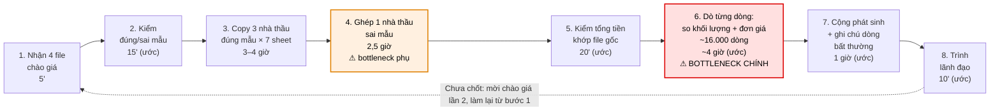
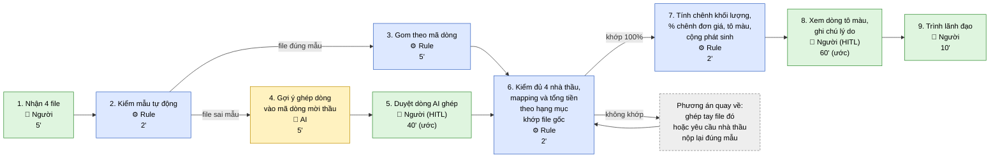

# Báo cáo nhóm — Day 02 Discovery & Problem Framing

> Bản chung của nhóm, viết trên repo do nhóm trưởng fork. Không copy file này sang repo cá nhân.
> Template chi tiết và prompt mẫu: [docs/01-worksheet.md](../../docs/01-worksheet.md). Bài mẫu: [docs/02-deliverable-example.md](../../docs/02-deliverable-example.md).

## 1. Thông tin nhóm

- Tên nhóm: TEAMLAGI
- Thành viên: 6 người, xem [TEAM.md](../../TEAM.md). Trưởng nhóm Nguyễn Trọng Hưởng xác nhận trong chat ngày 2026-11-09 rằng coach đã cho phép quy mô này và các thành viên đã đồng ý phân công.
- Candidate problem được chọn (1 câu): Đối chiếu hồ sơ chào giá của các nhà thầu với yêu cầu/BOQ và giữa các nhà thầu để phát hiện chênh lệch.
- Quyết định cuối: nhóm xác nhận sau review; bản tổng hợp mục 8 đề xuất Not Yet cho triển khai/pilot, ưu tiên kiểm phương án Rule.
- Nguồn hướng đã chọn: trưởng nhóm cung cấp trong chat. Phạm vi đề xuất sau review là phần soát khối lượng/đơn giá trên bảng đã ghép đúng; actor và dữ liệu tham chiếu theo Vinh, quyền sử dụng và kiểm chứng CP4 được kiểm riêng.

**Nguồn bản tổng hợp:** nội dung review CP5–CP6 được tổng hợp từ nhánh Vinh/Tuyên và ghi rõ đề xuất, baseline theo nguồn, giả định và target. CP3 dùng ghi chép trao đổi thực tế; CP4 dùng bằng chứng người ngoài nhóm. Theo dõi bàn giao tại [nhật ký điều phối](../../docs/TEAM_WORK_LOG.md).

---

## 2. Hội tụ nhóm (CP3)

**Phần đã xác nhận:** nhóm đã thảo luận và chọn hướng ở mục 1. **Phần chưa có nguồn:** ghi chép pitch/challenge, cluster, OST, shortlist/điểm và lý do chọn–loại. Các mục 2.1–2.4 dưới đây chờ nội dung nhóm tự thực hiện và cung cấp; không suy diễn từ báo cáo CP1–CP2 thành kết quả thảo luận CP3.

| Nội dung cần đưa vào báo cáo | Căn cứ cần nhóm cung cấp | Kiểm tra khi tổng hợp |
|---|---|---|
| Pitch và challenge | Candidate đã thực sự trình bày; ai hỏi ai; câu hỏi và điều chỉnh thực tế | Mỗi thành viên có ít nhất một câu hỏi; phân biệt card chuẩn bị với card đã pitch |
| Cluster và OST | Cách nhóm đã gom; một outcome; các opportunity và ý đã gạch bỏ nếu có | Nhánh là nhu cầu/pain; không thay bằng tên công cụ/tính năng |
| Shortlist và điểm | Ba candidate, điểm 1–5 theo bảy tiêu chí, căn cứ nhóm sử dụng | Chỉ tính tổng từ điểm nhóm cung cấp; không tự tạo điểm |
| Lý do và bất đồng | Lý do nhóm chọn, loại ít nhất hai candidate khác và cách xử lý bất đồng nếu có | Chưa có ghi chép không được diễn đạt thành “không có bất đồng” |

### 2.1. Pitch

| # | Người đưa ra | Candidate (Job Story ngắn) | Actor | Bottleneck | Câu hỏi phản biện nhận được (ai hỏi) |
|---:|---|---|---|---|---|
| 1 | | | | | |
| 2 | | | | | |
| 3 | | | | | |
| 4 | | | | | |
| 5 | | | | | |
| 6 | | | | | |
| 7 | | | | | |
| 8 | | | | | |
| 9 | | | | | |
| 10 | | | | | |
| 11 | | | | | |
| 12 | | | | | |

### 2.2. Cluster

| Cluster | Các candidate | Pattern chung |
|---|---|---|
| A | | |
| B | | |
| C | | |

### 2.3. Opportunity Solution Tree rút gọn

Gốc là **1 outcome**. Nhánh là **opportunity** (nhu cầu, pain), không phải tính năng hay công cụ.

```text
OUTCOME:
├── Opportunity A:
├── Opportunity B:
└── Opportunity C:
```

Những ý đã gạch bỏ vì là solution đội lốt opportunity:

-

### 2.4. Chấm điểm shortlist (1–5)

| Candidate | Actor rõ | Quy trình rõ | Pain có bằng chứng | Impact đo được | Vừa sức lab | So sánh được No AI/Rule/Workflow/Agent | Nhóm hiểu domain | Tổng |
|---|---:|---:|---:|---:|---:|---:|---:|---:|
| | | | | | | | | |
| | | | | | | | | |
| | | | | | | | | |

**Candidate được chọn:** Đối chiếu hồ sơ chào giá của các nhà thầu với yêu cầu/BOQ và giữa các nhà thầu để phát hiện chênh lệch. Nguồn: trưởng nhóm xác nhận trong chat; chi tiết phạm vi còn chờ chốt.

**Vì sao chọn:** Chưa có lý do do nhóm cung cấp; chờ ghi lại lập luận thực tế.

**Vì sao loại các candidate còn lại:** Chưa có nội dung do nhóm cung cấp; cần lý do cho ít nhất hai candidate.

**Xử lý bất đồng (nếu có):** Chưa được xác nhận.

### 2.5. Bản tham khảo do AI soạn — chưa phải kết quả CP3

**Nguồn và giới hạn:** bản này được soạn theo yêu cầu trưởng nhóm ngày 2026-11-09, dựa trên các candidate đã viết trong báo cáo cá nhân. Việc sắp cluster, OST, shortlist, câu hỏi và lập luận bên dưới là đề xuất của AI; chưa xác nhận nhóm từng trình bày, đặt câu hỏi hoặc đồng thuận như vậy. Không dùng phần này làm bằng chứng hoàn thành CP3 hoặc đóng góp cá nhân. Theo `RULES.md`, nhóm vẫn tự thực hiện pitch/challenge và ghi lại kết quả thực tế tại mục 2.1–2.4; việc đồng ý một bản tham khảo không thay thế hoạt động đó.

#### a. Danh mục candidate đã có trong báo cáo cá nhân

Các mã dưới đây chỉ phục vụ bản tham khảo, không phải thứ tự pitch. Nguồn [S-H] đến [S-T] nằm ở mục 10. Nội dung được rút gọn, không phải lời nói nguyên văn của thành viên.

| Người có báo cáo | Candidate trong top 3 cá nhân | Actor/phạm vi thể hiện trong nguồn | Giới hạn khi sử dụng |
|---|---|---|---|
| Hưởng [S-H] | H1: tìm nội dung cũ trong chat; H2: so sánh laptop trong ngân sách; H3: tìm chỗ ở gắn với lịch trình Vũng Tàu | Người tham gia nhóm chat; người mua laptop; người phụ trách chỗ ở cho nhóm lớp | Số liệu theo trí nhớ; chưa có bấm giờ từng bước; một tuần chuẩn bị không phải công thao tác |
| Vinh [S-V] | V1: soát khối lượng/đơn giá; V2: gom bảng chào giá, gồm file sai mẫu; V3: đối chiếu hồ sơ năng lực với tiêu chí | Chuyên viên KTKT phía chủ đầu tư; V3 có đồng nghiệp cùng chấm | Nguồn mô tả một gói thầu; cần xác nhận xuất xứ dữ liệu và quyền sử dụng; thời gian bước con có ước lượng |
| Linh [S-L] | L1: tổng hợp/cập nhật thông tin CSKH; L2: phụ đề, dịch và định vị đoạn video; L3: tổng hợp thông tin ứng viên | CSKH; người xem tài liệu/video; HR/người tuyển dụng theo phần scan | Mới có tên top 3; các Problem Card chi tiết còn trống, chưa có baseline đủ dùng |
| Khương [S-K] | K1: research làm căn cứ định hướng content; K2: làm rõ user story e-commerce; K3: kiểm thử và tài liệu API | Người làm content; backend developer và người nhận bàn giao frontend | Research 2 ngày thuộc một job được bạn chia sẻ; các mốc khác thuộc phạm vi cá nhân, chưa phải kiểm chứng CP4 |
| Quân [S-Q] | Q1: phân loại/phát hiện report khách hàng trùng; Q2: onboarding và tìm tài liệu nội bộ; Q3: tổng hợp/đối soát chứng từ | CSKH; intern/quản lý; kế toán | Top 3 và Card #2 mô tả Q2 ở mức khác nhau; cần Quân xác nhận phạm vi. Một số số liệu ban đầu/giả thuyết còn cần xác minh |
| Tuyên [S-T] | T1: đồng bộ tin tuyển dụng đa kênh khi JD đổi; T2: tập trung/chuẩn hóa hồ sơ ứng viên; T3: theo dõi trạng thái và bàn giao trong pipeline | Recruiter/HR, Hiring Manager và các bên phối hợp tuyển dụng | Báo cáo dùng benchmark bên ngoài; chưa phải baseline doanh nghiệp cụ thể hoặc bằng chứng của hướng chào giá |

#### b. Câu hỏi gợi ý để nhóm tự xem xét

Đây là câu hỏi do AI đề xuất trong bản tham khảo, chưa có người hỏi hoặc người nhận thực tế. Chỉ ghi vào nhật ký phản biện sau khi có nội dung thực sự diễn ra, đúng nguồn.

| Candidate/phạm vi | Câu hỏi tham khảo | Lỗ hổng cần làm rõ |
|---|---|---|
| V1–V2: chào giá | Bảng đã ghép đúng mã dòng chưa; công thức so khối lượng/đơn giá còn bỏ trống trường hợp nào? | Tách việc chuẩn hóa/ghép dòng khỏi việc so sánh số; chưa có lý do mặc định cần AI |
| H1: chat | Thời gian mất ở đọc/nhận diện nội dung hay chờ tải, và dữ liệu cũ có còn lấy được không? | Can thiệp tìm kiếm có thể không giảm được phần chờ của ứng dụng |
| L1: CSKH | Lần xử lý gần nhất có những nguồn nào, phải ghi lại trường nào và mất bao nhiêu phút? | Chưa có một trường hợp hành vi cụ thể cùng baseline |
| K1: research content | Hai ngày thuộc một brief nào, bước nào tốn nhất và người làm dùng căn cứ gì để chốt insight? | Không suy từ thời gian một job ra mọi job hoặc hiệu quả chuyển đổi |
| Q1: report trùng | Nhóm định nghĩa trùng bằng cùng sự cố hay nội dung gần giống; ai kiểm đáp án khi hai report khác chữ? | Cần tiêu chí và đáp án; số liệu ban đầu còn cần xác minh |
| T1: tuyển dụng đa kênh | Nếu đã có ATS/công cụ đăng đa kênh, phần chậm còn lại là cập nhật JD hay phối hợp phê duyệt? | Tránh chọn một pain mà công cụ hoặc quy trình hiện tại đã giải đủ |

#### c. Phương án gom cluster tham khảo

| Cluster đề xuất | Candidate | Pattern chung | Điểm cần giữ riêng |
|---|---|---|---|
| A — Khó truy xuất thông tin đúng lúc | H1, L2, Q2 | Thông tin có sẵn nhưng khó đến đúng nội dung cần dùng | Chat, video và tài liệu onboarding khác quyền truy cập, định dạng và cách đo |
| B — Tổng hợp nhiều nguồn trước khi xử lý/chọn lựa | H2, H3, L1, K1, Q1 | Người phụ trách phải đọc, gom và hiểu thông tin phân tán | Không coi cùng pattern là cùng actor hoặc cùng baseline |
| C — Chuẩn hóa và đối chiếu theo tiêu chí | V1, V2, V3, L3, Q3, T2 | Khác cấu trúc/mô tả làm tăng công tìm, ghép, kiểm thiếu hoặc sai lệch | V1 và V2 là hai bước khác nhau; hồ sơ năng lực, ứng viên và chứng từ có tiêu chí riêng |
| D — Làm rõ nội dung để bàn giao | K2, K3 | Yêu cầu hoặc tài liệu chưa đủ rõ để người sau thực hiện | Cần phân biệt thời gian tự làm rõ, trao đổi và chờ |
| E — Giữ thông tin nhất quán khi nhiều bên cập nhật | T1, T3 | Trạng thái/nội dung thay đổi nhưng cập nhật và bàn giao không đồng bộ | Chậm do công cụ khác chậm do trách nhiệm hoặc phê duyệt |

#### d. OST tham khảo cho bước hội tụ

Outcome dưới đây là định hướng đề xuất, chưa có baseline/target do nhóm chốt. Sau hội tụ cần gắn phút công với một actor, một loại tác vụ và phạm vi dữ liệu cụ thể; không dùng một metric chung cho cả 18 candidate.

```text
OUTCOME ĐỀ XUẤT: Giảm phút công tìm, tổng hợp và đối chiếu thông tin
                cho một tác vụ cụ thể, đồng thời giữ chất lượng được kiểm từ nguồn
├── Opportunity A: Khó lấy đúng nội dung cần dùng từ thông tin đã có
│   └── H1, L2, Q2
├── Opportunity B: Thông tin phân tán làm tăng công đọc và tổng hợp
│   └── H2, H3, L1, K1, Q1
├── Opportunity C: Dữ liệu khác cấu trúc/mô tả làm tăng công ghép và đối chiếu
│   └── V1, V2, V3, L3, Q3, T2
├── Opportunity D: Yêu cầu/tài liệu chưa rõ khiến bàn giao thiếu căn cứ
│   └── K2, K3
└── Opportunity E: Thay đổi nội dung/trạng thái không được cập nhật nhất quán
    └── T1, T3
```

Ví dụ cách diễn đạt nên loại khỏi tầng opportunity: “chatbot tìm tài liệu”, “agent tự chấm nhà thầu”, “dashboard tuyển dụng”. Đây là ví dụ AI nêu để kiểm cách viết, không phải những ý được ghi nhận nhóm từng đưa ra hoặc gạch bỏ.

#### e. Shortlist và cơ sở đánh giá tham khảo

**Shortlist AI đề xuất để đối chiếu:** V1 — soát chênh lệch chào giá; H1 — tìm nội dung chat; T1 — giữ nhất quán tin tuyển dụng khi JD đổi. Chưa có căn cứ khẳng định đây là shortlist nhóm từng chọn. V2 cần được xem riêng như điều kiện đầu vào của V1, không mặc định gộp toàn bộ thời gian hai việc thành một bottleneck.

| Tiêu chí nhóm cần chấm 1–5 | V1 — chào giá | H1 — chat | T1 — tin tuyển dụng |
|---|---|---|---|
| Actor rõ | Báo cáo Vinh nêu chuyên viên KTKT; nhóm cần chốt actor của phạm vi chung | Hưởng là người có trải nghiệm; cần thu hẹp một nhóm/nguồn | Báo cáo Tuyên nêu HR/Recruiter và các bên phối hợp; cần chọn actor chính |
| Quy trình rõ | Có mô tả gom → soát → trình; cần tách phạm vi ghép và soát | Có bản nháp; chưa xác nhận đủ từng bước thực tế | Có mô tả đăng/cập nhật; chưa có quy trình thực tế tại một tổ chức |
| Pain có bằng chứng | Có dữ liệu được báo cáo trong CP1–CP2; nguồn và phạm vi cần kiểm; chưa có CP4 | Có ước lượng trí nhớ và lượt không tìm được; chưa có nhật ký đo | Có benchmark được báo cáo; chưa có baseline của actor cụ thể |
| Impact đo được | Có thể đo phút/vòng và chất lượng phát hiện trên cùng bộ hồ sơ; chưa có số đo nhóm xác nhận | Có thể đo phút/lượt và tỷ lệ tìm đúng; cần tính lượt thất bại | Có thể đo phút cập nhật/JD và số bài lệch; cần dữ liệu thực tế |
| Vừa sức lab | Phải giới hạn hạng mục, định dạng và dữ liệu được phép dùng | Phải giới hạn một nguồn và khả năng lấy dữ liệu | Phải giới hạn kênh và quyền truy cập; tránh triển khai đa nền tảng |
| So sánh 4 mức | Có thể đối chứng bảng/công thức với hỗ trợ ghép mô tả; chưa chọn mức | Có thể đối chứng tìm kiếm/lọc/chỉ mục với hỗ trợ ngữ nghĩa | Có thể đối chứng nguồn JD chung và Rule với hỗ trợ xử lý nội dung |
| Nhóm hiểu domain | Có báo cáo Vinh làm đầu mối domain; không suy ra cả nhóm đã hiểu đủ | Có trải nghiệm cá nhân Hưởng; chưa xác nhận mức hiểu của cả nhóm | Tuyên mô tả kinh nghiệm công cụ tuyển dụng; chưa xác nhận cả nhóm hiểu đủ |

**Điểm số và tổng:** chưa chấm. Bảng này cung cấp căn cứ và lỗ hổng để nhóm tự chấm tại mục 2.4; không tạo số nhằm làm cho hướng đã chọn có tổng cao nhất. Các nguồn benchmark chưa được mở kiểm trong lượt này nên không dùng số của chúng để chấm pain/impact của nhóm.

#### f. Lập luận chọn–loại để nhóm xem xét

**Vì sao hướng chào giá có thể đáng ưu tiên:** báo cáo Vinh đã mô tả actor, chuỗi hồ sơ → bảng tổng hợp → đối chiếu → trình duyệt và phân biệt file đúng/sai mẫu. Hướng này cho phép thiết kế đầu ra kiểm được tới dòng nguồn, so với yêu cầu/BOQ và giữa các nhà thầu. Có thể đặt cách làm bảng/công thức làm đối chứng để đánh giá phần còn cần hỗ trợ. Đây là lập luận đề xuất từ nội dung nguồn, chưa phải lý do đồng thuận đã ghi nhận của nhóm hoặc bằng chứng đã kiểm chứng.

**Điều kiện có thể làm lập luận trên không đứng vững:** không có quyền dùng dữ liệu; không xác định được dòng tương ứng/đáp án đối chiếu; chưa tách công ghép khỏi công soát; hoặc bảng/công thức đã xử lý đủ trong phạm vi chọn. Trường hợp cuối vẫn có thể dẫn đến một bài lab chọn No AI/Rule hợp lệ; nhóm tự quyết sau kiểm chứng.

**Vì sao có thể chưa ưu tiên H1 ở vòng này:** trải nghiệm tìm chat có thật theo báo cáo Hưởng, nhưng chưa tách công tìm khỏi chờ tải và chưa xác minh khả năng lấy lịch sử/tệp cũ. Hỗ trợ ngữ nghĩa có thể không xử lý phần chậm chính. Đây là điểm cần kiểm, không chứng minh hướng này không đáng giải.

**Vì sao có thể chưa ưu tiên T1 ở vòng này:** báo cáo Tuyên đã lưu ý công cụ đa kênh hiện có và khác biệt giữa benchmark với baseline thực tế. Chưa biết khoảng trống sau công cụ/quy trình hiện tại là gì; cần actor, dữ liệu cập nhật JD và phạm vi kênh cụ thể. Không dùng benchmark tuyển dụng để so lớn/nhỏ trực tiếp với số liệu chào giá hoặc tìm chat.

**Phần nhóm cần tự ghi tiếp:** hướng đã chọn có đúng với V1 hay gồm cả V2; shortlist thực tế; điểm và căn cứ; lý do thực sự của nhóm; các câu hỏi thực sự đã hỏi/nhận; bất đồng và cách xử lý nếu có. Không chuyển các đoạn AI đề xuất ở đây thành sự kiện quá khứ.

---

## 3. Kiểm chứng + research giải pháp đã có (CP4)

**Nguồn kiểm chứng:** phần 3.1–3.2 giữ cập nhật của Linh trên main tại e278c07; số liệu domain bổ trợ theo báo cáo Vinh. Snapshot được xem trong đúng giới hạn nguồn ghi ở ghi chú review dưới đây. Mục 3.3 giữ research của Khương đã merge qua PR #5; tài liệu Microsoft bổ trợ được dẫn riêng ở mục 10.

### 3.1. Assumption Map

| # | Giả định | Loại (Value / Usability / Feasibility / Viability) | Quan trọng (1–5) | Đã có bằng chứng (1–5) | Kiểm chứng trước? |
|---:|---|---|---:|---:|---|
| 1 |Người phụ trách đánh giá thầu mất nhiều thời gian đối chiếu thủ công HSDT của nhiều nhà thầu với các tiêu chí trong HSMT|Value |5 | 2|Ưu tiên 1|
| 2 |Quá trình đối chiếu thủ công có nguy cơ bỏ sót sự khác biệt về thông số kỹ thuật, giá, tiến độ và điều kiện hợp đồng |Value |5 |2 |Ưu tiên 2 |
| 3 |Người đánh giá cần xem được vị trí tài liệu gốc làm căn cứ cho từng kết quả so sánh, thay vì chỉ nhận kết luận tự động|Usability	 |5 |2 |Ưu tiên 3 |
| 4 |Có thể trích xuất đủ chính xác thông tin từ các HSDT có định dạng PDF, Word, bảng biểu hoặc bản scan để hỗ trợ đối chiếu|Feasibility	 |5 |3 |có |
| 5 |Người dùng sẵn sàng thay đổi một phần quy trình hiện tại để sử dụng công cụ hỗ trợ so sánh, nhưng vẫn giữ quyền quyết định cuối cùng|Usability	 |4 |1 |có |
| 6 |Lợi ích tiết kiệm thời gian và giảm công sức kiểm tra đủ lớn để đơn vị cân nhắc chi phí triển khai, bảo mật và vận hành|Viability |4 |1 |có |

*Điền 4–6 giả định; xóa dòng thừa.*

Giả định nhóm kiểm chứng trong buổi này: Giả định #1 — Việc so sánh, đối chiếu HSDT thực sự tạo ra khối lượng công việc thủ công đáng kể, có thể đo được bằng thời gian xử lý và số lần phải kiểm tra lại.

Lý do: Đây là giả định cốt lõi về giá trị của vấn đề. Nếu người dùng không mất nhiều thời gian hoặc đã có công cụ đáp ứng tốt, việc phát triển giải pháp mới có thể không cần thiết.

### 3.2. Kiểm chứng

Cách đã dùng: Phỏng vấn nhanh 2–3 người đã từng tham gia lập, rà soát hoặc đánh giá hồ sơ thầu

| Trường | Nội dung |
|---|---|
| Người được hỏi (vai trò) |Chuyên viên phụ trách hồ sơ đấu thầu tại công ty xây dựng|
| Câu nói đáng nhớ nhất (nguyên văn) |Có rất nhiều số liệu cần so sánh |
| Lần gần nhất gặp vấn đề này: chuyện gì đã xảy ra? | Trong quá trình đối chiếu hồ sơ, một số liệu quan trọng liên quan đến khối lượng nguyên vật liệu bị sai lệch, dẫn đến thiếu hụt vật tư so với nhu cầu thực tế.|
| Hiện đang xử lý bằng cách nào (workaround)? |Kiểm tra lại số liệu và tự bù đắp phần vật liệu thiếu hụt.|
| Mất bao lâu, bao lần? | Chưa có số liệu cụ thể về thời gian và tần suất; cần hỏi thêm để định lượng mức độ ảnh hưởng. |
| Insight / opportunity rút ra |Việc đối chiếu nhiều số liệu về khối lượng vật tư có thể tạo ra rủi ro sai sót và thiệt hại tài chính. Cơ hội là hỗ trợ phát hiện chênh lệch và truy vết số liệu trước khi hoàn tất hồ sơ|

Tổng hợp:

| Nguồn | Số người / số mẫu | Tín hiệu xác nhận | Tín hiệu phản bác |
|---|---:|---|---|
| | | | |

**Nhóm đã sửa problem thế nào sau kiểm chứng:**

Ghi chú review nguồn CP4 tại main e278c07: phần Linh bổ sung ghi cách phỏng vấn 2–3 người, nhưng repo hiện thể hiện một snapshot và thiếu thời điểm/cách hỏi, số người thực tế, thời gian/tần suất và tín hiệu phản bác. Giữ nội dung người phụ trách cung cấp, đồng thời yêu cầu bổ sung nguồn trước khi dùng để xác nhận các giả định. Các giả định về trích PDF/scan thuộc hướng mở rộng, không mặc định là điều kiện của Rule so số.

### 3.3. Research giải pháp đã có

Liên kết tài liệu chính thức được mở kiểm trong lượt review PR ngày 2026-11-09. Chức năng được tài liệu mô tả không chứng minh công cụ đã đạt target trên dữ liệu nhóm; cách áp dụng và khoảng trống trong bảng được giữ như đề xuất cần kiểm.

| Công cụ / case / pattern | Link | Giải bước nào trong quy trình? | Điểm mạnh | Khoảng trống / rủi ro | Bài học cho nhóm |
|---|---|---|---|---|---|
| **Excel: công thức + Conditional Formatting (Rule)** | [Microsoft: định dạng theo điều kiện](https://support.microsoft.com/en-us/excel/use-conditional-formatting-to-highlight-information-in-excel); [hàm MEDIAN](https://support.microsoft.com/en-au/excel/functions/median-function) | Microsoft hỗ trợ tô màu theo công thức và tính trung vị. Nhóm có thể áp dụng vào bước 2–3: tính chênh khối lượng và độ lệch đơn giá so với trung vị; dùng kết quả làm danh sách cần rà soát ở bước 5. Đây là cách áp dụng do nhóm đề xuất. | Phù hợp với file tổng hợp hiện tại; phép tính minh bạch, truy lại được từng dòng; không cần LLM. | Phải kiểm mã dòng, đơn vị tính và kiểu dữ liệu; cần thống nhất ngưỡng cảnh báo. Ô trống, giá 0 và công thức lỗi cần xử lý riêng. Trung vị của 4 báo giá không đồng nghĩa với giá thị trường hợp lý. | Dùng làm baseline không AI. Đo xem công thức và bộ lọc có đủ đưa thời gian soát xuống dưới 1,5 giờ/vòng trước khi xây thêm hệ thống. |
| **Procore Bidding — Bid Leveling** | [Procore: Level Bids for a Bid Form](https://support.procore.com/products/online/user-guide/project-level/bidding/tutorials/level-bids-for-a-bid-form) | Hỗ trợ đối chiếu chào giá ở bước 2–3 và ghi nhận rà soát ở bước 5: xem dòng thiếu/loại trừ, điều chỉnh giá trị, ghi chú, tô màu và xem lịch sử thay đổi. | Tập trung việc so sánh và lưu dấu vết điều chỉnh trên cùng công cụ. | Tài liệu yêu cầu có bid form và báo giá trong hệ thống. Chưa xác minh khả năng nhận nguyên trạng file Excel 7 sheet của Nam, tự cảnh báo theo ngưỡng trung vị hoặc xử lý gói 4.100 dòng trong thời gian mục tiêu. | Học cách tách giá trị nhà thầu nộp với giá trị điều chỉnh khi so sánh; lưu lý do và lịch sử. Không xem “có bid leveling” là bằng chứng đáp ứng toàn bộ workflow của Nam. |
| **Autodesk BuildingConnected — Bid Leveling** | [BuildingConnected: Bid Leveling Overview](https://support.buildingconnected.com/hc/en-us/articles/47949854611219-Bid-Leveling-Overview) | Hỗ trợ bước 3–5: trình bày báo giá từng nhà thầu thành các cột, chia theo mục/dòng của bid form; so với estimated cost; tô màu, ghi chú và điều chỉnh giá trị khi rà soát. | So sánh trực quan trên một bảng; có mốc dự toán để tham chiếu và chỗ ghi nhận nhận xét. | Cấu trúc so sánh dựa trên bid form của dự án. Chưa xác minh việc nhập file hiện có, kiểm chênh khối lượng mời thầu tự động hoặc phát hiện đơn giá bất thường theo quy tắc nhóm cần. | Học cách trình bày báo giá cạnh nhau, phân biệt chênh so với dự toán và chênh giữa nhà thầu. Cần thử bằng dữ liệu mẫu trước khi kết luận phù hợp. |

---

## 4. Quy trình trước/sau (CP5)

Phần này mô tả cả gom và soát; thời gian tương lai là kỳ vọng thiết kế. Lựa chọn Rule cho riêng bước so số và giả thuyết AI cho ghép file sai mẫu cần được đánh giá theo phạm vi riêng, trước khi nhóm chốt mức can thiệp.

Phạm vi: từ lúc nhận bảng chào giá của 4 nhà thầu đến lúc trình lãnh đạo, gồm 2 phần **gom** (Card #2) và **soát** (Card #1) trong báo cáo cá nhân của Nguyễn Văn Vinh. Vẽ cả phần gom vì bước soát chỉ làm được khi bảng của 4 nhà thầu đã được gom đúng theo mã dòng. Số liệu lấy từ gói thầu gần nhất; thời gian ghi "(ước)" là ước lượng từng bước, tổng gom và tổng soát là đo thật.

### 4.1. Quy trình hiện tại

**HIỆN TẠI** — 8 bước/vòng, 8/8 bước thủ công, khoảng 11–13 giờ/vòng × 2 vòng/gói. Ô viền đỏ là bottleneck.



| Bước | Actor | Input | Output | Thời gian / tần suất | Ghi chú |
|---:|---|---|---|---|---|
| 1 | Chuyên viên KTKT (Nam) | Email / file nộp của 4 nhà thầu | 4 file Excel chào giá đã lưu | 5' / vòng | 2 vòng/gói ở gói gần nhất |
| 2 | Chuyên viên KTKT | 4 file chào giá, mẫu 7 sheet trong HSYC | Danh sách file đúng mẫu / sai mẫu (gói gần nhất: 3 đúng, 1 sai) | 15' (ước) / vòng | |
| 3 | Chuyên viên KTKT | 3 file đúng mẫu | File tổng hợp 7 sheet, 63 cột/sheet | 3–4 giờ / vòng (đo) | Copy tay từng sheet |
| 4 | Chuyên viên KTKT | 1 file sai mẫu (1 sheet 4.870 dòng) | Dòng của nhà thầu sai mẫu được xếp vào đúng hạng mục, đúng mã dòng | 2,5 giờ / vòng (đo) | Bottleneck phụ: chậm khoảng 2 lần so với một nhà thầu đúng mẫu; chỉ xảy ra khi có nhà thầu sai mẫu |
| 5 | Chuyên viên KTKT | File tổng hợp + 4 file gốc | Xác nhận tổng tiền từng nhà thầu khớp file gốc | 20' (ước) / vòng | Handoff sang phần soát |
| 6 | Chuyên viên KTKT | File tổng hợp (~4.100 dòng × 4 nhà thầu) | Các dòng có khối lượng khác mời thầu hoặc đơn giá chênh lớn được đánh dấu | ~4 giờ (ước) / vòng | **Bottleneck chính**; dò bằng mắt |
| 7 | Chuyên viên KTKT | Các dòng đã đánh dấu | Tổng phát sinh từng nhà thầu (0 đến ~3,9 tỷ) + ghi chú lý do | 1 giờ (ước) / vòng | |
| 8 | Chuyên viên KTKT → Lãnh đạo | Bảng tổng hợp có ghi chú | Lãnh đạo chọn nhà thầu, hỏi lại, hoặc mời chào giá lần 2 | 10' (ước) / vòng | Gói gần nhất: bị hỏi lại / trả lại ~4 lần |

Tổng: gom (bước 1–5) 6–7 giờ + soát (bước 6–8) 5–6 giờ = **khoảng 11–13 giờ/vòng, 22–26 giờ/gói (2 vòng)**.

**Bottleneck chính:** Bước 6, dò khoảng 16.000 dòng (4.100 dòng × 4 nhà thầu) bằng mắt để tìm dòng có khối lượng khác mời thầu hoặc đơn giá chênh lớn, mất khoảng 4 giờ/vòng. Đây là bước vừa tốn thời gian nhất vừa có rủi ro cao nhất: sót một dòng có thể làm lệch so sánh giá tới hàng tỷ (gói gần nhất có 1 nhà thầu mà giá trị tính theo khối lượng chào thấp hơn giá trị tính theo khối lượng mời thầu khoảng 3 tỷ). Bước 4 là bottleneck phụ, phụ thuộc vào việc có nhà thầu sai mẫu hay không (tỷ lệ này cần kiểm ở CP4).

### 4.2. Quy trình tương lai

**TƯƠNG LAI (kỳ vọng, chưa pilot)** — 9 bước/vòng, 4/9 bước thủ công, khoảng 2–2,5 giờ/vòng. Xanh dương = Rule, vàng = AI, xanh lá = con người, xám = phương án quay về.



| Bước | Ai / cái gì làm | Việc | Thời gian (ước) |
|---:|---|---|---|
| 1 | Con người | Nhận 4 file chào giá | 5' |
| 2 | Rule (macro) | Kiểm tên sheet, cột, mã dòng so với mẫu HSYC; tách file đúng mẫu / sai mẫu | 2' |
| 3 | Rule (Power Query / macro) | Gom các file đúng mẫu vào file tổng hợp theo mã dòng | 5' |
| 4 | AI | Chỉ với file sai mẫu: đọc từng dòng, gợi ý dòng đó thuộc mã dòng nào trong BOQ mời thầu (kể cả khi mô tả khác chữ), kèm mức tin cậy; dòng không tìm được thì đánh dấu "chưa ghép" | 5' |
| 5 | Con người (HITL) | Duyệt dòng AI ghép, ưu tiên dòng tin cậy thấp và dòng "chưa ghép"; tự ghép các dòng còn lại | 40' |
| 6 | Rule | So tổng tiền từng hạng mục của từng nhà thầu với file gốc; chỉ sang bước 7 khi khớp 100% | 2' |
| 7 | Rule (công thức + conditional formatting) | Tính chênh khối lượng = khối lượng chào − khối lượng mời thầu; % chênh đơn giá so với trung vị 4 nhà thầu; tô màu dòng chênh khối lượng khác 0 hoặc chênh đơn giá vượt ngưỡng; cộng phát sinh | 2' |
| 8 | Con người (HITL) | Xem các dòng tô màu, quyết định dòng nào thật sự bất thường, ghi lý do | 60' |
| 9 | Con người | Trình lãnh đạo | 10' |

Gom (bước 1–6) khoảng 1 giờ; soát (bước 7–9) khoảng 1,2 giờ.

**Boundary — AI không được:**
- Sửa khối lượng, đơn giá hay bất kỳ con số nào của nhà thầu; AI chỉ gợi ý dòng đó thuộc mã dòng nào.
- Tự xóa hoặc bỏ qua dòng mà nó không ghép được (phải đánh dấu "chưa ghép" để người xử lý).
- Kết luận nhà thầu nào đạt, rẻ nhất hay bị loại; quyết định này thuộc chuyên viên và lãnh đạo.
- Tự gửi file cho lãnh đạo hoặc nhà thầu.
- Nhận dữ liệu chào giá qua công cụ AI chưa được tổ chức cho phép (dữ liệu chào giá là thông tin mật của gói thầu).

**Khi nào con người phải kiểm tra (HITL):**
- Bước 5: mọi mapping do AI gợi ý phải được người duyệt đối chiếu mã, mô tả, đơn vị và dòng nguồn trước khi dùng; ưu tiên dòng tin cậy thấp và xử lý riêng các dòng chưa ghép.
- Bước 6: nếu tổng tiền bất kỳ hạng mục nào không khớp file gốc thì dừng, không sang bước 7.
- Bước 8: mọi dòng tô màu phải được người xem và ghi lý do trước khi trình.

Kiểm tra chéo: tổng tiền khớp không chứng minh mọi dòng được ghép đúng. Một dòng ghép sai có thể không tạo chênh khối lượng nếu hai dòng cùng khối lượng hoặc cùng đơn vị. Vì vậy chuyên viên kiểm mã, mô tả, đơn vị và dòng nguồn của mọi mapping AI trước khi sử dụng, không chỉ các gợi ý có mức tin cậy thấp; dòng mơ hồ được chuyển xử lý thủ công.

**Phương án quay về:**
- AI ghép sai, tổng tiền không khớp, hoặc AI không dùng được → chuyên viên ghép tay file sai mẫu như hiện tại (khoảng 2,5 giờ), hoặc yêu cầu nhà thầu nộp lại đúng mẫu.
- Macro / Power Query lỗi (ví dụ nhà thầu đổi mã dòng) → quay về copy tay (bước 3 hiện tại) cho file đó.
- Ngưỡng tô màu báo quá nhiều dòng → chỉnh ngưỡng cùng lãnh đạo; trong lúc chờ, dò tay các dòng có giá trị lớn.

### 4.3. Before / after

| Chỉ số | Trước | Sau (kỳ vọng) | Ghi chú |
|---|---:|---:|---|
| Số bước | 8 | 9 | Thêm bước kiểm mẫu tự động và tách riêng bước người duyệt dòng AI ghép |
| Tổng thời gian | 11–13 giờ/vòng (22–26 giờ/gói) | ~2–2,5 giờ/vòng (~4–5 giờ/gói) | "Trước" đo trên gói gần nhất; "Sau" là ước lượng, cần đo khi pilot |
| Số bước thủ công | 8/8 | 4/9 | Bước thủ công còn lại: nhận file, duyệt dòng AI ghép, xem dòng tô màu, trình lãnh đạo |
| Bottleneck chính | Dò ~16.000 dòng bằng mắt (~4 giờ/vòng) | Xem và ghi lý do cho các dòng tô màu (~60'/vòng) | Thời gian bước 8 phụ thuộc số dòng bị tô màu, tức là phụ thuộc ngưỡng |
| Rủi ro mới phát sinh | — | AI ghép sai dòng nhưng tổng tiền vẫn khớp; ngưỡng tô màu đặt sai gây báo nhầm nhiều hoặc bỏ sót; nhà thầu đổi mã dòng làm gom tự động sai; dữ liệu mật đi qua công cụ AI; chuyên viên tin máy, soát lơ là hơn | Xử lý bằng bước 6 (khớp tổng tiền), bước 7 (tô màu dòng chênh), HITL ở bước 5 và 8, và boundary về công cụ AI |

---

## 5. Problem Statement v0 (CP5)

Phạm vi của v0/v1 đề xuất dưới đây là **riêng phần soát**; sơ đồ mục 4 của Vinh giữ nguyên để thể hiện bối cảnh toàn luồng gom + soát. Target 2–2,5 giờ/vòng trong mục 4 là kỳ vọng cho toàn luồng có AI mapping, không dùng thay target riêng bước soát.

Bản tổng hợp đề xuất từ pain và quy trình trong báo cáo Vinh; v0 giữ cách mô tả vấn đề, chưa gắn một công cụ cụ thể. Đây là nội dung chuẩn bị review, không ghi nhận nhóm đã tự viết/chốt bản này.

| Trường | Nội dung |
|---|---|
| **Actor** | Chuyên viên KTKT phía chủ đầu tư phụ trách soát chào giá gói cơ điện. |
| **Quy trình** | Sau khi gom chào giá vào bảng tổng hợp, kiểm khối lượng với BOQ, so đơn giá, tổng hợp phát sinh và ghi chú trước khi trình lãnh đạo. |
| **Bottleneck** | Dò từng dòng khối lượng và đơn giá giữa khoảng 4.100 hạng mục và 4 nhà thầu; bước 2–3 khoảng 240 phút theo phân rã ước lượng của Vinh. |
| **Impact** | Riêng phần soát được Vinh báo cáo 5–6 giờ/vòng, hai vòng/gói. Dòng chênh bị bỏ sót có thể làm thông tin trình duyệt thiếu chính xác; khoản chênh trong một hồ sơ không được quy thành thiệt hại đã phát sinh. |
| **Success Metric** (baseline → target, cách đo) | Baseline tham chiếu 300–360 phút/vòng theo Vinh → target đề xuất dưới 90 phút/vòng cùng phạm vi; không bỏ sót chênh khối lượng xác định được trong bộ đối chiếu. Chạy trên một bộ hồ sơ cũ được phép dùng, chuyên viên kiểm đáp án; ghi công xử lý, kiểm/sửa, kết quả và ngoại lệ cho từng vòng. |
| **Boundary** (AI không được làm gì; khi nào cần con người kiểm tra — HITL) | Bảo toàn số gốc và nguồn; chuyên viên xác nhận trường hợp mơ hồ và bảng trước trình; không tự chọn/loại nhà thầu, sửa giá/khối lượng hoặc gửi hồ sơ. |

Phản biện nhận được (từ AI hoặc nhóm khác) và nhóm có đồng ý không:

- Review tài liệu chỉ ra v0 cần nói rõ điều kiện mapping; không lấy thời gian gom làm baseline riêng bước soát.
- Target thời gian phải tính cả công kiểm/sửa; các lượt không xử lý được phải báo kết quả, không chỉ chọn lượt thành công.
- Tổng tiền khớp vẫn có thể che sai mapping; cần kiểm nguồn và bộ tình huống đổi dòng.
- Ngưỡng và đáp án cần người domain duyệt; các điểm này được đưa vào v1 đề xuất. Phản hồi của nhóm được ghi theo trao đổi thực tế.

---

## 6. Mức can thiệp AI (CP6)

### 6.1. Ma trận độ mơ hồ × độ phức tạp
**Bài toán:** Kiểm tra chênh lệch khối lượng, đơn giá và các thông tin bất thường trong hồ sơ chào giá gói thầu cơ điện

**Bối cảnh:**

Một gói thầu có khoảng 4.100 dòng BOQ, 4 nhà thầu tham gia chào giá, tương đương khoảng 16.000 dòng cần đối chiếu mỗi vòng
Theo dữ liệu từ Problem Card cá nhân, quá trình kiểm tra mất khoảng 5–6 giờ/vòng và một gói thầu có thể trải qua 2 vòng chào giá

**Đánh giá các công đoạn:**

| Công đoạn | Độ mơ hồ | Độ phức tạp | Nhận định |
|---|---|---|---|
| So khối lượng chào với BOQ | Thấp | Cao về khối lượng dữ liệu | Có thể sử dụng công thức và Rule |
| Phát hiện đơn giá chênh lệch | Trung bình | Trung bình | Rule phát hiện, con người đánh giá nguyên nhân |
| Gom file đúng mẫu | Thấp | Trung bình | Power Query, Macro |
| Ghép file sai mẫu | Cao | Cao | Workflow kết hợp AI hỗ trợ đối chiếu ngữ nghĩa |
| Đánh giá hồ sơ năng lực | Cao | Cao | AI trích xuất bằng chứng, chuyên viên quyết định |

**Vị trí của bài toán chính:** Độ mơ hồ thấp khi bảng đã ghép đúng mã/đơn vị và quy tắc rõ; nhiều nguồn/bước phụ thuộc nhau tạo độ phức tạp tích hợp. Số dòng lớn riêng nó không chứng minh cần Agent.

Khó khăn chính không nằm ở việc cần AI suy luận mà nằm ở số lượng dòng phải kiểm tra lớn, thao tác thủ công lặp lại và nguy cơ bỏ sót các chênh lệch

### 6.2. So sánh bốn mức can thiệp

| Mức | Phương án | Khả năng giải quyết | Hạn chế | Lựa chọn |
|---|---|---|---|---|
| No AI | Chuẩn hóa mẫu, checklist mã/đơn vị/phiên bản, phân công kiểm và quản lý BOQ chung; soát thủ công theo cách đã cải tiến | Có thể đủ khi phạm vi nhỏ hoặc công soát sau cải tiến đạt mục tiêu | Cần đo công còn lại sau cải tiến, không mặc định bằng hiện trạng 5–6 giờ/vòng | Đối chứng cần thử trước khi chọn Rule |
| Rule | Sử dụng Excel Formula, Conditional Formatting, Power Query để phát hiện chênh lệch | Có thể kiểm tra toàn bộ dòng đã khớp mã, tự động tính chênh khối lượng và đơn giá | Cần dữ liệu được ghép đúng, chưa tự hiểu file sai mẫu | **Ưu tiên cho bài toán chính** |
| Workflow | Kết hợp bước nhập dữ liệu, kiểm tra, tổng hợp và xuất báo cáo, bổ sung AI khi cần xử lý dữ liệu phi cấu trúc | Giảm thao tác giữa các bước, hỗ trợ xử lý nhà thầu chào sai mẫu | Phụ thuộc dữ liệu đầu vào và khả năng đối chiếu | Cân nhắc cho bài toán mở rộng |
| Agent | Hệ thống tự lựa chọn công cụ, phân tích hồ sơ và thực hiện nhiều bước | Linh hoạt với tác vụ có nhiều ngoại lệ | Chi phí cao, khó kiểm soát, nguy cơ kết luận sai | Chưa cần thiết |

**Mức lựa chọn đề xuất: Rule-based Automation**

**Lý do:**

- Chênh lệch khối lượng có thể xác định chính xác bằng phép tính
- Chênh lệch đơn giá có thể phát hiện bằng công thức và ngưỡng cảnh báo
- Không cần sử dụng LLM để xử lý dữ liệu số đã có cấu trúc
- Dễ kiểm thử, giải thích kết quả và đối chiếu với file gốc
- Giảm chi phí và rủi ro so với phương án dùng Agent

**Trường hợp có thể sử dụng AI:**

Khi nhà thầu gửi bảng chào giá không theo mẫu, mô tả hạng mục khác cách diễn đạt trong BOQ, AI có thể đề xuất ghép các dòng tương ứng theo ý nghĩa
Đây là công đoạn thuộc Problem Card #2, không phải bước so sánh số liệu của Problem Card #1

### 6.3. AI Canvas rút gọn

Phương án Rule chính không cần AI Canvas theo worksheet. Bảng dưới là bản chuẩn bị riêng cho hướng mở rộng ghép file sai mẫu nếu sau này có bằng chứng cần AI; không tính lợi ích của hướng này vào target soát Rule.

| Thành phần | Nội dung |
|---|---|
| **Prediction** | Với file sai mẫu, AI đề xuất mã BOQ hoặc hạng mục tương ứng cho từng dòng chào giá dựa trên nội dung mô tả |
| **Judgment** | Chuyên viên KTKT kiểm tra mã dòng, quy cách, đơn vị tính, khối lượng và sự phù hợp của đề xuất |
| **Action** | Hệ thống tạo bảng đối chiếu và danh sách dòng bất thường, chuyên viên xác nhận trước khi sử dụng |
| **Outcome** | Giảm thời gian kiểm tra và ghép bảng, không bỏ sót dòng chênh khối lượng, tổng tiền khớp file gốc |
| **Input** | BOQ gốc, bảng chào giá của nhà thầu, mã hạng mục, mô tả, đơn vị tính, khối lượng và đơn giá |
| **Feedback** | Các dòng được chuyên viên chấp nhận, chỉnh sửa hoặc từ chối, kết quả soát lại trên gói thầu đã có đáp án |

**Điểm can thiệp chính:**

- Rule phát hiện chênh lệch số liệu
- AI hỗ trợ đối chiếu mô tả hạng mục không đồng nhất
- Chuyên viên KTKT kiểm tra và xác nhận kết quả
- Lãnh đạo tiếp tục chịu trách nhiệm phê duyệt theo quy trình

**Boundary:**

- Không tự động kết luận nhà thầu đạt hoặc không đạt
- Không tự động lựa chọn nhà thầu trúng thầu
- Không thay đổi file chào giá gốc
- Không tự sửa khối lượng hoặc đơn giá do nhà thầu cung cấp
- Không tự ghép các dòng thiếu căn cứ đối chiếu
- Không sử dụng dữ liệu hồ sơ ngoài phạm vi được cấp quyền
- Các trường hợp thiếu mã, trùng mã hoặc không khớp tổng tiền phải được chuyển cho chuyên viên kiểm tra
- Khi hệ thống không thể xác định kết quả đáng tin cậy, quay về quy trình kiểm tra thủ công

### 6.4. Hai câu hỏi Google PAIR

Các câu trả lời sau phục vụ hướng mở rộng có AI và cần actor xác nhận. Không coi chúng là bằng chứng nhóm đã chọn hoặc thử AI trong phạm vi Rule.

**1. Người dùng muốn được hỗ trợ hay giao hẳn việc cho hệ thống?**

Đề xuất kết hợp cả hai cách tùy theo công đoạn
Đối với việc so sánh khối lượng, đơn giá và tổng tiền theo các công thức đã xác định, có thể tự động hóa hoàn toàn bước tính toán
Đối với việc ghép file sai mẫu, nhận diện hạng mục tương đương và đánh giá nguyên nhân chênh lệch, hệ thống chỉ đưa ra gợi ý và bằng chứng để chuyên viên xác minh
Cách tiếp cận này giúp giảm thao tác lặp lại nhưng vẫn giữ trách nhiệm chuyên môn và quyết định ở con người
Đây là đề xuất thiết kế, cần được xác nhận với người trực tiếp xử lý hồ sơ

**2. AI sai kiểu nào tệ hơn, báo nhầm hay bỏ sót?**
Đối với bài toán này, bỏ sót một chênh lệch quan trọng có thể gây hậu quả lớn hơn vì ảnh hưởng đến việc so sánh giá trị chào thầu

- False Positive: Cảnh báo dòng bất thường nhưng thực tế có lý do hợp lệ, khiến chuyên viên phải kiểm tra thêm
- False Negative: Không phát hiện dòng chênh lệch thực sự, khiến thông tin bất thường không được đưa ra xem xét

Do đó, ưu tiên phát hiện đầy đủ các chênh lệch khối lượng có thể xác định bằng công thức
Đối với đơn giá, cảnh báo bất thường không đồng nghĩa với đơn giá sai, mà chỉ là tín hiệu cần người phụ trách kiểm tra

**Phương án kiểm soát:**

- Đối chiếu theo mã dòng và đơn vị tính
- Kiểm tra toàn bộ chênh lệch khối lượng bằng Rule
- Không tự động bỏ qua những dòng chưa ghép được
- Lưu giá trị gốc, giá trị tính toán và lý do cảnh báo
- Kiểm tra tổng giá trị sau khi ghép bảng
- Chuyên viên xác nhận kết quả trước khi trình lãnh đạo

---

## 7. Problem Statement v1 + tiêu chí đánh giá (CP6)

Bản đề xuất sau review v0 và nguồn Vinh/Tuyên; tiêu chí dưới đây là bộ kiểm đề xuất để phối hợp Quân hoàn thiện, không phải sản phẩm Quân đã bàn giao hoặc kết quả test đã chạy.

| Trường | Nội dung |
|---|---|
| **Actor** | Chuyên viên KTKT phía chủ đầu tư, người domain duyệt mapping và bộ đáp án. |
| **Quy trình** | Nhận bảng đã ghép và xác nhận cùng phiên bản/đơn vị → kiểm cổng dữ liệu → tính chênh theo quy tắc → chuyên viên kiểm/sửa → tạo bảng có nguồn → kiểm trước trình. |
| **Bottleneck** | Dò và đối chiếu thủ công phần soát; công chuẩn hóa/ghép sai mẫu được tách riêng và ghi như điều kiện/phần mở rộng. |
| **Impact** | Theo Vinh, riêng phần soát 300–360 phút/vòng; giảm công lặp phải đi cùng giữ chất lượng phát hiện và khả năng giải trình từ nguồn. |
| **Success Metric** (baseline → target, cách đo) | Target ≤90 phút công/vòng cho phần soát, gồm kiểm/sửa và xử lý ngoại lệ; báo riêng thời gian chờ và công gom trước đó. Baseline tham chiếu theo Vinh cần đối chiếu nhật ký. So cùng bộ hồ sơ, cùng quy tắc và đáp án; ghi cả lượt thất bại. Bộ tiêu chí bên dưới phải đạt đồng thời, không đổi chất lượng lấy tốc độ. |
| **Boundary** | Không sửa số gốc, tự chọn/loại nhà thầu, tự gửi hồ sơ hoặc bỏ dòng lỗi. Mapping, ngưỡng, dung sai và bảng cuối được người có trách nhiệm kiểm. Tổng tiền chỉ là một phép kiểm. |
| **AI intervention point** | Không có trong phạm vi chính: dữ liệu đủ cấu trúc và so sánh bằng quy tắc cố định. Gợi ý mapping ngữ nghĩa là giả thuyết mở rộng, không được tính là chức năng đã chọn. |
| **Mức chọn** | Rule — đề xuất để kiểm, so với No AI cải tiến. |
| **Rủi ro & người kiểm tra** | Sai mapping/đơn vị/công thức, bỏ sót, cảnh báo quá nhiều, quyền dữ liệu; người domain kiểm nguồn/đáp án, Quân phụ trách bộ eval theo phân công, Hưởng tổng hợp kết quả. |

**Thay đổi so với v0 và lý do:**

| Trường | v0 | v1 | Vì sao đổi |
|---|---|---|---|
| Quy trình | Nhận bảng đã gom | Đặt cổng kiểm mapping, đơn vị và phiên bản trước tính | Cùng tổng tiền vẫn có thể ghép sai dòng |
| Success Metric | Giảm tổng thời gian soát | Tính kiểm/sửa, ngoại lệ và báo cả thất bại; chất lượng là điều kiện đồng thời | Tránh chuyển công sang người duyệt hoặc loại mẫu khó |
| Boundary | Bảo toàn nguồn, người duyệt | Thêm kiểm khóa/đơn vị, ngưỡng/dung sai được duyệt và chuyển ngoại lệ | Ngưỡng hoặc kiểu dữ liệu sai có thể tạo cảnh báo sai |
| AI intervention point / mức chọn | Không gắn giải pháp | Không có AI ở phạm vi chính; Rule đề xuất, AI mapping tách riêng | Giữ cùng phạm vi khi so giải pháp và không chọn AI vì số dòng lớn |

**Tiêu chí đánh giá đầu ra của AI (3–5 tiêu chí):**

Theo hướng dẫn trường hợp Rule, năm tiêu chí sau áp dụng cho giải pháp không dùng AI.

| # | Tiêu chí | Đạt khi | Không đạt khi |
|---:|---|---|---|
| 1 | Bao phủ và truy vết | Mọi dòng nguồn có trạng thái được đối chiếu hoặc ngoại lệ rõ; mọi kết quả truy được file/sheet/dòng và phiên bản. | Mất dòng, tự bỏ bản ghi, nhân đôi do join sai hoặc thiếu nguồn. |
| 2 | Tính toán và đơn vị | Kết quả chênh khối lượng, giá và tổng khớp đáp án độc lập theo cùng tiền tệ/quy tắc/dung sai đã duyệt; thiếu giá, trùng khóa, khác đơn vị được cảnh báo. | Tính trên dòng không tương ứng; coi ô trống là 0; chia cho trung vị 0; tự chuyển đơn vị không có quy tắc. |
| 3 | Phát hiện và kiểm mapping | Không bỏ sót dòng chênh khối lượng trong bộ đáp án; cảnh báo giá đúng quy tắc và có người xác minh ý nghĩa; bộ test có đổi chỗ dòng cùng tiền/cùng khối lượng. | Sót chênh đã biết hoặc chấp nhận mapping sai chỉ vì tổng tiền khớp; gán “giá sai” chỉ từ ngưỡng. |
| 4 | Bảo toàn và kiểm trước trình | File gốc giữ nguyên; bảng kết quả có nguồn, ngoại lệ, cấu hình và xác nhận của chuyên viên; tổng tiền đối chiếu cùng cách tính. | Sửa số gốc, output không giải trình được hoặc đưa ngoại lệ mơ hồ qua cổng kiểm. |
| 5 | Thời gian và khả năng sử dụng | Tổng công cùng phạm vi dưới 90 phút/vòng, ghi cả kiểm/sửa/ngoại lệ; chuyên viên hiểu và sửa được kết quả; mọi tiêu chí chất lượng cũng đạt. | Vượt target, chỉ nhanh do bỏ bước kiểm, hoặc chỉ báo lượt thành công để che lượt thất bại. |

Bộ tình huống đề xuất cho Quân: bảng đúng mã; mã thiếu; khóa trùng; đơn vị khác; đảo vị trí dòng cùng tiền; cùng khối lượng nhưng khác mô tả; thiếu giá; trung vị giá 0; đổi phiên bản BOQ; dòng chỉ có ở một nhà thầu. Đáp án phải do người domain xác nhận trước khi dùng. Danh sách này là kế hoạch test, không phải bằng chứng các test đã đạt.

---

## 8. Quyết định (CP6)

Bản review tổng hợp đề xuất, phân biệt với đề xuất cá nhân của Tuyên: Tuyên đề xuất Go cho Rule ở Card #1 và Not Yet với AI. Bản tổng hợp bổ sung điều kiện quyền dữ liệu, mapping, đối chứng và đáp án trước pilot; lựa chọn của cả nhóm được xác nhận sau trao đổi thực tế.

### 8.1. Bốn rủi ro

| Rủi ro | Câu hỏi | Mức độ rủi ro (Thấp = an toàn / TB / Cao = nguy hiểm) | Lý do / bằng chứng |
|---|---|---|---|
| **Value** | Người dùng có thật sự cần và sẽ dùng không? | TB | Vinh mô tả pain 5–6 giờ/vòng ở một trường hợp; cần kiểm ngoài nhóm và đo phần công còn lại sau checklist/Rule. Không suy một trường hợp thành nhu cầu thị trường. |
| **Usability** | Người dùng có dùng được, có hiểu và sửa được đầu ra của AI không? | TB | Giữ cách xem bảng quen thuộc có thể thuận lợi, nhưng công review phụ thuộc số cảnh báo; cần actor thử và giải thích lại một kết quả. |
| **Feasibility** | Có đủ dữ liệu, công cụ, kỹ năng để làm không? | Cao | Sai mapping có thể làm số tính đúng nhưng so sai dòng; nguồn hiện có là mô tả trong báo cáo, cần bộ dữ liệu/đáp án được kiểm và bài test ngoại lệ trước khi dùng. |
| **Viability** | Có hợp chi phí, pháp lý, quy định tổ chức không? Ai vận hành? | Cao | Quyền dùng hồ sơ, nơi xử lý và người duy trì quy tắc cần được đơn vị sở hữu xác nhận; có tài liệu không đồng nghĩa có quyền đưa vào công cụ hoặc repo. |

### 8.2. Kết luận

**Quyết định đề xuất:** **Not Yet** cho triển khai/pilot; ưu tiên kiểm điều kiện của phương án Rule. AI mapping và Agent nằm ngoài phạm vi chính. Đây là kết luận review, không ghi là quyết định đã được sáu người đồng thuận.

**Lý do:** có pain được báo cáo và một phương án đơn giản có thể kiểm, nhưng hai rủi ro Cao ở dữ liệu/mapping và quyền sử dụng cần giảm trước khi Go. Không nâng mức chỉ để bài có AI.

**Nếu Go — pilot nhỏ nhất:** sau khi điều kiện được đáp ứng, dùng một bộ hồ sơ cũ được phép xử lý, ưu tiên đủ bốn nhà thầu và hai vòng nếu có; bắt đầu một hạng mục để kiểm logic rồi chạy toàn vòng để so đúng baseline. Ghi thời gian tạo cấu hình lần đầu riêng với thời gian vận hành mỗi vòng, đồng thời tính công thiết lập vào đánh giá chi phí tổng.

**Nếu Not Yet — cần kiểm chứng gì trước:** Linh tổng hợp kiểm chứng đúng actor ngoài nhóm; Khương review nguồn/công cụ; Vinh xác nhận phạm vi, nhật ký và dữ liệu được phép dùng; Quân cùng người domain duyệt bộ đáp án, dung sai/ngưỡng và trường hợp lỗi; Tuyên cập nhật bốn rủi ro theo bằng chứng; Hưởng tổng hợp để nhóm chốt.

**Điều kiện chuyển Go:** quyền dùng/nơi xử lý được xác nhận; đầu vào và đáp án có người domain duyệt; cấu hình/ngưỡng được kiểm; kế hoạch so cùng phạm vi và người chịu trách nhiệm rõ. Kết quả thử mới dùng để quyết định mở rộng.

**Nếu No-Go — nên làm gì thay AI:** nếu không thể có dữ liệu/quyền dùng hoặc cách đơn giản đáp ứng đủ nhu cầu, giữ mẫu thống nhất, checklist và quy trình soát hiện có/công cụ sẵn có; không triển khai AI chỉ vì đã chọn một hướng bài toán.

**Ngưỡng dừng** (nếu sau … mà … thì quay về …):
- Dừng ngay lượt xử lý khi mất/trùng dòng ngoài dự kiến, mapping không được xác nhận, tổng tiền lệch ngoài dung sai, file gốc bị đổi hoặc phát sinh truy cập ngoài quyền. Quay về file gốc và chuyên viên đối chiếu.
- Trong tối đa hai vòng pilot đầu tiên, chỉ một trường hợp bỏ sót chênh khối lượng đã có trong đáp án hoặc nhận sai mapping trong bộ test là điều kiện dừng sử dụng output để trình; sửa và kiểm lại trước thử tiếp.
- Sau hai vòng cùng phạm vi, nếu tổng công kiểm/sửa/ngoại lệ vẫn từ 90 phút/vòng trở lên hoặc không tốt hơn No AI cải tiến, dừng mở rộng, rà soát target/phạm vi và dùng phương án đơn giản được kiểm.
- Khi thiếu dữ liệu hoặc đáp án cho một loại chênh lệch, chuyển loại đó cho người kiểm thay vì tự điền kết quả.

---

## 9. Hạn chế và hướng tiếp theo

- Bản này tích hợp review nguồn Vinh/Tuyên, bộ tiêu chí đề xuất và research tài liệu công cụ; không khẳng định đã chạy pilot, phỏng vấn hoặc có đồng thuận về các bản v0/v1 được soạn trong lượt này.
- Phạm vi đề xuất chính là soát trên bảng đã ghép đúng. Nhóm cần xác nhận phạm vi, quyền dùng dữ liệu, đáp án, dung sai/ngưỡng và nguồn thời gian; hoạt động gom/AI mapping được đo và quyết định riêng.
- Bằng chứng CP3 và CP4 phải đến từ trao đổi/kiểm chứng thực tế. Mục 2.5 là tài liệu chuẩn bị lịch sử, không thay thế ghi chép buổi thảo luận.
- Quân cùng người domain hoàn thiện eval; Linh bổ sung nguồn kiểm chứng, Khương đối chiếu research; Vinh/Tuyên phản hồi các điểm review. Hưởng cập nhật nội dung và `TEAM.md` theo sản phẩm được xác nhận.
- Đánh giá lợi ích tính cả thiết lập, kiểm/sửa, xử lý ngoại lệ và lượt thất bại. Không xem target tương lai là hiệu quả đã đạt.
- Bản tổng hợp v0/v1 và đề xuất quyết định này ở nhánh Hưởng/local. CP5 của Vinh, research của Khương và CP6 của Tuyên đã merge qua PR #4/#5/#6; bản local giữ nguyên các phần đó và ghi rõ nơi bổ sung đề xuất review.

## 10. Tài liệu tham khảo

- [RULES.md](../../RULES.md) — giới hạn dùng AI và tính trung thực của bằng chứng.
- [CHECKPOINTS.md](../../CHECKPOINTS.md), [Worksheet](../../docs/01-worksheet.md), [RUBRIC.md](../../RUBRIC.md), [SUBMISSION.md](../../SUBMISSION.md) — cấu trúc và điều kiện kiểm tra bài nộp.
- [TEAM.md](../../TEAM.md), [nhật ký điều phối](../../docs/TEAM_WORK_LOG.md) — phân công, nguồn xác nhận và phần còn thiếu.
- Trưởng nhóm Nguyễn Trọng Hưởng, trao đổi trong chat ngày 2026-11-09: cung cấp hướng đã chọn; xác nhận các thành viên đồng ý phân công và coach đã cho phép nhóm 6 người. Chưa kèm biên bản CP3 hoặc nguồn kiểm chứng CP4 trong repo.
- **Nguồn nội bộ của bản tham khảo 2.5:** đọc trực tiếp nội dung Git tại commit `4c402eb728df47a395c4ce4da5d0e223a798fc6a` của `origin/main`. Các link dưới đây cố định theo commit để phân biệt nội dung đã đọc với bản thay đổi về sau; chưa kiểm giao diện web trong lượt này.
- [S-H — Báo cáo Hưởng, CP1–CP2](https://github.com/trongjhuongwr/K5-L3A-DAY02-TEAMLAGI-DiscoveryProblemFraming/blob/4c402eb728df47a395c4ce4da5d0e223a798fc6a/report/individual/202603607_NguyenTrongHuong.md).
- [S-V — Báo cáo Vinh, CP1–CP2](https://github.com/trongjhuongwr/K5-L3A-DAY02-TEAMLAGI-DiscoveryProblemFraming/blob/4c402eb728df47a395c4ce4da5d0e223a798fc6a/report/individual/2A202603672_NguyenVanVinh.md).
- [S-L — Báo cáo Linh, danh sách top 3](https://github.com/trongjhuongwr/K5-L3A-DAY02-TEAMLAGI-DiscoveryProblemFraming/blob/4c402eb728df47a395c4ce4da5d0e223a798fc6a/report/individual/2A202603624_DamTuanLinh.md).
- [S-K — Báo cáo Khương, CP1–CP2](https://github.com/trongjhuongwr/K5-L3A-DAY02-TEAMLAGI-DiscoveryProblemFraming/blob/4c402eb728df47a395c4ce4da5d0e223a798fc6a/report/individual/2A202603627_MaiDangKhuong.md).
- [S-Q — Báo cáo Quân, CP1–CP2](https://github.com/trongjhuongwr/K5-L3A-DAY02-TEAMLAGI-DiscoveryProblemFraming/blob/4c402eb728df47a395c4ce4da5d0e223a798fc6a/report/individual/2A202603626_PhamNgocTrungQuan.md).
- [S-T — Báo cáo Tuyên, CP1–CP2](https://github.com/trongjhuongwr/K5-L3A-DAY02-TEAMLAGI-DiscoveryProblemFraming/blob/4c402eb728df47a395c4ce4da5d0e223a798fc6a/report/individual/2A202603648_GiapManhTuyen.md).

- **[V-CP5]** [Quy trình nhóm do Vinh viết tại `2f96679`](https://github.com/trongjhuongwr/K5-L3A-DAY02-TEAMLAGI-DiscoveryProblemFraming/blob/2f966796fadb9e2df49bc7aa96d10777595e595b/report/team/group_report.md) và [báo cáo cá nhân cùng commit](https://github.com/trongjhuongwr/K5-L3A-DAY02-TEAMLAGI-DiscoveryProblemFraming/blob/2f966796fadb9e2df49bc7aa96d10777595e595b/report/individual/2A202603672_NguyenVanVinh.md): nguồn baseline, phạm vi và kịch bản tương lai; đọc trực tiếp nội dung Git.
- **[T-CP6]** [Mức can thiệp và quyết định đề xuất của Tuyên tại `b650c92`](https://github.com/trongjhuongwr/K5-L3A-DAY02-TEAMLAGI-DiscoveryProblemFraming/blob/b650c927350787f4b09e9b3285add056a946c35a/report/team/group_report.md): nguồn so bốn mức, boundary và rủi ro; bản tổng hợp có điều chỉnh sau review.
- **[L-NEW]** [Báo cáo Linh tại `6f3fe68`](https://github.com/trongjhuongwr/K5-L3A-DAY02-TEAMLAGI-DiscoveryProblemFraming/blob/6f3fe68/report/individual/2A202603624-DamTuanLinh.md): đã điền ba card trên nhánh cá nhân; tên file nhánh còn dấu `-`, khác tên chuẩn hóa trên main. Nguồn này dùng cho câu hỏi review hiện tại, tách khỏi snapshot lịch sử mục 2.5.
- Research công cụ: [Append](https://learn.microsoft.com/en-us/power-query/append-queries), [Merge](https://learn.microsoft.com/en-us/power-query/merge-queries-overview), [Conditional Formatting](https://support.microsoft.com/en-us/excel/use-conditional-formatting-to-highlight-information-in-excel), tài liệu Microsoft mở kiểm ngày 2026-11-09.
- Hưởng yêu cầu trợ lý đọc, review và soạn bản tổng hợp trong chat ngày 2026-11-09; các câu hỏi, phân tích v0/v1, eval và kết luận soạn ở lượt này là đề xuất review. Việc nhóm chốt và kết quả thử được ghi theo hoạt động thực tế.

- Tích hợp xác nhận ngày 2026-11-09: [PR #3](https://github.com/trongjhuongwr/K5-L3A-DAY02-TEAMLAGI-DiscoveryProblemFraming/pull/3), [PR #4](https://github.com/trongjhuongwr/K5-L3A-DAY02-TEAMLAGI-DiscoveryProblemFraming/pull/4), [PR #5](https://github.com/trongjhuongwr/K5-L3A-DAY02-TEAMLAGI-DiscoveryProblemFraming/pull/5), [PR #6](https://github.com/trongjhuongwr/K5-L3A-DAY02-TEAMLAGI-DiscoveryProblemFraming/pull/6), [PR #7](https://github.com/trongjhuongwr/K5-L3A-DAY02-TEAMLAGI-DiscoveryProblemFraming/pull/7), main tại `314b6d8c71bfaba38aa18e2e0745f3c5da6eb8b0`. Các mục 3.3/4/6 trong bản local giữ nguyên từ main này; v0/v1, eval và kết luận tổng hợp là đề xuất để người phụ trách/nhóm kiểm.

- Nguồn CP4 mới nhất: [cập nhật Linh tại e278c07](https://github.com/trongjhuongwr/K5-L3A-DAY02-TEAMLAGI-DiscoveryProblemFraming/blob/e278c07e098b3a8dc339a39d7d6e3dfe4b04c5e4/report/team/group_report.md), giữ nguyên assumption map và snapshot, kèm ghi chú giới hạn khi review.
