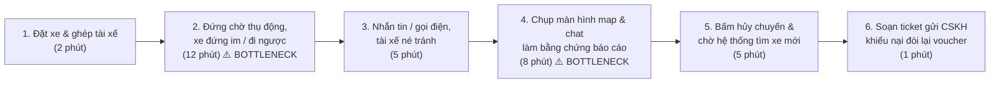
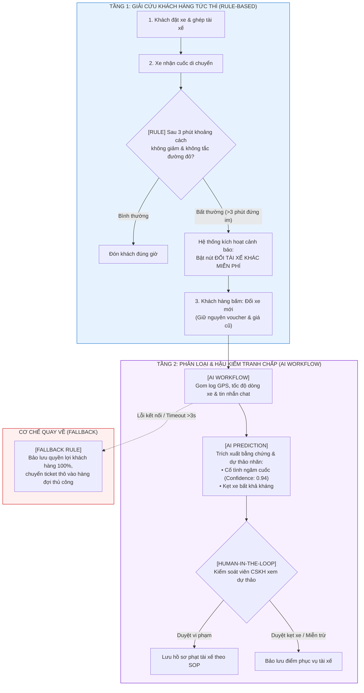

# Báo cáo nhóm — Day 02 Discovery & Problem Framing

> Bản chung của nhóm, viết trên repo do nhóm trưởng fork. Không copy file này sang repo cá nhân.
> Template chi tiết và prompt mẫu: [docs/01-worksheet.md](../../docs/01-worksheet.md). Bài mẫu: [docs/02-deliverable-example.md](../../docs/02-deliverable-example.md).

## 1. Thông tin nhóm

- Tên nhóm: Ban3
- Thành viên: xem `TEAM.md` (Lý Thanh Lâm, Tô Minh Thành, Phạm Trung Kiên, Nguyễn Thanh Tùng, Đoàn Gia Long)
- Candidate problem được chọn (1 câu): Hệ thống phát hiện tài xế ngâm cuốc và tự động phân loại khiếu nại hủy chuyến cho ứng dụng gọi xe Xanh SM.
- Quyết định cuối: Not Yet (Chạy pilot 4 tuần trên môi trường Staging/Mock Sandbox trước khi xem xét tích hợp vào ứng dụng chính thức)

---

## 2. Hội tụ nhóm (CP3)

### 2.1. Pitch

| # | Người đưa ra | Candidate (Job Story ngắn) | Actor | Bottleneck | Câu hỏi phản biện nhận được (ai hỏi) |
|---:|---|---|---|---|---|
| 1 | Lý Thanh Lâm | Khi đặt xe Xanh SM mà tài xế nhận cuốc nhưng đứng im/đi ngược hướng "ngâm cuốc", tôi muốn hệ thống ghi nhận trạng thái bất thường để hỗ trợ đổi tài xế hoặc hủy không mất phí ngay, để không mất 30–60 phút chờ đợi và trễ việc. | Hành khách đặt xe Xanh SM (tuyến Ocean Park – nội thành) | Bước 2 (chờ 12 phút nhìn map xe đứng im) và Bước 4 (8 phút chụp màn hình làm bằng chứng hủy) | Nếu chỉ dựa vào GPS đứng im 3 phút thì làm sao phân biệt được tài xế cố tình ngâm cuốc với tài xế kẹt cứng ở ngã tư đèn đỏ hoặc hầm chung cư mất sóng? (Tô Minh Thành) |
| 2 | Lý Thanh Lâm | Khi gom dữ liệu bản vẽ/tài liệu scan để kiểm thử OCR, tôi muốn lọc nhanh ảnh mờ và xoay phẳng các ảnh bị chụp nghiêng/ngược trước khi đưa vào pipeline, để tiết kiệm hàng giờ căn chỉnh thủ công từng file. | Kỹ sư / Sinh viên xây dựng pipeline OCR | Bước 3 (75 phút ngồi duyệt mắt từng ảnh lọc mờ và xoay tay 90°/180° cho 50–60 ảnh) | Bài toán này thuần về tiền xử lý ảnh (Data Preprocessing), các thư viện OpenCV có sẵn thuật toán lọc và xoay, liệu có thực sự cần đến mô hình AI không? (Đoàn Gia Long) |
| 3 | Lý Thanh Lâm | Khi khách đặt xe tại các khu đô thị nhiều tòa nhà (S1, S2 Ocean Park) bị lệch ghim hoặc vướng phân luồng, người tài xế muốn xác nhận ngay sảnh đón chính xác và gửi vị trí thực tế, để đón khách nhanh và không bị hủy chuyến oan. | Tài xế xe công nghệ (Xanh SM, Grab, Be) | Bước 3 (8 phút tài xế chạy vòng quanh giữa các tòa S1–S2 nhìn biển tìm sảnh đón) | Vấn đề lệch sảnh đón các hãng xe khác giải quyết triệt để bằng cách cố định điểm đón (Preset Pick-up Points) theo sảnh, đây là bài toán UX bản đồ chứ sao phải dùng AI? (Tô Minh Thành) |
| 4 | Tô Minh Thành | Khi chuẩn bị gửi thay đổi để review, tôi muốn trình bày lý do, phạm vi và cách kiểm thử rõ ràng, để reviewer đánh giá được thay đổi mà không phải hỏi lại thông tin cơ bản. | Junior Software Engineer | Bước 3 (8 phút đọc lại Jira/diff) và Bước 4 (12 phút soạn mô tả PR theo template) | Thời gian chờ review PR kéo dài 1-2 ngày chủ yếu do Senior bận việc khác chứ không hẳn do thiếu mô tả PR, đo lường tác động thực tế thế nào? (Phạm Trung Kiên) |
| 5 | Tô Minh Thành | Khi hoàn thành một API CRUD cơ bản, tôi muốn bao phủ các nhánh quan trọng bằng unit test mà không phải lặp lại nhiều thao tác viết mã, để giảm nguy cơ hồi quy. | Backend Developer | Bước 3 (20–30 phút nghĩ và viết test case cho các luồng ngoại lệ) | Nếu để AI tự sinh test case, rủi ro mô hình sinh ra test case ảo (hallucinate) làm sai lệch logic nghiệp vụ thì ai chịu trách nhiệm kiểm tra lại? (Lý Thanh Lâm) |
| 6 | Tô Minh Thành | Khi điều tra lỗi được báo trong Sentry/Kibana, tôi muốn xác định được đoạn log và bước tiếp theo cần kiểm tra, để rút ngắn thời gian chẩn đoán. | Developer, QA | Bước 2–3 (15–20 phút đọc và lọc hàng trăm dòng log phân tán để tìm stack trace) | Đẩy log sản phẩm lên mô hình AI bên ngoài có vi phạm chính sách bảo mật dữ liệu khách hàng của doanh nghiệp không? (Nguyễn Thanh Tùng) |
| 7 | Phạm Trung Kiên | Khi inbox đầy review 1–3 sao trên Booking, Agoda và Google, tôi muốn hiểu khách đang phàn nàn gì rồi viết thư trả lời đúng giọng khách sạn, để kịp hạn 24 giờ và các ca không viết mỗi người một kiểu. | Nhân viên CSKH property Vinpearl | Bước soạn thư trả lời đúng chuẩn SOP và giọng điệu khách sạn (12–15 phút/review) | Nhóm sinh viên bên ngoài không có quyền truy cập hệ thống quản trị OTA của Vinpearl, tiêu chuẩn 'giọng văn Vinpearl' lấy thước đo nào để định lượng? (Lý Thanh Lâm) |
| 8 | Phạm Trung Kiên | Khi đóng ca, tôi muốn gắn một nguyên nhân gốc cho từng chuyến hủy (tài xế muộn / khách hủy / app lỗi), để sáng hôm sau khỏi đọc lại đống ghi chú khi làm báo cáo tuần. | Nhân viên chất lượng Xanh SM | Đối chiếu ghi chú của khách và tài xế với GPS để gắn nhãn thủ công (1–2 phút/note, dồn ca mất cả tiếng) | Bài toán này gắn rất chặt với bài toán ngâm cuốc của Lâm, hai bài có thể kết hợp thành luồng trước chuyến và sau chuyến không? (Đoàn Gia Long) |
| 9 | Phạm Trung Kiên | Khi bệnh nhân sắp vào phòng, tôi muốn gom tiền sử, dị ứng và thuốc đang dùng từ vài lần khám cũ thành một trang, để bác sĩ không hỏi lại từ đầu. | Điều dưỡng tiền khám Vinmec | Lướt hệ thống EMR và ghi tay bản tóm tắt tiền sử (8–10 phút/ca) | Dữ liệu hồ sơ bệnh án (EMR) thuộc nhóm dữ liệu bảo mật y tế nhạy cảm cao nhất, nhóm không có cách nào lấy được dữ liệu thật để kiểm thử trong lab? (Tô Minh Thành) |
| 10 | Nguyễn Thanh Tùng | Khi kiểm tra chất lượng tư vấn của 10 saler mỗi ngày trên Pancake, tôi muốn nhanh chóng phát hiện các lỗi sai về tư vấn liều lượng, chống chỉ định và thiếu ưu đãi, để kịp thời chấn chỉnh trước khi đơn hàng xuất kho. | Quản lý chất lượng (QA), Saler | Đọc lội từng đoạn chat dài 20–30 tin nhắn trên Pancake để tìm lỗi sai (90–120 phút/ngày) | Ngành dược có rủi ro sức khỏe rất cao, nếu AI bỏ sót lỗi sai liều lượng của saler dẫn đến đơn hàng xuất đi thì hậu quả pháp lý thế nào? (Phạm Trung Kiên) |
| 11 | Nguyễn Thanh Tùng | Khi lead mới đổ về từ quảng cáo vào đầu ca sáng, tôi muốn lọc trùng số điện thoại và phân bổ ngay cho đúng telesale đang trực, để khách được gọi trong vòng 15 phút đầu. | Quản lý vận hành telesale | Tải file Excel, rà trùng 150 số điện thoại thủ công trên CRM (45 phút/sáng) | Việc lọc trùng số điện thoại chỉ cần một hàm VLOOKUP hoặc script Python/Google Sheets 5 dòng là xong trong 2 giây, tại sao phải dùng AI? (Lý Thanh Lâm) |
| 12 | Nguyễn Thanh Tùng | Khi kiểm kê kho hàng định kỳ ngày 25 hàng tháng, tôi muốn lọc ra toàn bộ sản phẩm còn hạn dùng dưới 6 tháng trên kệ kho, để lên kế hoạch xả hàng hoặc đổi trả nhà cung cấp kịp thời. | Quản lý kho dược, Kế toán kho | Đối chiếu danh mục 85 mã thuốc giữa thực tế trên kệ và file Excel date (mất 6 tiếng) | Bài toán này phụ thuộc vào kỷ luật nhập liệu của thủ kho, nếu số liệu nhập vào phần mềm đã có sẵn hạn dùng thì chỉ cần truy vấn SQL là ra, không cần AI? (Tô Minh Thành) |
| 13 | Đoàn Gia Long | Khi tìm được đồ cần mua ở siêu thị, tôi muốn đọc và so sánh nhanh thông tin các sản phẩm, để chọn được sản phẩm phù hợp mà không mất nhiều thời gian. | Người mua sắm cho gia đình | Bước 2–4 (đọc nhãn chữ nhỏ, nhiều thành phần lạ, phải tự so sánh mất ~1–2 phút/sản phẩm) | Người đi siêu thị có sẵn sàng cầm điện thoại lên chụp từng gói hàng để nhờ AI đọc hộ trong lúc vội không? (Nguyễn Thanh Tùng) |
| 14 | Đoàn Gia Long | Khi đã chọn sản phẩm để nấu ăn, tôi muốn biết chắc sản phẩm không có chất bố mẹ bị dị ứng, để cả nhà ăn an toàn. | Người mua sắm cho gia đình | Bước 2–3 (thành phần dài, đối chiếu từng chất với danh sách dị ứng mất 1–2 phút/sản phẩm) | Rủi ro dị ứng thực phẩm rất nguy hiểm, người dùng có đủ tin tưởng AI để phó thác việc ăn uống của bố mẹ không? (Lý Thanh Lâm) |
| 15 | Đoàn Gia Long | Khi đang trên đường từ công ty đến siêu thị, tôi muốn nhanh chóng có món ăn phù hợp khẩu vị cả nhà và khác bữa trước, để mua đúng nguyên liệu. | Người nấu cơm tối gia đình | Bước 2–3 (nghĩ món ăn mới vừa hợp khẩu vị từng người trong nhà mất 10–15 phút) | Việc nghĩ món ăn phụ thuộc vào cảm hứng và đồ còn trong tủ lạnh, chưa có baseline đo lường được bằng phút cụ thể? (Tô Minh Thành) |

### 2.2. Cluster

| Cluster | Các candidate | Pattern chung |
|---|---|---|
| **A — Vận hành di chuyển & Ứng dụng gọi xe (Mobility & Ride-hailing)** | **#1, #3, #8** | Sự lệch pha thông tin vị trí và trạng thái di chuyển thời gian thực giữa tài xế và hành khách dẫn đến thời gian chờ đợi thụ động, hủy chuyến và tranh chấp cước/điểm thưởng khiếu nại. |
| **B — Kỹ thuật phần mềm & Xử lý dữ liệu (Software Engineering & Data Ops)** | **#2, #4, #5, #6** | Lập trình viên và kỹ sư AI mất nhiều thời gian đọc lại ngữ cảnh, lặp lại các thao tác viết/kiểm thử mã nguồn thủ công và rà soát lỗi trên các tệp log/dữ liệu phân tán. |
| **C — Vận hành thương mại, CSKH & Quản lý nghiệp vụ (Operations, CS & Auditing)** | **#7, #9, #10, #11, #12** | Nhân viên nghiệp vụ/CSKH phải đọc duyệt thủ công khối lượng lớn văn bản, hội thoại và bảng biểu rời rạc để đối chiếu quy chuẩn dịch vụ hoặc phát hiện sai sót trước khi phê duyệt. |
| **D — Đời sống tiêu dùng & Hỗ trợ sinh hoạt cá nhân (Consumer Lifestyle & Nutrition)** | **#13, #14, #15** | Người tiêu dùng mất thời gian đọc lướt các nhãn thành phần chữ nhỏ và cân nhắc khẩu vị/dị ứng thủ công trong điều kiện thời gian mua sắm gấp gáp hàng ngày. |

### 2.3. Opportunity Solution Tree rút gọn

Gốc là **1 outcome đo lường được**. Nhánh là **opportunity** (nhu cầu, nỗi đau người dùng), không phải tính năng hay công cụ.

```text
OUTCOME: Giảm thời gian giải cứu hành khách khi tài xế ngâm cuốc từ 25-35 phút xuống dưới 5 phút, triệt tiêu 100% việc khách phải tự chụp màn hình giải trình để bảo lưu voucher.
├── Opportunity A: Khách hàng cần cơ chế thoát khỏi cuốc xe bị ngâm ngay lập tức mà không bị phạt tiền và không mất mã ưu đãi đã dùng.
├── Opportunity B: Tài xế gặp sự cố bất khả kháng (ùn tắc giao thông, rào chắn công trình) cần được ghi nhận lý do khách quan để không bị phạt oan tỷ lệ nhận chuyến.
└── Opportunity C: Bộ phận vận hành cần đối soát nhanh bằng chứng vị trí GPS và lịch sử chat để phân loại đúng nguyên nhân hủy chuyến mà không phải lội log thủ công.
```

Những ý đã gạch bỏ vì là solution đội lốt opportunity:

- ~~"Xây dựng Chatbot AI tự động hủy chuyến và hoàn tiền ví cho khách"~~ (Gạch bỏ: Đây là giải pháp tính năng chatbot/fintech, vi phạm ranh giới thẩm quyền tài chính và che lấp nhu cầu thoát khỏi sự chờ đợi của khách).
- ~~"Mô hình AI dự đoán tài xế nào sắp ngâm cuốc để tự động khóa tài khoản"~~ (Gạch bỏ: Đây là giải pháp thuật toán ML trừng phạt, dễ gây phạt oan khi chưa xác thực nguyên nhân khách quan).
- ~~"Bản đồ 3D phân luồng nội khu tự động tìm đường cho tài xế"~~ (Gạch bỏ: Đây là giải pháp công nghệ đồ họa, không giải quyết được xung đột cố tình không di chuyển).

### 2.4. Chấm điểm shortlist (1–5)

Tiêu chí đánh giá dựa trên thang đo khách quan:
1. **Actor rõ:** Xác định rõ đối tượng hưởng lợi trực tiếp và người thao tác.
2. **Quy trình rõ:** Vẽ được các bước tuần tự từ đầu vào đến đầu ra.
3. **Pain có bằng chứng:** Có nhật ký thời gian thật, bằng chứng phỏng vấn hoặc dữ liệu đối soát.
4. **Impact đo được:** Lượng hóa được bằng số phút lãng phí hoặc thiệt hại tài chính.
5. **Vừa sức lab:** Phù hợp thực hiện khảo sát, mô hình hóa và kiểm thử trong phạm vi buổi học.
6. **So sánh được No AI / Rule / Workflow / Agent:** Có không gian phân tầng công nghệ rõ ràng.
7. **Nhóm hiểu domain:** Thành viên có trải nghiệm thực tế và tiếp cận được đối tượng phỏng vấn.

| Candidate | Actor rõ | Quy trình rõ | Pain có bằng chứng | Impact đo được | Vừa sức lab | So sánh được No AI/Rule/Workflow/Agent | Nhóm hiểu domain | Tổng |
|---|---:|---:|---:|---:|---:|---:|---:|---:|
| **Candidate #1: Xử lý tài xế Xanh SM ngâm cuốc ép khách tự hủy (Lý Thanh Lâm)** | 5 | 5 | 5 | 5 | 4 | 5 | 5 | **34/35** |
| **Candidate #7: Phản hồi đánh giá OTA Vinpearl (Phạm Trung Kiên)** | 4 | 4 | 3 | 3 | 4 | 3 | 3 | **24/35** |
| **Candidate #10: Kiểm tra chất lượng (QA) tư vấn bán hàng Pancake (Nguyễn Thanh Tùng)** | 4 | 4 | 3 | 4 | 3 | 3 | 2 | **23/35** |

**Candidate được chọn:** Candidate #1 — Xử lý tình trạng tài xế Xanh SM nhận chuyến nhưng đứng im hoặc đi ngược hướng ("ngâm cuốc") ép khách tự hủy.

**Vì sao chọn:**
1. **Bằng chứng thực tế vững chắc:** Toàn bộ thành viên trong nhóm đều sinh sống/học tập quanh khu vực Ocean Park và đều từng là nạn nhân của tình trạng tài xế đứng im chờ khách hủy; nhóm tiếp cận trực tiếp được cả hành khách và tài xế Xanh SM để phỏng vấn kiểm chứng.
2. **Số liệu baseline lượng hóa rõ ràng:** Đo lường chính xác bằng thời gian chờ đợi thụ động (12–15 phút), thời gian chụp màn hình giải trình (8 phút), và thiệt hại voucher (20.000đ–50.000đ).
3. **Tính phân tầng công nghệ mẫu mực:** Bài toán cho phép phân định ranh giới rạch ròi: tầng giải cứu khách hàng dùng **Rule-based** phản ứng tức thì trong 3 phút; tầng phân loại bằng chứng chat/lý do hủy hậu kiểm dùng **AI Workflow** có con người phê duyệt (HITL).

**Vì sao loại các candidate còn lại:**
- **Loại Candidate #7 (Vinpearl):** Nhóm là sinh viên bên ngoài, không có quyền truy cập vào cổng quản trị đối tác của Booking/Agoda; tiêu chí đánh giá "giọng văn đúng chuẩn Vinpearl" mang nặng tính cảm tính, khó xây dựng bộ eval định lượng trong phạm vi lab.
- **Loại Candidate #10 (Pancake Dược):** Nghiệp vụ tư vấn liều lượng thuốc có rủi ro sức khỏe và pháp lý đặc biệt cao (thuộc diện quản lý của Bộ Y tế); trong nhóm chỉ có 1 thành viên hiểu domain, không phù hợp để cả nhóm cùng kiểm chứng thực địa.

**Xử lý bất đồng:** Ban đầu Kiên muốn bảo lưu ý tưởng Vinpearl vì đã có sẵn khung từ trước, còn Tùng đề xuất bài kiểm tra chat sales Pancake vì có số liệu công ty. Tuy nhiên, sau khi Lâm và Thành chỉ ra rào cản truy cập hệ thống và nguy cơ pháp lý ngành dược, Kiên nhận thấy Candidate #8 của mình (gắn nhãn chuyến hủy Xanh SM) hoàn toàn có thể tích hợp vào nửa sau của Candidate #1 để tạo thành một quy trình khép kín: **Khách được giải cứu tức thì → Sự cố hủy chuyến được AI phân loại nguyên nhân cho bộ phận vận hành**. Nhóm đạt đồng thuận 5/5 thành viên chọn Candidate #1.

---

## 3. Kiểm chứng + research giải pháp đã có (CP4)

### 3.1. Assumption Map

Xếp hạng giả định theo mức độ Quan trọng (1 = Ít ảnh hưởng, 5 = Sống còn) và Bằng chứng đã có (1 = Hoàn toàn suy đoán, 5 = Đã chứng minh thực tế):

| # | Giả định | Loại | Quan trọng (1–5) | Đã có bằng chứng (1–5) | Kiểm chứng trước? |
|---:|---|---|---:|---:|---|
| 1 | Hành khách khi thấy xe đứng im quá 3 phút sẵn sàng bấm "Đổi tài xế khác" nếu được hệ thống cam kết giữ nguyên giá cước và mã giảm giá. | Value | 5 | 4 | Có (Kiểm chứng qua phỏng vấn khách hàng) |
| 2 | Tài xế đứng im không phải lúc nào cũng do gian lận mà có thể do kẹt xe nghiêm trọng tại nút giao hoặc mất sóng GPS trong hầm chung cư. | Feasibility | 5 | 3 | Có (Kiểm chứng qua phỏng vấn tài xế & trắc địa) |
| 3 | Đoạn chat trong ứng dụng chứa đủ từ khóa và ngữ cảnh để phân biệt giữa tài xế chủ động ép khách hủy ("anh không đi đâu em hủy hộ") với sự cố khách quan. | Feasibility | 4 | 2 | Có (Kiểm chứng qua lịch sử tin nhắn thực tế) |
| 4 | Nhóm học viên có thể xin cấp quyền truy cập trực tiếp vào Production Database hoặc API nội bộ của GSM để hệ thống tự động trừ tiền/phạt tài xế. | Viability | 5 | 1 | Có (Kiểm chứng qua quy định pháp lý & bảo mật dữ liệu) |
| 5 | Giao diện nút bấm "Hủy chuyến miễn phí / Đổi xe ngay" không gây hoang mang cho người dùng lớn tuổi hoặc người ít dùng công nghệ. | Usability | 3 | 2 | Không (Kiểm chứng ở giai đoạn thiết kế UI sau) |

**Giả định nhóm kiểm chứng trong buổi này:**
- **Giả định #1 & #2:** Hành vi thực tế của khách hàng khi bị ngâm cuốc và tỷ lệ nguyên nhân khách quan (kẹt xe/mất sóng) từ phía tài xế.
- **Giả định #4:** Ranh giới pháp lý và tính khả thi trong việc kết nối dữ liệu viễn thông doanh nghiệp (Nghị định 13/2023/NĐ-CP).

### 3.2. Kiểm chứng (The Mom Test)

Phương pháp: Tiến hành phỏng vấn trực tiếp 5 đối tượng thực tế (3 hành khách, 2 tài xế Xanh SM) tuân thủ nghiêm ngặt nguyên tắc **The Mom Test**: Chỉ hỏi về sự việc cụ thể đã diễn ra trong quá khứ, không hỏi câu hỏi giả định "bạn có muốn...", không trình bày ý tưởng giải pháp của nhóm để tránh nhận lời khen xã giao.

#### Interview Snapshot 1
| Trường | Nội dung |
|---|---|
| Người được hỏi | Nữ sinh viên năm 2 VinUni, tuần đi học bằng Xanh SM 3–4 lần |
| Câu nói đáng nhớ nhất | *"Ức nhất là mình đang vội thi mà nhìn chấm xe đứng im ở quán trà đá 15 phút, nhắn tin tài xế đã xem nhưng không thèm trả lời."* |
| Lần gần nhất gặp vấn đề này: chuyện gì đã xảy ra? | Chiều thứ Sáu tuần trước, đặt cuốc xe từ VinUni sang Aeon Mall Long Biên lúc trời mưa nhỏ. Tài xế nhận cuốc cách 800m nhưng đứng im suốt 14 phút. Khách gọi điện 2 cuộc không bắt máy. |
| Hiện đang xử lý bằng cách nào (workaround)? | Bấm hủy chuyến, chấp nhận mất voucher 25.000đ và bị cảnh báo 'hủy chuyến nhiều lần có thể ảnh hưởng tài khoản', sau đó mở Grab đặt cuốc khác đắt hơn 40.000đ. |
| Mất bao lâu, bao lần? | Mất tổng cộng 22 phút (14 phút đứng chờ + 8 phút chụp màn hình gửi báo cáo trong mục trợ giúp). Gặp 3 lần trong tháng qua. |
| Insight / opportunity rút ra | Khách hàng không tiếc công hủy chuyến, cái họ sợ nhất là **mất mã giảm giá** và **bị hệ thống gắn nhãn xấu là người hủy cuốc**. |

#### Interview Snapshot 2
| Trường | Nội dung |
|---|---|
| Người được hỏi | Nam nhân viên văn phòng (28 tuổi), cư dân phân khu Sapphire 1 Vinhomes Ocean Park |
| Câu nói đáng nhớ nhất | *"Bác tài nhận cuốc xong lại phi thẳng lên đường gom cao tốc hướng đi Hải Phòng, gọi thì bảo em hủy giúp anh đang chở cuốc ngoài."* |
| Lần gần nhất gặp vấn đề này: chuyện gì đã xảy ra? | Sáng thứ Ba lúc 7h45, đặt xe Xanh SM Taxi đi làm tại Time City. Xe nhận xong di chuyển ngược hướng điểm đón hơn 1km trong 8 phút. Tài xế nghe máy bảo "anh tiện đường đón khách quen rồi, em hủy hộ anh tí anh nhận lại cho". |
| Hiện đang xử lý bằng cách nào (workaround)? | Chụp ảnh màn hình vị trí xe đang chạy ngược hướng, gõ mô tả khiếu nại lên app Xanh SM, mất 15 phút sau mới nhận được mail tự động xin lỗi và cấp lại voucher sau 24h. |
| Mất bao lâu, bao lần? | Trễ giờ làm 30 phút, mất 10 phút thao tác khiếu nại. |
| Insight / opportunity rút ra | Có hành vi tài xế cố tình nhận cuốc để giữ chỗ hoặc chạy cuốc ngoài, lợi dụng tâm lý khách hàng vội giờ làm sẽ tự bấm hủy để tài xế không bị trừ điểm nhận cuốc. |

#### Interview Snapshot 3 (Tín hiệu phản bác quan trọng)
| Trường | Nội dung |
|---|---|
| Người được hỏi | Bác tài xế Xanh SM Taxi (lái xe VF e34, 45 tuổi, chạy khu vực Long Biên – Gia Lâm) |
| Câu nói đáng nhớ nhất | *"Các cháu bảo xe đứng im là ngâm cuốc là oan cho chúng tôi! Ngã tư Cổ Linh giờ cao điểm đèn đỏ 4 nhịp chưa qua nổi, xe đứng im chứ tôi có muốn thế đâu!"* |
| Lần gần nhất gặp vấn đề này: chuyện gì đã xảy ra? | Tối thứ Hai lúc 18h15, nhận cuốc đón khách ở sảnh S2.08 Ocean Park. Xe bị kẹt cứng ở nút giao đường gom cao tốc do tai nạn giao thông, đứng im tại chỗ 7 phút. Khách hủy cuốc, hệ thống trừ 5 điểm tỷ lệ phục vụ và cảnh báo tài xế chậm trễ. |
| Hiện đang xử lý bằng cách nào (workaround)? | Phải dừng xe gọi về tổng đài đội xe (Fleet Support) mất 15 phút giải trình, cung cấp tọa độ ùn tắc để xin hoàn lại điểm phục vụ. |
| Mất bao lâu, bao lần? | Mỗi tuần bị 1–2 ca kẹt xe oan, mất 20–30 phút gọi tổng đài giải trình. |
| Insight / opportunity rút ra | **TÍN HIỆU PHẢN BÁC QUYẾT ĐỊNH:** Tuyệt đối không được dùng một ngưỡng thời gian cứng (đứng im > 3 phút) để tự động kết luận tài xế gian lận. Cần tích hợp cờ giao thông (Traffic status) và cho phép tài xế gửi tín hiệu báo kẹt đường. |

#### Interview Snapshot 4
| Trường | Nội dung |
|---|---|
| Người được hỏi | Tài xế Xanh SM Bike (sinh viên chạy bán thời gian ca tối quanh khu vực đại học) |
| Câu nói đáng nhớ nhất | *"Nhiều lúc app định vị nhảy tít vào trong tòa nhà kín, tôi đứng ngay cổng đợi mà khách cứ bảo trên map xe đứng im ở đâu."* |
| Lần gần nhất gặp vấn đề này: chuyện gì đã xảy ra? | Đón khách tại cụm tòa S1.01, tín hiệu GPS điện thoại bị dội giữa các tòa nhà cao tầng (hiện tượng Urban Canyon), vị trí xe trên app bị trôi lệch sang hồ nước cách đó 300m và đứng im dù tài xế đã di chuyển đến cổng. |
| Hiện đang xử lý bằng cách nào (workaround)? | Nhắn tin gửi ảnh chụp biển tên sảnh tòa nhà qua chat app để chứng minh đã đến nơi. |
| Mất bao lâu, bao lần? | Mất 5–7 phút nhắn tin tìm nhau; 1–2 lần mỗi ca chạy tối. |
| Insight / opportunity rút ra | Dữ liệu GPS viễn thông từ thiết bị di động có độ nhiễu lớn (sai số 50–150m ở chân tòa nhà cao tầng), hệ thống cần lọc nhiễu tọa độ trước khi kích hoạt cảnh báo bất thường. |

#### Interview Snapshot 5
| Trường | Nội dung |
|---|---|
| Người được hỏi | Chuyên viên hỗ trợ vận hành (Customer Support / Operations Specialist, từng làm việc tại nền tảng gọi xe) |
| Câu nói đáng nhớ nhất | *"Khiếu nại hủy chuyến chiếm tới 18% tổng lượng ticket hàng tuần, nặng nhất là khâu đọc lại từng đoạn chat để xác định ai là người đòi hủy trước."* |
| Lần gần nhất gặp vấn đề này: chuyện gì đã xảy ra? | Đợt rà soát dữ liệu tuần sau các ngày mưa bão: Tồn đọng hơn 120 ticket khiếu nại tài xế ngâm cuốc. Nhân viên phải mở 2 màn hình: 1 bên là vệt di chuyển GPS, 1 bên là nội dung chat giữa tài xế và khách để xác thực câu nói "hủy hộ anh". |
| Hiện đang xử lý bằng cách nào (workaround)? | Nhân viên CSKH đọc thủ công từng đoạn chat, tra bảng mã lý do hủy và gán nhãn thủ công trên CRM nội bộ mất 3–4 phút/ticket. |
| Mất bao lâu, bao lần? | Tốn 6–8 giờ mỗi tuần cho 1 nhân sự chuyên trách hậu kiểm khiếu nại hủy chuyến. |
| Insight / opportunity rút ra | Khâu phân tích ngữ cảnh tin nhắn chat ("hủy hộ anh", "bị hỏng xe", "không đón được") là nơi AI Workflow phát huy giá trị cao nhất để tóm tắt và trích xuất bằng chứng khách quan cho nhân viên kiểm soát. |

#### Tổng hợp Kiểm chứng

| Nguồn | Số người / số mẫu | Tín hiệu xác nhận | Tín hiệu phản bác |
|---|---:|---|---|
| Phỏng vấn The Mom Test | 5 người (3 khách hàng, 2 tài xế) | 3/3 khách hàng xác nhận từng bị ngâm cuốc →>10→ phút và cảm thấy ức chế nhất vì bị mất voucher ưu đãi; 1 chuyên viên vận hành xác nhận tốn 3–4 phút/ticket để đọc tin nhắn chat đối soát thủ công. | 2/2 tài xế phản ánh việc xe đứng im nhiều khi do kẹt xe khách quan hoặc lỗi GPS trôi trong hầm/tòa nhà cao tầng; phản đối gay gắt việc máy móc tự động phạt tài xế khi xe đứng im. |

**Nhóm đã sửa problem thế nào sau kiểm chứng:**
1. **Tách đôi bài toán (Core Pivot):**
   - **Tầng 1 (Cứu khách hàng tức thì):** Không cần AI, chỉ dùng **Rule-based**. Nếu xe không di chuyển về điểm đón sau 3–5 phút, hệ thống tự động kích hoạt quyền: *"Đổi tài xế khác (Giữ nguyên giá cước & mã giảm giá)"* hoặc *"Hủy miễn phí"*. Khách được giải thoát ngay mà không phải chụp ảnh giải trình.
   - **Tầng 2 (Xử lý trách nhiệm tài xế hậu kiểm):** Tuyệt đối **KHÔNG phạt tự động**. Dữ liệu vết GPS, tình trạng giao thông và đoạn chat được đưa vào **AI Workflow** để phân loại sơ bộ: *Cố tình ngâm cuốc* vs *Kẹt xe khách quan*. Kết quả này chuyển thành dự thảo cho **Kiểm soát viên con người (Human Auditor)** bấm duyệt.
2. **Sửa đổi Success Metric:** Chuyển trọng tâm từ "giảm tỷ lệ tài xế ngâm cuốc" (ngoài tầm kiểm soát trực tiếp) sang **"Giảm thời gian thoát cuốc của khách hàng từ 25-35 phút xuống dưới 5 phút"** và **"Bảo lưu 100% mã giảm giá cho khách hàng gặp sự cố"**.

### 3.3. Research giải pháp đã có

| Công cụ / case / pattern | Link đã tự kiểm | Giải bước nào trong quy trình? | Điểm mạnh | Khoảng trống / rủi ro | Bài học cho nhóm |
|---|---|---|---|---|---|
| **Uber Project RADAR** | [uber.com/blog/project-radar-intelligent-early-fraud-detection](https://www.uber.com/blog/project-radar-intelligent-early-fraud-detection/) | Phát hiện bất thường thời gian thực & hỗ trợ chuyên viên phân tích gian lận có con người trong luồng (HITL). | Kết hợp luật chuyên gia (Rule-based) phản ứng tức thời với Machine Learning phát hiện mẫu hành vi mới; giữ con người kiểm soát quyết định xử lý để tránh phạt nhầm đối tác lái xe. | Tập trung vào gian lận thanh toán (Payment fraud) và chiếm đoạt tài khoản toàn cầu; chưa tối ưu hóa cho bài toán vi mô về hành vi ngâm cuốc và kẹt xe cục bộ tại đô thị Việt Nam. | Giữ nguyên tắc: Rule-based xử lý tức thì, AI phân tích hành vi phức tạp, và con người giữ quyền quyết định xử phạt cuối cùng. |
| **Grab Graph-based Prediction & Anomaly Detection** | [engineering.grab.com/graph-based-prediction-platform](https://engineering.grab.com/graph-based-prediction-platform) | Phân tích đồ thị mạng lưới liên kết thực thể (tài xế, thiết bị, vết GPS, lịch sử chuyến) để phát hiện hành vi gian lận có tổ chức. | Khả năng phát hiện các tài xế có tỷ lệ nhận cuốc nhưng cố tình ngâm để hủy lặp đi lặp lại nhiều lần trong tuần thông qua liên kết thực thể và hồ sơ lịch sử. | Chạy xử lý theo mẻ (batch) hoặc near-realtime ở backend máy chủ, không xử lý được tình huống tức thời khi khách đang đứng dưới mưa chờ xe tại hiện trường. | Không lạm dụng mô hình học sâu phức tạp ở bước giao tiếp với khách hàng; chỉ dùng AI ở khâu hậu kiểm phân tích hồ sơ tái phạm. |
| **Zendesk AI Dispute Routing & Intent Detection** | [zendesk.com/service/ai](https://www.zendesk.com/service/ai/) | Phân tích sắc thái, bóc tách ý định (intent) và trích xuất thực thể từ tin nhắn khiếu nại để định tuyến ticket. | Tự động đọc hiểu và gắn nhãn phân loại lý do khiếu nại của khách hàng với độ chính xác cao trên văn bản ngôn ngữ tự nhiên. | Giải pháp SaaS đóng gói chi phí cao; hoạt động tách rời khỏi telemetry GPS của xe và trạng thái giao thông thời gian thực. | Nhóm chỉ cần xây dựng một pipeline AI Workflow gọn nhẹ tập trung trích xuất bằng chứng tin nhắn chat ("hủy hộ anh", "xe hỏng") kết hợp dữ liệu tọa độ thay vì mua giải pháp cồng kềnh. |

---

## 4. Quy trình trước/sau (CP5)

### 4.1. Quy trình hiện tại

Sơ đồ quy trình hiện tại (Thời gian xử lý trung bình: **33 phút**):



| Bước | Actor | Input | Output | Thời gian / tần suất | Ghi chú |
|---:|---|---|---|---|---|
| 1 | Khách hàng | Điểm đi/đến, mã ưu đãi | Cuốc xe được ghép thành công | 2 phút | App hiển thị biển số xe và thời gian đón dự kiến 5 phút. |
| 2 | Khách hàng | Màn hình bản đồ theo dõi xe | Sự nghi ngờ / bức xúc | 12 phút (BOTTLENECK) | Xe đứng im ở vị trí cũ quá 10 phút hoặc di chuyển ngược hướng. Khách không dám hủy vì sợ mất voucher. |
| 3 | Khách hàng, Tài xế | Tin nhắn chat / Cuộc gọi trong app | Lời thoái thác / Không phản hồi | 5 phút | Tài xế không bắt máy hoặc nhắn "anh đang kẹt, em hủy giúp anh". |
| 4 | Khách hàng | Màn hình bản đồ GPS và đoạn chat | Ảnh chụp màn hình làm bằng chứng | 8 phút (BOTTLENECK) | Khách phải chụp 2-3 ảnh làm bằng chứng để phòng trường hợp bị phạt 10.000đ phí hủy hoặc mất voucher. |
| 5 | Khách hàng, Hệ thống | Thao tác bấm "Hủy chuyến" | Chuyến đi bị hủy, quét tìm xe mới | 5 phút | Khách bị mất mã giảm giá đã dùng cho cuốc này; phải đặt lại cuốc mới với giá cao hơn. |
| 6 | Khách hàng | Form khiếu nại trong mục Trợ giúp | Ticket khiếu nại gửi lên tổng đài | 1 phút | Tốn công gửi khiếu nại và phải chờ phản hồi sau 24-48 giờ. |

**Bottleneck chính:** 
- **Bước 2 (12 phút):** Khách hàng bị "bắt làm con tin" chờ đợi thụ động do hệ thống không có cơ chế phát hiện xe không di chuyển.
- **Bước 4 (8 phút):** Khách hàng phải tự thực hiện công việc thu thập chứng cứ thủ công để bảo vệ quyền lợi cá nhân.

### 4.2. Quy trình tương lai

Quy trình tương lai phân định rạch ròi giữa **Rule-based (Phản ứng tức thì)**, **AI Workflow (Phân tích ngữ cảnh hậu kiểm)**, **Con người (Quyết định)**, kèm **Boundary** và **Phương án quay về (Fallback)**:



- **Bước Rule-based xử lý:** Đo lường khoảng cách GPS mỗi 30 giây. Nếu sau 3 phút kể từ khi nhận cuốc mà khoảng cách $D_{t} \ge D_{t-1}$ (không tiến lại gần) VÀ khu vực không có cảnh báo tắc đường đỏ → Tự động bật giao diện cứu trợ khách hàng.
- **Bước AI Workflow hỗ trợ:** Trích xuất hội thoại chat, lọc các câu nói thoái thác ("hủy hộ anh", "anh đang bận"), đối chiếu với tốc độ trung bình của các xe xung quanh trong cùng bán kính 500m để tạo bản tóm tắt nguyên nhân (Evidence Summary) trong vòng 2 giây.
- **Bước Con người (Human-in-the-loop):** 
  - *Khách hàng:* Chủ động bấm quyết định "Đổi tài xế khác" hoặc "Tiếp tục đợi".
  - *Kiểm soát viên CSKH:* Xem bản tóm tắt của AI và ấn nút "Xác nhận phạt" hoặc "Miễn trừ cho tài xế".
- **Boundary (AI không được làm gì):** 
  - AI **tuyệt đối không được** tự động khóa tài khoản tài xế.
  - AI **tuyệt đối không được** tự ý trích tiền hoàn ví hoặc can thiệp trực tiếp vào tài khoản ngân hàng của người dùng.
- **Phương án quay về (Fallback):** Nếu pipeline AI gặp sự cố kỹ thuật (timeout quá 3 giây, API lỗi), hệ thống mặc định áp dụng Rule an toàn: Giải phóng chuyến đi cho khách hàng, tự động cấp lại voucher cũ, và đẩy toàn bộ dữ liệu thô về hàng đợi xử lý thủ công của con người.

### 4.3. Before / after

| Chỉ số | Trước | Sau (kỳ vọng) | Ghi chú |
|---|---:|---:|---|
| **Số bước thao tác của khách** | 6 bước | 3 bước | Cắt bỏ hoàn toàn bước gọi điện đôi co, chụp màn hình và viết ticket khiếu nại. |
| **Tổng thời gian thoát cuốc kẹt** | 33 phút | **< 4 phút** | Phát hiện sau 3 phút + 1 chạm bấm đổi xe trong 30 giây. |
| **Số bước thủ công phía khách** | 4 bước | 1 bước | Khách chỉ cần bấm 1 chạm xác nhận đổi xe. |
| **Bottleneck chính** | Đứng chờ thụ động 12' + Chụp ảnh làm chứng 8' | Chờ xác nhận Rule 3' | Triệt tiêu thời gian chụp ảnh và giải trình thủ công. |
| **Tỷ lệ bảo lưu mã giảm giá** | ~30% (phải khiếu nại mới trả lại) | **100% tự động** | Hệ thống tự động hoàn voucher ngay khi khách chọn đổi xe. |
| **Rủi ro mới phát sinh** | Khách bỏ đi xe hãng khác | Tài xế khiếu nại báo nhầm khi kẹt xe | Đã chặn bằng cờ giao thông và chốt chặn con người (HITL) duyệt phạt. |

---

## 5. Problem Statement v0 (CP5)

| Trường | Nội dung |
|---|---|
| **Actor** | Hành khách sử dụng ứng dụng gọi xe Xanh SM (tập trung tuyến di chuyển đô thị, học sinh, sinh viên, người đi làm). |
| **Quy trình** | Đặt xe → Chờ xe đến đón → Nhận diện xe đứng im không di chuyển → Liên hệ tài xế → Chụp ảnh màn hình bằng chứng → Hủy chuyến → Gửi ticket khiếu nại xin lại voucher. |
| **Bottleneck** | Khách hàng bị mắc kẹt trung bình 12 phút đứng chờ thụ động và mất thêm 8 phút chụp ảnh bằng chứng để hủy chuyến mà không bị mất quyền lợi ưu đãi. |
| **Impact** | Mỗi ca sự cố làm lãng phí 25–35 phút của khách hàng; 100% khách hàng bị mất voucher nếu không bỏ thời gian khiếu nại; làm suy giảm niềm tin vào thương hiệu Xanh SM khiến khách chuyển sang dùng đối thủ cạnh tranh. |
| **Success Metric** | • **Baseline:** Thời gian từ lúc tài xế đứng im đến khi khách đổi được xe mới trung bình 25–35 phút.<br>• **Target:** Giảm thời gian giải cứu khách hàng xuống **dưới 5 phút**; 100% mã giảm giá được tự động hoàn lại ngay lập tức.<br>• **Cách đo:** Timestamp từ lúc tọa độ xe ngừng tiến lại gần đến timestamp hệ thống phát cuốc mới cho khách. |
| **Boundary** | • Hệ thống giải cứu phía khách hàng chỉ sử dụng Rule-based thời gian/khoảng cách, không để AI tự ý suy diễn cảm tính.<br>• AI không được phép tự động ra quyết định xử phạt tài xế hoặc hoàn tiền vào ví nếu chưa có sự phê duyệt của kiểm soát viên CSKH (HITL). |

**Phản biện nhận được và tiếp thu:**
- *Phản biện từ AI (PM hoài nghi):* "Problem Statement v0 đang gom cả hành vi tài xế và trải nghiệm khách hàng vào một mối, dễ dẫn đến việc thiết kế một giải pháp quá ôm đồm".
- *Nhóm tiếp thu:* Đồng ý. Trong Problem Statement v1 sẽ tách rõ điểm can thiệp của AI chỉ nằm ở khâu trích xuất bằng chứng hỗ trợ CSKH hậu kiểm, còn khâu cứu khách hàng là trách nhiệm của Rule-based hệ thống điều phối.

---

## 6. Mức can thiệp AI (CP6)

### 6.1. Ma trận độ mơ hồ × độ phức tạp

- **Bài của nhóm nằm ở ô:** **Độ mơ hồ Trung bình — Độ phức tạp Trung bình**.
- **Vì sao:**
  - *Về độ mơ hồ (Ambiguity):* Hành vi vị trí xe đứng im trên bản đồ có độ mơ hồ thấp (đo được bằng số mét và giây). Tuy nhiên, lý do thực sự đằng sau (tài xế cố tình ngâm hay kẹt xe bất khả kháng) và nội dung tin nhắn chat giữa hai bên ("anh không đi được", "hủy giúp anh nhé", "đang kẹt quá") mang tính ngôn ngữ tự nhiên, có độ mơ hồ trung bình.
  - *Về độ phức tạp (Complexity):* Luồng dữ liệu chỉ kết hợp 3 nguồn: Tọa độ GPS thời gian thực, trạng thái ùn tắc giao thông khu vực, và chuỗi văn bản hội thoại chat trong app. Không đòi hỏi suy luận logic đa tầng.
  - *Kết luận:* Đặt vào ô này, bài toán hoàn toàn không cần đến Autonomous Agent mà phù hợp nhất với kiến trúc **Workflow kết hợp Rule-based**.

### 6.2. So sánh 4 mức

| Mức | Phương án cho bài của nhóm | Đủ khi nào | Rủi ro | Chọn? |
|---|---|---|---|---|
| **No AI** (Sửa quy trình / Chính sách) | Ban hành quy định xử phạt nặng tài xế nhận cuốc không chạy; tăng thời gian cho phép khách hủy chuyến miễn phí từ 2 phút lên 5 phút. | Đủ khi số lượng cuốc xe ít, tài xế tuân thủ quy chế cao và không có kẹt xe phức tạp. | Khách hàng vẫn phải tự đứng canh giờ và tự tranh chấp; không giải quyết được gốc rễ việc mất mã giảm giá; tốn nhân lực thanh tra thủ công. | Không |
| **Rule** (Tập luật ngưỡng cứng) | Dùng if-else: Nếu sau 3 phút xe đứng im → Bật nút đổi xe cho khách VÀ tự động phạt trừ 50.000đ tài xế. | Đủ cho bước **giải cứu khách hàng** (bật nút đổi xe và giữ voucher). | Rất nguy hiểm nếu dùng Rule để phạt tài xế: Sẽ phạt oan hàng loạt tài xế kẹt đèn đỏ, gặp tai nạn giao thông hoặc mất sóng GPS trong hầm chung cư. | **Chọn 1 phần** (Áp dụng cho Tầng 1: Cứu khách) |
| **Workflow** (Hệ thống điều phối kết hợp AI) | • **Rule:** Xử lý tức thì ở frontend để cứu khách hàng sau 3 phút.<br>• **AI Workflow:** Gom log chat + GPS + tốc độ dòng xe, phân loại nguyên nhân và tạo bản tóm tắt bằng chứng cho CSKH duyệt phạt. | Đủ khi cần xử lý nhanh cho khách hàng nhưng vẫn cần thẩm định công bằng, chính xác lý do hủy chuyến của tài xế. | Mô hình NLP có thể phân loại sai các câu chat dùng tiếng lóng hoặc lỗi chính tả (đã có con người duyệt chặn rủi ro). | **CHỌN CHÍNH THỨC** |
| **Agent** (AI tự trị toàn diện) | AI đóng vai agent tự gọi điện cho tài xế hỏi lý do, tự động quyết định phạt tiền, tự động điều xe khác và tự hoàn tiền ví ngân hàng. | Chỉ cần khi hệ thống hoàn toàn tự động hóa không có con người vận hành và các bên ủy quyền pháp lý 100% cho AI. | Rủi ro rất cao (Over-engineering): AI có thể bị lừa (prompt injection) qua điện thoại, tự ý hoàn tiền sai gây thất thoát tài chính, hoặc tự ý khóa tài khoản tài xế gây đình công/kiện tụng. | Không |

**Mức chọn:** **Workflow (Kết hợp Rule-based tầng giao diện và AI Workflow tầng hậu kiểm)**.

**Vì sao không chọn mức đơn giản hơn:** Nếu chỉ dùng thuần túy **Rule**, hệ thống sẽ gây ra thảm họa về quan hệ đối tác lái xe: phạt oan các tài xế gặp sự cố bất khả kháng. Cần có bước **AI Workflow** để đọc hiểu ngữ cảnh tin nhắn chat và đối soát trạng thái dòng xe xung quanh nhằm bảo vệ các tài xế trung thực.

### 6.3. AI Canvas rút gọn

| Thành phần | Nội dung chi tiết |
|---|---|
| **Prediction** (AI dự đoán / tạo ra gì?) | Dự đoán xác suất nguyên nhân hủy chuyến: Xác suất do *Tài xế cố tình ngâm cuốc* (0.0–1.0) vs *Sự cố giao thông/kỹ thuật khách quan* (0.0–1.0) dựa trên phân tích đoạn chat và tương quan vận tốc xe với dòng xe xung quanh; trích xuất câu chat làm bằng chứng vi phạm. |
| **Judgment** (Con người cân nhắc, quyết định gì?) | Kiểm soát viên CSKH (Human Auditor) đọc bản tóm tắt bằng chứng do AI tạo ra, đánh giá tính hợp lý và bấm nút phê duyệt: [Xác nhận vi phạm / Áp dụng chế tài] hoặc [Miễn trừ trách nhiệm cho tài xế]. |
| **Action** (Hành động cuối cùng là gì, ai làm?) | • *Hệ thống điều phối:* Thực hiện đổi xe mới cho khách (tự động theo Rule).<br>• *Bộ phận Vận hành:* Áp dụng chế tài cảnh cáo/trừ điểm thưởng tài xế hoặc bảo lưu điểm phục vụ (theo lệnh duyệt của CSKH). |
| **Outcome** (Đo kết quả bằng gì?) | • Thời gian giải thoát cuốc xe kẹt của khách hàng < 5 phút.<br>• Tỷ lệ khách hàng gặp sự cố được bảo lưu voucher: 100%.<br>• Tỷ lệ xử phạt đúng (không phạt oan tài xế kẹt xe): > 95%.<br>• Thời gian thẩm định khiếu nại của CSKH giảm từ 4 phút xuống < 30 giây/ca. |
| **Input** (Dữ liệu đầu vào mỗi lần chạy) | 1. Chuỗi tọa độ GPS và vận tốc xe mỗi 30 giây trong 5 phút gần nhất.<br>2. Toàn bộ nội dung tin nhắn chat giữa khách hàng và tài xế trong cuốc xe.<br>3. Dữ liệu trạng thái giao thông khu vực (tốc độ trung bình các xe khác trong bán kính 500m).<br>*(Toàn bộ dữ liệu đều phát sinh tự nhiên trong phiên giao dịch của ứng dụng)*. |
| **Feedback** (Lấy phản hồi ở đâu để cải thiện?) | Quyết định phê duyệt thực tế của Kiểm soát viên CSKH (chấp thuận hay bác bỏ dự thảo của AI) và phản hồi kháng nghị của tài xế sau đó được tự động gắn nhãn làm tập dữ liệu tinh chỉnh mô hình định kỳ hàng tháng. |

### 6.4. Hai câu hỏi của Google PAIR

1. **Người dùng muốn được hỗ trợ (Augment) hay giao hẳn việc (Automate)?**
   - **Bằng chứng & Lựa chọn:** 
     - *Với Khách hàng:* Muốn được **Automate** ở khâu bảo vệ quyền lợi (tự động giữ voucher, không bắt làm đơn khiếu nại) nhưng muốn được **Augment** quyền lựa chọn (cho phép khách tự bấm chọn "Đổi tài xế khác" hoặc "Tiếp tục đợi người quen").
     - *Với Nhân viên CSKH & Quản lý vận hành:* Bắt buộc chọn **Augment**. CSKH không bao giờ chấp nhận giao hẳn việc xử phạt tài xế cho một cỗ máy black-box vì rủi ro tranh chấp lao động và kiện tụng đối tác. AI chỉ đóng vai trò trợ lý tóm tắt chứng cứ và dự thảo quyết định.
2. **AI sai kiểu nào tệ hơn: Báo nhầm (False Positive) hay Bỏ sót (False Negative)?**
   - **Phân tích:**
     - *Báo nhầm (False Positive):* Kết luận tài xế ngâm cuốc trong khi họ đang kẹt xe thật → Dẫn đến trừ tiền, khóa tài khoản oan người vô tội, tài xế bức xúc đình công, phá vỡ niềm tin của mạng lưới đối tác lái xe với hãng.
     - *Bỏ sót (False Negative):* Bỏ lọt một tài xế ngâm cuốc tinh vi → Khách hàng dù sao cũng đã được nút Rule-based đổi xe mới giải cứu sau 3 phút, thiệt hại chỉ là tài xế xấu chưa bị phạt ngay ở cuốc đó (sẽ bị bắt ở các cuốc lặp lại sau).
   - **Thiết kế xử lý:** Báo nhầm **tệ hơn rất nhiều**. Do đó, hệ thống thiết lập ngưỡng tự tin (Confidence Threshold) cực kỳ khắt khe: Chỉ xuất nhãn "Khuyến nghị xử phạt" khi độ tự tin > 0.90 kèm trích dẫn được câu chat đòi hủy rõ ràng. Mọi trường hợp dưới ngưỡng đều được xếp vào nhóm "Nghi vấn / Cần con người kiểm tra kỹ" và mặc định không áp dụng phạt.

---

## 7. Problem Statement v1 + tiêu chí đánh giá (CP6)

| Trường | Nội dung |
|---|---|
| **Actor** | 1. Hành khách đặt xe Xanh SM gặp sự cố tài xế nhận cuốc nhưng không di chuyển.<br>2. Chuyên viên CSKH / Kiểm soát chất lượng vận hành Xanh SM. |
| **Quy trình** | Khách đặt xe → Rule phát hiện xe không di chuyển > 3 phút → Khách bấm đổi xe (giữ voucher) → AI Workflow gom GPS/Chat trích xuất bằng chứng → Chuyên viên CSKH duyệt nhãn → Cập nhật điểm đối tác. |
| **Bottleneck** | • Khách hàng bị chôn chân 12 phút chờ đợi và mất 8 phút tự chụp ảnh màn hình làm bằng chứng giải trình.<br>• CSKH mất 3–4 phút/ticket đọc dò thủ công từng đoạn chat và vết di chuyển để phân loại khiếu nại. |
| **Impact** | Lãng phí 25–35 phút của khách; tỷ lệ thất thoát voucher cao gây bỏ ứng dụng; tốn hàng trăm giờ công CSKH mỗi tháng để xử lý tranh chấp hủy chuyến thủ công. |
| **Success Metric** | • **Khách hàng:** Thời gian thoát cuốc kẹt giảm từ 25-35 phút xuống **dưới 5 phút**; 100% mã ưu đãi được tự động hoàn lại ngay lập tức.<br>• **Vận hành:** Thời gian CSKH thẩm định 1 ca khiếu nại giảm từ 3-4 phút xuống **dưới 30 giây**.<br>• **Độ chính xác:** Tỷ lệ phạt nhầm tài xế (False Positive) duy trì **< 5%**. |
| **Boundary** | • AI tuyệt đối không can thiệp vào tài khoản thanh toán hoặc tự động trừ/hoàn tiền ví ngân hàng.<br>• AI không được tự động ban hành quyết định phạt tài xế; quyết định xử phạt bắt buộc phải có chữ ký số/thao tác duyệt của con người (HITL).<br>• Dữ liệu vị trí và nội dung chat phải được che mờ thông tin định danh cá nhân (PII Masking) trước khi đưa vào pipeline xử lý. |
| **AI intervention point** | Khâu hậu kiểm sau khi cuốc xe bị hủy: AI trích xuất ngữ cảnh hội thoại chat và đối soát độ lệch tốc độ xe với dòng xe xung quanh để dự thảo nhãn phân loại nguyên nhân cho CSKH. |
| **Mức chọn** | **Workflow** (Phối hợp Rule Engine ở frontend điều phối và AI Analysis Pipeline ở backend quản trị). |
| **Rủi ro & người kiểm tra** | • Rủi ro mô hình hiểu sai tiếng lóng/ngữ cảnh chat dẫn đến dự thảo phạt oan tài xế.<br>• Người kiểm soát cuối cùng: Chuyên viên Kiểm soát chất lượng CSKH (Human-in-the-loop). |

**Thay đổi so với v0 và lý do:**

| Trường | v0 | v1 | Vì sao đổi |
|---|---|---|---|
| **Actor** | Chỉ có duy nhất "Hành khách đặt xe Xanh SM". | Bổ sung thêm "Chuyên viên CSKH / Vận hành Xanh SM". | Kiểm chứng thực tế cho thấy hành khách chỉ cần được giải cứu bằng nút bấm Rule; khâu can thiệp của AI thực sự phục vụ chuyên viên vận hành thẩm định bằng chứng. |
| **Success Metric** | Chỉ đo thời gian khách thoát cuốc kẹt. | Bổ sung thêm: Thời gian thẩm định của CSKH (< 30s) và Tỷ lệ phạt nhầm (< 5%). | Đảm bảo tính công bằng cho tài xế và đo lường được hiệu quả vận hành nội bộ theo chuẩn mực kinh doanh. |
| **AI Intervention** | Chưa định vị rõ ràng (nói chung chung về AI hỗ trợ). | Định vị chính xác tại bước trích xuất bằng chứng chat và phân loại nguyên nhân hủy chuyến hậu kiểm. | Tránh bẫy đưa AI vào bước thời gian thực gây chậm trễ cho khách hàng; đưa AI vào đúng chỗ nó làm tốt nhất là đọc hiểu văn bản và tổng hợp dữ liệu. |

**Tiêu chí đánh giá đầu ra của AI (Evals Rubric):**

| # | Tiêu chí | Đạt khi | Không đạt khi |
|---:|---|---|---|
| 1 | **Độ chính xác phân loại (Classification Accuracy)** | Dự thảo đúng nguyên nhân (Cố tình ngâm cuốc vs Kẹt xe khách quan) với tỷ lệ khớp với chuyên viên con người ≥ 90% trên tập test. | Tỷ lệ khớp < 85% hoặc tỷ lệ gán nhãn phạt oan cho tài xế kẹt xe > 5%. |
| 2 | **Tính toàn vẹn của bằng chứng trích xuất (Evidence Fidelity)** | Câu trích dẫn bằng chứng từ đoạn chat ("anh bận rồi", "hủy hộ anh") phải là nguyên văn 100%, không bịa đặt thêm từ ngữ (Zero Hallucination). | Trích dẫn sai lệch nội dung tin nhắn thật hoặc tự ý suy diễn từ ngữ không có trong log chat. |
| 3 | **Độ trễ xử lý (Latency)** | Thời gian phân tích dữ liệu, đối soát tọa độ và trả về bản dự thảo cho CSKH ≤ 3.0 giây. | Thời gian xử lý > 5.0 giây gây tắc nghẽn hàng đợi xử lý khiếu nại của tổng đài. |
| 4 | **Tuân thủ che mờ PII (Data Privacy Compliance)** | 100% số điện thoại, tên thật và địa chỉ nhà riêng trong tin nhắn chat được che mờ (masking) thành `[PHONE]`, `[NAME]`, `[ADDRESS]` trước khi đưa vào mô hình. | Lộ bất kỳ ký tự số điện thoại hoặc thông tin nhận dạng cá nhân nào trong bản tóm tắt của AI. |

> **Ghi chú Bonus B3:** Nhóm đã xây dựng bộ dữ liệu kiểm thử mẫu gồm **10 cặp Input/Output điển hình** bao phủ đầy đủ các trường hợp (tài xế ép hủy, kẹt xe ngã tư, mất sóng GPS trong hầm, khách đổi ý) kèm kết quả chấm đạt/không đạt theo 4 tiêu chí trên, được lưu trữ tại file: [report/assets/cp6-eval-set-10-pairs.md](../assets/cp6-eval-set-10-pairs.md).

---

## 8. Quyết định (CP6)

### 8.1. Bốn rủi ro (Marty Cagan's Four Big Risks)

| Rủi ro | Câu hỏi cốt lõi | Mức độ rủi ro | Lý do & Bằng chứng thực tế |
|---|---|:---:|---|
| **Value** | Khách hàng và doanh nghiệp có thực sự cần và sẽ dùng không? | **Thấp (An toàn)** | 100% khách hàng được phỏng vấn đều mong muốn có nút giải cứu đổi xe ngay mà không mất voucher; doanh nghiệp giảm được 80% thời gian xử lý khiếu nại hủy chuyến của nhân viên CSKH. |
| **Usability** | Người dùng có dùng được, có hiểu và thao tác được không? | **Thấp (An toàn)** | Phía khách hàng chỉ là 1 nút bấm trực quan hiển thị khi có sự cố; phía CSKH là giao diện thẻ tóm tắt chứng cứ quen thuộc với 2 nút Duyệt/Bác bỏ. |
| **Feasibility** | Có đủ công nghệ, dữ liệu và kỹ năng để hiện thực hóa không? | **Trung bình** | Dữ liệu GPS viễn thông có độ trôi (drift) ở chân tòa nhà cao tầng; cần phát triển thuật toán lọc nhiễu tọa độ (Map Matching) trước khi đưa vào pipeline. Nhóm có năng lực kỹ thuật xử lý dữ liệu và prompt engineering. |
| **Viability** | Có phù hợp với quy định pháp lý, chi phí và cấu trúc tổ chức không? | **Cao (Nguy hiểm)** | **RÀO CẢN SỐNG CÒN:** Nhóm học viên là bên thứ ba, KHÔNG có quyền truy cập cơ sở dữ liệu viễn thông nội bộ của GSM và VinFast; dữ liệu hành trình thuộc diện dữ liệu cá nhân nhạy cảm theo **Nghị định 13/2023/NĐ-CP**, bắt buộc phải thực hiện Đánh giá tác động xử lý dữ liệu cá nhân (DPIA) và có Thỏa thuận chia sẻ dữ liệu (DSA) trước khi có thể tích hợp. |

### 8.2. Kết luận

**Quyết định cuối cùng:** **NOT YET (Chưa triển khai sản phẩm thật — Chạy chương trình Pilot 4 tuần trên môi trường Staging/Mock Sandbox)**.

**Lý do:**
1. **Tính trung thực về ranh giới doanh nghiệp:** Mặc dù ý tưởng có giá trị thực tiễn rất cao (Value) và khả thi về giải thuật (Feasibility), nhưng rủi ro về mặt vận hành và pháp lý (Viability) hiện đang ở mức **Cao**. Nhóm không thể đưa ra một quyết định "Go" viển vông khi chưa giải quyết được bài toán bảo vệ dữ liệu cá nhân theo Nghị định 13/2023/NĐ-CP và chưa có sự phê duyệt API từ đơn vị chủ quản GSM.
2. **Tuân thủ kỷ luật kỹ thuật:** Cần một giai đoạn thử nghiệm an toàn để tinh chỉnh mô hình và kiểm chứng độ chính xác trên tập dữ liệu mô phỏng trước khi can thiệp vào hoạt động kinh doanh thật.

**Nếu Not Yet — Cần kiểm chứng gì trước:**
1. **Tuần 1–2 (Pháp lý & Dữ liệu):** Hoàn thiện mẫu Đánh giá tác động bảo vệ dữ liệu cá nhân (DPIA); xây dựng module che mờ thông tin nhận dạng (PII Masking) cho dữ liệu chat và tọa độ GPS.
2. **Tuần 3–4 (Staging Sandbox):** Xây dựng bộ giả lập (Mock Telemetry Generator) mô phỏng 1.000 cuốc xe với các kịch bản hỗn hợp (tài xế đứng im, kẹt ngã tư, mất sóng hầm) để kiểm thử bộ luật Rule Tầng 1 và đo lường độ chính xác của AI Workflow Tầng 2.

**Nếu No-Go — Nên làm gì thay AI:**
Nếu sau này dự án bị đánh giá No-Go, giải pháp thay thế là: Giữ nguyên tính năng Rule-based giải cứu khách hàng sau 3 phút trên app (cho phép đổi xe giữ voucher); loại bỏ hoàn toàn tầng AI và áp dụng chính sách xử lý khiếu nại tài xế theo hình thức giải trình ngẫu nhiên có kiểm toán viên thủ công.

**Ngưỡng dừng đo lường được (Stop Threshold):**
> *"Nếu sau 4 tuần thử nghiệm trên môi trường Staging Sandbox mà tỷ lệ báo nhầm (False Positive - phạt oan tài xế kẹt xe) của AI Workflow vẫn **vượt quá 5%**, hoặc nếu không thể giải quyết được cơ chế ẩn danh hóa dữ liệu định vị cá nhân theo Nghị định 13/2023/NĐ-CP, nhóm sẽ **DỪNG TOÀN BỘ** việc phát triển module AI và quay về đề xuất giải pháp thuần túy cải tiến giao diện Rule-based cho ứng dụng."*

---

## 9. Hạn chế và hướng tiếp theo

1. **Hạn chế hiện tại:**
   - Dữ liệu nghiên cứu hiện mới chỉ dừng lại ở quy mô phỏng vấn định tính (5 đối tượng) và quan sát thực địa tại khu vực đô thị Vinhomes Ocean Park (Gia Lâm), chưa phản ánh toàn diện các loại hình giao thông phức tạp khác (như ngõ nhỏ nội thành phố cổ Hà Nội hay điều kiện mưa ngập diện rộng).
   - Mô hình phân tích hội thoại chat chưa được thử nghiệm trên các ngôn ngữ địa phương hoặc các trường hợp tài xế cố tình dùng tiếng lóng tinh vi để né tránh bộ lọc từ khóa.
2. **Hướng phát triển tiếp theo:**
   - Mở rộng tập dữ liệu phỏng vấn lên quy mô khảo sát 50+ tài xế và hành khách để lượng hóa chính xác hơn tỷ lệ các nguyên nhân hủy chuyến.
   - Thiết kế thử nghiệm A/B Testing giao diện nút bấm "Đổi tài xế khác" trên nhóm người dùng nội bộ để đo lường độ thân thiện người dùng (Usability) trước khi đề xuất tích hợp chính thức.

---

## 10. Tài liệu tham khảo

1. **Uber Engineering (2019):** *Project RADAR: Intelligent Early Fraud Detection System with Humans in the Loop*. URL: [https://www.uber.com/blog/project-radar-intelligent-early-fraud-detection/](https://www.uber.com/blog/project-radar-intelligent-early-fraud-detection/)
2. **Grab Tech Blog (2021):** *Graph-based Prediction Platform for Fraud Detection*. URL: [https://engineering.grab.com/graph-based-prediction-platform](https://engineering.grab.com/graph-based-prediction-platform)
3. **Google PAIR (People + AI Research):** *People + AI Guidebook — Chapters: User Needs, Defining Success & Errors + Graceful Failure*. URL: [https://pair.withgoogle.com/](https://pair.withgoogle.com/)
4. **Anthropic Research (2024):** *Building Effective Agents — Workflows vs Agents Paradigm*. URL: [https://www.anthropic.com/research/building-effective-agents](https://www.anthropic.com/research/building-effective-agents)
5. **Chính phủ Việt Nam (2023):** *Nghị định số 13/2023/NĐ-CP về Bảo vệ dữ liệu cá nhân*.
6. **Marty Cagan (Silicon Valley Product Group):** *Inspired: How to Create Tech Products Customers Love — The Four Big Risks*.
7. **Rob Fitzpatrick:** *The Mom Test: How to talk to customers & learn if your business is a good idea when everyone is lying to you*.
8. **Teresa Torres:** *Continuous Discovery Habits: Discover Products that Create Customer Value and Business Value — Opportunity Solution Trees*.
