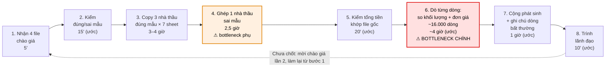
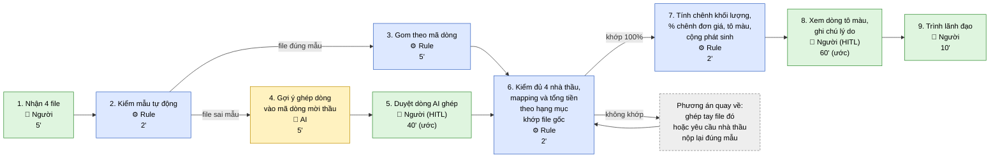

# Báo cáo nhóm — Day 02 Discovery & Problem Framing

> Bản chung của nhóm, viết trên repo do nhóm trưởng fork. Không copy file này sang repo cá nhân.
> Template chi tiết và prompt mẫu: [docs/01-worksheet.md](../../docs/01-worksheet.md). Bài mẫu: [docs/02-deliverable-example.md](../../docs/02-deliverable-example.md).

## 1. Thông tin nhóm

- Tên nhóm:
- Thành viên: xem `TEAM.md`
- Candidate problem được chọn (1 câu):
- Quyết định cuối: Go / Not Yet / No-Go

---

## 2. Hội tụ nhóm (CP3)

### 2.1. Pitch

| # | Người đưa ra | Candidate (Job Story ngắn) | Actor | Bottleneck | Câu hỏi phản biện nhận được (ai hỏi) |
|---:|---|---|---|---|---|
| 1 | | | | | |
| 2 | | | | | |
| 3 | | | | | |
| 4 | | | | | |
| 5 | | | | | |
| 6 | | | | | |
| 7 | | | | | |
| 8 | | | | | |
| 9 | | | | | |
| 10 | | | | | |
| 11 | | | | | |
| 12 | | | | | |
| 13 | | | | | |
| 14 | | | | | |
| 15 | | | | | |
| 16 | | | | | |
| 17 | | | | | |
| 18 | | | | | |

### 2.2. Cluster

| Cluster | Các candidate | Pattern chung |
|---|---|---|
| A | | |
| B | | |
| C | | |

### 2.3. Opportunity Solution Tree rút gọn

Gốc là **1 outcome**. Nhánh là **opportunity** (nhu cầu, pain), không phải tính năng hay công cụ.

```text
OUTCOME: 
├── Opportunity A: 
├── Opportunity B: 
└── Opportunity C: 
```

Những ý đã gạch bỏ vì là solution đội lốt opportunity:

-

### 2.4. Chấm điểm shortlist (1–5)

| Candidate | Actor rõ | Quy trình rõ | Pain có bằng chứng | Impact đo được | Vừa sức lab | So sánh được No AI/Rule/Workflow/Agent | Nhóm hiểu domain | Tổng |
|---|---:|---:|---:|---:|---:|---:|---:|---:|
| | | | | | | | | |
| | | | | | | | | |
| | | | | | | | | |

**Candidate được chọn:**

**Vì sao chọn:**

**Vì sao loại các candidate còn lại:**

**Xử lý bất đồng (nếu có):**

---

## 3. Kiểm chứng + research giải pháp đã có (CP4)

### 3.1. Assumption Map

| # | Giả định | Loại (Value / Usability / Feasibility / Viability) | Quan trọng (1–5) | Đã có bằng chứng (1–5) | Kiểm chứng trước? |
|---:|---|---|---:|---:|---|
| 1 |Người phụ trách đánh giá thầu mất nhiều thời gian đối chiếu thủ công HSDT của nhiều nhà thầu với các tiêu chí trong HSMT|Value |5 | 2|Ưu tiên 1|
| 2 |Quá trình đối chiếu thủ công có nguy cơ bỏ sót sự khác biệt về thông số kỹ thuật, giá, tiến độ và điều kiện hợp đồng |Value |5 |2 |Ưu tiên 2 |
| 3 |Người đánh giá cần xem được vị trí tài liệu gốc làm căn cứ cho từng kết quả so sánh, thay vì chỉ nhận kết luận tự động|Usability	 |5 |2 |Ưu tiên 3 |
| 4 |Có thể trích xuất đủ chính xác thông tin từ các HSDT có định dạng PDF, Word, bảng biểu hoặc bản scan để hỗ trợ đối chiếu|Feasibility	 |5 |3 |có |
| 5 |Người dùng sẵn sàng thay đổi một phần quy trình hiện tại để sử dụng công cụ hỗ trợ so sánh, nhưng vẫn giữ quyền quyết định cuối cùng|Usability	 |4 |1 |có |
| 6 |Lợi ích tiết kiệm thời gian và giảm công sức kiểm tra đủ lớn để đơn vị cân nhắc chi phí triển khai, bảo mật và vận hành|Viability |4 |1 |có |

*Điền 4–6 giả định; xóa dòng thừa.*

Giả định nhóm kiểm chứng trong buổi này: Giả định #1 — Việc so sánh, đối chiếu HSDT thực sự tạo ra khối lượng công việc thủ công đáng kể, có thể đo được bằng thời gian xử lý và số lần phải kiểm tra lại.

Lý do: Đây là giả định cốt lõi về giá trị của vấn đề. Nếu người dùng không mất nhiều thời gian hoặc đã có công cụ đáp ứng tốt, việc phát triển giải pháp mới có thể không cần thiết. 

### 3.2. Kiểm chứng

Cách đã dùng: Phỏng vấn nhanh 2–3 người đã từng tham gia lập, rà soát hoặc đánh giá hồ sơ thầu

| Trường | Nội dung |
|---|---|
| Người được hỏi (vai trò) |Chuyên viên phụ trách hồ sơ đấu thầu tại công ty xây dựng|
| Câu nói đáng nhớ nhất (nguyên văn) |Có rất nhiều số liệu cần so sánh |
| Lần gần nhất gặp vấn đề này: chuyện gì đã xảy ra? | Trong quá trình đối chiếu hồ sơ, một số liệu quan trọng liên quan đến khối lượng nguyên vật liệu bị sai lệch, dẫn đến thiếu hụt vật tư so với nhu cầu thực tế.|
| Hiện đang xử lý bằng cách nào (workaround)? |Kiểm tra lại số liệu và tự bù đắp phần vật liệu thiếu hụt.|
| Mất bao lâu, bao lần? | Chưa có số liệu cụ thể về thời gian và tần suất; cần hỏi thêm để định lượng mức độ ảnh hưởng. |
| Insight / opportunity rút ra |Việc đối chiếu nhiều số liệu về khối lượng vật tư có thể tạo ra rủi ro sai sót và thiệt hại tài chính. Cơ hội là hỗ trợ phát hiện chênh lệch và truy vết số liệu trước khi hoàn tất hồ sơ|

Tổng hợp:

| Nguồn | Số người / số mẫu | Tín hiệu xác nhận | Tín hiệu phản bác |
|---|---:|---|---|
| Phỏng vấn chuyên viên đấu thầu| 3|2 người xác nhận muốn sử dụng sản phẩm làm 1 công cụ hỗ trợ làm việc | 1 người nói việc đối chiếu rất phức tạp AI detech cũng có thể sai và không ai chịu trách nhiệm cho việc đó|

**Nhóm đã sửa problem thế nào sau kiểm chứng:**3 người được phỏng vấn, 2 người ủng hộ và 1 người lo ngại về độ chính xác, trách nhiệm, nên điều chỉnh mô hình từ AI tự động đánh giá hồ sơ sang AI hỗ trợ đối chiếu, có con người kiểm chứng (Human-in-the-loop).

### 3.3. Research giải pháp đã có

Liên kết tài liệu chính thức được mở kiểm trong lượt review PR ngày 2026-11-09. Chức năng được tài liệu mô tả không chứng minh công cụ đã đạt target trên dữ liệu nhóm; cách áp dụng và khoảng trống trong bảng được giữ như đề xuất cần kiểm.

| Công cụ / case / pattern | Link | Giải bước nào trong quy trình? | Điểm mạnh | Khoảng trống / rủi ro | Bài học cho nhóm |
|---|---|---|---|---|---|
| **Excel: công thức + Conditional Formatting (Rule)** | [Microsoft: định dạng theo điều kiện](https://support.microsoft.com/en-us/excel/use-conditional-formatting-to-highlight-information-in-excel); [hàm MEDIAN](https://support.microsoft.com/en-au/excel/functions/median-function) | Microsoft hỗ trợ tô màu theo công thức và tính trung vị. Nhóm có thể áp dụng vào bước 2–3: tính chênh khối lượng và độ lệch đơn giá so với trung vị; dùng kết quả làm danh sách cần rà soát ở bước 5. Đây là cách áp dụng do nhóm đề xuất. | Phù hợp với file tổng hợp hiện tại; phép tính minh bạch, truy lại được từng dòng; không cần LLM. | Phải kiểm mã dòng, đơn vị tính và kiểu dữ liệu; cần thống nhất ngưỡng cảnh báo. Ô trống, giá 0 và công thức lỗi cần xử lý riêng. Trung vị của 4 báo giá không đồng nghĩa với giá thị trường hợp lý. | Dùng làm baseline không AI. Đo xem công thức và bộ lọc có đủ đưa thời gian soát xuống dưới 1,5 giờ/vòng trước khi xây thêm hệ thống. |
| **Procore Bidding — Bid Leveling** | [Procore: Level Bids for a Bid Form](https://support.procore.com/products/online/user-guide/project-level/bidding/tutorials/level-bids-for-a-bid-form) | Hỗ trợ đối chiếu chào giá ở bước 2–3 và ghi nhận rà soát ở bước 5: xem dòng thiếu/loại trừ, điều chỉnh giá trị, ghi chú, tô màu và xem lịch sử thay đổi. | Tập trung việc so sánh và lưu dấu vết điều chỉnh trên cùng công cụ. | Tài liệu yêu cầu có bid form và báo giá trong hệ thống. Chưa xác minh khả năng nhận nguyên trạng file Excel 7 sheet của Nam, tự cảnh báo theo ngưỡng trung vị hoặc xử lý gói 4.100 dòng trong thời gian mục tiêu. | Học cách tách giá trị nhà thầu nộp với giá trị điều chỉnh khi so sánh; lưu lý do và lịch sử. Không xem “có bid leveling” là bằng chứng đáp ứng toàn bộ workflow của Nam. |
| **Autodesk BuildingConnected — Bid Leveling** | [BuildingConnected: Bid Leveling Overview](https://support.buildingconnected.com/hc/en-us/articles/47949854611219-Bid-Leveling-Overview) | Hỗ trợ bước 3–5: trình bày báo giá từng nhà thầu thành các cột, chia theo mục/dòng của bid form; so với estimated cost; tô màu, ghi chú và điều chỉnh giá trị khi rà soát. | So sánh trực quan trên một bảng; có mốc dự toán để tham chiếu và chỗ ghi nhận nhận xét. | Cấu trúc so sánh dựa trên bid form của dự án. Chưa xác minh việc nhập file hiện có, kiểm chênh khối lượng mời thầu tự động hoặc phát hiện đơn giá bất thường theo quy tắc nhóm cần. | Học cách trình bày báo giá cạnh nhau, phân biệt chênh so với dự toán và chênh giữa nhà thầu. Cần thử bằng dữ liệu mẫu trước khi kết luận phù hợp. |

---

## 4. Quy trình trước/sau (CP5)

Phần này mô tả cả gom và soát; thời gian tương lai là kỳ vọng thiết kế. Lựa chọn Rule cho riêng bước so số và giả thuyết AI cho ghép file sai mẫu cần được đánh giá theo phạm vi riêng, trước khi nhóm chốt mức can thiệp.

Phạm vi: từ lúc nhận bảng chào giá của 4 nhà thầu đến lúc trình lãnh đạo, gồm 2 phần **gom** (Card #2) và **soát** (Card #1) trong báo cáo cá nhân của Nguyễn Văn Vinh. Vẽ cả phần gom vì bước soát chỉ làm được khi bảng của 4 nhà thầu đã được gom đúng theo mã dòng. Số liệu lấy từ gói thầu gần nhất; thời gian ghi "(ước)" là ước lượng từng bước, tổng gom và tổng soát là đo thật.

### 4.1. Quy trình hiện tại

**HIỆN TẠI** — 8 bước/vòng, 8/8 bước thủ công, khoảng 11–13 giờ/vòng × 2 vòng/gói. Ô viền đỏ là bottleneck.



| Bước | Actor | Input | Output | Thời gian / tần suất | Ghi chú |
|---:|---|---|---|---|---|
| 1 | Chuyên viên KTKT (Nam) | Email / file nộp của 4 nhà thầu | 4 file Excel chào giá đã lưu | 5' / vòng | 2 vòng/gói ở gói gần nhất |
| 2 | Chuyên viên KTKT | 4 file chào giá, mẫu 7 sheet trong HSYC | Danh sách file đúng mẫu / sai mẫu (gói gần nhất: 3 đúng, 1 sai) | 15' (ước) / vòng | |
| 3 | Chuyên viên KTKT | 3 file đúng mẫu | File tổng hợp 7 sheet, 63 cột/sheet | 3–4 giờ / vòng (đo) | Copy tay từng sheet |
| 4 | Chuyên viên KTKT | 1 file sai mẫu (1 sheet 4.870 dòng) | Dòng của nhà thầu sai mẫu được xếp vào đúng hạng mục, đúng mã dòng | 2,5 giờ / vòng (đo) | Bottleneck phụ: chậm khoảng 2 lần so với một nhà thầu đúng mẫu; chỉ xảy ra khi có nhà thầu sai mẫu |
| 5 | Chuyên viên KTKT | File tổng hợp + 4 file gốc | Xác nhận tổng tiền từng nhà thầu khớp file gốc | 20' (ước) / vòng | Handoff sang phần soát |
| 6 | Chuyên viên KTKT | File tổng hợp (~4.100 dòng × 4 nhà thầu) | Các dòng có khối lượng khác mời thầu hoặc đơn giá chênh lớn được đánh dấu | ~4 giờ (ước) / vòng | **Bottleneck chính**; dò bằng mắt |
| 7 | Chuyên viên KTKT | Các dòng đã đánh dấu | Tổng phát sinh từng nhà thầu (0 đến ~3,9 tỷ) + ghi chú lý do | 1 giờ (ước) / vòng | |
| 8 | Chuyên viên KTKT → Lãnh đạo | Bảng tổng hợp có ghi chú | Lãnh đạo chọn nhà thầu, hỏi lại, hoặc mời chào giá lần 2 | 10' (ước) / vòng | Gói gần nhất: bị hỏi lại / trả lại ~4 lần |

Tổng: gom (bước 1–5) 6–7 giờ + soát (bước 6–8) 5–6 giờ = **khoảng 11–13 giờ/vòng, 22–26 giờ/gói (2 vòng)**.

**Bottleneck chính:** Bước 6, dò khoảng 16.000 dòng (4.100 dòng × 4 nhà thầu) bằng mắt để tìm dòng có khối lượng khác mời thầu hoặc đơn giá chênh lớn, mất khoảng 4 giờ/vòng. Đây là bước vừa tốn thời gian nhất vừa có rủi ro cao nhất: sót một dòng có thể làm lệch so sánh giá tới hàng tỷ (gói gần nhất có 1 nhà thầu mà giá trị tính theo khối lượng chào thấp hơn giá trị tính theo khối lượng mời thầu khoảng 3 tỷ). Bước 4 là bottleneck phụ, phụ thuộc vào việc có nhà thầu sai mẫu hay không (tỷ lệ này cần kiểm ở CP4).

### 4.2. Quy trình tương lai

**TƯƠNG LAI (kỳ vọng, chưa pilot)** — 9 bước/vòng, 4/9 bước thủ công, khoảng 2–2,5 giờ/vòng. Xanh dương = Rule, vàng = AI, xanh lá = con người, xám = phương án quay về.



| Bước | Ai / cái gì làm | Việc | Thời gian (ước) |
|---:|---|---|---|
| 1 | Con người | Nhận 4 file chào giá | 5' |
| 2 | Rule (macro) | Kiểm tên sheet, cột, mã dòng so với mẫu HSYC; tách file đúng mẫu / sai mẫu | 2' |
| 3 | Rule (Power Query / macro) | Gom các file đúng mẫu vào file tổng hợp theo mã dòng | 5' |
| 4 | AI | Chỉ với file sai mẫu: đọc từng dòng, gợi ý dòng đó thuộc mã dòng nào trong BOQ mời thầu (kể cả khi mô tả khác chữ), kèm mức tin cậy; dòng không tìm được thì đánh dấu "chưa ghép" | 5' |
| 5 | Con người (HITL) | Duyệt dòng AI ghép, ưu tiên dòng tin cậy thấp và dòng "chưa ghép"; tự ghép các dòng còn lại | 40' |
| 6 | Rule | So tổng tiền từng hạng mục của từng nhà thầu với file gốc; chỉ sang bước 7 khi khớp 100% | 2' |
| 7 | Rule (công thức + conditional formatting) | Tính chênh khối lượng = khối lượng chào − khối lượng mời thầu; % chênh đơn giá so với trung vị 4 nhà thầu; tô màu dòng chênh khối lượng khác 0 hoặc chênh đơn giá vượt ngưỡng; cộng phát sinh | 2' |
| 8 | Con người (HITL) | Xem các dòng tô màu, quyết định dòng nào thật sự bất thường, ghi lý do | 60' |
| 9 | Con người | Trình lãnh đạo | 10' |

Gom (bước 1–6) khoảng 1 giờ; soát (bước 7–9) khoảng 1,2 giờ.

**Boundary — AI không được:**
- Sửa khối lượng, đơn giá hay bất kỳ con số nào của nhà thầu; AI chỉ gợi ý dòng đó thuộc mã dòng nào.
- Tự xóa hoặc bỏ qua dòng mà nó không ghép được (phải đánh dấu "chưa ghép" để người xử lý).
- Kết luận nhà thầu nào đạt, rẻ nhất hay bị loại; quyết định này thuộc chuyên viên và lãnh đạo.
- Tự gửi file cho lãnh đạo hoặc nhà thầu.
- Nhận dữ liệu chào giá qua công cụ AI chưa được tổ chức cho phép (dữ liệu chào giá là thông tin mật của gói thầu).

**Khi nào con người phải kiểm tra (HITL):**
- Bước 5: mọi mapping do AI gợi ý phải được người duyệt đối chiếu mã, mô tả, đơn vị và dòng nguồn trước khi dùng; ưu tiên dòng tin cậy thấp và xử lý riêng các dòng chưa ghép.
- Bước 6: nếu tổng tiền bất kỳ hạng mục nào không khớp file gốc thì dừng, không sang bước 7.
- Bước 8: mọi dòng tô màu phải được người xem và ghi lý do trước khi trình.

Kiểm tra chéo: tổng tiền khớp không chứng minh mọi dòng được ghép đúng. Một dòng ghép sai có thể không tạo chênh khối lượng nếu hai dòng cùng khối lượng hoặc cùng đơn vị. Vì vậy chuyên viên kiểm mã, mô tả, đơn vị và dòng nguồn của mọi mapping AI trước khi sử dụng, không chỉ các gợi ý có mức tin cậy thấp; dòng mơ hồ được chuyển xử lý thủ công.

**Phương án quay về:**
- AI ghép sai, tổng tiền không khớp, hoặc AI không dùng được → chuyên viên ghép tay file sai mẫu như hiện tại (khoảng 2,5 giờ), hoặc yêu cầu nhà thầu nộp lại đúng mẫu.
- Macro / Power Query lỗi (ví dụ nhà thầu đổi mã dòng) → quay về copy tay (bước 3 hiện tại) cho file đó.
- Ngưỡng tô màu báo quá nhiều dòng → chỉnh ngưỡng cùng lãnh đạo; trong lúc chờ, dò tay các dòng có giá trị lớn.

### 4.3. Before / after

| Chỉ số | Trước | Sau (kỳ vọng) | Ghi chú |
|---|---:|---:|---|
| Số bước | 8 | 9 | Thêm bước kiểm mẫu tự động và tách riêng bước người duyệt dòng AI ghép |
| Tổng thời gian | 11–13 giờ/vòng (22–26 giờ/gói) | ~2–2,5 giờ/vòng (~4–5 giờ/gói) | "Trước" đo trên gói gần nhất; "Sau" là ước lượng, cần đo khi pilot |
| Số bước thủ công | 8/8 | 4/9 | Bước thủ công còn lại: nhận file, duyệt dòng AI ghép, xem dòng tô màu, trình lãnh đạo |
| Bottleneck chính | Dò ~16.000 dòng bằng mắt (~4 giờ/vòng) | Xem và ghi lý do cho các dòng tô màu (~60'/vòng) | Thời gian bước 8 phụ thuộc số dòng bị tô màu, tức là phụ thuộc ngưỡng |
| Rủi ro mới phát sinh | — | AI ghép sai dòng nhưng tổng tiền vẫn khớp; ngưỡng tô màu đặt sai gây báo nhầm nhiều hoặc bỏ sót; nhà thầu đổi mã dòng làm gom tự động sai; dữ liệu mật đi qua công cụ AI; chuyên viên tin máy, soát lơ là hơn | Xử lý bằng bước 6 (khớp tổng tiền), bước 7 (tô màu dòng chênh), HITL ở bước 5 và 8, và boundary về công cụ AI |

---

## 5. Problem Statement v0 (CP5)

| Trường | Nội dung |
|---|---|
| **Actor** | |
| **Quy trình** | |
| **Bottleneck** | |
| **Impact** | |
| **Success Metric** (baseline → target, cách đo) | |
| **Boundary** (AI không được làm gì; khi nào cần con người kiểm tra — HITL) | |

Phản biện nhận được (từ AI hoặc nhóm khác) và nhóm có đồng ý không:

-

---

## 6. Mức can thiệp AI (CP6)

### 6.1. Ma trận độ mơ hồ × độ phức tạp
**Bài toán:** Kiểm tra chênh lệch khối lượng, đơn giá và các thông tin bất thường trong hồ sơ chào giá gói thầu cơ điện

**Bối cảnh:**

Một gói thầu có khoảng 4.100 dòng BOQ, 4 nhà thầu tham gia chào giá, tương đương khoảng 16.000 dòng cần đối chiếu mỗi vòng
Theo dữ liệu từ Problem Card cá nhân, quá trình kiểm tra mất khoảng 5–6 giờ/vòng và một gói thầu có thể trải qua 2 vòng chào giá

**Đánh giá các công đoạn:**

| Công đoạn | Độ mơ hồ | Độ phức tạp | Nhận định |
|---|---|---|---|
| So khối lượng chào với BOQ | Thấp | Cao về khối lượng dữ liệu | Có thể sử dụng công thức và Rule |
| Phát hiện đơn giá chênh lệch | Trung bình | Trung bình | Rule phát hiện, con người đánh giá nguyên nhân |
| Gom file đúng mẫu | Thấp | Trung bình | Power Query, Macro |
| Ghép file sai mẫu | Cao | Cao | Workflow kết hợp AI hỗ trợ đối chiếu ngữ nghĩa |
| Đánh giá hồ sơ năng lực | Cao | Cao | AI trích xuất bằng chứng, chuyên viên quyết định |

**Vị trí của bài toán chính:** Độ mơ hồ thấp khi bảng đã ghép đúng mã/đơn vị và quy tắc rõ; nhiều nguồn/bước phụ thuộc nhau tạo độ phức tạp tích hợp. Số dòng lớn riêng nó không chứng minh cần Agent.

Khó khăn chính không nằm ở việc cần AI suy luận mà nằm ở số lượng dòng phải kiểm tra lớn, thao tác thủ công lặp lại và nguy cơ bỏ sót các chênh lệch

### 6.2. So sánh bốn mức can thiệp

| Mức | Phương án | Khả năng giải quyết | Hạn chế | Lựa chọn |
|---|---|---|---|---|
| No AI | Chuẩn hóa mẫu, checklist mã/đơn vị/phiên bản, phân công kiểm và quản lý BOQ chung; soát thủ công theo cách đã cải tiến | Có thể đủ khi phạm vi nhỏ hoặc công soát sau cải tiến đạt mục tiêu | Cần đo công còn lại sau cải tiến, không mặc định bằng hiện trạng 5–6 giờ/vòng | Đối chứng cần thử trước khi chọn Rule |
| Rule | Sử dụng Excel Formula, Conditional Formatting, Power Query để phát hiện chênh lệch | Có thể kiểm tra toàn bộ dòng đã khớp mã, tự động tính chênh khối lượng và đơn giá | Cần dữ liệu được ghép đúng, chưa tự hiểu file sai mẫu | **Ưu tiên cho bài toán chính** |
| Workflow | Kết hợp bước nhập dữ liệu, kiểm tra, tổng hợp và xuất báo cáo, bổ sung AI khi cần xử lý dữ liệu phi cấu trúc | Giảm thao tác giữa các bước, hỗ trợ xử lý nhà thầu chào sai mẫu | Phụ thuộc dữ liệu đầu vào và khả năng đối chiếu | Cân nhắc cho bài toán mở rộng |
| Agent | Hệ thống tự lựa chọn công cụ, phân tích hồ sơ và thực hiện nhiều bước | Linh hoạt với tác vụ có nhiều ngoại lệ | Chi phí cao, khó kiểm soát, nguy cơ kết luận sai | Chưa cần thiết |

**Mức lựa chọn đề xuất: Rule-based Automation**

**Lý do:**

- Chênh lệch khối lượng có thể xác định chính xác bằng phép tính
- Chênh lệch đơn giá có thể phát hiện bằng công thức và ngưỡng cảnh báo
- Không cần sử dụng LLM để xử lý dữ liệu số đã có cấu trúc
- Dễ kiểm thử, giải thích kết quả và đối chiếu với file gốc
- Giảm chi phí và rủi ro so với phương án dùng Agent

**Trường hợp có thể sử dụng AI:**

Khi nhà thầu gửi bảng chào giá không theo mẫu, mô tả hạng mục khác cách diễn đạt trong BOQ, AI có thể đề xuất ghép các dòng tương ứng theo ý nghĩa
Đây là công đoạn thuộc Problem Card #2, không phải bước so sánh số liệu của Problem Card #1

### 6.3. AI Canvas rút gọn

Phương án Rule chính không cần AI Canvas theo worksheet. Bảng dưới là bản chuẩn bị riêng cho hướng mở rộng ghép file sai mẫu nếu sau này có bằng chứng cần AI; không tính lợi ích của hướng này vào target soát Rule.

| Thành phần | Nội dung |
|---|---|
| **Prediction** | Với file sai mẫu, AI đề xuất mã BOQ hoặc hạng mục tương ứng cho từng dòng chào giá dựa trên nội dung mô tả |
| **Judgment** | Chuyên viên KTKT kiểm tra mã dòng, quy cách, đơn vị tính, khối lượng và sự phù hợp của đề xuất |
| **Action** | Hệ thống tạo bảng đối chiếu và danh sách dòng bất thường, chuyên viên xác nhận trước khi sử dụng |
| **Outcome** | Giảm thời gian kiểm tra và ghép bảng, không bỏ sót dòng chênh khối lượng, tổng tiền khớp file gốc |
| **Input** | BOQ gốc, bảng chào giá của nhà thầu, mã hạng mục, mô tả, đơn vị tính, khối lượng và đơn giá |
| **Feedback** | Các dòng được chuyên viên chấp nhận, chỉnh sửa hoặc từ chối, kết quả soát lại trên gói thầu đã có đáp án |

**Điểm can thiệp chính:**

- Rule phát hiện chênh lệch số liệu
- AI hỗ trợ đối chiếu mô tả hạng mục không đồng nhất
- Chuyên viên KTKT kiểm tra và xác nhận kết quả
- Lãnh đạo tiếp tục chịu trách nhiệm phê duyệt theo quy trình

**Boundary:**

- Không tự động kết luận nhà thầu đạt hoặc không đạt
- Không tự động lựa chọn nhà thầu trúng thầu
- Không thay đổi file chào giá gốc
- Không tự sửa khối lượng hoặc đơn giá do nhà thầu cung cấp
- Không tự ghép các dòng thiếu căn cứ đối chiếu
- Không sử dụng dữ liệu hồ sơ ngoài phạm vi được cấp quyền
- Các trường hợp thiếu mã, trùng mã hoặc không khớp tổng tiền phải được chuyển cho chuyên viên kiểm tra
- Khi hệ thống không thể xác định kết quả đáng tin cậy, quay về quy trình kiểm tra thủ công

### 6.4. Hai câu hỏi Google PAIR

Các câu trả lời sau phục vụ hướng mở rộng có AI và cần actor xác nhận. Không coi chúng là bằng chứng nhóm đã chọn hoặc thử AI trong phạm vi Rule.

**1. Người dùng muốn được hỗ trợ hay giao hẳn việc cho hệ thống?**

Đề xuất kết hợp cả hai cách tùy theo công đoạn
Đối với việc so sánh khối lượng, đơn giá và tổng tiền theo các công thức đã xác định, có thể tự động hóa hoàn toàn bước tính toán
Đối với việc ghép file sai mẫu, nhận diện hạng mục tương đương và đánh giá nguyên nhân chênh lệch, hệ thống chỉ đưa ra gợi ý và bằng chứng để chuyên viên xác minh
Cách tiếp cận này giúp giảm thao tác lặp lại nhưng vẫn giữ trách nhiệm chuyên môn và quyết định ở con người
Đây là đề xuất thiết kế, cần được xác nhận với người trực tiếp xử lý hồ sơ

**2. AI sai kiểu nào tệ hơn, báo nhầm hay bỏ sót?**
Đối với bài toán này, bỏ sót một chênh lệch quan trọng có thể gây hậu quả lớn hơn vì ảnh hưởng đến việc so sánh giá trị chào thầu

- False Positive: Cảnh báo dòng bất thường nhưng thực tế có lý do hợp lệ, khiến chuyên viên phải kiểm tra thêm
- False Negative: Không phát hiện dòng chênh lệch thực sự, khiến thông tin bất thường không được đưa ra xem xét

Do đó, ưu tiên phát hiện đầy đủ các chênh lệch khối lượng có thể xác định bằng công thức
Đối với đơn giá, cảnh báo bất thường không đồng nghĩa với đơn giá sai, mà chỉ là tín hiệu cần người phụ trách kiểm tra

**Phương án kiểm soát:**

- Đối chiếu theo mã dòng và đơn vị tính
- Kiểm tra toàn bộ chênh lệch khối lượng bằng Rule
- Không tự động bỏ qua những dòng chưa ghép được
- Lưu giá trị gốc, giá trị tính toán và lý do cảnh báo
- Kiểm tra tổng giá trị sau khi ghép bảng
- Chuyên viên xác nhận kết quả trước khi trình lãnh đạo

---

## 7. Problem Statement v1 + tiêu chí đánh giá (CP6)

| Trường | Nội dung |
|---|---|
| **Actor** | |
| **Quy trình** | |
| **Bottleneck** | |
| **Impact** | |
| **Success Metric** (baseline → target, cách đo) | |
| **Boundary** | |
| **AI intervention point** | |
| **Mức chọn** | No AI / Rule / Workflow / Agent |
| **Rủi ro & người kiểm tra** | |

**Thay đổi so với v0 và lý do:**

| Trường | v0 | v1 | Vì sao đổi |
|---|---|---|---|
| | | | |

**Tiêu chí đánh giá đầu ra của AI (3–5 tiêu chí):**

| # | Tiêu chí | Đạt khi | Không đạt khi |
|---:|---|---|---|
| 1 | | | |
| 2 | | | |
| 3 | | | |

---

## 8. Quyết định (CP6)

### 8.1. Bốn rủi ro

| Rủi ro | Mức độ sơ bộ | Lý do và bằng chứng | Phương án xử lý |
|---|---|---|---|
| **Value Risk** | Thấp đến trung bình | Đã có dấu hiệu thực tế về khối lượng khoảng 16.000 dòng/vòng và thời gian kiểm tra 5–6 giờ/vòng, nhưng chưa đo hiệu quả của phương án mới | Thử nghiệm trên gói thầu cũ và so sánh thời gian trước/sau |
| **Usability Risk** | Trung bình | Chuyên viên quen sử dụng Excel, hệ thống mới có thể gây khó khăn nếu thay đổi cấu trúc làm việc | Giữ định dạng Excel quen thuộc, hiển thị rõ dòng sai lệch và cho phép kiểm tra thủ công |
| **Feasibility Risk** | Trung bình | Công thức có thể xử lý dữ liệu đúng mã dòng, nhưng file sai mẫu và mã hạng mục không khớp có thể gây lỗi | Tách bước kiểm tra cấu trúc, bước ghép dữ liệu và bước phát hiện chênh lệch |
| **Viability Risk** | Trung bình | Giải pháp Rule có chi phí triển khai tương đối thấp, nhưng cần duy trì quy tắc và bảo mật dữ liệu chào giá | Ưu tiên công cụ sẵn có, phân quyền truy cập, đo chi phí vận hành và thời gian tiết kiệm |

### 8.2. Kết luận

**Quyết định đề xuất cá nhân: GO với Rule-based Automation cho Problem Card #1**

Đây là đề xuất của người phụ trách để nhóm review, không phải quyết định chung hoặc kết quả pilot. Trước thử cần xác nhận quyền dùng dữ liệu, mapping/đơn vị/phiên bản, ngưỡng và đáp án được người domain duyệt. Baseline được dẫn theo báo cáo Vinh, không thay kiểm chứng CP4 ngoài nhóm.
**Đối với AI: NOT YET**
**Lý do:**

Problem Card #1 đã có dấu hiệu thực tế rõ ràng về khối lượng dữ liệu, thời gian xử lý và những chênh lệch cần phát hiện
Các phép so sánh khối lượng và đơn giá có thể thực hiện bằng công thức khi dữ liệu đã được ghép đúng mã dòng
Vì vậy, chưa có lý do đủ mạnh để sử dụng AI hoặc Agent thay cho Rule ở công đoạn này
AI có thể được nghiên cứu thêm cho việc xử lý file sai mẫu và đối chiếu mô tả hạng mục, nhưng cần kiểm chứng riêng lợi ích so với Power Query hoặc các quy tắc ghép dữ liệu

**Pilot nhỏ nhất nếu GO:**

Sử dụng một bộ hồ sơ chào giá đã xử lý trước đây, gồm 4 nhà thầu, khoảng 4.100 dòng BOQ và hai vòng chào giá nếu dữ liệu đầy đủ

**Các bước thử nghiệm:**

1. Chuẩn bị BOQ và bảng chào giá gốc
2. Chuẩn hóa mã hạng mục và kiểm tra đơn vị tính
3. Sử dụng Rule phát hiện chênh lệch khối lượng
4. Tính toán chênh lệch đơn giá theo ngưỡng được thống nhất
5. Xuất danh sách dòng cần kiểm tra
6. Đối chiếu kết quả với bảng đã được chuyên viên rà soát
7. Đo thời gian xử lý và số trường hợp bị bỏ sót

**Success Metrics:**

| Metric | Baseline từ bài cá nhân | Target |
|---|---|---|
| Thời gian soát một vòng | 5–6 giờ/vòng | Dưới 1,5 giờ/vòng |
| Thời gian soát một gói hai vòng | 10–12 giờ/gói | Dưới 3 giờ/gói |
| Phát hiện chênh lệch khối lượng ở dòng khớp mã | Chưa đo số dòng bị bỏ sót | Không bỏ sót dòng có chênh lệch trong bộ kiểm thử |
| Tổng tiền đối chiếu | Cần kiểm tra từng file gốc | Khớp 100% với các giá trị nguồn theo cùng phương pháp tính |
| Số lần lãnh đạo hỏi lại hoặc trả lại | Khoảng 4 lần ở gói gần nhất | Không tăng so với baseline |

**Điều kiện để mở rộng sang AI Workflow:**

- Có các trường hợp file sai mẫu xảy ra lặp lại
- Phương án Rule hoặc Power Query không ghép được đầy đủ dữ liệu
- AI giúp giảm thời gian ghép bảng mà không làm sai thông tin
- Các dòng AI ghép có thể được truy xuất và kiểm tra
- Có người chịu trách nhiệm xác nhận kết quả

**Ngưỡng dừng:**

- Tổng tiền trong bảng tổng hợp không khớp với file gốc mà không giải thích được
- Hệ thống bỏ sót chênh lệch khối lượng trong dữ liệu đã khớp mã
- Không phát hiện hoặc không cảnh báo các dòng thiếu mã, trùng mã hay không ghép được
- Sau tối đa hai vòng pilot cùng phạm vi soát, nếu tổng công xử lý + kiểm/sửa/ngoại lệ vẫn từ 90 phút/vòng trở lên hoặc không tốt hơn No AI cải tiến thì dừng mở rộng và rà soát lại phương án
- Khi tổng chi phí thiết lập/vận hành/kiểm tra vượt lợi ích thời gian tiết kiệm quy đổi theo cách tính được nhóm duyệt trước pilot thì dừng mở rộng
- Không đảm bảo quyền truy cập và bảo mật hồ sơ chào giá

**Phương án quay về:**

Tiếp tục sử dụng file Excel gốc, công thức kiểm tra và quy trình rà soát thủ công của chuyên viên KTKT
Không sử dụng kết quả ghép dữ liệu chưa xác minh để tính toán hoặc trình lãnh đạo

**Kết luận:**

Bài toán có cơ sở để tự động hóa vì khối lượng dữ liệu lớn, thao tác lặp lại và có chỉ số thời gian thực tế
Tuy nhiên, giải pháp phù hợp nhất với Problem Card #1 là Rule-based Automation thay vì AI Agent
Việc sử dụng AI chỉ nên triển khai ở các bước cần hiểu nội dung phi cấu trúc, đặc biệt khi xử lý bảng chào giá không theo mẫu hoặc tài liệu hồ sơ năng lực
Quyết định cuối cùng vẫn cần được nhóm xác nhận dựa trên kết quả kiểm chứng và đánh giá của các actor liên quan

---

## 9. Hạn chế và hướng tiếp theo

-

## 10. Tài liệu tham khảo

-
