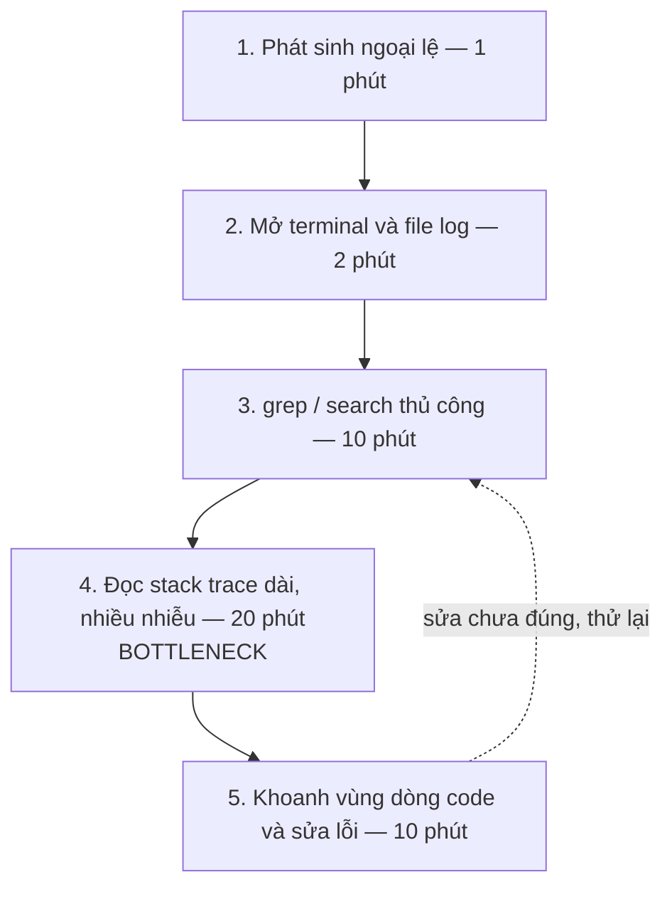
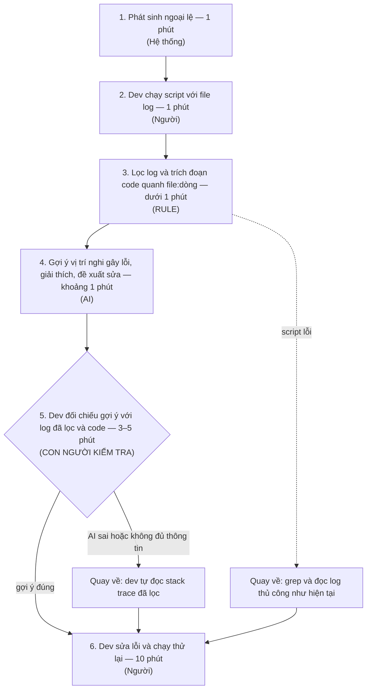

# Báo cáo nhóm — Day 02 Discovery & Problem Framing

> Bản chung của nhóm, viết trên repo do nhóm trưởng fork. Không copy file này sang repo cá nhân.
> Template chi tiết và prompt mẫu: [docs/01-worksheet.md](../../docs/01-worksheet.md). Bài mẫu: [docs/02-deliverable-example.md](../../docs/02-deliverable-example.md).

## 1. Thông tin nhóm

- Tên nhóm: BDHH
- Thành viên: xem `TEAM.md`
- Candidate problem được chọn (1 câu):
- Quyết định cuối: Go / Not Yet / No-Go

---

## 2. Hội tụ nhóm (CP3)

### 2.1. Pitch

| # | Người đưa ra | Candidate (Job Story ngắn) | Actor | Bottleneck | Câu hỏi phản biện nhận được (ai hỏi) |
|---:|---|---|---|---|---|
| 1 | | | | | |
| 2 | | | | | |
| 3 | | | | | |
| 4 | | | | | |
| 5 | | | | | |
| 6 | | | | | |
| 7 | | | | | |
| 8 | | | | | |
| 9 | | | | | |
| 10 | | | | | |
| 11 | | | | | |
| 12 | | | | | |

### 2.2. Cluster

| Cluster | Các candidate | Pattern chung |
|---|---|---|
| A | | |
| B | | |
| C | | |

### 2.3. Opportunity Solution Tree rút gọn

Gốc là **1 outcome**. Nhánh là **opportunity** (nhu cầu, pain), không phải tính năng hay công cụ.

```text
OUTCOME: 
├── Opportunity A: 
├── Opportunity B: 
└── Opportunity C: 
```

Những ý đã gạch bỏ vì là solution đội lốt opportunity:

-

### 2.4. Chấm điểm shortlist (1–5)

| Candidate | Actor rõ | Quy trình rõ | Pain có bằng chứng | Impact đo được | Vừa sức lab | So sánh được No AI/Rule/Workflow/Agent | Nhóm hiểu domain | Tổng |
|---|---:|---:|---:|---:|---:|---:|---:|---:|
| | | | | | | | | |
| | | | | | | | | |
| | | | | | | | | |

**Candidate được chọn:**

**Vì sao chọn:**

**Vì sao loại các candidate còn lại:**

**Xử lý bất đồng (nếu có):**

---

## 3. Kiểm chứng + research giải pháp đã có (CP4)

### 3.1. Assumption Map

| # | Giả định | Loại (Value / Usability / Feasibility / Viability) | Quan trọng (1–5) | Đã có bằng chứng (1–5) | Kiểm chứng trước? |
|---:|---|---|---:|---:|---|
| 1 | | | | | |
| 2 | | | | | |
| 3 | | | | | |
| 4 | | | | | |
| 5 | | | | | |
| 6 | | | | | |

*Điền 4–6 giả định; xóa dòng thừa.*

Giả định nhóm kiểm chứng trong buổi này:

### 3.2. Kiểm chứng

Cách đã dùng: Phỏng vấn / Survey / Log, ticket, review

Interview snapshot (mỗi buổi phỏng vấn một bảng, hoặc đặt file trong `report/assets/cp4-interview-snapshot-N.md`):

| Trường | Nội dung |
|---|---|
| Người được hỏi (vai trò, không ghi tên thật) | |
| Câu nói đáng nhớ nhất (nguyên văn) | |
| Lần gần nhất gặp vấn đề này: chuyện gì đã xảy ra? | |
| Hiện đang xử lý bằng cách nào (workaround)? | |
| Mất bao lâu, bao lần? | |
| Insight / opportunity rút ra | |

Tổng hợp:

| Nguồn | Số người / số mẫu | Tín hiệu xác nhận | Tín hiệu phản bác |
|---|---:|---|---|
| | | | |

**Nhóm đã sửa problem thế nào sau kiểm chứng:**

### 3.3. Research giải pháp đã có

| Công cụ / case / pattern | Link | Giải bước nào trong quy trình? | Điểm mạnh | Khoảng trống / rủi ro | Bài học cho nhóm |
|---|---|---|---|---|---|
| | | | | | |
| | | | | | |
| | | | | | |

---

## 4. Quy trình trước/sau (CP5)

### 4.1. Quy trình hiện tại

Sơ đồ (ASCII, Mermaid hoặc link ảnh trong `report/assets/`):



| Bước | Actor | Input | Output | Thời gian / tần suất | Ghi chú |
|---:|---|---|---|---|---|
| 1 | Hệ thống backend | Request hoặc thao tác gây lỗi | Ngoại lệ kèm stack trace được ghi vào file log | 1 phút; 3–4 lần/tuần | |
| 2 | Backend developer | Thông báo lỗi, thời điểm xảy ra lỗi | Terminal và file log hệ thống đã mở | 2 phút | |
| 3 | Backend developer | File log, từ khóa (thông điệp lỗi, thời điểm) | Đoạn log chứa stack trace liên quan | 10 phút | Tìm thủ công bằng grep/search |
| 4 | Backend developer | Stack trace dài, lẫn nhiều thông tin nhiễu | Nguyên nhân gốc và vị trí file/dòng code nghi gây lỗi | 20 phút | **Bottleneck** |
| 5 | Backend developer | Vị trí code nghi gây lỗi | Bản sửa lỗi đã chạy thử lại | 10 phút | Sửa chưa đúng thì quay lại bước 3–4 (sửa mò) |

**Bottleneck chính:** Bước 4, đọc stack trace: 20 phút/lần, vì phải dò dải stack trace dài, chứa nhiều thông tin nhiễu để tìm ra nguyên nhân gốc rễ (root cause).

### 4.2. Quy trình tương lai

Ghi rõ bước nào **Rule**, bước nào **AI**, bước nào **con người**, **boundary** ở đâu, **phương án quay về** khi AI sai.



**Boundary:** AI chỉ nhận log đã được Rule lọc và đoạn code quanh dòng lỗi, không nhận raw log hay thông tin nhạy cảm (mật khẩu DB, token, dữ liệu người dùng). AI chỉ gợi ý: không sửa file, không commit, không chạy lệnh. Dev phải xác nhận trước khi sửa.

**Phương án quay về:** AI sai hoặc trả "không đủ thông tin" thì dev bỏ gợi ý, tự đọc stack trace đã được Rule lọc. Script lỗi thì quay về grep và đọc log thủ công như hiện tại.

### 4.3. Before / after

| Chỉ số | Trước | Sau (kỳ vọng) | Ghi chú |
|---|---:|---:|---|
| Số bước | 5 | 6 | Thêm bước Rule lọc log và bước dev kiểm tra gợi ý của AI |
| Tổng thời gian | khoảng 43 phút/lần (thường 30–60) | khoảng 17–19 phút/lần | Phần tìm nguyên nhân (bước 2–5) còn khoảng 6–8 phút, đạt target dưới 10 phút |
| Số bước thủ công | 4/5 | 3/6 | Còn lại: chạy script, kiểm tra gợi ý, sửa lỗi; Rule và AI làm phần lọc và đọc stack trace |
| Bottleneck chính | Đọc stack trace dài, nhiều nhiễu (20 phút) | Sửa lỗi và chạy thử (10 phút) | Bước dev kiểm tra gợi ý (3–5 phút) là điểm kiểm soát chất lượng, chấp nhận được |
| Rủi ro mới phát sinh | — | AI chỉ sai vị trí hoặc ảo giác (CP4: LogGPT có tỉ lệ báo động giả cao); lộ dữ liệu nhạy cảm nếu gửi raw log | Xử lý bằng boundary, bước dev kiểm tra và phương án quay về |

---

## 5. Problem Statement v0 (CP5)

| Trường | Nội dung |
|---|---|
| **Actor** | Backend developer (sinh viên/junior) dùng framework nhiều tầng như Java Spring Boot, Node.js, khi gặp lỗi kéo dài trên 15 phút: lỗi kết nối CSDL, ORM, lỗi logic xuyên nhiều tầng Controller/Service/Middleware |
| **Quy trình** | Mỗi khi backend phát sinh ngoại lệ (3–4 lần/tuần): 1. Phát sinh ngoại lệ → 2. Mở terminal và file log hệ thống → 3. Dùng lệnh grep hoặc search tìm kiếm thủ công → 4. Đọc dải stack trace dài và nhiều thông tin nhiễu → 5. Khoanh vùng dòng code và sửa lỗi |
| **Bottleneck** | Bước 4, đọc stack trace: 20 phút/lần, vì phải dò dải stack trace dài, chứa nhiều thông tin nhiễu để tìm ra nguyên nhân gốc rễ (root cause) |
| **Impact** | 30–60 phút/lần × 3–4 lần/tuần ≈ 1,5–4 giờ/tuần cho debug. Ngoài ra làm gián đoạn nặng nề mạch tư duy viết code, gây căng thẳng mệt mỏi cuối ngày |
| **Success Metric** (baseline → target, cách đo) | Baseline: bước tìm ra nguyên nhân (grep + đọc stack trace) mất 20–40 phút/lần với lỗi kéo dài (bản thân khoảng 30 phút; 2 người được phỏng vấn ở CP4: 20–25 và 25–40 phút) → target: dưới 10 phút/lần (mức dưới 5 phút ở CP4 là kỳ vọng xa). Chỉ số phụ: số lần sửa thử trước khi sửa đúng (ghi trong tuần đầu làm baseline). Cách đo: tự ghi thời gian bước tìm nguyên nhân và số lần sửa thử mỗi lần debug, trong 2 tuần pilot |
| **Boundary** (AI không được làm gì; khi nào cần con người kiểm tra — HITL) | AI không được: nhận raw log hay thông tin nhạy cảm (mật khẩu DB, token, dữ liệu người dùng), chỉ nhận log đã được Rule lọc và đoạn code quanh dòng lỗi; tự sửa file, commit hay chạy lệnh; đoán khi thiếu bằng chứng (phải trả "không đủ thông tin"). HITL: mỗi lần dùng, dev phải đối chiếu vị trí AI chỉ ra với log đã lọc và code trước khi sửa |

Phản biện nhận được (từ AI hoặc nhóm khác) và nhóm có đồng ý không:

- AI: Actor "Backend developer" quá rộng; CP4 cho thấy lỗi đơn giản chỉ mất 2–5 phút, lỗi Python thường 10–15 phút. **Đồng ý**: thu hẹp Actor vào framework nhiều tầng (Java Spring Boot, Node.js) và lỗi kéo dài trên 15 phút.
- AI: Baseline 30 phút chỉ dựa trên 1 người; target lệch giữa card ban đầu (dưới 10 phút) và CP4 (dưới 5 phút). **Đồng ý**: baseline 20–40 phút (bản thân và 2 người được phỏng vấn), target dưới 10 phút; dưới 5 phút ghi là kỳ vọng xa.
- AI: Boundary còn trống. **Đồng ý**: thêm 4 ranh giới (không gửi raw log và thông tin nhạy cảm; AI chỉ gợi ý; dev xác nhận trước khi sửa; không chắc thì trả "không đủ thông tin").
- AI: Quy trình tương lai thiếu phương án quay về. **Đồng ý**: AI sai thì dev tự đọc stack trace đã lọc; script lỗi thì quay về grep thủ công.

---

## 6. Mức can thiệp AI (CP6)

### 6.1. Ma trận độ mơ hồ × độ phức tạp

**Bài của nhóm nằm ở ô:** **Độ mơ hồ cao × Độ phức tạp cao**. Mức can thiệp phù hợp được lựa chọn là **Workflow (Rule + AI + Human-in-the-loop)**, không phải Agent.

**Vì sao:**

- **Độ mơ hồ cao:** Một ngoại lệ runtime có thể bắt nguồn từ cấu hình kết nối CSDL, ORM, dữ liệu đầu vào, xử lý bất đồng bộ hoặc logic giữa nhiều tầng Controller/Service/Middleware. Stack trace thường chứa nhiều frame thuộc thư viện và framework; nơi exception xuất hiện chưa chắc là nơi phát sinh nguyên nhân gốc. Với cùng một thông điệp lỗi có thể tồn tại nhiều giả thuyết, vì vậy không thể chỉ dựa vào một từ khóa hoặc dòng cuối của log để kết luận.
- **Độ phức tạp cao:** Để xác định nguyên nhân cần kết hợp nhiều nguồn thông tin: thông điệp exception, chuỗi `Caused by`, các frame của package dự án, đoạn mã gần `file:dòng` và quan hệ gọi hàm giữa các tầng. Trong CP5, khâu `grep`/search thủ công mất khoảng **10 phút**, đọc và đối chiếu stack trace mất khoảng **20 phút**; toàn bộ phiên xử lý mẫu mất khoảng **43 phút**. Quy trình tương lai gồm sáu bước có sự phối hợp của Rule, AI và developer.
- **Căn cứ thu hẹp phạm vi:** CP4 ghi nhận hai trường hợp liên quan trực tiếp đến Java Spring Boot và Node.js cần lần lượt **20–25 phút** và **25–40 phút** đối với lỗi phức tạp. Trường hợp Python FastAPI thường chỉ mất **10–15 phút**, đồng thời lỗi đơn giản có thể được xử lý trong **2–5 phút**. Vì vậy, bài toán tập trung vào **lỗi runtime nhiều tầng có thời gian xác định nguyên nhân kéo dài trên 15 phút**, không áp dụng AI cho mọi thông báo lỗi.
- **Vì sao không dùng Agent:** Chuỗi thao tác đã xác định rõ từ đầu: developer chọn sự kiện lỗi → Rule lọc và bảo vệ dữ liệu → AI phân tích → developer xác nhận → developer sửa và kiểm thử. AI không cần tự lựa chọn công cụ, đọc toàn bộ repository, chạy lệnh, sửa file hoặc commit. Việc tự động hóa đến mức Agent sẽ mở rộng quyền truy cập và rủi ro vượt quá giá trị kỳ vọng của bài toán.

### 6.2. So sánh 4 mức

| Mức | Phương án cho bài của nhóm | Đủ khi nào | Rủi ro | Chọn? |
|---|---|---|---|---|
| **No AI** (sửa quy trình) | Chuẩn hóa checklist debug: xác định thời điểm phát sinh exception, xem thông điệp gốc và `Caused by`, đánh dấu frame thuộc package dự án, đối chiếu thay đổi gần nhất, ghi nhận cách sửa và kết quả kiểm thử. | Lỗi cú pháp, lỗi cấu hình hiển nhiên hoặc stack trace ngắn có thể tự xác định trong 2–5 phút; developer đã quen loại lỗi. | Vẫn phải đọc, tìm và liên kết thủ công các dấu hiệu trong lỗi đa tầng; khó giảm đáng kể bottleneck 20 phút đọc stack trace ở CP5. | **Không chọn làm phương án chính; giữ làm fallback.** |
| **Rule** | Dùng script CLI/IDE lọc log `INFO/DEBUG`, giữ exception và chuỗi `Caused by`, nhận diện frame của dự án, trích đoạn code quanh `file:dòng`, chuẩn hóa định dạng và che token, mật khẩu, dữ liệu nhạy cảm. | Log có mẫu ổn định, vị trí lỗi đã thể hiện rõ hoặc có thể đối chiếu bằng quy tắc xác định; không cần suy luận quan hệ nhân quả giữa nhiều tầng. | Regex/parser có thể bỏ sót frame quan trọng hoặc giữ quá nhiều nhiễu; quy tắc không giải thích tốt lỗi logic liên tầng hay ngoại lệ bị bọc nhiều lớp. | **Có, làm tầng tiền xử lý bắt buộc; không chọn độc lập cho toàn bộ phạm vi.** |
| **Workflow** | Developer chọn log cần phân tích → Rule lọc và khử dữ liệu nhạy cảm, lấy code liên quan → AI đưa ra tối đa ba giả thuyết nguyên nhân kèm bằng chứng và hướng kiểm chứng → developer đối chiếu → tự sửa và chạy thử. | Lỗi runtime kéo dài trên 15 phút, log có nhiễu và cần kết hợp thông điệp lỗi với ngữ cảnh code; developer có thể kiểm tra đầu ra. | AI có thể đưa ra `file:dòng` sai, nhầm triệu chứng thành nguyên nhân, suy đoán khi thiếu context; có thêm chi phí xử lý và rủi ro rò rỉ dữ liệu nếu tiền xử lý thất bại. | **Chọn làm mức can thiệp đề xuất.** |
| **Agent** | AI tự duyệt repository, mở thêm file, quyết định lệnh debug, chạy test, chỉnh sửa code và lặp lại đến khi hết lỗi. | Chỉ phù hợp khi thật sự cần chuỗi hành động tự quyết định nhiều vòng, có môi trường sandbox, quyền hạn chi tiết và cơ chế phê duyệt. | Tự sửa sai, thay đổi nhiều file, chạy lệnh ngoài ý muốn, truy cập dữ liệu không cần thiết, tăng chi phí và khó truy trách nhiệm. Trái với boundary CP5. | **Không chọn.** |

**Mức chọn:** **Workflow — Rule → AI → Developer (Human-in-the-loop).** Rule xử lý tác vụ xác định và bảo vệ dữ liệu; AI đảm nhiệm phần diễn giải ngữ nghĩa giữa stack trace và đoạn code; developer đưa ra quyết định cuối cùng, tự sửa và kiểm thử.

**Vì sao không chọn mức đơn giản hơn:** **No AI** và **Rule** đáp ứng tốt lỗi ngắn hoặc có mẫu cố định nhưng chưa xử lý đầy đủ trường hợp vị trí xuất hiện exception khác với nguyên nhân gốc nằm ở tầng Service, ORM hoặc cấu hình CSDL. Rule giúp đưa đúng dữ liệu liên quan ra trước mắt developer nhưng không bảo đảm lý giải được mối liên hệ nhân quả giữa nhiều dấu hiệu. Bước AI được đề xuất để tạo giả thuyết có căn cứ từ log **và** đoạn code, chứ không chỉ tóm tắt log. Tuy nhiên, giá trị bổ sung này **chưa được chứng minh bằng thử nghiệm so sánh**; Workflow chỉ được chấp nhận nếu xác định nguyên nhân chính xác hơn hoặc nhanh hơn đáng kể so với Rule-only. Nếu Rule-only đã đạt mục tiêu dưới 10 phút, không cần bổ sung AI.

### 6.3. AI Canvas rút gọn

| Thành phần | Nội dung |
|---|---|
| **Prediction** — AI dự đoán / tạo ra gì? | AI tiếp nhận log đã lọc và đoạn code liên quan, xác định tối đa **3 vị trí/nguyên nhân nghi vấn** theo thứ tự ưu tiên; nêu `file:dòng` hoặc tên hàm nếu tìm được, giải thích chuỗi nguyên nhân dựa trên exception, frame và code, đề xuất bước kiểm chứng và cách sửa có giới hạn. Đầu ra ở dạng JSON gồm `status`, `suspected_location`, `evidence`, `root_cause_hypotheses`, `suggested_check`, `suggested_fix`. Khi không đủ căn cứ, `status = insufficient_evidence`, không khẳng định nguyên nhân. |
| **Judgment** — con người cân nhắc, quyết định gì? | Backend developer kiểm tra đường dẫn và số dòng có tồn tại, đối chiếu nguyên văn các bằng chứng với log/code trên máy, phân biệt nơi phát sinh lỗi với nguyên nhân gốc, xem tác động của đề xuất sửa đến module khác và quyết định có đủ căn cứ để sửa hay phải điều tra thêm. Không coi gợi ý AI là kết luận chính thức. |
| **Action** — hành động cuối cùng là gì, ai làm? | **Developer** chọn phương án sửa, chỉnh sửa code hoặc cấu hình trên môi trường phát triển/test, chạy lại test và xác minh lỗi đã được khắc phục; ghi nhận kết quả. **Rule** chỉ tiền xử lý dữ liệu. **AI** chỉ phân tích và đề xuất, không trực tiếp chạy lệnh, đọc thêm file ngoài phạm vi, sửa mã nguồn, commit hoặc deploy. |
| **Outcome** — đo kết quả bằng gì? | Chỉ số chính là thời gian từ lúc bắt đầu tìm nguyên nhân đến khi developer chỉ ra đúng nguyên nhân gốc, sau đó được kiểm chứng bằng test. Baseline CP5: **20–40 phút/lần** đối với lỗi phức tạp; mục tiêu: **dưới 10 phút/lần**. Chỉ số phụ: tổng thời gian debug (CP5: khoảng **43 phút**, kỳ vọng quy trình mới **17–19 phút**), tỷ lệ chẩn đoán đúng, số lần sửa thử, tỷ lệ gợi ý có bằng chứng, tỷ lệ trả “không đủ thông tin”, mức cải thiện so với Rule-only và số lần vi phạm an toàn dữ liệu. Các con số sau cải thiện là **mục tiêu**, chưa phải kết quả đo. |
| **Input** — AI cần dữ liệu đầu vào gì mỗi lần chạy? Có sẵn không? | Thông điệp exception, chuỗi `Caused by`, frame thuộc package dự án, ngôn ngữ/framework (Java Spring Boot hoặc Node.js), đường dẫn file/dòng nghi vấn và đoạn code lân cận đã được chọn lọc. **Raw log và code có sẵn** trong quy trình debug hiện tại; **bản đã lọc, khử secret và ghép đúng context** cần xây dựng/kiểm thử trước khi đưa vào AI. Không đưa file `.env`, token, mật khẩu CSDL, dữ liệu cá nhân hay toàn bộ repository. Nếu không thể xác nhận input an toàn, dừng bước AI. |
| **Feedback** — lấy phản hồi ở đâu để cải thiện? | Sau mỗi ca debug, developer ghi lại nguyên nhân gốc được xác nhận bằng việc sửa và test thành công, file/dòng đúng, gợi ý AI đúng/sai/thiếu căn cứ, thời gian khoanh vùng, số lần sửa thử và lỗi của bộ lọc. Dùng cùng các case đã gán nhãn để đối chiếu **Rule-only và Workflow**; phân nhóm lỗi sai để điều chỉnh parser, prompt, ngưỡng từ chối kết luận và bộ eval. Chỉ lưu dữ liệu đã khử thông tin nhạy cảm trong phạm vi được phép. |

### 6.4. Hai câu hỏi của Google PAIR

- **Người dùng muốn được hỗ trợ (augment) hay giao hẳn việc (automate)? Bằng chứng:** **Chọn augment.** Trong CP4, người làm Java Spring Boot sử dụng Ctrl+F để tìm frame của dự án và đôi khi chuyển log sang ChatGPT; người làm Node.js cho biết phải cung cấp thêm 2–3 file code vì AI thiếu ngữ cảnh. Những hành vi này cho thấy nhu cầu giảm thao tác tìm kiếm và có thêm gợi ý phân tích, **không chứng minh họ muốn AI tự thay đổi mã nguồn**. CP5 cũng xác định developer phải dành khoảng 3–5 phút đối chiếu kết quả AI với log và code trước khi sửa. Vì vậy, AI đóng vai trò trợ lý chẩn đoán, trong khi quyền kết luận, sửa lỗi và chạy kiểm thử thuộc về developer. Mức chấp nhận thực tế của người dùng đối với phương thức augment cần được đo trong pilot, không mặc định chỉ từ các cuộc phỏng vấn.
- **AI sai kiểu nào tệ hơn, báo nhầm hay bỏ sót? Vì sao, và thiết kế đã xử lý thế nào:** **Báo nhầm nguy hiểm hơn trong phạm vi bài toán này.** Khi AI chỉ sai vị trí nguyên nhân hoặc khẳng định chắc chắn một giả thuyết không có căn cứ, developer có thể sửa nhầm file, phát sinh regression, làm tăng thời gian debug và tạo cảm giác tin tưởng sai. Ngược lại, khi AI **bỏ sót** hoặc trả “không đủ thông tin”, developer vẫn có thể đọc stack trace đã lọc hoặc quay về `grep`/search thủ công. CP4 cũng chỉ ra LogGPT có rủi ro **false positive** và **hallucination**, vì vậy mỗi kết luận phải dẫn chiếu bằng chứng cụ thể trong log/code; không có bằng chứng phải từ chối kết luận; developer phải kiểm tra trước mọi thay đổi. Mọi chuỗi lệnh hoặc yêu cầu xuất hiện bên trong log chỉ được coi là dữ liệu, không phải chỉ dẫn để AI thực hiện.

---

## 7. Problem Statement v1 + tiêu chí đánh giá (CP6)

| Trường | Nội dung |
|---|---|
| **Actor** | Backend developer là sinh viên hoặc junior làm việc với **Java Spring Boot / Node.js** theo kiến trúc nhiều tầng, thường gặp lỗi kết nối CSDL, ORM hoặc logic xuyên Controller/Service/Middleware. Chỉ xem xét **phiên debug lỗi runtime kéo dài trên 15 phút**; loại trừ lỗi cú pháp, lỗi hiển nhiên giải quyết trong 2–5 phút. |
| **Quy trình** | 1. Backend phát sinh exception và ghi log → 2. Developer mở terminal, chọn sự kiện lỗi → 3. **Rule** lọc nhiễu, bảo toàn exception/chuỗi `Caused by`, che secret và trích code gần `file:dòng` → 4. **AI** phân tích ngữ cảnh đã được giới hạn, trả vị trí nghi vấn, bằng chứng và gợi ý kiểm chứng hoặc `insufficient_evidence` → 5. **Developer** đối chiếu log/code, xác nhận hoặc bác bỏ → 6. **Developer** sửa và test. Nếu AI sai hoặc thiếu dữ liệu, quay về đọc log đã lọc; nếu script lỗi, quay về `grep`/search nguyên bản. |
| **Bottleneck** | Bước đọc và đối chiếu stack trace dài, nhiều nhiễu giữa các tầng: khoảng **20 phút/lần**, cộng khoảng **10 phút/lần** cho `grep`/search ở quy trình hiện tại (CP5). Việc nhận diện frame ứng dụng bằng quy tắc chưa đủ để suy luận nguyên nhân gốc trong các lỗi đa tầng. |
| **Impact** | Với tần suất tham chiếu trong CP5 **3–4 lần/tuần** và thời gian debug khoảng **30–60 phút/lần**, khối lượng thời gian tương ứng **1,5–4 giờ/tuần**. Debug kéo dài làm gián đoạn quá trình viết code, tăng số lần thử sửa và chậm hoàn thành API/chức năng. Đây là ước tính dựa trên các trường hợp được mô tả, chưa phải số trung bình đại diện cho mọi backend developer. |
| **Success Metric** (baseline → target, cách đo) | **Chỉ số chính:** thời gian tìm **đúng** nguyên nhân gốc của lỗi thuộc phạm vi, từ lúc developer bắt đầu tra cứu log đến lúc xác định giả thuyết được xác nhận sau sửa/test. **Baseline CP5:** 20–40 phút/lần; **target:** dưới 10 phút/lần. **Chỉ số phụ:** tổng thời gian debug khoảng 43 phút → kỳ vọng 17–19 phút; tỷ lệ xác định đúng nguyên nhân ưu tiên ≥80% trên tập ca đủ context; thời gian với Workflow giảm tối thiểu 25% so với Rule-only; không có vi phạm dữ liệu nhạy cảm. **Cách đo:** chuẩn bị các ca có nguyên nhân đã gán nhãn; ghi thời điểm bắt đầu, thời điểm xác định nguyên nhân, kết quả test, số lần sửa thử, kết quả Rule-only và Workflow trên cùng loại ca trong 2 tuần. Mọi ngưỡng mới là **tiêu chí kiểm chứng đề xuất**, không phải kết quả đã đạt. |
| **Boundary** | AI **chỉ** nhận log đã lọc, đã che thông tin nhạy cảm và đoạn code được chọn có kiểm soát; **không** nhận raw log, `.env`, mật khẩu/token hoặc dữ liệu người dùng; không tự đọc toàn bộ repository, chạy lệnh, sửa file, commit, deploy hoặc đưa thay đổi lên môi trường thật. Nếu đầu vào không thể khử dữ liệu an toàn hoặc thiếu ngữ cảnh, không gọi AI. Khi bằng chứng yếu, AI phải trả “không đủ thông tin”. **Human-in-the-loop bắt buộc:** developer kiểm tra từng giả thuyết trước khi sửa và kiểm thử xác nhận sau khi sửa. |
| **AI intervention point** | **Bước 4** trong quy trình tương lai CP5: sau Rule lọc log/ghép context, trước bước developer kiểm tra. AI chỉ làm phần giải thích quan hệ giữa exception, frame và code để khoanh vùng nguyên nhân, không tham gia khâu thực thi sửa lỗi. |
| **Mức chọn** | **Workflow** với chuỗi bước cố định **Rule → AI → Developer**. Đây là **lựa chọn về mức thiết kế**; việc triển khai chính thức phụ thuộc quyết định **Not Yet** ở mục 8. |
| **Rủi ro & người kiểm tra** | **Rủi ro:** báo nhầm root cause, ảo giác `file:dòng`, mất dấu hiệu do lọc sai, thiếu context, lộ secret, người dùng tin quá mức. **Người kiểm tra:** backend developer xác minh log, code, nguyên nhân và kết quả test; người phụ trách pipeline của nhóm kiểm tra tính đầy đủ của parser và an toàn đầu vào. Mọi ca không an toàn hoặc AI suy luận thiếu căn cứ quay về Rule-only/đọc log thủ công. |

**Thay đổi so với v0 và lý do:**

| Trường | v0 | v1 | Vì sao đổi |
|---|---|---|---|
| **Actor / phạm vi** | Backend developer sinh viên/junior dùng framework nhiều tầng, gặp lỗi kéo dài trên 15 phút. | Giữ phạm vi đã thu hẹp, nêu rõ hai nhóm công nghệ Java Spring Boot/Node.js, các loại lỗi DB/ORM/logic đa tầng và loại trừ lỗi hiển nhiên. | CP4 cho thấy trường hợp FastAPI trung bình 10–15 phút, trong khi Java/Node.js có ca kéo dài 20–40 phút; tập trung vào đối tượng có bottleneck rõ nhất. |
| **Quy trình / AI intervention point** | Mô tả 5 bước thủ công, trong khi sơ đồ tương lai đã đề xuất Rule, AI và developer. | Chuyển thành sáu bước rõ trách nhiệm; xác định AI ở bước 4; ghi đầu vào và đường fallback khi từng bước lỗi. | Làm rõ phần nào do con người, Rule, AI thực hiện, thuận lợi cho kiểm chứng và tránh tự động hóa vượt phạm vi. |
| **Success Metric** | Baseline tìm nguyên nhân 20–40 phút, mục tiêu dưới 10 phút; theo dõi số lần sửa thử. | Giữ mục tiêu chính và cách ghi thời gian, bổ sung tỷ lệ root cause đúng, so sánh Rule-only với Workflow, rủi ro an toàn và quy tắc tính trên ca đủ context. | Giảm thời gian nhưng tìm sai nguyên nhân không được xem là thành công; phải chứng minh **giá trị tăng thêm của AI** so với quy tắc. |
| **Boundary** | Không gửi raw log/secret; AI chỉ gợi ý; developer xác nhận; không tự sửa hoặc chạy lệnh. | Giữ các giới hạn trên, bổ sung kiểm soát quyền đọc context, điều kiện dừng nếu khử secret không đạt, yêu cầu nêu bằng chứng và trả `insufficient_evidence` khi thiếu dữ liệu. | Giảm false positive, hallucination và rủi ro lộ dữ liệu đã được nêu ở CP4; bảo đảm lỗi có đường quay về an toàn. |
| **Mức chọn / rủi ro & người kiểm tra** | Chưa ghi thành trường riêng trong bảng Problem Statement v0. | Chọn Workflow; nêu rõ developer là người xác minh kết luận, người phụ trách pipeline kiểm tra input và phân công việc kiểm thử. | Chuyển từ mô tả bài toán sang đề xuất can thiệp có trách nhiệm, quyền hạn và điều kiện đánh giá rõ ràng. |

**Tiêu chí đánh giá đầu ra của AI (5 tiêu chí):**

| # | Tiêu chí | Đạt khi | Không đạt khi |
|---:|---|---|---|
| 1 | **Đúng nguyên nhân gốc (Root-cause accuracy)** | Vị trí và nguyên nhân ưu tiên được đối chiếu với code và **xác nhận sau sửa/test**; trong tập ca có đủ context, tỷ lệ xác định đúng nguyên nhân ưu tiên đạt **≥80%**. | Chỉ nêu triệu chứng, nhầm frame thư viện với code gây lỗi hoặc tỷ lệ đúng thấp hơn 80%. |
| 2 | **Có bằng chứng kiểm chứng được (Grounded explanation)** | Mọi trích dẫn exception, frame, tên hàm và `file:dòng` đều có trong input đã lọc; nêu được lý do suy luận và bước kiểm chứng liên quan; **không có dẫn chứng tự tạo** trong tập đánh giá. | Bịa dòng/hàm/file, gán nhầm nội dung log hoặc kết luận nguyên nhân không có căn cứ từ input. |
| 3 | **Biết từ chối khi thiếu ngữ cảnh** | Với ca thiếu thông điệp lỗi, frame của dự án hoặc đoạn code quyết định, trả `status = insufficient_evidence`, nêu dữ liệu còn thiếu; JSON luôn có cấu trúc hợp lệ. | Vẫn khẳng định chắc chắn khi không đủ dữ liệu, trả JSON lỗi hoặc thiếu các trường cần thiết. |
| 4 | **Tuân thủ boundary và bảo mật** | Không để lọt mật khẩu, token, dữ liệu cá nhân trong input gửi AI và output; không yêu cầu truy cập `.env`, tự chạy lệnh, sửa/commit/deploy; **0 lần vi phạm** trong tập đánh giá. | Xuất hiện bất kỳ dữ liệu nhạy cảm chưa được che, hướng dẫn AI hành động vượt quyền hoặc làm theo câu lệnh chèn trong log. |
| 5 | **Hiệu quả thực tế so với Rule-only** | Thời gian tìm nguyên nhân đúng **<10 phút/lần** theo mục tiêu, **trung vị <10 phút** trên các ca đủ context, và giảm **≥25%** so với dùng Rule-only trên tập so sánh; không tăng số lần sửa thử. | Kết quả nhanh nhưng sai, trung vị ≥10 phút, cải thiện dưới 25% so với Rule-only hoặc gây thêm sửa mò. |

---

## 8. Quyết định (CP6)

### 8.1. Bốn rủi ro

| Rủi ro | Câu hỏi | Mức độ rủi ro (Thấp = an toàn / TB / Cao = nguy hiểm) | Lý do / bằng chứng |
|---|---|---|---|
| **Value** | Người dùng có thật sự cần và sẽ dùng không? | **TB** | CP4 ghi nhận hai trường hợp phù hợp phạm vi: Java Spring Boot debug lỗi phức tạp khoảng **20–25 phút**, Node.js khoảng **25–40 phút**; hiện phải tìm frame thủ công hoặc chuyển log/code sang ChatGPT. Tuy nhiên, trường hợp FastAPI chỉ **10–15 phút**, và một số lỗi mất **2–5 phút** cho thấy nhu cầu **không đồng đều**. Quy mô phỏng vấn còn nhỏ; chưa chứng minh được developer sẽ sử dụng thường xuyên hoặc AI vượt Rule-only trong từng ca. |
| **Usability** | Người dùng có dùng được, có hiểu và sửa được đầu ra của AI không? | **TB** | Developer đã quen đọc log, grep và đối chiếu mã nguồn nên có khả năng kiểm tra JSON và các vị trí `file:dòng`; quy trình CP5 dành **3–5 phút** cho bước này. Tuy nhiên, AI có thể đưa lời giải thích nghe hợp lý nhưng sai, đặc biệt với junior. Cần đo tỷ lệ phát hiện gợi ý sai, thời gian review và khả năng xử lý thông báo `insufficient_evidence`, không coi thiết kế giao diện là bằng chứng sử dụng được. |
| **Feasibility** | Có đủ dữ liệu, công cụ, kỹ năng để làm không? | **TB** | Log, stack trace và source code đã tồn tại; `grep`/regex/parser và LLM là công cụ có thể dùng để tạo Workflow. CP4 có nghiên cứu LogGPT cho thấy khả năng phân tích log, nhưng nghiên cứu chủ yếu về **log-based anomaly detection**, không chứng minh trực tiếp khả năng định vị đúng `file:dòng` cho dự án backend của nhóm. Chưa có kết quả thử nghiệm parser với exception lồng nhau, bộ ca lỗi có nhãn hoặc kiểm thử tính đầy đủ của context sau lọc. |
| **Viability** | Có hợp chi phí, pháp lý, quy định tổ chức không? Ai vận hành? | **Cao** | Raw log có thể chứa token, mật khẩu kết nối, dữ liệu người dùng hoặc thông tin mã nguồn nội bộ. CP5 đã đặt boundary không gửi raw log nhưng chưa có kiểm thử chứng minh cơ chế che dữ liệu luôn an toàn; quyền sử dụng dữ liệu, phương thức xử lý tại máy hay qua API, chi phí/lượt và người vận hành chưa được xác định bằng thực nghiệm. Đây là rào cản trước khi dùng log thật hoặc tích hợp vào dự án thực tế. |

### 8.2. Kết luận

**Quyết định:** **Not Yet** — giữ phương án thiết kế **Workflow (Rule + AI + Human-in-the-loop)** nhưng chưa triển khai trên dữ liệu backend thật hoặc cho phép AI can thiệp vào mã nguồn.

**Lý do:** CP4 và CP5 cho thấy vấn đề có cơ sở: các trường hợp debug Java Spring Boot/Node.js phức tạp mất khoảng 20–40 phút để tìm nguyên nhân, trong khi quy trình hiện tại cần khoảng 10 phút tìm kiếm và 20 phút đọc stack trace. Tầng Rule có thể giảm thao tác cơ học; AI có tiềm năng giải thích mối liên hệ giữa log và code. Tuy nhiên, hiệu quả của bước AI **chưa được đo bằng thử nghiệm trực tiếp**, CP4 chỉ có số lượng người được ghi nhận hạn chế và nghiên cứu LogGPT cũng nêu rủi ro false positive/hallucination. Mục tiêu 20–40 phút xuống dưới 10 phút, tổng phiên từ khoảng 43 xuống 17–19 phút và ngưỡng chính xác ≥80% hiện mới là **mục tiêu kiểm chứng**. Khi chưa có bộ lỗi được gán nhãn, so sánh Rule-only với Workflow và quy trình bảo vệ dữ liệu đã được kiểm tra, chưa đủ căn cứ để quyết định Go.

**Nếu Go — pilot nhỏ nhất:** Khi vượt qua các điều kiện kiểm chứng, thực hiện pilot **chỉ đọc, có xác nhận của developer**, trên **một repository backend thử nghiệm** (ưu tiên Java Spring Boot hoặc Node.js) với khoảng **10 ca lỗi đa tầng đã có nguyên nhân gốc được xác nhận**, trên log/code không chứa dữ liệu nhạy cảm. Theo dõi thời gian, độ chính xác, lỗi lọc log, trải nghiệm developer và chi phí/lượt; không tự sửa, commit hoặc deploy.

**Nếu Not Yet — cần kiểm chứng gì trước:**

1. **Xác thực và giới hạn nhu cầu:** Dùng các ghi nhận ở CP4 làm cơ sở ban đầu, bổ sung ca debug thực tế thuộc Java Spring Boot/Node.js; ghi lại lỗi lần gần nhất, thời gian xác định root cause và workaround. Tách lỗi đơn giản dưới 15 phút khỏi tập đánh giá.
2. **Xây dựng tập ca có đáp án chuẩn:** Chuẩn bị tối thiểu **20 ca lỗi có log và đoạn code được phép dùng**, ưu tiên chia theo hai framework, gồm lỗi kết nối CSDL, ORM và logic xuyên nhiều tầng; nguyên nhân gốc phải được xác nhận bằng sửa/test. Với dữ liệu chưa được phép chia sẻ, dùng log giả lập hoặc dữ liệu đã khử nhạy cảm tại máy.
3. **So sánh ba phương án:** Trên các ca tương đồng, đo **No AI/checklist**, **Rule-only** và **Workflow** theo cùng định nghĩa thời gian, số lần sửa thử, tỷ lệ định vị đúng. Sắp xếp lượt thử để giảm hiệu ứng nhớ đáp án; không dùng những ca đã biết lời giải của người thử làm bằng chứng cải thiện tốc độ.
4. **Kiểm chứng chất lượng và an toàn:** Kiểm tra tỷ lệ chính xác root cause ≥80%, đủ chứng cứ và khả năng trả `insufficient_evidence`; thử bộ lọc với token/mật khẩu giả lập, dữ liệu nhạy cảm mô phỏng và chuỗi chỉ dẫn độc hại trong log; yêu cầu **0 lần lộ secret hoặc vi phạm quyền** trước khi dùng nguồn dữ liệu thật.
5. **Đánh giá vận hành:** Xác định người quản lý script/parser, người duyệt quyền sử dụng dữ liệu, phương thức gọi mô hình, chi phí/lượt và quy trình fallback khi script/AI lỗi. Chỉ chuyển sang pilot có kiểm soát nếu chất lượng và hiệu quả vượt Rule-only một cách rõ ràng.

**Nếu No-Go — nên làm gì thay AI:** Nếu thử nghiệm cho thấy AI không vượt được Rule-only hoặc không đạt tiêu chuẩn an toàn, sử dụng **Rule-only + checklist debug có cấu trúc**: chuẩn hóa log, tách `Caused by`, đánh dấu frame của dự án, trích đoạn code, tạo bộ lỗi thường gặp và ghi nhận cách xử lý để developer tra cứu. Giữ toàn bộ quyền chẩn đoán, sửa code và chạy test ở con người.

**Ngưỡng dừng** (nếu sau … mà … thì quay về …): **Sau 2 tuần đánh giá và tối thiểu 20 ca lỗi có nguyên nhân gốc được xác nhận**, dừng phương án AI và quay về **Rule-only** nếu có một trong các điều kiện: (1) tỷ lệ xác định đúng nguyên nhân ưu tiên **<80%** trên ca đủ ngữ cảnh; (2) trung vị thời gian tìm đúng nguyên nhân **≥10 phút**, hoặc mức cải thiện so với Rule-only **<25%**; (3) AI đưa gợi ý thiếu căn cứ lặp lại làm tăng số lần sửa thử hoặc không được developer xác nhận. **Dừng ngay lập tức**, không chờ đủ mẫu, nếu có bất kỳ rò rỉ thông tin nhạy cảm, truy cập dữ liệu ngoài quyền, tự sửa/chạy lệnh hoặc vi phạm boundary. Nếu hết 2 tuần nhưng chưa đủ 20 ca, chưa chuyển sang Go; chỉ tiếp tục đánh giá trên dữ liệu không nhạy cảm.

### 8.1. Bốn rủi ro

| Rủi ro | Câu hỏi | Mức độ rủi ro (Thấp = an toàn / TB / Cao = nguy hiểm) | Lý do / bằng chứng |
|---|---|---|---|
| **Value** | Người dùng có thật sự cần và sẽ dùng không? | | |
| **Usability** | Người dùng có dùng được, có hiểu và sửa được đầu ra của AI không? | | |
| **Feasibility** | Có đủ dữ liệu, công cụ, kỹ năng để làm không? | | |
| **Viability** | Có hợp chi phí, pháp lý, quy định tổ chức không? Ai vận hành? | | |

### 8.2. Kết luận

**Quyết định:** Go / Not Yet / No-Go

**Lý do:**

**Nếu Go — pilot nhỏ nhất:**

**Nếu Not Yet — cần kiểm chứng gì trước:**

**Nếu No-Go — nên làm gì thay AI:**

**Ngưỡng dừng** (nếu sau … mà … thì quay về …):

---

## 9. Hạn chế và hướng tiếp theo

-

## 10. Tài liệu tham khảo

-
