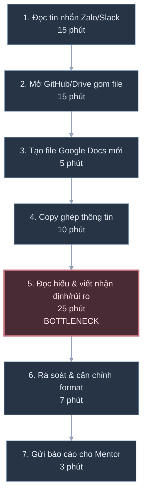

# Báo cáo nhóm — Day 02 Discovery & Problem Framing

> Bản chung của nhóm, viết trên repo do nhóm trưởng fork. Không copy file này sang repo cá nhân.
> Template chi tiết và prompt mẫu: [docs/01-worksheet.md](../../docs/01-worksheet.md). Bài mẫu: [docs/02-deliverable-example.md](../../docs/02-deliverable-example.md).

## 1. Thông tin nhóm

- Tên nhóm: 3randomguy
- Thành viên: xem `TEAM.md`
- Candidate problem được chọn (1 câu):Hỗ trợ nhóm trưởng soạn nháp phần nhận định tiến độ và rủi ro tuần từ dữ liệu cập nhật phân tán của các thành viên.
- Quyết định cuối: Go 

---

## 2. Hội tụ nhóm (CP3)

### 2.1. Pitch

| # | Người đưa ra | Candidate (Job Story ngắn) | Actor | Bottleneck | Câu hỏi phản biện nhận được (ai hỏi) |
|---:|---|---|---|---|---|
| 1 | TV 1 | Khi tan ca học trưa (13h), tôi muốn chọn chỗ ăn và nghỉ nhanh, để hồi phục thể lực cho ca học chiều. | Sinh viên campus | Xếp hàng lâu và mất thời gian di chuyển tìm chỗ nghỉ. | Định nghĩa "nghỉ ngơi chất lượng" đo thế nào? (TV 2) |
| 2 | TV 1 | Khi đến nhà ăn giờ cao điểm, tôi muốn biết vị trí còn bàn trống, để không phải bưng khay đi tìm chỗ. | Sinh viên ăn trưa | Nghẽn cục bộ tại sảnh ăn lúc xả ca 13h–13h30. | Dữ liệu mật độ thời gian thực lấy từ đâu? (TV 3) |
| 3 | TV 1 | Khi chuyển ca học lúc 13h50, tôi muốn tìm lộ trình nhanh nhất sang tòa kế tiếp, để kịp giờ vào lớp 14h. | Sinh viên chuyển lớp | Không rõ tình trạng thang máy và đường tắt giữa các tòa. | Bản đồ trong nhà (indoor map) có hỗ trợ API không? (TV 2) |
| 4 | TV 2 | Khi hết chiều thứ Sáu, tôi muốn gom số liệu bán hàng và tiến độ từ 5 người vào 1 mẫu, để nộp báo cáo đúng hạn. | Quản lý / PM | Mất 2–3 giờ copy-paste và format lại từ nhiều bảng tính. | Nếu dùng Google Sheet cố định thì giảm được nửa giờ không? (TV 1) |
| 5 | TV 2 | Khi nhận hơn 300 phản hồi khảo sát, tôi muốn tự phân loại chủ đề khen/chê, để nắm bắt phản hồi khách quan. | Chuyên viên CX / Data | Đọc thủ công mất nhiều ngày, dễ sót và mang thiên kiến. | Tiêu chí đánh giá độ chính xác của nhãn là gì? (TV 3) |
| 6 | TV 2 | Khi phát sinh tình huống mới, tôi muốn tra cứu nhanh điều khoản quy chế cũ, để xử lý đúng quy định. | Pháp chế / Thư ký | Mất trọn một buổi lục tìm trong 5–6 file PDF cũ. | Tần suất phát sinh có nhiều không? (TV 1) |
| 7 | TV 3 | Khi đến hạn báo cáo tuần cho Mentor, tôi muốn tóm tắt tiến độ đồ án, để Mentor nắm bắt nhanh. | PM / Nhóm trưởng đồ án | Mất nhiều giờ gom việc từng người và viết nhận xét rủi ro. | Bản tóm tắt tự động liệu có phản ánh đúng ngữ cảnh không? (TV 2) |
| 8 | TV 3 | Khi sửa cấu trúc DB/API, tôi muốn sơ đồ thiết kế tự cập nhật, để cả nhóm không code lệch nhau. | Đội ngũ Dev | Sơ đồ bị bỏ quên sau các đợt sửa code gấp. | Thành viên có chịu cập nhật khi đổi ý tưởng không? (TV 1) |
| 9 | TV 3 | Khi merge code sát deadline, tôi muốn phát hiện và xử lý sớm xung đột Git, để tránh lỗi build. | Lập trình viên | Conflict dồn vào phút chót, mất công gỡ từng dòng code. | Bắt buộc code review có làm chậm release không? (TV 2) |

### 2.2. Cluster

| Cluster | Các candidate | Pattern chung |
|---|---|---|
| A | Báo cáo & Tổng hợp | Candidate 4 (Báo cáo tuần 5 người), Candidate 7 (Báo cáo tiến độ cho Mentor) | Gom dữ liệu thô và tiến độ phân tán từ nhiều người để viết thành tài liệu tổng hợp |
| B | Đọc hiểu & Phân loại văn bản | Candidate 5 (Phân loại 300 khảo sát CX), Candidate 6 (Tra cứu điều khoản quy chế cũ) | Đọc khối lượng lớn tài liệu phi cấu trúc (PDF, text tự do) để bóc tách và phân nhóm thông tin |
| C | Điều phối & Di chuyển Campus | Candidate 1 (Nghỉ trưa thể lực), Candidate 2 (Tìm bàn trống nhà ăn), Candidate 3 (Lộ trình chuyển lớp) | Tối ưu hóa việc phân bổ không gian và thời gian di chuyển vật lý trong khuôn viên|

### 2.3. Opportunity Solution Tree rút gọn

Gốc là **1 outcome**. Nhánh là **opportunity** (nhu cầu, pain), không phải tính năng hay công cụ.

OUTCOME: Giảm từ 2.5 giờ xuống còn 30 phút mỗi tuần cho công việc tổng hợp báo cáo tiến độ mà người nhận vẫn nắm đầy đủ thông tin chuẩn xác
├── Opportunity A: Dữ liệu công việc và tiến độ của các thành viên nằm phân tán, không đồng nhất định dạng
├── Opportunity B: Mất nhiều thời gian nhất ở khâu đọc hiểu, chọn lọc đầu việc trọng tâm và viết nhận định rủi ro
└── Opportunity C: Khó kiểm chứng nhanh xem thành viên nào nộp thiếu hoặc số liệu tự báo cáo có mâu thuẫn không

**Những ý đã gạch bỏ vì là solution đội lốt opportunity**:
- Dashboard tự động cập nhật tiến độ (Đây là Solution, gạch bỏ khỏi tầng Opportunity)
- Chatbot AI tự động viết báo cáo tuần (Đây là Solution công nghệ, gạch bỏ khỏi tầng Opportunity)
- Google Form chuẩn hóa nhập liệu (Đây là Solution quy trình/công cụ, gạch bỏ khỏi tầng Opportunity)

-

### 2.4. Chấm điểm shortlist (1–5)
3 candidate đại diện cho 3 cluster rõ nét nhất được đưa vào shortlist:
1. **Tổng hợp báo cáo tuần từ nhiều nguồn** 
2. **Phân loại phản hồi khảo sát khách hàng tự do** 
3. **Tìm bàn trống nhà ăn giờ cao điểm** 

| Candidate | Actor rõ | Quy trình rõ | Pain có bằng chứng | Impact đo được | Vừa sức lab | So sánh được No AI/Rule/Workflow/Agent | Nhóm hiểu domain | Tổng |
|---|---:|---:|---:|---:|---:|---:|---:|---:|
| **Tổng hợp báo cáo tuần từ nhiều nguồn** | 5 | 5 | 5 | 4 | 4 | 4 | 5 | **32** |
| **Phân loại phản hồi khảo sát tự do** | 4 | 4 | 4 | 4 | 4 | 4 | 4 | **28** |
| **Tìm bàn trống nhà ăn giờ cao điểm** | 4 | 3 | 5 | 3 | 2 | 2 | 5 | **24** |

**Candidate được chọn:** Tổng hợp báo cáo tuần từ nhiều nguồn

**Vì sao chọn:** Actor (Trưởng nhóm / PM) và quy trình đầu cuối vô cùng rõ ràng (Input: các file rời rạc $\rightarrow$ Output: báo cáo hoàn chỉnh).
* Nỗi đau lặp lại đều đặn mỗi tuần, có bằng chứng thời gian tiêu tốn rõ ràng (2–3 giờ/chiều thứ Sáu).
* Rất vừa sức trong phạm vi thời gian lab, có dữ liệu mẫu thực tế ngay lập tức và đo lường được baseline chuẩn xác.
* Dễ dàng thiết kế thực nghiệm để so sánh rõ nét 4 mức độ: Không dùng AI (quy trình biểu mẫu) $\rightarrow$ Rule-based (Excel formula/VBA) $\rightarrow$ Workflow (Prompt chain) $\rightarrow$ Agent (tự kiểm tra thiếu sót và tạo draft).

**Vì sao loại các candidate còn lại:** Tìm bàn trống nhà ăn giờ cao điểm*: Rào cản kỹ thuật rất lớn (Feasibility thấp) vì phụ thuộc vào hạ tầng cảm biến/camera thời gian thực mà nhóm sinh viên không có quyền truy cập dữ liệu trường trong thời gian lab.
* *Phân loại phản hồi khảo sát tự do*: Tần suất diễn ra không thường xuyên (theo đợt/quý), khó thiết lập baseline đo lường ngay trong vài ngày lab và ranh giới đánh giá độ chính xác (accuracy metric) dễ gây tranh cãi.

**Xử lý bất đồng (nếu có):** TV 1 muốn ưu tiên bài toán "Tìm bàn trống nhà ăn" vì trải nghiệm thực tế mỗi ngày tại campus rất bức xúc. Sau khi nhóm phân tích về tính khả thi của dữ liệu phần cứng (không có API camera/cảm biến), TV 1 đã đồng thuận dời bài toán này sang hướng nghiên cứu tương lai khi có thiết bị IoT hỗ trợ, và thống nhất chọn bài toán "Tổng hợp báo cáo tuần" để có thể triển khai đo lường và làm prototype ngay trong lab.

---

## 3. Kiểm chứng + research giải pháp đã có (CP4)

### 3.1. Assumption Map

| # | Giả định | Loại (Value / Usability / Feasibility / Viability) | Quan trọng (1–5) | Đã có bằng chứng (1–5) | Kiểm chứng trước? |
|---:|---|---|---:|---:|---|
| 1 | Người làm báo cáo thực sự tốn trên 2 giờ mỗi tuần chỉ cho khâu format, copy-paste và gõ lại nhận định tiến độ.|Value | 5| 4| Có|
| 2 | Người đọc báo cáo (Leader/Mentor) quan tâm đến bức tranh rủi ro và đầu việc trọng tâm hơn là một danh sách liệt kê tất cả các task vụn vặt.|Value |5 |3 | Có|
| 3 | Người làm báo cáo sẵn sàng tin tưởng và kiểm tra lại (HITL) bản nháp do hệ thống tổng hợp thay vì tự tay viết từ đầu.|Usability | 4| 2| Có|
| 4 | LLM có thể đọc các gạch đầu dòng ngắn, viết tắt hoặc thiếu ngữ cảnh từ thành viên mà vẫn trích xuất đúng đầu việc chính xác mà không bị ảo giác (hallucination).| Feasibility|5 |2 | Có|

Giả định nhóm kiểm chứng trong buổi này:
-Giả định #1 (Nỗi đau thực tế về thời gian thao tác)
-Giả định #2 & #3 (Người nhận chỉ đọc narrative; người làm sẵn sàng dùng bản nháp).

### 3.2. Kiểm chứng

Cách đã dùng: Phỏng vấn sâu 1:1 kết hợp khảo sát nhanh qua biểu mẫu.

Interview snapshot (mỗi buổi phỏng vấn một bảng, hoặc đặt file trong `report/assets/cp4-interview-snapshot-N.md`):

| Trường | Nội dung |
|---|---|
| Người được hỏi (vai trò, không ghi tên thật) | Bạn cùng lớp|
| Câu nói đáng nhớ nhất (nguyên văn) | Mỗi lần mở file Google Docs trắng ra viết phần nhận xét tuần, mình bị đứng hình mất 20 phút vì chẳng biết nên khen cái gì hay cảnh báo rủi ro từ đâu.|
| Lần gần nhất gặp vấn đề này: chuyện gì đã xảy ra? | Chiều Chủ nhật vừa rồi khi làm báo cáo nộp giảng viên trước 23h59: mở sẵn file từ 20h nhưng ngồi nhìn màn hình trắng đến 20h30 mới bắt đầu gõ được vài dòng vì không biết chắt lọc ý chính từ tiến độ của 3 bạn còn lại thế nào.|
| Hiện đang xử lý bằng cách nào (workaround)? | Mở lại bài nộp tuần trước để copy nguyên đoạn nhận xét cũ rồi thay tên tính năng, hoặc chỉ chụp màn hình danh sách commit/task dán vào để né việc phải viết văn nhận định.|
| Mất bao lâu, bao lần? |Mất khoảng 45–60 phút mỗi tuần, lặp lại đều đặn mỗi kỳ nộp báo cáo sprint suốt 6 tuần học vừa qua. |
| Insight / opportunity rút ra |Nỗi đau cốt lõi là hội chứng trang trắng (blank page syndrome) khi viết narrative; người làm báo cáo cần một bản nháp gợi ý khung 3 phần (đã làm - rủi ro - việc tuần tới) để đọc và sửa thay vì phải tự cấu trúc câu từ từ con số không. |

Tổng hợp:

| Nguồn | Số người / số mẫu | Tín hiệu xác nhận | Tín hiệu phản bác |
|---|---:|---|---|
| Phỏng vấn bạn cùng lớp (Leader nhóm môn học)|3 sinh viên |2/3 xác nhận luôn bị tắc ý ở khâu mở đầu và viết nhận xét rủi ro; 3/3 đều phải copy khung bài cũ để viết đè lên. | 1 bạn cho biết nếu nhóm quy định rõ tiêu chí hoàn thành (DoD) ngay từ đầu thì việc nhận xét dễ hơn và không mất nhiều thời gian.|

**Nhóm đã sửa problem thế nào sau kiểm chứng:** Thu hẹp trọng tâm can thiệp: Ban đầu nhóm định giải quyết bài toán lớn là "tự động hóa toàn bộ việc thu thập dữ liệu và gửi báo cáo tuần". Sau kiểm chứng, phát hiện bottleneck nặng nhất không phải là gom link mà là hội chứng trang trắng khi viết nhận định tiến độ/rủi ro. Nhóm thu hẹp bài toán lại thành: "Soạn nháp phần nhận định (tiến độ cốt lõi, điểm nghẽn/blocker, kế hoạch tiếp theo) từ dữ liệu thành viên đã nộp để người làm báo cáo duyệt và chỉnh sửa".   

### 3.3. Research giải pháp đã có

| Công cụ / case / pattern | Link | Giải bước nào trong quy trình? | Điểm mạnh | Khoảng trống / rủi ro | Bài học cho nhóm |
|---|---|---|---|---|---|
|Google Forms + Sheet Template (No AI) |forms.google.com |Gom dữ liệu cập nhật từ các thành viên vào 1 bảng tập trung. | Cực kỳ đơn giản, không tốn chi phí, chuẩn hóa được cấu trúc cột.| Không tự tổng hợp thành văn bản nhận định; PM vẫn phải đọc từng dòng để tự viết tóm tắt.|Dùng Form/Sheet làm bước đầu vào chuẩn hóa cho thành viên điền nhanh. |
|Notion AI Workspace |notion.so | Tóm tắt trang tiến độ dự án, sinh bullet points tuần.|Tích hợp sâu vào công cụ quản lý dự án, giao diện mượt. |Tốn phí bản quyền; tóm tắt còn chung chung nếu nội dung con nghèo nàn; dễ bỏ sót blocker kỹ thuật. |Cần prompt có khung cấu trúc ép buộc (Rubric) thay vì để AI tóm tắt tự do. |
| n8n / Zapier + LLM Workflow|n8n.io/workflows |Kích hoạt theo lịch: gom tin nhắn/sheet $\rightarrow$ gọi API LLM $\rightarrow$ tạo bản nháp Docs. | Tự động hóa hoàn toàn luồng chuyển giao dữ liệu theo đúng kiến trúc Workflow định sẵn.| Dễ lỗi nếu định dạng đầu vào thay đổi; nếu để tự động gửi đi thì rủi ro sai sót rất cao.|Áp dụng mô hình Workflow nhưng bắt buộc phải có bước con người (PM) duyệt và chỉnh sửa trước khi gửi. |

---

## 4. Quy trình trước/sau (CP5)

### 4.1. Quy trình hiện tại

HIỆN TẠI — 7 bước, 80 phút, 7/7 bước thủ công

| Bước | Actor | Input | Output | Thời gian / tần suất | Ghi chú |
|---:|---|---|---|---|---|
| 1 | PM | Tin nhắn cập nhật của các thành viên | Ghi nhớ tiến độ | 15' / tuần | Tin nhắn gửi rải rác, cộc lốc |
| 2 | PM | Repo GitHub / Link Drive bài tập | Danh sách sản phẩm hoàn thành | 15' / tuần | Phải tự click kiểm tra từng link |
| 3 | PM | Template mẫu | Trang văn bản trắng | 5' / tuần | Thao tác lặp lại |
| 4 | PM | Dữ liệu gom ở bước 1 & 2 | Báo cáo thô | 10' / tuần | Copy-paste cơ học |
| 5 | PM | Báo cáo thô | Đoạn nhận xét rủi ro, tiến độ | **25' / tuần** | **Bottleneck: Tốn chất xám diễn giải, sợ viết sai** |
| 6 | PM | Bản thảo báo cáo | Báo cáo hoàn chỉnh | 7' / tuần | Căn chỉnh lề, font chữ |
| 7 | PM | Báo cáo hoàn chỉnh | Email/Tin nhắn gửi Mentor | 3' / tuần | Gửi kèm link |

**Bottleneck chính:** Bước 5 (Viết nhận định tiến độ và rủi ro) mất nhiều thời gian nhất vì phải xâu chuỗi thông tin vụn vặt thành một bức tranh tổng quan có nghĩa.

---

### 4.2. Quy trình tương lai

TƯƠNG LAI — 5 bước, khoảng 20 phút, 2/5 bước thủ công

```mermaid
flowchart TD
    A["1. Thành viên điền form tiến độ ngắn<br/>2 phút"]
    --> B["2. Script tự động tổng hợp vào 1 bảng<br/>1 phút"]

    B --> C["3. AI đọc bảng & sinh bản nháp nhận định<br/>2 phút"]

    C --> D["4. PM đối chiếu số liệu & sửa bản nháp<br/>12 phút"]

    D --> E["5. PM bấm duyệt và gửi Mentor<br/>3 phút"]

    R1["RULE<br/>Google Form tập trung"] -.-> A
    R2["RULE<br/>Google Sheets Script"] -.-> B
    R3["WORKFLOW<br/>LLM sinh nháp theo khung"] -.-> C
    R4["CON NGƯỜI<br/>HITL kiểm soát chất lượng"] -.-> D
    R5["CON NGƯỜI"] -.-> E

    L["BOUNDARY<br/>AI tuyệt đối không tự gửi báo cáo.<br/>AI chỉ nhận xét dựa trên dữ liệu trong form,<br/>không suy đoán tiến độ ngoài đời."]

    C -.-> L

    M{"AI sinh nháp bị ảo giác<br/>hoặc server gặp lỗi?"}
    C --> M

    M -->|Có| N["FALLBACK<br/>PM copy bảng tổng hợp ở bước 2<br/>và tự viết theo template cũ"]
    N --> D

    M -->|Không| D

    K["HOÀN THÀNH BÁO CÁO"]
    E --> K

    style A fill:#263445,stroke:#6685a6,color:#e2e8f0
    style B fill:#263445,stroke:#6685a6,color:#e2e8f0
    style C fill:#263c52,stroke:#6098c5,color:#e0f2fe,stroke-width:2px
    style D fill:#244638,stroke:#63a889,color:#dcfce7,stroke-width:2px
    style E fill:#244638,stroke:#63a889,color:#dcfce7,stroke-width:2px
    style R1 fill:#303746,stroke:#78869b,color:#e2e8f0
    style R2 fill:#303746,stroke:#78869b,color:#e2e8f0
    style R3 fill:#263c52,stroke:#6098c5,color:#e0f2fe
    style R4 fill:#244638,stroke:#63a889,color:#dcfce7
    style R5 fill:#244638,stroke:#63a889,color:#dcfce7
    style L fill:#493d27,stroke:#c49a50,color:#fef3c7,stroke-width:2px
    style M fill:#393344,stroke:#a78bca,color:#ede9fe
    style N fill:#482b35,stroke:#c06b78,color:#ffe4e6,stroke-width:2px
    style K fill:#263c52,stroke:#6098c5,color:#e0f2fe

    linkStyle default stroke:#94a3b8,stroke-width:1.5px
```

Boundary: AI tuyệt đối không tự gửi báo cáo đi; AI chỉ nhận xét dựa trên dữ liệu có trong form, không tự suy đoán tiến độ ngoài đời.   Phương án quay về (Fallback): Nếu AI sinh nháp bị ảo giác hoặc server lỗi $\rightarrow$ PM copy bảng tổng hợp ở bước 2 và tự viết theo khung template cũ.

### 4.3. Before / after

| Chỉ số | Trước | Sau (kỳ vọng) | Ghi chú |
|---|---:|---:|---|
| Số bước |7 |5 |Gom các bước vụn vặt vào form và script tự động |
| Tổng thời gian |80 phút |khoảng 20 phút |Giảm ~75% thời gian thao tác |
| Số bước thủ công |7/7 | 2/5| PM chỉ tập trung vào khâu kiểm duyệt và gửi|
| Bottleneck chính | Tự viết nhận định từ đầu| PM rà soát và chỉnh sửa bản nháp| Nút thắt mới là khâu kiểm tra chất lượng (chấp nhận được)|
| Rủi ro mới phát sinh | | AI nhận định sai lệch ngữ cảnh, bỏ sót rủi ro|Xử lý bằng quy tắc Human-in-the-loop (PM duyệt) |

---

## 5. Problem Statement v0 (CP5)

| Trường | Nội dung |
|---|---|
| **Actor** | Trưởng nhóm sinh viên (PM) làm đồ án môn học (3–5 người)|
| **Quy trình** | Chiều thứ Sáu hàng tuần: gom tin nhắn/tiến độ từ các thành viên $\rightarrow$ tổng hợp vào file $\rightarrow$ viết nhận xét rủi ro $\rightarrow$ gửi Mentor|
| **Bottleneck** |Viết phần nhận định và tóm tắt rủi ro mất 25–30 phút vì dữ liệu gửi về cộc lốc, không đồng nhất|
| **Impact** | Tốn 80 phút/tuần/PM; 30% số lần nộp muộn; Mentor không nắm được khó khăn thực tế trước buổi họp|
| **Success Metric** (baseline → target, cách đo) |Giảm tổng thời gian từ 80 phút xuống dưới 25 phút; báo cáo nộp đúng hạn 100% trước 17h thứ Sáu |
| **Boundary** (AI không được làm gì; khi nào cần con người kiểm tra — HITL) |AI không tự động gửi báo cáo; không tự bịa thêm các đầu việc ngoài dữ liệu đầu vào |

Phản biện nhận được (từ AI hoặc nhóm khác) và nhóm có đồng ý không:

-Phản biện chỉ ra metric thành công chỉ đo tốc độ (thời gian làm báo cáo), không đo chất lượng nội dung: báo cáo làm nhanh hơn nhưng viết lan man, Mentor không hiểu được rủi ro cốt lõi thì vẫn là thất bại.   -Nhóm đồng ý: Cần bổ sung tiêu chí đo lường chất lượng nội dung (tỷ lệ PM phải viết lại bản nháp và khả năng nắm bắt nhanh của Mentor) ở phiên bản v1.   

---

## 6. Mức can thiệp AI (CP6)

### 6.1. Ma trận độ mơ hồ × độ phức tạp

Bài của nhóm nằm ở ô:Độ mơ hồ Cao × Độ phức tạp Thấp–Trung bình.

Vì sao:
Độ mơ hồ cao: Dữ liệu cập nhật từ các thành viên mỗi tuần một kiểu hành văn, mức độ chi tiết khác nhau, việc nhận diện "đâu là rủi ro nghiêm trọng" mang tính định tính.  
 Độ phức tạp thấp–trung bình: Quy trình xử lý theo một chuỗi tuyến tính cố định (Thu thập dữ liệu $\rightarrow$ Soạn nháp $\rightarrow$ Kiểm tra $\rightarrow$ Gửi đi), không rẽ nhánh logic phức tạp hay cần gọi nhiều công cụ ngoài luồng.   
 --> Phù hợp nhất với kiến trúc Workflow (có AI can thiệp tại một bước cụ thể).   

### 6.2. So sánh 4 mức

| Mức | Phương án cho bài của nhóm | Đủ khi nào | Rủi ro | Chọn? |
|---|---|---|---|---|
| **No AI** (sửa quy trình) | Dùng Google Form + Google Docs template cố định|Khi nhóm chỉ cần kiểm đếm danh sách task xong/chưa xong, không cần nhận định | Không giải quyết được khâu tóm tắt narrative và đọc hiểu ngữ cảnh cộc lốc| Dùng làm nền tảng đầu vào|
| **Rule** | Dùng Google Sheets Script tự kéo dữ liệu form ghép vào file Docs|Khi các trường thông tin hoàn toàn đồng nhất, không cần viết văn tóm tắt | Câu chữ bị rời rạc, không lọc ra được điểm nghẽn chính| Dùng cho bước 1 & 2|
| **Workflow** | Rule gom số liệu $\rightarrow$ Prompt AI soạn nháp 3 phần (Xong - Nghẽn - Kế hoạch) $\rightarrow$ PM duyệt $\rightarrow$ Gửi|Khi quy trình cố định, AI đảm nhận phần đọc hiểu và diễn đạt ngôn ngữ | AI nháp chưa sát ý hoặc dùng từ ngữ sáo rỗng|CHỌN |
| **Agent** |Tự động đọc Git, tự chat giục thành viên, tự phân tích và tự gửi cho Mentor | Khi hệ thống có quyền truy cập toàn diện và có khả năng tự ra quyết định|Quá phức tạp, chi phí cao, mất kiểm soát và nguy cơ gửi sai thông tin |Không chọn |

**Mức chọn:** Workflow

**Vì sao không chọn mức đơn giản hơn:** Cả No AI và Rule-based thuần túy chỉ gom dữ liệu về một chỗ nhưng bất lực trong việc "đọc hiểu và chắt lọc rủi ro" từ ngôn từ tự do của sinh viên — đây lại chính là nút thắt tốn nhiều thời gian nhất đã được kiểm chứng.

### 6.3. AI Canvas rút gọn

| Thành phần | Nội dung |
|---|---|
| **Prediction** — AI dự đoán / tạo ra gì? |Bản nháp báo cáo súc tích gồm 3 phần: (1) Kết quả hoàn thành then chốt, (2) Điểm nghẽn/Rủi ro cần Mentor hỗ trợ, (3) Mục tiêu tuần tới. |
| **Judgment** — con người cân nhắc, quyết định gì? | PM đọc và quyết định: Đánh giá xem AI nêu rủi ro có đúng thực tế không, có đầu việc nào bị hiểu sai ngữ cảnh không.|
| **Action** — hành động cuối cùng là gì, ai làm? |PM chỉnh sửa lại câu từ (nếu cần) và bấm nút xác nhận gửi email/tin nhắn cho Mentor. |
| **Outcome** — đo kết quả bằng gì? |Thời gian hoàn tất báo cáo giảm xuống dưới 25 phút; Mentor nắm đúng vấn đề ngay trong 2–3 phút đọc. |
| **Input** — AI cần dữ liệu đầu vào gì mỗi lần chạy? Có sẵn không? |Dữ liệu cập nhật từ Google Form của các thành viên, link commit/tài liệu, mục tiêu tuần trước. Đều có sẵn. |
| **Feedback** — lấy phản hồi ở đâu để cải thiện? |Đoạn văn PM phải sửa tay trước khi gửi; phản hồi trực tiếp từ Mentor trong buổi họp tuần. |

### 6.4. Hai câu hỏi của Google PAIR

- Người dùng muốn **được hỗ trợ (augment)** hay **giao hẳn việc (automate)**? Bằng chứng:
Augment (Hỗ trợ sinh bản nháp). 3/3 PM được phỏng vấn đều khẳng định họ bắt buộc phải đọc và duyệt trước khi gửi cho Mentor/Thầy cô, vì uy tín cá nhân của trưởng nhóm gắn liền với báo cáo đó; không ai chấp nhận để AI tự động gửi đi mà không kiểm tra.   
- AI sai kiểu nào tệ hơn, **báo nhầm** hay **bỏ sót**? Vì sao, và thiết kế đã xử lý thế nào:
Bỏ sót rủi ro tệ hơn báo nhầm. Nếu một module bị trễ hoặc có thành viên đang tắc mà AI không nêu ra, Mentor sẽ không kịp thời can thiệp tháo gỡ, dẫn tới vỡ tiến độ đồ án. Thiết kế prompt bắt buộc phải quét kỹ trường thông tin "Khó khăn gặp phải" và ưu tiên gắn cờ mọi bất thường.   

---

## 7. Problem Statement v1 + tiêu chí đánh giá (CP6)

| Trường | Nội dung |
|---|---|
| **Actor** | Trưởng nhóm sinh viên (PM) làm đồ án nhóm (3–5 người), cần báo cáo tiến độ định kỳ cho Mentor/Giảng viên hướng dẫn|
| **Quy trình** |Điền form tập trung $\rightarrow$ Script gom bảng $\rightarrow$ AI sinh nháp nhận định $\rightarrow$ PM rà soát/sửa $\rightarrow$ Gửi báo cáo |
| **Bottleneck** |Khâu tổng hợp thông tin phân tán và diễn giải thành rủi ro/tiến độ súc tích (chiếm 25/80 phút) |
| **Impact** |Tốn 80 phút/tuần; báo cáo dài dòng khiến Mentor mất thời gian gặng hỏi lại trong buổi họp |
| **Success Metric** (baseline → target, cách đo) |(1) Tổng thời gian từ 80 phút giảm xuống dưới 25 phút; (2) PM phải sửa lại dưới 30% nội dung bản nháp; (3) Mentor nắm bắt được vấn đề trong dưới 3 phút đọc |
| **Boundary** |AI không tự gửi báo cáo; không suy đoán số liệu ngoài dữ liệu form; giữ nguyên sự thật khách quan |
| **AI intervention point** |Can thiệp ở bước chuyển đổi từ bảng dữ liệu thô sang văn bản nháp nhận định (trước khi PM review) |
| **Mức chọn** | Workflow |
| **Rủi ro & người kiểm tra** |Rủi ro AI bịa rủi ro hoặc bỏ sót việc trễ hạn $\rightarrow$ PM là chốt chặn cuối (HITL) rà soát từng dòng trước khi gửi    |

**Thay đổi so với v0 và lý do:**

| Trường | v0 | v1 | Vì sao đổi |
|---|---|---|---|
|Success Metric | Chỉ đo thời gian làm báo cáo (dưới 25 phút)|Thêm tiêu chí: PM sửa lại < 30% bản nháp và Mentor nắm bắt trong 3 phút |Phản biện chỉ ra rằng nhanh hơn nhưng nội dung vô nghĩa thì không có giá trị thực tế. |
|Quy trình |Thu thập tự do từ tin nhắn chat | Bắt buộc điền qua Google Form chuẩn hóa ngắn|Cần chặn rác từ đầu vào để AI không phải xử lý định dạng quá lộn xộn. |

**Tiêu chí đánh giá đầu ra của AI (3–5 tiêu chí):**

| # | Tiêu chí | Đạt khi | Không đạt khi |
|---:|---|---|---|
| 1 |Trung thực dữ liệu (No Hallucination) | 100% các đầu việc hoàn thành và khó khăn đều truy ngược được về dữ liệu form nộp.|AI tự bịa thêm các tính năng hoặc phỏng đoán rủi ro không có trong báo cáo. |
| 2 |Không bỏ sót Blocker | Mọi thành viên có ghi nhận khó khăn/vướng mắc đều được phản ánh vào mục Cần hỗ trợ.|Bỏ qua vướng mắc của thành viên khiến Mentor không biết. |
| 3 | Ngắn gọn, đúng trọng tâm| Bản nháp dưới 300 từ, trình bày gạch đầu dòng rõ ràng theo 3 phần: Xong - Nghẽn - Kế hoạch.| Văn bản dài dòng, kể lể chi tiết task vụn vặt, hành văn sáo rỗng.|

---

## 8. Quyết định (CP6)

### 8.1. Bốn rủi ro

| Rủi ro | Câu hỏi | Mức độ rủi ro (Thấp = an toàn / TB / Cao = nguy hiểm) | Lý do / bằng chứng |
|---|---|---|---|
| **Value** | Người dùng có thật sự cần và sẽ dùng không? |Thấp |Cả 3 PM được phỏng vấn đều mong muốn có công cụ soạn nháp để tiết kiệm thời gian chiều thứ Sáu. |
| **Usability** | Người dùng có dùng được, có hiểu và sửa được đầu ra của AI không? | Thấp|Đầu ra là văn bản Docs/Markdown thông thường, PM chỉ cần đọc và sửa trực tiếp như thói quen cũ. |
| **Feasibility** | Có đủ dữ liệu, công cụ, kỹ năng để làm không? |Thấp |Sử dụng Google Form kết hợp Make/n8n hoặc prompt mẫu đưa vào Claude/ChatGPT; không đòi hỏi hạ tầng phức tạp. |
| **Viability** | Có hợp chi phí, pháp lý, quy định tổ chức không? Ai vận hành? |Thấp | Chi phí API rất nhỏ (vài cent mỗi tuần); dữ liệu đồ án sinh viên không vướng quy định bảo mật doanh nghiệp khắt khe.|

### 8.2. Kết luận

**Quyết định:** Go (Phạm vi thí điểm nhóm nhỏ)

**Lý do:** Toàn bộ 4 rủi ro đều ở mức Thấp; bài toán có quy trình chuẩn xác, baseline đo lường rõ ràng và mang lại giá trị giải phóng thời gian thực tế ngay lập tức.

**Nếu Go — pilot nhỏ nhất:**
Thiết lập một Google Form ngắn (3 câu hỏi: Đã xong gì? Đang kẹt ở đâu? Tuần tới làm gì?).   
Nhóm trưởng dùng 1 prompt chuẩn hóa dán dữ liệu tổng hợp từ Form vào ChatGPT/Claude để sinh bản nháp.   
Bấm giờ thực tế quy trình trong 2 tuần liên tiếp và chấm điểm bản nháp theo 3 tiêu chí đánh giá. 

**Ngưỡng dừng** (nếu sau … mà … thì quay về …):
Nếu sau 2 tuần pilot mà PM vẫn phải viết lại trên 50% câu chữ của bản nháp $\rightarrow$ Dừng dùng AI, quay về dùng Google Docs template điền tay truyền thống (No AI).   Nếu các thành viên không chịu điền Form mà vẫn nhắn tin riêng $\rightarrow$ Dừng công nghệ để chấn chỉnh kỷ luật quy trình làm việc trước.  

## 9. Hạn chế và hướng tiếp theo
Hạn chế: Thí nghiệm mới thực hiện trên quy mô nhóm làm đồ án sinh viên môn học; chưa kiểm chứng trên môi trường doanh nghiệp có nhiều công cụ phân tán phức tạp (như Jira + GitLab + Slack enterprise).   
Hướng tiếp theo: Sau khi ổn định khâu sinh bản nháp từ Form, nhóm sẽ nghiên cứu tích hợp webhook để tự động lấy commit message từ GitHub/GitLab làm dữ liệu đầu vào bổ trợ.

## 10. Tài liệu tham khảo
Teresa Torres (2021), Continuous Discovery Habits (Phương pháp Opportunity Solution Tree).   
Rob Fitzpatrick (2013), The Mom Test (Nguyên tắc phỏng vấn kiểm chứng nhu cầu khách hàng không thiên vị).   
Google PAIR Guidebook (Quy chuẩn thiết kế trải nghiệm người dùng tương tác với AI: Augment vs Automate, Error tolerance).   
Atlassian Rovo & n8n Automation Workflows for Weekly Reporting.   

