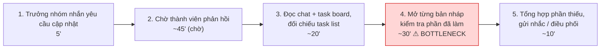
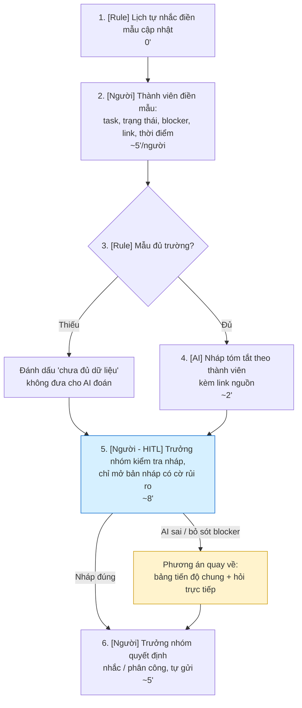

# Báo cáo nhóm — Day 02 Discovery & Problem Framing

> Bản chung của nhóm, viết trên repo do nhóm trưởng fork. Không copy file này sang repo cá nhân.
> Template chi tiết và prompt mẫu: [docs/01-worksheet.md](../../docs/01-worksheet.md). Bài mẫu: [docs/02-deliverable-example.md](../../docs/02-deliverable-example.md).

## 1. Thông tin nhóm

* Tên nhóm:Distro
* Thành viên: xem `TEAM.md`
* Candidate problem được chọn (1 câu):
* Quyết định cuối: Go / Not Yet / No-Go

***

## 2. Hội tụ nhóm (CP3)

### 2.1. Pitch

|  # | Người đưa ra      | Candidate (Job Story ngắn)                                                                                                                                         | Actor                                                                  | Bottleneck                                                                                                                                                  | Câu hỏi phản biện nhận được (ai hỏi)                                                                                                                                                                                                                                                                 |
| -: | ----------------- | ------------------------------------------------------------------------------------------------------------------------------------------------------------------ | ---------------------------------------------------------------------- | ----------------------------------------------------------------------------------------------------------------------------------------------------------- | ---------------------------------------------------------------------------------------------------------------------------------------------------------------------------------------------------------------------------------------------------------------------------------------------------- |
|  1 | Kiều Đình Văn     | Khi bắt đầu lab và nhận repo có nhiều file hướng dẫn, tôi muốn nắm nhanh việc cần nộp, cách đặt tên và tiêu chí bị trừ điểm để bắt tay làm đúng.                   | Học viên K5; coach chấm bài bị ảnh hưởng khi nộp sai                   | Đối chiếu RUBRIC với CHECKPOINTS để ghép checkpoint – sản phẩm cần nộp – điều kiện bị trừ điểm; khoảng 8 phút trong quy trình tổng 15–30 phút.              | Liệu checklist mẫu dùng lại có được không không, hay các lab khác nhau đáng kể trong docs? (Đỗ Đắc Duy)                                                                                                                                                                                              |
|  2 | Kiều Đình Văn     | Khi nhóm cần hẹn giờ làm phần chung, tôi muốn chốt được khung giờ mọi người đều rảnh để bắt đầu sớm trước deadline.                                                | Thành viên nhóm Distro (3–4 người), thường là người điều phối hỏi lịch | Chờ phản hồi từng người khoảng 3 giờ; câu hỏi mở khiến câu trả lời khó so sánh, có thể kéo dài thêm khoảng 1 giờ để chốt.                                   | Tình trạng này xảy ra gần nhất khi nào,có liên tục mỗi lần không,mỗi lần đầu tầm 3-4 giờ trong khi nhóm 3 - 4 thành viên không? (Đỗ Đắc Duy)                                                                                                                                                         |
|  3 | Kiều Đình Văn     | Khi deadline được thông báo rải rác ở nhiều nơi, tôi muốn thấy các deadline sắp tới ở một chỗ để không bị lỡ hạn.                                                  | Học viên                                                               | Dò lại LMS, email và group chat; khoảng 10 phút/lần, thông tin trong chat dễ bị trôi.                                                                       | Vấn đề là,deadlines ở nhiều nền tảng khác nhau,hay do bạn chưa có công cụ để lưu các deadlines khi nhận?(Đỗ Đắc Duy)                                                                                                                                                                                 |
|  4 | Đỗ Đắc Duy        | Khi bắt đầu ngày làm việc, tôi muốn tổng hợp thông báo, yêu cầu và deadline quan trọng từ email, Discord và lịch để không bỏ sót việc cần làm.                     | Dev, PM                                                                | Chuyển qua lại giữa nhiều nguồn, tìm lại nội dung liên quan rồi tự tổng hợp; baseline sơ bộ khoảng 45 phút/ngày, còn cần xác nhận trùng lặp.                | Trong thực tế, tin nhắn công việc hay bị viết tắt hoặc trao đổi phân tán trong nhiều box chat. Nếu AI tóm tắt hoặc quét sót một thông báo khẩn cấp từ PM/khách hàng làm mình sót việc, thì ai sẽ chịu trách nhiệm cho sai sót này? (Đào Kiên Cường)                                                  |
|  5 | Đỗ Đắc Duy        | Khi bắt đầu một task, tôi muốn xác định nhanh quy trình, quy định và tài liệu liên quan để không phải đọc nhiều tài liệu không cần thiết hoặc bỏ sót yêu cầu.      | Dev, PM và thành viên trong team                                       | Tìm đúng tài liệu liên quan trong các thư mục/công cụ rồi đọc, lọc và đối chiếu; ước tính khoảng 45 phút mỗi lần bắt đầu task (cần xác minh).               | Nút thắt ở đây là do dev 'không thể tìm thấy tài liệu', hay thực chất là do người giao task (PM/Tech Lead) viết docs quá sơ sài (Đào Kiên Cường)                                                                                                                                                     |
|  6 | Đỗ Đắc Duy        | Khi bắt đầu project dùng AI Coding Agent, tôi muốn xác định skills, rules và coding convention phù hợp để giảm thời gian setup và hạn chế code không đúng quy ước. | Dev, Tech Lead, Reviewer                                               | Tìm hiểu convention, kiểm tra rules/skills, chọn hoặc viết cấu hình và chạy thử; setup ước tính hơn 30 phút/project.                                        | Setup rules cho project chỉ làm 1 lần lúc khởi tạo dự án (tần suất rất thấp). Tại sao nhóm không dùng một file template rules mẫu dùng chung mà lại cần build 1 solution riêng cho problem này(Đào Kiên Cường)                                                                                       |
|  7 | Nguyễn Thùy Dương | Khi nhận hợp đồng thuê trọ trước khi ký, tôi muốn hiểu rõ nghĩa vụ về tiền cọc, chi phí và chấm dứt thuê để biết điều gì cần hỏi lại hoặc đề nghị sửa.             | Sinh viên mới tốt nghiệp đang tìm phòng trọ                            | Đọc và hiểu các điều khoản cần hỏi lại; thời gian bottleneck chưa được đo riêng (thời gian đọc ban đầu 20–30 phút theo mô tả, cần xác nhận).                | Một năm bạn ký mấy hợp đồng thuê trọ? Nếu chỉ 1–2 lần thì giảm 30% thời gian đọc hợp đồng là tiết kiệm được bao nhiêu phút mỗi năm? Hay pain thật là số tiền cọc bị mất, và nếu vậy thì bạn đã mất bao nhiêu, vì điều khoản nào? (Kiều Đình Văn)                                                     |
|  8 | Nguyễn Thùy Dương | Khi tự học qua video bài giảng dài sau giờ làm, tôi muốn lưu ý chính và tìm lại đúng đoạn hướng dẫn để thực hành mà không phải ghi chép thủ công quá lâu.          | Người tự học kỹ năng online, đặc biệt sinh viên mới tốt nghiệp         | Dừng video để gõ và tổ chức ghi chú; tổng thời gian nêu khoảng 70–90 phút cho video 30 phút nhưng chưa xác nhận, thời gian riêng của bottleneck chưa đo.    | Bạn đã thử tính năng transcript có sẵn của YouTube hoặc công cụ tóm tắt video nào chưa? Nếu thử rồi thì chúng còn thiếu bước nào khiến bạn vẫn mất 60–90 phút? Còn bảng scan ghi là ghi chú xong ‘khó tra cứu lại’, vậy pain thật nằm ở lúc ghi chép hay ở lúc tìm lại đoạn cần xem? (Kiều Đình Văn) |
|  9 | Nguyễn Thùy Dương | Khi tổng hợp chi phí chung cuối tháng, tôi muốn xác định đúng phần tiền mỗi người theo thỏa thuận để thanh toán minh bạch và đúng hạn.                             | Sinh viên ở ghép, đặc biệt người phụ trách tổng hợp chi phí            | Nhập/kiểm tra hóa đơn và tính phần tiền từng người theo quy tắc chia; baseline toàn quy trình 45–60 phút/tháng chưa xác nhận, riêng thời gian tính chưa đo. | Bạn đã tự kết luận dùng Rule, Google Sheets là đủ. Vậy cuối tháng 30–45 phút đó mất vào bước nào: tính toán, hay đi nhắc từng người đóng tiền? Nếu là tính toán thì sao phòng bạn chưa dùng Splitwise hay một bảng công thức cố định?(Kiều Đình Văn)                                                 |
| 10 | Đào Kiên Cường    | Khi chuẩn bị ứng tuyển vị trí intern/fresher, tôi muốn biết độ tương thích giữa hồ sơ và JD, đồng thời xác định phần cần chỉnh để chuẩn bị CV nhanh hơn.           | Sinh viên năm cuối ứng tuyển intern/fresher                            | Viết lại bullet dự án và summary cho khớp từ khóa, khoảng 20–25 phút/lần; tổng quy trình khoảng 45 phút/vị trí.                                             | Điểm “% phù hợp với JD” dựa trên tiêu chí nào? CV có nhiều từ khóa hơn liệu có thực sự giúp ứng viên được gọi phỏng vấn?(Nguyễn Thùy Dương)                                                                                                                                                          |
| 11 | Đào Kiên Cường    | Khi chuẩn bị hồ sơ xét tốt nghiệp, tôi muốn xác định quy chế áp dụng đúng khóa và đối chiếu điều kiện với bảng điểm để biết mình còn thiếu gì.                     | Sinh viên năm cuối chuẩn bị xét công nhận tốt nghiệp                   | Đọc lọc quy chế đúng khóa và đối chiếu thủ công từng môn/nhóm tự chọn; ước tính toàn quy trình khoảng 150 phút/đợt.                                         | Nút thắt là khó hiểu quy chế hay chưa xác định được quy chế nào áp dụng cho khóa mình? Nếu chọn sai văn bản ngay từ đầu thì AI đối chiếu có còn đáng tin không?(Nguyễn Thùy Dương)                                                                                                                   |
| 12 | Đào Kiên Cường    | Khi gần đến hạn milestone/báo cáo đồ án, tôi muốn nắm tiến độ thực tế và phần còn thiếu của từng thành viên để điều phối kịp thời.                                 | Trưởng nhóm đồ án môn học hoặc đồ án tốt nghiệp                        | Chờ phản hồi thành viên (ước tính 45 phút) và mở từng bản nháp để kiểm tra nội dung (khoảng 30 phút) mỗi đợt deadline.                                      | Pain chính là thành viên không báo cáo hay thực sự chưa hoàn thành việc? Nếu họ không đưa bản nháp lên thư mục chung thì quét file có giải quyết được tình trạng thiếu thông tin không?(Nguyễn Thùy Dương)                                                                                           |

### 2.2. Cluster

| Cluster                               | Các candidate                                                                                                                                                                                                                                   | Pattern chung                                                                                                                                     |
| ------------------------------------- | ----------------------------------------------------------------------------------------------------------------------------------------------------------------------------------------------------------------------------------------------- | ------------------------------------------------------------------------------------------------------------------------------------------------- |
| A — Tìm và hiểu hướng dẫn / kiến thức | #1 Nắm yêu cầu, cách nộp và tiêu chí chấm trong repo; #5 Tìm quy trình, quy định và tài liệu liên quan đến task; #6 Xác định skills, rules và coding convention cho AI Coding Agent; #8 Ghi chú và tìm lại đoạn hướng dẫn trong video bài giảng | Thông tin hướng dẫn nằm trong nhiều tài liệu hoặc định dạng; người dùng cần tìm đúng phần liên quan để bắt đầu hoặc thực hiện công việc.          |
| B — Điều phối công việc và deadline   | #2 Chốt giờ làm chung; #3 Tổng hợp deadline rải rác; #4 Gom thông báo, yêu cầu và deadline từ nhiều kênh; #12 Theo dõi tiến độ milestone và phần còn thiếu của từng thành viên                                                                  | Thông tin về thời gian, trạng thái và việc cần làm phân tán; người dùng cần nắm tình hình để phối hợp và tránh trễ hạn.                           |
| C — Đối chiếu thông tin               | #7 Hiểu nghĩa vụ trong hợp đồng thuê trọ; #9 Xác định phần chi phí mỗi người; #10 Đối chiếu hồ sơ với JD; #11 Đối chiếu bảng điểm với quy chế tốt nghiệp                                                                                        | Người dùng cần hiểu các điều kiện hoặc thỏa thuận rồi đối chiếu với hoàn cảnh của mình để xác định nghĩa vụ, mức độ phù hợp hoặc kết quả cần đạt. |

### 2.3. Opportunity Solution Tree rút gọn

Gốc là **1 outcome**. Nhánh là **opportunity** (nhu cầu, pain), không phải tính năng hay công cụ.

```text
OUTCOME: Giảm thời gian và công sức đièu phối công việc của nhóm,đồng thời hạn chế bỏ sót deadline và việc quan trọng.
├── Opportunity A: Khó tìm được khung giờ làm việc chung
├── Opportunity B: Khó nắm bắt và tổng hợp thông tin từ nhiều nguồn
└── Opportunity C: Dễ bỏ sót các yêu cầu từ nhiều kênh
└── Opportunity D: Khó nhận biết tiến độ thực tế từ nhiều kênh.
```

Những ý đã gạch bỏ vì là solution đội lốt opportunity:

× AI tổng hợp thông báo
× AI lập lịch họp

### 2.4. Chấm điểm shortlist (1–5)

| Candidate                                                             | Actor rõ | Quy trình rõ | Pain có bằng chứng | Impact đo được | Vừa sức lab | So sánh được No AI/Rule/Workflow/Agent | Nhóm hiểu domain |   Tổng |
| --------------------------------------------------------------------- | -------: | -----------: | -----------------: | -------------: | ----------: | -------------------------------------: | ---------------: | -----: |
| #12 Theo dõi tiến độ và phần còn thiếu của thành viên trước milestone |        5 |            4 |                  3 |              4 |           4 |                                      4 |                4 | **28** |
| #3 Gom deadline được thông báo rải rác về một chỗ                     |        4 |            4 |                  3 |              3 |           5 |                                      5 |                4 | **28** |
| #4 Tổng hợp thông báo, yêu cầu và deadline từ nhiều kênh mỗi ngày     |        4 |            4 |                  3 |              4 |           3 |                                      4 |                3 | **25** |

**Candidate được chọn (đề xuất theo hướng OST hiện có):**\
Khi gần đến hạn milestone/báo cáo đồ án, trưởng nhóm muốn nắm được tiến độ thực tế và phần còn thiếu của từng thành viên để điều phối việc hoàn thành đúng hạn.

**Vì sao chọn:**\
Candidate #12 khớp trực tiếp với outcome về điều phối công việc nhóm và opportunity “khó nhận biết tiến độ thực tế”. Actor, thời điểm và bottleneck đã được mô tả tương đối rõ; báo cáo cá nhân có ước tính khoảng 110 phút/đợt deadline cho việc hỏi, chờ phản hồi và kiểm tra bản nháp. Quy trình cũng có thể so sánh với các cách đơn giản hơn như quy ước cập nhật tiến độ, checklist hoặc bảng theo dõi.

**Vì sao loại các candidate còn lại:**

* **#3 — Gom deadline:** có phương án Rule đơn giản (một lịch chung và nhắc hạn), nên phù hợp làm phương án đối chứng; tần suất pain được ghi nhận còn thấp và chưa đủ căn cứ để ưu tiên hơn bài toán tiến độ nhóm.
* **#4 — Tổng hợp thông tin nhiều kênh:** pain có phạm vi rộng nhưng gộp nhiều loại thông tin và nguồn dữ liệu; baseline khoảng 45 phút/ngày còn sơ bộ, có nguy cơ trùng thời gian giữa các hoạt động. Cần thu hẹp phạm vi trước khi chọn.
* Các candidate khác có bối cảnh hoặc actor riêng, nhưng ít khớp hơn với outcome điều phối công việc nhóm đã ghi trong OST; một số có phương án No AI/Rule rõ hoặc số liệu chưa được xác nhận.

**Xử lý bất đồng (nếu có):**

## 3. Kiểm chứng + research giải pháp đã có (CP4)

### 3.1. Assumption Map

|  # | Giả định                                                                                                                                     | Loại (Value / Usability / Feasibility / Viability) | Quan trọng (1–5) | Đã có bằng chứng (1–5) | Kiểm chứng trước? |
| -: | -------------------------------------------------------------------------------------------------------------------------------------------- | -------------------------------------------------- | ---------------: | ---------------------: | ----------------- |
|  1 | Trưởng nhóm thường không nắm được tiến độ thực tế của từng thành viên trước milestone nếu chỉ dựa vào trao đổi trong nhóm.                   | Value                                              |                5 |                      3 | Có                |
|  2 | Việc hỏi từng thành viên và kiểm tra từng bản nháp gây tốn thời gian đáng kể cho trưởng nhóm.                                                | Value                                              |                5 |                      2 | Có                |
|  3 | Thành viên có xu hướng cập nhật tiến độ không đầy đủ, không đúng thời điểm hoặc không theo một định dạng thống nhất.                         | Value                                              |                5 |                      3 | Có                |
|  4 | Các tài liệu/bản nháp của thành viên được lưu ở nơi mà trưởng nhóm có thể truy cập để kiểm tra.                                              | Feasibility                                        |                4 |                      2 | Có                |
|  5 | Có thể xác định trạng thái và phần việc còn thiếu từ nội dung bản nháp, checklist hoặc các tài liệu liên quan với độ tin cậy chấp nhận được. | Feasibility                                        |                4 |                      2 | Có                |
|  6 | Trưởng nhóm sẵn sàng sử dụng một công cụ theo dõi mới nếu nó giúp giảm công sức tổng hợp mà không tạo thêm thao tác cập nhật cho thành viên. | Usability / Viability                              |                3 |                      2 | Sau               |

Điểm bằng chứng được cập nhật sau khi nhóm tổng hợp 3 ghi chép phỏng vấn ở mục 3.2; đây là mức tín hiệu định tính, không phải độ tin cậy thống kê. #1 có ví dụ cụ thể từ P01 và P03; #2 chỉ có ước lượng cho một lần của P01 và cần tách thời gian chờ khỏi công sức chủ động; #3 có tín hiệu từ cả ba người về format, thời điểm cập nhật và checklist. #4 được hỗ trợ bởi việc P01/P02 dùng Drive/Docs nhưng có giới hạn khi P03 chưa đẩy code lên GitHub. #5 mới có dấu hiệu rằng mở sản phẩm giúp phát hiện thiếu sót, đồng thời P02/P03 cho thấy ghép nội dung và số commit không đủ để kết luận hoàn thành; chưa có kiểm thử độ tin cậy. #6 chỉ có ý kiến giả định có điều kiện từ P02/P03, chưa có hành vi dùng thử. Chưa rõ ba người thuộc một hay nhiều nhóm nên không suy rộng kết quả. Ưu tiên kiểm chứng tiếp #1–#3 và kiểm tra trực tiếp độ tin cậy của #5.

### 3.2. Kiểm chứng

**Interview snapshots:** [P01 — trưởng nhóm](../assets/cp4-interview-snapshot-1.md) · [P02 — thành viên cập nhật thường xuyên](../assets/cp4-interview-snapshot-2.md) · [P03 — thành viên cập nhật chậm](../assets/cp4-interview-snapshot-3.md).

| Nguồn | Số người / số mẫu | Tín hiệu xác nhận | Tín hiệu phản bác / giới hạn |
| --- | ---: | --- | --- |
| Ghi chép phỏng vấn (P01–P03) | 3 người; mỗi người thuộc nhóm 4 thành viên, mối quan hệ giữa các nhóm không nêu | P01 mô tả nhắn hỏi rồi mở file kiểm tra; P02 nêu format cập nhật không thống nhất; P03 kể việc đã làm nhưng chưa đẩy lên GitHub và trưởng nhóm biết phần API trễ khi hỏi sát deadline. | P02 nói cập nhật một dòng không phiền; chỉ việc nhập nhiều nơi mới thêm công. Không có ngày phỏng vấn, tần suất định lượng, hoặc thông tin xác định 3 người thuộc một hay nhiều nhóm. |
| Ước lượng thời gian trong phỏng vấn | 1 trường hợp có số liệu (P01) | P01 ước tính hơn 1 giờ elapsed: 30–40 phút nhắn hỏi/chờ và khoảng 30 phút kiểm tra file. | Thời gian chờ có thể làm việc khác; đây không đồng nghĩa hơn một giờ công sức chủ động. Chưa có nhật ký bấm giờ. |
| Tự thuật cá nhân trong Problem Card #3 | 1 mô tả nội bộ; không cộng vào n=3 | Bổ sung một quy trình tương tự và ước lượng 60–90 phút gián đoạn, tổng 2–3 giờ/đợt. | Chưa xác minh độc lập; phạm vi đo khác với P01 và các ước lượng ở mục 2. |

**Tổng hợp theo giả định:**

- **#1 — khó nắm tiến độ thực tế:** có tín hiệu ở P01 (cần mở file để biết phần kết quả còn thiếu) và P03 (phần API trễ chỉ lộ ra khi trưởng nhóm hỏi sát hạn). Đây là hai câu chuyện cụ thể, chưa cho biết tần suất phổ biến.
- **#2 — hỏi và soát nháp tốn thời gian:** P01 ước lượng hơn một giờ elapsed, nhưng 30–40 phút là nhắn hỏi/chờ và có thể làm việc khác; công sức kiểm tra file khoảng 30 phút. Cần đo riêng thời gian chủ động và thời gian chờ.
- **#3 — cập nhật thiếu/không đúng lúc/không thống nhất:** P02 mô tả không có format chung; P03 ít cập nhật khi đang làm dở và có lúc chưa đẩy code; P01 nói checklist riêng không được mọi người cập nhật. Tín hiệu xuất hiện ở cả ba vai trò, nhưng mẫu nhỏ và chưa rõ họ thuộc các nhóm riêng biệt hay không.
- **#4 — tài liệu có thể truy cập:** P01 dùng Drive, P02 gửi link Docs, nhưng P03 có lúc chưa đẩy code lên GitHub. Khả năng kiểm tra phụ thuộc vào việc sản phẩm được chia sẻ/cập nhật đúng nơi.
- **#5 — suy ra phần thiếu đáng tin cậy:** mở tài liệu giúp P01 phát hiện phần kết quả còn thiếu; ngược lại, P02 nêu vấn đề liên kết/format khi ghép phần, còn P03 cảnh báo không thể lấy số commit làm kết luận hoàn thành. Bằng chứng ủng hộ việc có link/sản phẩm để con người xem, chưa chứng minh tự động đánh giá độ hoàn thành đáng tin cậy.
- **#6 — chấp nhận công cụ mới:** P02 không ngại cập nhật ngắn nhưng ngại nhập lặp; P03 thấy công cụ có thể hữu ích nhưng phản đối kết luận tự động chỉ từ commit. Đây là tín hiệu về yêu cầu ít thao tác và cần báo “chưa xác định” khi thiếu dữ liệu, chưa phải bằng chứng ý định sử dụng.

**Nhóm đã sửa problem thế nào sau kiểm chứng:** Tạm thu hẹp trọng tâm từ “tự động xác định ai hoàn thành/chưa hoàn thành” sang giúp trưởng nhóm nhìn thấy cập nhật gần nhất, liên kết tới sản phẩm, phần đang bị block và phần chưa đủ dữ liệu để xác định. Không kết luận hoàn thành chỉ từ phần trăm, số commit hoặc trạng thái do thành viên tự báo; cần người kiểm tra nội dung trước khi điều phối. Đây là hướng điều chỉnh sơ bộ từ 3 ghi chép, cần kiểm tra tiếp với người tham gia và đo baseline trước khi chốt giải pháp AI.

### 3.3. Research giải pháp đã có

| Công cụ / case / pattern | Link                                                                                                                                          | Giải bước nào trong quy trình?                                                     | Điểm mạnh                                                                                                                               | Khoảng trống / rủi ro                                                                                                                          | Bài học cho nhóm                                                                                                                 |
| ------------------------ | --------------------------------------------------------------------------------------------------------------------------------------------- | ---------------------------------------------------------------------------------- | --------------------------------------------------------------------------------------------------------------------------------------- | ---------------------------------------------------------------------------------------------------------------------------------------------- | -------------------------------------------------------------------------------------------------------------------------------- |
| Trello                   | [Trello Automation](https://trello.com/en/butler-automation)                                                                                  | Tổ chức task trên board/card, checklist và tự động hóa thao tác lặp.               | Trello mô tả automation no-code tích hợp trên board; phù hợp để thử quy tắc nhắc/cập nhật trạng thái trước.                             | Board chỉ phản ánh thông tin đã được ghi/cập nhật; trạng thái Done tự nó không chứng minh chất lượng hay độ đầy đủ của đầu ra.                 | Bắt đầu bằng checklist và quy ước cập nhật; đo xem quy trình đơn giản đã đủ chưa trước khi thêm AI.                              |
| Notion Projects & Tasks  | [Notion Projects and Tasks](https://www.notion.com/en-gb/help/guides/getting-started-with-projects-and-tasks)                                 | Tập trung project/task, người phụ trách, trạng thái, hạn và tài liệu liên quan.    | Tài liệu mô tả hai database liên kết Project–Task, thuộc tính người phụ trách/hạn/trạng thái và phần trăm task liên quan đã hoàn thành. | Tiến độ hiển thị dựa trên dữ liệu task trong workspace; chưa tự xác nhận chất lượng nội dung bản nháp hoặc công việc chưa được ghi thành task. | Phân biệt trạng thái được báo cáo với tiến độ có bằng chứng; giảm thao tác nhập trùng.                                           |
| GitHub Projects          | [GitHub Projects documentation](https://docs.github.com/en/issues/planning-and-tracking-with-projects/learning-about-projects/about-projects) | Theo dõi issue/PR theo người phụ trách, trạng thái, milestone và góc nhìn dự án.   | Có board, table, roadmap, custom fields, biểu đồ; dữ liệu issue/PR được liên kết và cập nhật cùng Projects.                             | Phù hợp nhất với công việc đã nằm trong GitHub; báo cáo, nghiên cứu, slide hoặc bản nháp ngoài repo có thể không được phản ánh.                | Tận dụng nguồn dữ liệu sẵn có và xem mức bao phủ từng loại đầu việc trước khi chọn công cụ.                                      |
| Linear                   | [Linear Project Milestones](https://linear.app/docs/project-milestones)                                                                       | Chia project thành milestone, gắn issue và theo dõi tiến độ trên project/timeline. | Tài liệu mô tả milestone, issue liên kết và hiển thị tiến độ theo góc nhìn project/initiative.                                          | Chỉ phản ánh issue đã được nhập và cập nhật; trang tài liệu đã dẫn không chứng minh tính năng AI soạn cập nhật hay nhắc lịch cập nhật.         | Có thể học cách nối task với milestone; đánh giá độ đầy đủ dữ liệu và không coi tiến độ công cụ là bằng chứng chất lượng đầu ra. |

***

## 4. Quy trình trước/sau (CP5)

### 4.1. Quy trình hiện tại

Sơ đồ (ASCII, Mermaid hoặc link ảnh trong `report/assets/`):

```text
HIỆN TẠI — 5 bước, khoảng 110 phút/đợt (trong đó ~45 phút là chờ), 5/5 bước thủ công

[1 Trưởng nhóm nhắn group yêu cầu cập nhật: 5']
→ [2 Chờ thành viên phản hồi: ~45' (thời gian chờ)]
→ [3 Đọc cập nhật trong chat + task board, đối chiếu task list: ~20']
→ [4 Mở từng bản nháp/file kiểm tra phần thực sự đã làm: ~30'] ← BOTTLENECK
→ [5 Tổng hợp phần còn thiếu, gửi nhắc / điều phối: ~10']

Rà soát tiến độ (bước 3 + 4) = ~50 phút/đợt
```



| Bước | Actor | Input | Output | Thời gian / tần suất | Ghi chú |
|---:|---|---|---|---|---|
| 1 | Trưởng nhóm | Mốc milestone, danh sách task đã phân công | Tin nhắn yêu cầu cập nhật trong group chat | ~5', mỗi đợt check-in trước milestone | Câu hỏi mở ("mọi người làm tới đâu rồi?") nên câu trả lời không theo cùng định dạng |
| 2 | Thành viên | Tin nhắn yêu cầu | Cập nhật rải rác trong chat (text, link, "gần xong") | ~45' chờ | Thời gian chờ, không phải thời gian làm việc; handoff → trưởng nhóm |
| 3 | Trưởng nhóm | Tin nhắn cập nhật, task board, task list | Bảng trạng thái sơ bộ theo từng người | ~20' | Phải đọc nhiều nguồn, cách mỗi người báo cáo khác nhau |
| 4 | Trưởng nhóm | Link bản nháp, file trong thư mục chung | Danh sách phần thực sự còn thiếu + blocker | ~30' | "Đã cập nhật" chưa chắc là "đã làm xong", phải mở từng file để xác nhận |
| 5 | Trưởng nhóm | Danh sách phần thiếu + blocker | Tin nhắn nhắc việc, phân công bổ sung | ~10' | Handoff → thành viên |


**Bottleneck chính:** Bước 4, mở từng bản nháp để xác nhận phần thực sự đã làm (~30'/đợt). Đây là bước tốn nhiều thời gian thao tác nhất của trưởng nhóm và cần phán đoán: cập nhật "gần xong" hay "đang làm" không cho biết thực tế còn thiếu gì. Bước 2 có thời gian dài hơn (~45') nhưng là thời gian chờ người khác; AI không rút ngắn được nên nhóm đo riêng và xử lý bằng quy ước (mẫu cập nhật + giờ chốt), không tính vào lợi ích của AI.

### 4.2. Quy trình tương lai

Ghi rõ bước nào **Rule**, bước nào **AI**, bước nào **con người**, **boundary** ở đâu, **phương án quay về** khi AI sai.

```text
TƯƠNG LAI — 6 bước, ~15 phút thao tác của trưởng nhóm/đợt (chưa tính thời gian chờ, đo riêng)

[1 Lịch tự nhắc thành viên điền mẫu cập nhật trước giờ check-in: 0']   ← RULE
→ [2 Thành viên điền mẫu: task, trạng thái, blocker, link bản nháp, thời điểm: ~5'/người]   ← CON NGƯỜI
→ [3 Kiểm tra mẫu đủ trường; thiếu → đánh dấu "chưa đủ dữ liệu": ~0']   ← RULE
→ [4 Tạo nháp tóm tắt theo từng thành viên, mỗi kết luận kèm link nguồn: ~2']   ← AI
→ [5 Trưởng nhóm kiểm tra nháp, chỉ mở bản nháp của task bị gắn cờ rủi ro
     hoặc "chưa đủ dữ liệu": ~8']   ← CON NGƯỜI (HITL)
→ [6 Trưởng nhóm quyết định nhắc / phân công và tự gửi: ~5']   ← CON NGƯỜI

BOUNDARY: AI không tự gửi tin, không tự sửa trạng thái task, không tự phân công lại;
          không suy đoán tiến độ khi thiếu dữ liệu, phải ghi "chưa đủ dữ liệu".
PHƯƠNG ÁN QUAY VỀ: nháp AI sai trạng thái / bỏ sót blocker / >20% task thiếu dữ liệu
          → bỏ nháp, trưởng nhóm dùng bảng tiến độ chung và hỏi trực tiếp (cách làm cũ bước 3–4).
```



### 4.3. Before / after

| Chỉ số | Trước | Sau (kỳ vọng) | Ghi chú |
|---|---:|---:|---|
| Số bước | 5 | 6 | Thêm 1 bước Rule kiểm tra dữ liệu trước khi đưa cho AI |
| Tổng thời gian | ~110' (gồm ~45' chờ) | ~15' thao tác của trưởng nhóm + thời gian chờ (đo riêng) | Target chính: rà soát dưới 15'/đợt. Thành viên tốn thêm ~5'/người để điền mẫu (chuyển công, không mất đi) |
| Số bước thủ công | 5/5 | 3/6 | Thành viên điền mẫu; trưởng nhóm kiểm tra và quyết định |
| Bottleneck chính | Mở từng bản nháp (~30') | Trưởng nhóm kiểm tra nháp AI (~8') | Bottleneck chấp nhận được vì đây là điểm kiểm soát (HITL) |
| Rủi ro mới phát sinh | — | AI gán nhầm "hoàn thành", bỏ sót blocker; thành viên điền mẫu qua loa; dữ liệu nhóm đưa vào công cụ AI | Xử lý bằng boundary, bước Rule kiểm tra đủ trường, tiêu chí đánh giá ở mục 7 và ngưỡng dừng ở mục 8 |

***

## 5. Problem Statement v0 (CP5)

| Trường | Nội dung |
|---|---|
| **Actor** | Trưởng nhóm đồ án muốn biết tiến độ thực tế của từng thành viên trước mỗi milestone/báo cáo |
| **Quy trình** | Tổng hợp tiến độ từ nhiều nguồn: nhắn group yêu cầu cập nhật → chờ phản hồi → đọc chat và task board → mở từng bản nháp kiểm tra → tổng hợp phần thiếu và nhắc việc |
| **Bottleneck** | Bước mở từng bản nháp để xác nhận phần thực sự đã làm (~30'/đợt), cộng với đọc và đối chiếu cập nhật rải rác (~20'/đợt). Cập nhật kiểu "gần xong" không cho biết còn thiếu gì |
| **Impact** | ~110 phút/đợt cho trưởng nhóm (trong đó ~50 phút rà soát, ~45 phút chờ); phần còn thiếu thường chỉ lộ ra sát deadline, nhóm phải làm gấp |
| **Success Metric** (baseline → target, cách đo) | Thời gian rà soát tiến độ (bước 3 + 4): baseline ~50 phút/đợt (ước tính 45–60 phút từ báo cáo cá nhân) → target dưới 15 phút/đợt. Cách đo: trưởng nhóm bấm giờ từ lúc bắt đầu đọc cập nhật đến lúc có danh sách phần thiếu, trong 4 đợt check-in liên tiếp; thời gian chờ phản hồi ghi riêng |
| **Boundary** (AI không được làm gì; khi nào cần con người kiểm tra — HITL) | AI chỉ tóm tắt tiến độ từ dữ liệu được đưa vào; trưởng nhóm kiểm tra bản tóm tắt trước khi dùng để nhắc việc hoặc gửi cho nhóm |

Phản biện nhận được (từ AI hoặc nhóm khác) và nhóm có đồng ý không:

- **Metric chỉ đo tốc độ, không đo chất lượng**: rà soát nhanh hơn nhưng bỏ sót phần thiếu thì vẫn hỏng. → **Đồng ý.** v1 thêm số task bị phát hiện quá muộn và độ chính xác của bản tóm tắt.
- **Actor còn mơ hồ**: "trưởng nhóm muốn biết tiến độ" mới là nhu cầu, chưa nói rõ vai trò và quyết định người đó phải đưa ra. → **Đồng ý.** v1 ghi rõ trưởng nhóm / PM nhóm phụ trách điều phối milestone.
- **Quy trình chưa nêu rõ nguồn dữ liệu**: "nhiều nguồn" là nguồn nào? Không rõ input thì không thiết kế được bước AI. → **Đồng ý.** v1 liệt kê task board, chat, file, meeting, milestone.
- **Boundary mới nói AI làm gì, chưa nói AI không được làm gì**: AI có được tự cập nhật trạng thái hay tự nhắc thành viên không? → **Đồng ý.** v1 cấm AI tự cập nhật trạng thái, tự phân công, suy luận ngoài input.
- **Thời gian chờ phản hồi (~45') có nằm trong lợi ích kỳ vọng không?** Nếu có thì đang tính cả phần AI không giải được. → **Đồng ý một phần.** Giữ metric chỉ đo thời gian rà soát; thời gian chờ ghi riêng 
---

## 6. Mức can thiệp AI (CP6)

### 6.1. Ma trận độ mơ hồ × độ phức tạp

Bài của nhóm nằm ở ô độ mơ hồ trung bình–cao và độ phức tạp trung bình.

Lý do: “tiến độ thực tế” chưa thể xác định chắc chắn chỉ từ trạng thái tự báo hoặc số commit; cách cập nhật và mức độ đầy đủ của bằng chứng còn khác nhau. CP4 cũng chưa chứng minh rằng có thể tự động truy cập đủ các nguồn hoặc suy ra mức hoàn thành đáng tin cậy. Vì vậy, quy trình CP5 giới hạn đầu vào ở mẫu cập nhật có cấu trúc và liên kết sản phẩm do thành viên cung cấp. Task, deadline, trạng thái, blocker và link là các trường có thể chuẩn hóa; trường thiếu được báo “chưa đủ dữ liệu”. Phần diễn giải nội dung còn mơ hồ mới là ứng viên để thử AI, dưới sự kiểm tra của trưởng nhóm.

### 6.2. So sánh 4 mức

| Mức | Phương án cho bài của nhóm | Đủ khi nào | Rủi ro | Chọn? |
|---|---|---|---|---|
| **No AI** (sửa quy trình) | Dùng mẫu cập nhật thống nhất; thành viên điền trạng thái, blocker, việc còn lại và link; trưởng nhóm đọc và tổng hợp thủ công.|Khi mẫu chuẩn và checklist đã giúp giảm đủ công sức tổng hợp.|Vẫn cần trưởng nhóm đọc, nối các cập nhật và diễn giải phần mô tả tự do.| Phương án đối chứng và bước thử đầu tiên|
| **Rule** |Form kiểm tra trường bắt buộc, hạn cập nhật, trạng thái và task quá hạn; phần thiếu dữ liệu được gắn cờ.|Khi thông tin đã được chuẩn hóa và cần kiểm tra điều kiện rõ ràng.|Không diễn giải tốt mô tả blocker hoặc phần việc còn lại bằng ngôn ngữ tự do.| Dùng làm lớp kiểm tra đầu vào|
| **Workflow** |Từ mẫu cập nhật có cấu trúc và link do thành viên cung cấp, Rule kiểm tra đủ trường; AI chỉ nháp tóm tắt mô tả blocker/phần còn thiếu kèm nguồn; trưởng nhóm xác nhận.|Khi pilot cho thấy mẫu + Rule chưa đủ để tổng hợp nội dung tự do và AI cải thiện kết quả đo được.|AI có thể diễn giải sai hoặc bỏ sót; còn phụ thuộc vào dữ liệu mà thành viên cung cấp.| Hướng cần kiểm chứng|
| **Agent** | AI tự quét toàn bộ kênh thông tin, tự đánh giá tiến độ, nhắn nhủ thành viên và đề xuất phân công lại.| Khi hệ thống cần tự thực hiện nhiều bước và chịu trách nhiệm quyết định liên tục.| Quá rộng, dễ sai, khó kiểm soát, tiềm ẩn rủi ro về quyền truy cập và sự tin cậy.| Không chọn|

**Mức đề xuất để kiểm chứng:** Workflow có giới hạn. Đây chưa phải quyết định triển khai: CP4 chưa xác nhận đủ độ tin cậy của dữ liệu, còn CP8 quyết định Not Yet cho tới khi có pilot. Mẫu + Rule là baseline bắt buộc để so sánh.

**Vì sao không chọn mức đơn giản hơn:**
Candidate #12 là nhu cầu nắm phần còn thiếu trước milestone. CP4 cho thấy thông tin hiện rải rác, nhưng không chứng minh hệ thống có thể tự thu thập hoặc đánh giá đầy đủ từ mọi kênh. Do đó, không giả định AI sẽ quét chat, file hay task board. Trước hết cần thử mẫu cập nhật + Rule; chỉ đưa phần mô tả tự do đã được thành viên chủ động gửi vào AI để tạo nháp có dẫn nguồn nếu baseline chưa đủ. Workflow chỉ đáng chọn nếu pilot chứng minh nó tăng độ chính xác hoặc giảm thời gian rà soát mà không chuyển thêm gánh nặng đáng kể sang thành viên.

### 6.3. AI Canvas rút gọn

| Thành phần | Nội dung |
|---|---|
| **Prediction** — AI dự đoán / tạo ra gì? | Nháp tóm tắt nội dung blocker và phần còn thiếu từ mô tả/link mà thành viên cung cấp; kèm nguồn và ghi rõ trường hợp không đủ dữ liệu. AI không xác nhận task đã hoàn thành hay dự đoán chắc chắn nguy cơ trễ. |
| **Judgment** — con người cân nhắc, quyết định gì? | Trưởng nhóm đối chiếu nháp với nguồn, xác định mức độ ảnh hưởng của blocker và quyết định có cần hỏi lại, nhắc việc hoặc điều phối không. |
| **Action** — hành động cuối cùng là gì, ai làm? | Trưởng nhóm gửi nhắc, phân công bổ sung, sắp xếp lại công việc hoặc điều hành họp khắc phục chậm tiến độ. |
| **Outcome** — đo kết quả bằng gì? | Thời gian cần để rà soát tiến độ trước milestone; số task bị phát hiện quá muộn; tỉ lệ milestone đúng hạn; số lần cần điều phối đột xuất. |
| **Input** — AI cần dữ liệu đầu vào gì mỗi lần chạy? Có sẵn không? | Chỉ dùng các trường trong mẫu cập nhật do thành viên gửi: task, deadline, trạng thái tự báo, blocker, phần còn lại và link nguồn. Dữ liệu chưa được chuẩn hóa; Rule kiểm tra trường thiếu trước khi AI xử lý. Không mặc định AI có quyền truy cập chat, file hay lịch họp. |
| **Feedback** — lấy phản hồi ở đâu để cải thiện? | Phản hồi từ trưởng nhóm sau từng milestone: task nào bị đánh giá sai, blocker nào bị bỏ sót, cập nhật nào cần chuẩn hóa hơn. |

### 6.4. Hai câu hỏi của Google PAIR

- Người dùng muốn **được hỗ trợ (augment)** hay **giao hẳn việc (automate)**? Bằng chứng:Nhóm muốn AI tóm tắt tiến độ và phát hiện rủi ro, nhưng không muốn AI tự quyết định ai chậm, ai cần được giao việc, hay ai đã hoàn thành thật sự. Điều này cho thấy dạng hỗ trợ (augment), không phải tự động hóa hoàn toàn.
- AI sai kiểu nào tệ hơn, **báo nhầm** hay **bỏ sót**? Vì sao, và thiết kế đã xử lý thế nào:
Bỏ sót blocker là tệ hơn. Nếu AI không phát hiện được phần đang chậm, nhóm sẽ không kịp điều phối trước milestone. Vì vậy, thiết kế giữ “con người kiểm tra” ở cuối và ưu tiên cảnh báo rủi ro cao thay vì xem AI đã “đánh dấu chắc chắn”.
---

## 7. Problem Statement v1 + tiêu chí đánh giá (CP6)

| Trường | Nội dung |
|---|---|
| **Actor** | Trưởng nhóm / PM nhóm phụ trách điều phối tiến độ và milestone của đồ án |
| **Quy trình** | Trước mỗi milestone/báo cáo, thành viên gửi mẫu gồm task, trạng thái tự báo, blocker, phần còn lại và link sản phẩm; Rule đánh dấu trường thiếu; nếu đủ dữ liệu, AI có thể nháp tóm tắt có dẫn nguồn; trưởng nhóm mở nguồn, xác nhận và tổng hợp để điều phối. Quy trình không giả định tự động thu thập từ chat, file hay task board. |
| **Bottleneck** | Thông tin tiến độ nằm rải rác và cập nhật không đều; trưởng nhóm mất thời gian để đối chiếu dữ liệu và xác định phần còn thiếu thực tế |
| **Impact** | Nhiều task chỉ được phát hiện chậm khi gần deadline; nhóm dễ bỏ sót phần còn thiếu, làm tăng công sức gấp rút và nguy cơ trễ milestone |
| **Success Metric** (baseline → target, cách đo) | Baseline sơ bộ: khoảng 50 phút/check-in cho bước đọc và đối chiếu (CP5, ước tính; chưa bấm giờ). Mục tiêu thử nghiệm: dưới 15 phút thao tác của trưởng nhóm/check-in, đo bằng nhật ký thời gian qua 4 lần check-in; thời gian chờ và khoảng 5 phút nhập mẫu/người ghi riêng để thấy phần công việc được chuyển sang thành viên. Đồng thời ghi số blocker/task bị phát hiện muộn và lỗi tóm tắt; chưa có kết quả đo nên đây là mục tiêu, không phải kết quả đạt được. |
| **Boundary** | AI không tự cập nhật trạng thái cho thành viên, không tự phân công lại việc, không suy luận dựa trên thông tin không có trong input |
| **AI intervention point** | Sau khi thành viên gửi mẫu và Rule kiểm tra đủ trường, trước khi trưởng nhóm đối chiếu nguồn và quyết định điều phối. Nếu thiếu dữ liệu thì dừng ở nhãn “chưa đủ dữ liệu”. |
| **Mức chọn** | Workflow có giới hạn — giả thuyết cần so với mẫu + Rule; chưa được xác nhận là phù hợp hơn phương án đơn giản. |
| **Rủi ro & người kiểm tra** | AI có thể diễn giải sai blocker hoặc phần còn thiếu; trưởng nhóm mở link nguồn, sửa hoặc bỏ nháp trước khi chia sẻ. Thành viên chịu trách nhiệm về tính đúng của cập nhật; AI không suy ra mức hoàn thành từ commit hay trạng thái tự báo. |

**Thay đổi so với v0 và lý do:**

| Trường | v0 | v1 | Vì sao đổi |
|---|---|---|---|
| Actor | Trưởng nhóm muốn biết tiến độ thực tế | Trưởng nhóm / PM nhóm phụ trách điều phối milestone | Làm rõ vai trò người dùng và bối cảnh quyết định |
| Quy trình | Tổng hợp tiến độ từ nhiều nguồn | Thành viên gửi mẫu và link; Rule kiểm tra đủ trường; người phụ trách xác nhận nguồn trước khi dùng | Khớp với CP5 và không giả định tích hợp/tự động truy cập nguồn chưa được kiểm chứng |
| Success Metric | Thời gian rà soát ước tính ~50 phút; mục tiêu dưới 15 phút | Giữ thời gian là metric chính; ghi thêm lỗi tóm tắt và task/blocker phát hiện muộn trong pilot | CP4 chưa có baseline đo độc lập hoặc dữ liệu chất lượng; các chỉ số bổ sung cần thu thập, chưa phải kết quả |
| Boundary | AI tóm tắt tiến độ | AI không tự quyết định / cập nhật / phân công | Giữ người kiểm tra ở vị trí quan trọng, giảm rủi ro AI sai |


**Tiêu chí đánh giá đầu ra của AI (3–5 tiêu chí):**

| # | Tiêu chí | Đạt khi | Không đạt khi |
|---:|---|---|---|
| 1 | Đúng trạng thái task | Mọi task được AI mô tả đúng với dữ liệu đã có; không gán “hoàn thành” cho task chưa xong | Có task đánh dấu sai trạng thái hoặc bỏ sót task đang thực hiện |
| 2 | Không bỏ sót blocker | Tất cả blocker quan trọng xuất hiện trong input đều được liệt kê | Có blocker rõ ràng nhưng không được nhắc đến |
| 3 | Phân biệt rõ phần còn thiếu | AI nêu được ai đang chậm, thiếu gì và cần làm gì tiếp | Tóm tắt chung chung, không xác định người chịu trách nhiệm |
| 4 | Dễ đọc trong 2 phút | Bản tóm tắt ngắn, rõ, có nhấn mạnh rủi ro và mốc quan trọng | Dài dòng, mơ hồ, khó rà soát ngay |

***

## 8. Quyết định (CP6)

### 8.1. Bốn rủi ro

| Rủi ro | Câu hỏi | Mức độ rủi ro (Thấp = an toàn / TB / Cao = nguy hiểm) | Lý do / bằng chứng |
|---|---|---|---|
| **Value** | Người dùng có thật sự cần và sẽ dùng không? | **Trung bình** | Candidate #12 tập trung vào nhu cầu trưởng nhóm nắm phần còn thiếu trước milestone. Workflow có thể giảm công sức đọc và tổng hợp thông tin tự do, nhưng giá trị phụ thuộc vào việc thời gian tiết kiệm có lớn hơn công chuẩn bị dữ liệu và sửa nháp hay không. Pilot cần so sánh với bảng cập nhật tiến độ thông thường. |
| **Usability** | Người dùng có dùng được, có hiểu và sửa được đầu ra của AI không? | **Trung bình** | Bản tóm tắt phải chỉ rõ task, người phụ trách, deadline, blocker và nguồn cập nhật. Trưởng nhóm có thể sửa trước khi chia sẻ, nhưng vẫn có nguy cơ tin vào trạng thái AI diễn giải sai. Cần hiển thị “chưa đủ dữ liệu” khi không xác định được và dẫn về nguồn để đối chiếu. |
| **Feasibility** | Có đủ dữ liệu, công cụ, kỹ năng để làm không? | **Cao** | Khả năng tổng hợp đúng phụ thuộc vào cập nhật của thành viên và bằng chứng trong task, chat, file. Nếu dữ liệu thiếu hoặc mâu thuẫn, AI không thể xác định chắc chắn tiến độ thực tế. Cần thử trên dữ liệu mẫu đã được người phụ trách xác nhận trước khi dùng đầu ra để điều phối. |
| **Viability** | Có hợp chi phí, pháp lý, quy định tổ chức không? Ai vận hành? | **Trung bình** | Phạm vi một nhóm và nhập dữ liệu thủ công giúp giới hạn công triển khai. Tuy nhiên, cần thống nhất dữ liệu nào được chia sẻ, công cụ được phép dùng và giới hạn chi phí. Trưởng nhóm phụ trách vận hành, duyệt đầu ra và lưu phản hồi; không cấp quyền tự gửi tin hoặc sửa task cho AI. |

### 8.2. Kết luận

**Quyết định:** **Not Yet — giữ Workflow là hướng đề xuất, chưa dùng bản tóm tắt AI làm căn cứ điều phối cho đến khi vượt qua kiểm tra dữ liệu và chất lượng đầu ra.**

**Lý do:**

Workflow phù hợp với chuỗi bước cố định: cung cấp cập nhật → AI tạo nháp → trưởng nhóm kiểm tra → trưởng nhóm quyết định. Tuy nhiên, rủi ro Feasibility vẫn Cao vì chất lượng đầu ra phụ thuộc trực tiếp vào thông tin thành viên cung cấp. Ưu tiên hiện tại là xác định AI có tổng hợp đúng, không bỏ sót blocker và có tiết kiệm tổng thời gian so với cách làm đơn giản hay không.

**Nếu Not Yet — cần kiểm chứng gì trước:**

- Chuẩn bị mẫu cập nhật gồm task, người phụ trách, deadline, trạng thái, blocker, link bản nháp và thời điểm cập nhật. Với thông tin thiếu hoặc mâu thuẫn, AI phải nêu rõ thay vì tự suy đoán.
- Chạy thử trên dữ liệu đã được trưởng nhóm và người phụ trách task xác nhận; chấm theo bốn tiêu chí ở mục 7. Mọi kết luận về trạng thái, deadline và blocker phải truy được về input.
- Đo cùng một phạm vi công việc cho bảng tiến độ thông thường và Workflow: chuẩn bị dữ liệu, tổng hợp, kiểm tra, sửa và xác nhận. Ghi riêng thời gian chờ phản hồi để tránh tính phần AI không xử lý được thành lợi ích của AI.
- Thống nhất công cụ, quyền sử dụng dữ liệu, người vận hành và mức chi phí trước khi chạy thử.

**Nếu Go — pilot nhỏ nhất:**

Sau khi rủi ro Feasibility giảm xuống mức Trung bình hoặc Thấp, thử trong **1 nhóm, 2 tuần, tối thiểu 4 lần check-in**. Trưởng nhóm chọn dữ liệu đầu vào và dùng một mẫu yêu cầu cố định; AI tạo nháp tóm tắt kèm nguồn. Trưởng nhóm kiểm tra trước khi chia sẻ và tự quyết định nhắc việc hoặc điều phối.

Mục tiêu pilot đề xuất: trung vị tổng thời gian **dưới 15 phút/check-in**, nhanh hơn cách tổng hợp bằng bảng chung; không gán hoàn thành sai hoặc bỏ sót blocker quan trọng có trong input. Đây là mục tiêu đánh giá, chưa phải kết quả đạt được. AI không tự gửi tin, sửa trạng thái hoặc phân công lại việc.

**Nếu No-Go — nên làm gì thay AI:**

Dùng bảng tiến độ chung, mẫu cập nhật cố định và lịch check-in; người phụ trách xác nhận task và blocker, trưởng nhóm hỏi trực tiếp khi thông tin chưa rõ. Chọn phương án này nếu đã đạt mục tiêu thời gian, hoặc nếu công chuẩn bị và sửa nháp AI lớn hơn lợi ích đem lại.

**Ngưỡng dừng:**

- Nếu có **1 lần** AI gán nhầm task đã hoàn thành hoặc bỏ sót blocker quan trọng có trong input, tạm dừng dùng bản nháp để điều phối; quay về bảng đã được xác nhận và kiểm tra nguyên nhân trước khi thử lại.
- Nếu sau **2 tuần và ít nhất 4 check-in**, trung vị tổng thời gian vẫn từ **15 phút trở lên** hoặc không nhanh hơn cách dùng bảng chung, dừng pilot và quay về No AI/Rule.
- Nếu **2 check-in liên tiếp có trên 20% task thiếu người phụ trách, deadline hoặc cập nhật**, dừng tổng hợp bằng AI để chuẩn hóa dữ liệu; không yêu cầu AI đoán tiến độ.
- Nếu không thể sử dụng dữ liệu theo thỏa thuận của nhóm hoặc vượt mức chi phí đã thống nhất, dừng đưa dữ liệu vào công cụ và tiếp tục bằng bảng tiến độ chung.

---

## 9. Hạn chế và hướng tiếp theo

### 9.1. Hạn chế

- **Phụ thuộc chất lượng cập nhật:** AI chỉ tổng hợp thông tin được cung cấp; không có cập nhật không đồng nghĩa với chưa làm, và có bản nháp không đồng nghĩa với đã hoàn thành.
- **Trạng thái có thể mơ hồ:** các câu như “gần xong” hoặc “đang xử lý” không đủ để xác nhận tiến độ; cần người phụ trách làm rõ và cung cấp bằng chứng phù hợp.
- **Không thay thế đánh giá chuyên môn:** bản tóm tắt có thể phản ánh trạng thái báo cáo nhưng không tự bảo đảm chất lượng nội dung, code hoặc sản phẩm của từng task.
- **Có công vận hành phát sinh:** chọn nguồn, chuẩn bị input và sửa bản nháp có thể làm giảm lợi ích tiết kiệm thời gian, nhất là với nhóm nhỏ hoặc ít task.
- **Khả năng áp dụng còn giới hạn:** mục tiêu thời gian và ngưỡng đánh giá được đề xuất cho một nhóm đồ án; không mặc định áp dụng nguyên trạng cho nhóm lớn hoặc quy trình khác.

### 9.2. Hướng tiếp theo

| Bước | Hành động | Kết quả mong muốn |
|---:|---|---|
| 1 | Thống nhất mẫu cập nhật và cách hiểu các trạng thái task; thêm nguồn, thời điểm cập nhật. | Dữ liệu rõ ràng, phân biệt được hoàn thành, đang làm, bị chặn và chưa đủ thông tin. |
| 2 | Chuẩn bị các trường hợp mẫu: cập nhật đầy đủ, thiếu dữ liệu, deadline mâu thuẫn, blocker và task chưa có bản nháp. | Bộ mẫu có đáp án do người phụ trách xác nhận để chấm theo tiêu chí mục 7. |
| 3 | So sánh bảng tiến độ chung với nháp AI, tính cả thời gian chuẩn bị và sửa. | Xác định giá trị bổ sung của Workflow và giảm rủi ro Feasibility trước khi chuyển Go. |
| 4 | Khi đủ điều kiện, chạy pilot theo phạm vi và ngưỡng dừng ở mục 8. | Có số liệu thời gian, lỗi và phản hồi sau từng check-in để quyết định tiếp tục hoặc quay về No AI/Rule. |
| 5 | Trưởng nhóm rà soát kết quả cùng các thành viên, cập nhật mẫu yêu cầu và quy tắc kiểm tra. | Giữ cách làm đơn giản nhất đạt mục tiêu; chỉ mở rộng nguồn dữ liệu khi có nhu cầu và quyền sử dụng rõ ràng. |

## 10. Tài liệu tham khảo

Các nguồn phương pháp bên ngoài dưới đây đã được mở kiểm tra ngày **09/11/2026**. Các chỉ tiêu thời gian và ngưỡng dừng trong báo cáo là đề xuất cho bài toán của nhóm, không phải số liệu hiệu quả do những nguồn này công bố.

| Tác giả / tổ chức | Tài liệu | Nội dung tham khảo |
|---|---|---|
| Anthropic | [Building effective agents](https://www.anthropic.com/research/building-effective-agents) | Phân biệt Workflow với Agent; ưu tiên giải pháp đơn giản và chỉ tăng độ phức tạp khi cần. |
| Google PAIR | [People + AI Guidebook — User Needs + Defining Success](https://pair.withgoogle.com/chapter/user-needs/) | Xác định giá trị đối với người dùng, lựa chọn hỗ trợ hay tự động hóa và tiêu chí thành công. |
| Marty Cagan / SVPG | [The Four Big Risks](https://www.svpg.com/four-big-risks/) | Bốn rủi ro Value, Usability, Feasibility và Viability dùng cho đánh giá và quyết định. |
| Tài liệu lab | [Worksheet — phần CP6](../../docs/01-worksheet.md) | So sánh No AI/Rule/Workflow/Agent, AI Canvas, tiêu chí đánh giá và quyết định có ngưỡng dừng. |
| Tài liệu lab | [Framework quốc tế](../../docs/03-international-frameworks.md) | Giải thích và nguồn gốc các framework dùng trong báo cáo. |
| Tài liệu lab | [Rubric](../../RUBRIC.md) | Yêu cầu về lập luận chọn mức can thiệp, đánh giá rủi ro và quyết định. |
