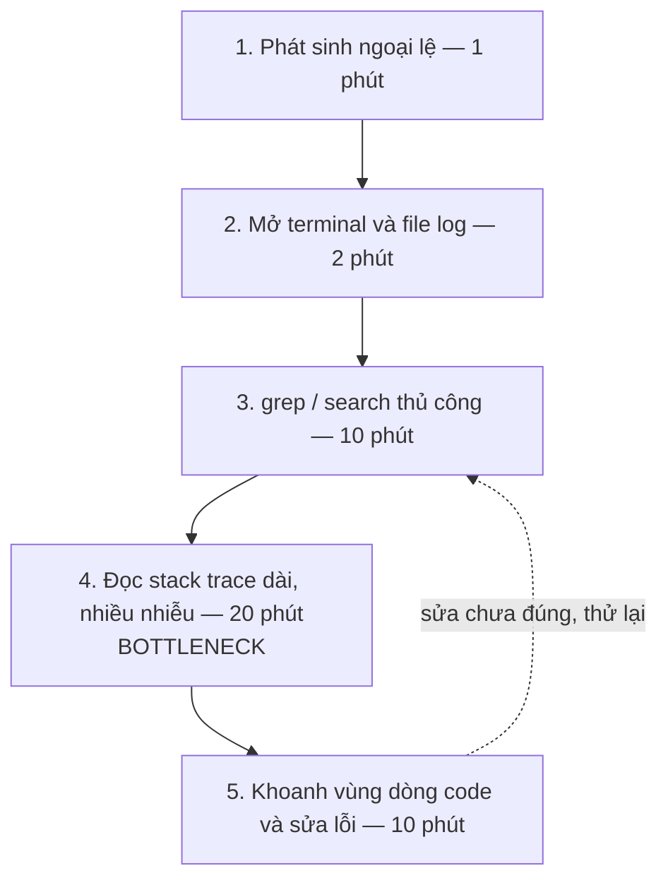
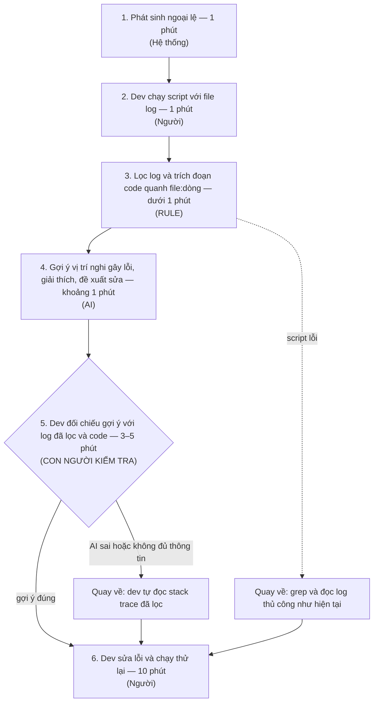

# Báo cáo nhóm — Day 02 Discovery & Problem Framing

> Bản chung của nhóm, viết trên repo do nhóm trưởng fork. Không copy file này sang repo cá nhân.
> Template chi tiết và prompt mẫu: [docs/01-worksheet.md](../../docs/01-worksheet.md). Bài mẫu: [docs/02-deliverable-example.md](../../docs/02-deliverable-example.md).

## 1. Thông tin nhóm

- Tên nhóm:
- Thành viên: xem `TEAM.md`
- Candidate problem được chọn (1 câu):
- Quyết định cuối: Go / Not Yet / No-Go

---

## 2. Hội tụ nhóm (CP3)

### 2.1. Pitch

| # | Người đưa ra | Candidate (Job Story ngắn) | Actor | Bottleneck | Câu hỏi phản biện nhận được (ai hỏi) |
|---:|---|---|---|---|---|
| 1 | | | | | |
| 2 | | | | | |
| 3 | | | | | |
| 4 | | | | | |
| 5 | | | | | |
| 6 | | | | | |
| 7 | | | | | |
| 8 | | | | | |
| 9 | | | | | |
| 10 | | | | | |
| 11 | | | | | |
| 12 | | | | | |

### 2.2. Cluster

| Cluster | Các candidate | Pattern chung |
|---|---|---|
| A | | |
| B | | |
| C | | |

### 2.3. Opportunity Solution Tree rút gọn

Gốc là **1 outcome**. Nhánh là **opportunity** (nhu cầu, pain), không phải tính năng hay công cụ.

```text
OUTCOME: 
├── Opportunity A: 
├── Opportunity B: 
└── Opportunity C: 
```

Những ý đã gạch bỏ vì là solution đội lốt opportunity:

-

### 2.4. Chấm điểm shortlist (1–5)

| Candidate | Actor rõ | Quy trình rõ | Pain có bằng chứng | Impact đo được | Vừa sức lab | So sánh được No AI/Rule/Workflow/Agent | Nhóm hiểu domain | Tổng |
|---|---:|---:|---:|---:|---:|---:|---:|---:|
| | | | | | | | | |
| | | | | | | | | |
| | | | | | | | | |

**Candidate được chọn:**

**Vì sao chọn:**

**Vì sao loại các candidate còn lại:**

**Xử lý bất đồng (nếu có):**

---

## 3. Kiểm chứng + research giải pháp đã có (CP4)

### 3.1. Assumption Map

| # | Giả định | Loại (Value / Usability / Feasibility / Viability) | Quan trọng (1–5) | Đã có bằng chứng (1–5) | Kiểm chứng trước? |
|---:|---|---|---:|---:|---|
| 1 | | | | | |
| 2 | | | | | |
| 3 | | | | | |
| 4 | | | | | |
| 5 | | | | | |
| 6 | | | | | |

*Điền 4–6 giả định; xóa dòng thừa.*

Giả định nhóm kiểm chứng trong buổi này:

### 3.2. Kiểm chứng

Cách đã dùng: Phỏng vấn / Survey / Log, ticket, review

Interview snapshot (mỗi buổi phỏng vấn một bảng, hoặc đặt file trong `report/assets/cp4-interview-snapshot-N.md`):

| Trường | Nội dung |
|---|---|
| Người được hỏi (vai trò, không ghi tên thật) | |
| Câu nói đáng nhớ nhất (nguyên văn) | |
| Lần gần nhất gặp vấn đề này: chuyện gì đã xảy ra? | |
| Hiện đang xử lý bằng cách nào (workaround)? | |
| Mất bao lâu, bao lần? | |
| Insight / opportunity rút ra | |

Tổng hợp:

| Nguồn | Số người / số mẫu | Tín hiệu xác nhận | Tín hiệu phản bác |
|---|---:|---|---|
| | | | |

**Nhóm đã sửa problem thế nào sau kiểm chứng:**

### 3.3. Research giải pháp đã có

| Công cụ / case / pattern | Link | Giải bước nào trong quy trình? | Điểm mạnh | Khoảng trống / rủi ro | Bài học cho nhóm |
|---|---|---|---|---|---|
| | | | | | |
| | | | | | |
| | | | | | |

---

## 4. Quy trình trước/sau (CP5)

### 4.1. Quy trình hiện tại

Sơ đồ (ASCII, Mermaid hoặc link ảnh trong `report/assets/`):



| Bước | Actor | Input | Output | Thời gian / tần suất | Ghi chú |
|---:|---|---|---|---|---|
| 1 | Hệ thống backend | Request hoặc thao tác gây lỗi | Ngoại lệ kèm stack trace được ghi vào file log | 1 phút; 3–4 lần/tuần | |
| 2 | Backend developer | Thông báo lỗi, thời điểm xảy ra lỗi | Terminal và file log hệ thống đã mở | 2 phút | |
| 3 | Backend developer | File log, từ khóa (thông điệp lỗi, thời điểm) | Đoạn log chứa stack trace liên quan | 10 phút | Tìm thủ công bằng grep/search |
| 4 | Backend developer | Stack trace dài, lẫn nhiều thông tin nhiễu | Nguyên nhân gốc và vị trí file/dòng code nghi gây lỗi | 20 phút | **Bottleneck** |
| 5 | Backend developer | Vị trí code nghi gây lỗi | Bản sửa lỗi đã chạy thử lại | 10 phút | Sửa chưa đúng thì quay lại bước 3–4 (sửa mò) |

**Bottleneck chính:** Bước 4, đọc stack trace: 20 phút/lần, vì phải dò dải stack trace dài, chứa nhiều thông tin nhiễu để tìm ra nguyên nhân gốc rễ (root cause).

### 4.2. Quy trình tương lai

Ghi rõ bước nào **Rule**, bước nào **AI**, bước nào **con người**, **boundary** ở đâu, **phương án quay về** khi AI sai.



**Boundary:** AI chỉ nhận log đã được Rule lọc và đoạn code quanh dòng lỗi, không nhận raw log hay thông tin nhạy cảm (mật khẩu DB, token, dữ liệu người dùng). AI chỉ gợi ý: không sửa file, không commit, không chạy lệnh. Dev phải xác nhận trước khi sửa.

**Phương án quay về:** AI sai hoặc trả "không đủ thông tin" thì dev bỏ gợi ý, tự đọc stack trace đã được Rule lọc. Script lỗi thì quay về grep và đọc log thủ công như hiện tại.

### 4.3. Before / after

| Chỉ số | Trước | Sau (kỳ vọng) | Ghi chú |
|---|---:|---:|---|
| Số bước | 5 | 6 | Thêm bước Rule lọc log và bước dev kiểm tra gợi ý của AI |
| Tổng thời gian | khoảng 43 phút/lần (thường 30–60) | khoảng 17–19 phút/lần | Phần tìm nguyên nhân (bước 2–5) còn khoảng 6–8 phút, đạt target dưới 10 phút |
| Số bước thủ công | 4/5 | 3/6 | Còn lại: chạy script, kiểm tra gợi ý, sửa lỗi; Rule và AI làm phần lọc và đọc stack trace |
| Bottleneck chính | Đọc stack trace dài, nhiều nhiễu (20 phút) | Sửa lỗi và chạy thử (10 phút) | Bước dev kiểm tra gợi ý (3–5 phút) là điểm kiểm soát chất lượng, chấp nhận được |
| Rủi ro mới phát sinh | — | AI chỉ sai vị trí hoặc ảo giác (CP4: LogGPT có tỉ lệ báo động giả cao); lộ dữ liệu nhạy cảm nếu gửi raw log | Xử lý bằng boundary, bước dev kiểm tra và phương án quay về |

---

## 5. Problem Statement v0 (CP5)

| Trường | Nội dung |
|---|---|
| **Actor** | Backend developer (sinh viên/junior) dùng framework nhiều tầng như Java Spring Boot, Node.js, khi gặp lỗi kéo dài trên 15 phút: lỗi kết nối CSDL, ORM, lỗi logic xuyên nhiều tầng Controller/Service/Middleware |
| **Quy trình** | Mỗi khi backend phát sinh ngoại lệ (3–4 lần/tuần): 1. Phát sinh ngoại lệ → 2. Mở terminal và file log hệ thống → 3. Dùng lệnh grep hoặc search tìm kiếm thủ công → 4. Đọc dải stack trace dài và nhiều thông tin nhiễu → 5. Khoanh vùng dòng code và sửa lỗi |
| **Bottleneck** | Bước 4, đọc stack trace: 20 phút/lần, vì phải dò dải stack trace dài, chứa nhiều thông tin nhiễu để tìm ra nguyên nhân gốc rễ (root cause) |
| **Impact** | 30–60 phút/lần × 3–4 lần/tuần ≈ 1,5–4 giờ/tuần cho debug. Ngoài ra làm gián đoạn nặng nề mạch tư duy viết code, gây căng thẳng mệt mỏi cuối ngày |
| **Success Metric** (baseline → target, cách đo) | Baseline: bước tìm ra nguyên nhân (grep + đọc stack trace) mất 20–40 phút/lần với lỗi kéo dài (bản thân khoảng 30 phút; 2 người được phỏng vấn ở CP4: 20–25 và 25–40 phút) → target: dưới 10 phút/lần (mức dưới 5 phút ở CP4 là kỳ vọng xa). Chỉ số phụ: số lần sửa thử trước khi sửa đúng (ghi trong tuần đầu làm baseline). Cách đo: tự ghi thời gian bước tìm nguyên nhân và số lần sửa thử mỗi lần debug, trong 2 tuần pilot |
| **Boundary** (AI không được làm gì; khi nào cần con người kiểm tra — HITL) | AI không được: nhận raw log hay thông tin nhạy cảm (mật khẩu DB, token, dữ liệu người dùng), chỉ nhận log đã được Rule lọc và đoạn code quanh dòng lỗi; tự sửa file, commit hay chạy lệnh; đoán khi thiếu bằng chứng (phải trả "không đủ thông tin"). HITL: mỗi lần dùng, dev phải đối chiếu vị trí AI chỉ ra với log đã lọc và code trước khi sửa |

Phản biện nhận được (từ AI hoặc nhóm khác) và nhóm có đồng ý không:

- AI: Actor "Backend developer" quá rộng; CP4 cho thấy lỗi đơn giản chỉ mất 2–5 phút, lỗi Python thường 10–15 phút. **Đồng ý**: thu hẹp Actor vào framework nhiều tầng (Java Spring Boot, Node.js) và lỗi kéo dài trên 15 phút.
- AI: Baseline 30 phút chỉ dựa trên 1 người; target lệch giữa card ban đầu (dưới 10 phút) và CP4 (dưới 5 phút). **Đồng ý**: baseline 20–40 phút (bản thân và 2 người được phỏng vấn), target dưới 10 phút; dưới 5 phút ghi là kỳ vọng xa.
- AI: Boundary còn trống. **Đồng ý**: thêm 4 ranh giới (không gửi raw log và thông tin nhạy cảm; AI chỉ gợi ý; dev xác nhận trước khi sửa; không chắc thì trả "không đủ thông tin").
- AI: Quy trình tương lai thiếu phương án quay về. **Đồng ý**: AI sai thì dev tự đọc stack trace đã lọc; script lỗi thì quay về grep thủ công.

---

## 6. Mức can thiệp AI (CP6)

### 6.1. Ma trận độ mơ hồ × độ phức tạp

Bài của nhóm nằm ở ô:

Vì sao:

### 6.2. So sánh 4 mức

| Mức | Phương án cho bài của nhóm | Đủ khi nào | Rủi ro | Chọn? |
|---|---|---|---|---|
| **No AI** (sửa quy trình) | | | | |
| **Rule** | | | | |
| **Workflow** | | | | |
| **Agent** | | | | |

**Mức chọn:**

**Vì sao không chọn mức đơn giản hơn:**

### 6.3. AI Canvas rút gọn

| Thành phần | Nội dung |
|---|---|
| **Prediction** — AI dự đoán / tạo ra gì? | |
| **Judgment** — con người cân nhắc, quyết định gì? | |
| **Action** — hành động cuối cùng là gì, ai làm? | |
| **Outcome** — đo kết quả bằng gì? | |
| **Input** — AI cần dữ liệu đầu vào gì mỗi lần chạy? Có sẵn không? | |
| **Feedback** — lấy phản hồi ở đâu để cải thiện? | |

### 6.4. Hai câu hỏi của Google PAIR

- Người dùng muốn **được hỗ trợ (augment)** hay **giao hẳn việc (automate)**? Bằng chứng:
- AI sai kiểu nào tệ hơn, **báo nhầm** hay **bỏ sót**? Vì sao, và thiết kế đã xử lý thế nào:

---

## 7. Problem Statement v1 + tiêu chí đánh giá (CP6)

| Trường | Nội dung |
|---|---|
| **Actor** | |
| **Quy trình** | |
| **Bottleneck** | |
| **Impact** | |
| **Success Metric** (baseline → target, cách đo) | |
| **Boundary** | |
| **AI intervention point** | |
| **Mức chọn** | No AI / Rule / Workflow / Agent |
| **Rủi ro & người kiểm tra** | |

**Thay đổi so với v0 và lý do:**

| Trường | v0 | v1 | Vì sao đổi |
|---|---|---|---|
| | | | |

**Tiêu chí đánh giá đầu ra của AI (3–5 tiêu chí):**

| # | Tiêu chí | Đạt khi | Không đạt khi |
|---:|---|---|---|
| 1 | | | |
| 2 | | | |
| 3 | | | |

---

## 8. Quyết định (CP6)

### 8.1. Bốn rủi ro

| Rủi ro | Câu hỏi | Mức độ rủi ro (Thấp = an toàn / TB / Cao = nguy hiểm) | Lý do / bằng chứng |
|---|---|---|---|
| **Value** | Người dùng có thật sự cần và sẽ dùng không? | | |
| **Usability** | Người dùng có dùng được, có hiểu và sửa được đầu ra của AI không? | | |
| **Feasibility** | Có đủ dữ liệu, công cụ, kỹ năng để làm không? | | |
| **Viability** | Có hợp chi phí, pháp lý, quy định tổ chức không? Ai vận hành? | | |

### 8.2. Kết luận

**Quyết định:** Go / Not Yet / No-Go

**Lý do:**

**Nếu Go — pilot nhỏ nhất:**

**Nếu Not Yet — cần kiểm chứng gì trước:**

**Nếu No-Go — nên làm gì thay AI:**

**Ngưỡng dừng** (nếu sau … mà … thì quay về …):

---

## 9. Hạn chế và hướng tiếp theo

-

## 10. Tài liệu tham khảo

-
